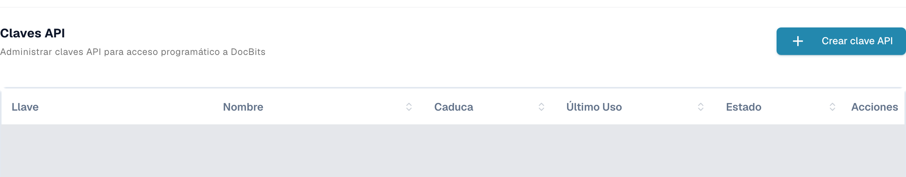
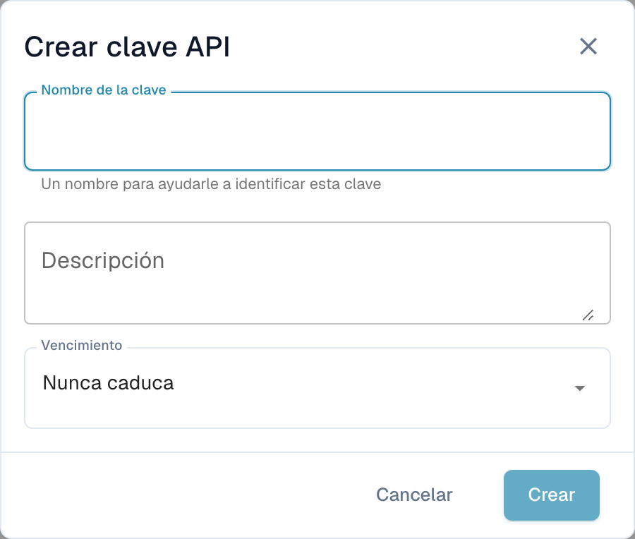

# Postman para DocBits

Con Postman puede enviar solicitudes HTTP a la API de DocBits. Empiece con una solicitud de solo lectura en un entorno que esté autorizado a usar. Separe los entornos de prueba y producción y guarde las credenciales en variables privadas o en un almacén de secretos.

## Configuración

### API de DocBits

Abra la documentación de la API del entorno correspondiente, por ejemplo, la [API de Sandbox](https://sandbox.api.docbits.com/docs) o la [API de producción](https://api.docbits.com/docs). Utilice las rutas actuales de las operaciones y el valor **Servers** que aparece allí. Una ruta de servidor relativa se añade al origen de la API.

En la [documentación de Dev comprobada aquí](https://eu.dev.api.docbits.com/docs), la ruta es `/dev-api`. Por tanto, la URL base completa es `https://eu.dev.api.docbits.com/dev-api`. Otros entornos pueden usar otra ruta de servidor.

La especificación de la API enumera varios esquemas de cabecera distintos:

| Cabecera | Finalidad |
| --- | --- |
| `X-ORG-ID` | Identifica la organización de destino cuando la operación lo requiere. |
| `Authorization` | Contiene el valor de autorización exigido por el mecanismo de autenticación correspondiente. |
| `X-API-KEY` | Contiene una clave de API para las operaciones que usan ese esquema. |

Estas cabeceras no son intercambiables. El diálogo global **Authorize** muestra los esquemas disponibles; no todas las operaciones necesitan todos ellos. Consulte los parámetros y la autorización de la operación concreta.

Solicite las credenciales adecuadas a su administrador. Los usuarios autorizados encuentran la gestión de claves en **Ajustes → Integración y SSO → Claves API**. La lista muestra el prefijo de clave, el nombre, la caducidad, el último uso y el estado. Las filas existentes están cubiertas en la captura.

<figure><figcaption><p>Vista real de Dev en español de Claves API con Crear clave API y las columnas Llave, Nombre, Caduca, Último Uso, Estado y Acciones; las filas existentes están cubiertas.</p></figcaption></figure>

**Crear clave API**, situado sobre la lista, abre primero un formulario vacío con **Nombre de la clave**, **Descripción** y **Vencimiento**. Solo al enviarlo se crea una clave. El formulario de la captura se cerró con **Cancelar**, sin enviarlo. No se creó, mostró, copió ni revocó ninguna clave. Cree claves únicamente según sus permisos y las normas de su organización.

<figure><figcaption><p>Formulario vacío Crear clave API en español con Nombre de la clave, Descripción, Vencimiento, Cancelar y Crear; Crear está desactivado mientras el nombre esté vacío.</p></figcaption></figure>

### Crear un espacio de trabajo en Postman

Abra Postman y use un espacio de trabajo con la visibilidad adecuada para su organización. Cree un entorno con la variable `base_url` y asígnele la URL base completa, incluida la ruta del servidor. Seleccione ese entorno antes de enviar una solicitud. La [guía de entornos de Postman](https://learning.postman.com/docs/use/send-requests/variables/managing-environments/) explica cómo seleccionar y usar las variables.

Cree una solicitud o añádala a su colección. Los siguientes nombres de controles de Postman corresponden a las etiquetas técnicas de la aplicación; las imágenes anteriores muestran la gestión de claves de DocBits en español.

## Ejemplo del método "GET"

Seleccione **GET** y la URL `{{base_url}}/version`. En **Authorization**, elija **No Auth** y después **Send**. La solicitud de Dev de solo lectura que se comprobó fue:

```http
GET https://eu.dev.api.docbits.com/dev-api/version
```

El endpoint devolvió HTTP 200 sin clave de API. Comprueba la disponibilidad de la API y devuelve información de versión. No demuestra el acceso a documentos o usuarios de una organización. Revise el estado y el contenido de la respuesta; si falla, compruebe primero el entorno seleccionado, el origen de la API y la ruta del servidor.

Para una operación que use una clave de API, seleccione **Authorization → API Key** en Postman. Introduzca `X-API-KEY` en **Key**, use un secreto privado como **Value** y seleccione **Header** en **Add to**. Añada `X-ORG-ID` en **Headers** si la operación lo requiere. Consulte las guías oficiales de [autorización con clave de API](https://learning.postman.com/docs/use/send-requests/authorization/authorization-types/#api-key) y [secretos de Vault](https://learning.postman.com/docs/use/postman-vault/use-vault-secrets/).

## Ejemplo del método "POST"

**POST** puede crear datos o iniciar un procesamiento. Copie el método, la ruta, los parámetros obligatorios y el esquema del cuerpo de la especificación actual de la API. Ejecute estas solicitudes solo para una tarea concreta y autorizada. Una consulta de versión correcta no demuestra que una solicitud de escritura vaya a funcionar.

### Cargar documento

Antes de cargar un documento, consulte la operación documentada actualmente. Si requiere datos de formulario multipart, seleccione ese tipo de cuerpo y use los nombres de campos y tipos de archivo indicados. No los deduzca de una captura de una versión anterior de la API. No se cargó ningún documento para esta guía.

## Ejemplo del método "DELETE"

**DELETE** puede eliminar datos de forma permanente. Compruebe la operación concreta, el identificador de destino y los permisos necesarios. Aquí no se ejecutó ninguna eliminación ni se afirmó que se hubiera probado con éxito.

## Ejemplo del método "PUT"

**PUT** puede modificar datos existentes. Utilice únicamente los parámetros y el esquema del cuerpo de la operación actual y confirme el alcance del cambio solicitado. Aquí no se ejecutó ninguna modificación.

## Cambiar la dirección de correo de un usuario

Obtenga la ruta y los campos obligatorios de la especificación actual de la API y haga revisar el cambio del usuario antes de ejecutarlo. Esta guía no utiliza datos reales de usuarios u organizaciones ni demuestra un cambio de correo electrónico realizado con éxito.

Se comprobaron la especificación actual de la API de Dev, la consulta de versión sin autenticación y las vistas reales de DocBits en español de la gestión de claves y del formulario vacío. No se ejecutaron consultas de datos autenticadas, creación de claves, cargas, altas de usuarios, modificaciones ni eliminaciones. No se probó ninguna solicitud en la aplicación Postman.
