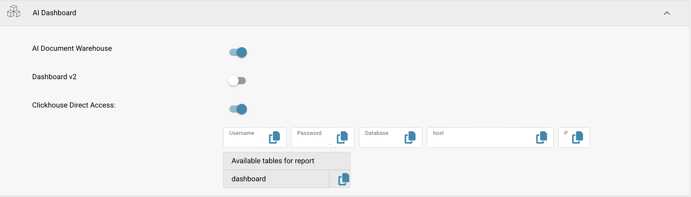
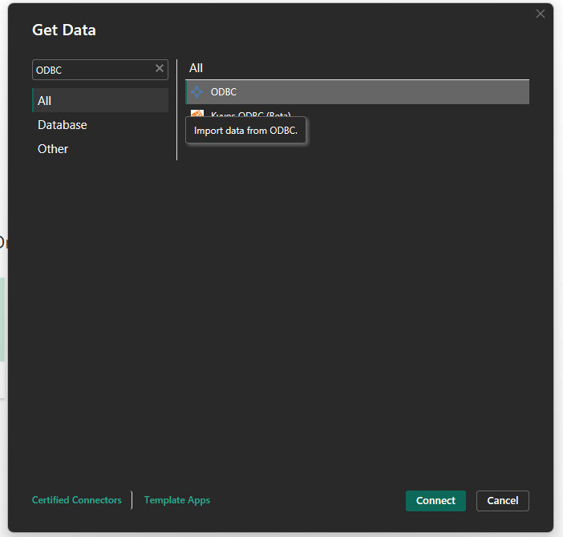
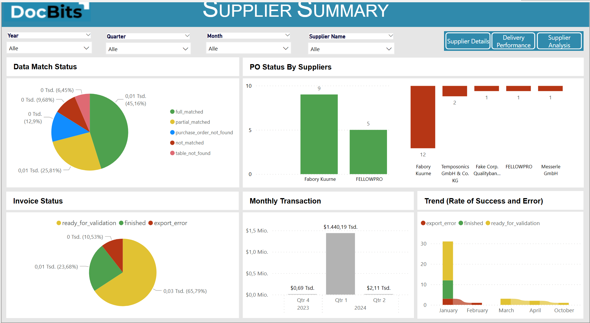

# Conectar a través de ClickHouse

Esta guía le explica cómo conectar **ClickHouse** a **Power BI Desktop** mediante el **controlador ODBC**. Abarca la instalación del controlador, la configuración de ODBC, la integración con Power BI y la configuración de la actualización de datos.




#### 1. Instalar el controlador ODBC de ClickHouse

* Descargue la última versión del **controlador ODBC de ClickHouse** desde:
  * [ClickHouse GitHub - clickhouse-odbc](https://github.com/ClickHouse/clickhouse-odbc)
* Ejecute el instalador y siga el asistente de configuración.

#### 2. Configurar el origen de datos ODBC

* Abra el **Administrador de orígenes de datos ODBC (64 bits)** desde el Panel de control o la búsqueda de Windows.
* Vaya a la pestaña **DSN de sistema** y haga clic en **Agregar**.
* Seleccione **ClickHouse ODBC Driver** en la lista y haga clic en **Finalizar**.
*   Rellene los campos obligatorios. Encontrará la información necesaria en:

    **DocBits** → **Settings** → **Document Processing** → **Module** → **AI Dashboard** → **ClickHouse Direct Access**

    <figure><figcaption></figcaption></figure>

    **Campos obligatorios:**

    * **Name**: un nombre para la conexión (por ejemplo, `ClickHouse_Prod`)
    * **Description**: una breve descripción para su referencia (opcional)
    * **Host**: copie el valor del host desde DocBits
    * **Port**: copie el valor del puerto desde DocBits
    * **Database**: copie el nombre de la base de datos desde DocBits
    * **Username**: copie el nombre de usuario desde DocBits
    * **Password**: copie la contraseña desde DocBits

#### 3. Conectar ClickHouse con Power BI

* Abra **Power BI Desktop**.
*   Seleccione **Get Data** → **ODBC** → **Connect**.\

    <figure><figcaption></figcaption></figure>
*   En la lista de DSN, seleccione el origen que ha configurado (por ejemplo, `ClickHouse_Prod`).\

    <figure><figcaption></figcaption></figure>
* Haga clic en **OK**. Si se le solicita, introduzca de nuevo las credenciales.

#### 4. Cargar y transformar los datos

* En el panel **Navigator**, explore y seleccione las tablas o vistas que desea importar.
* Elija:
  * **Load**: para importar directamente
  *   **Transform Data**: para abrir Power Query y dar forma a los datos\

      <figure><figcaption></figcaption></figure>

#### 5. Visualizar los datos

* Utilice el lienzo del informe para crear visualizaciones.
* Arrastre campos, añada segmentaciones, elija los tipos de gráfico y utilice expresiones **DAX** según necesite.
* Aproveche el **Power Query Editor** para limpiar o pivotar sus datos de ClickHouse antes de crear los elementos visuales.
* Documentación de Power BI: [https://learn.microsoft.com/en-us/power-bi/](https://learn.microsoft.com/en-us/power-bi/)

#### 6. Activar la actualización programada (opcional)

<mark style="color:red;">**Nota:**</mark> **Requiere Power BI Pro o Premium + Gateway**

* Para mantener sus informes sincronizados con ClickHouse:
* Publique su archivo `.pbix` en el **servicio de Power BI**.
* Instale el **Power BI Gateway** (modo Standard) en un equipo con acceso de red a ClickHouse.
* En el servicio de Power BI:
  * Vaya a su conjunto de datos → **Settings** → **Scheduled Refresh**
  * Asigne su DSN e indique las credenciales
* Encontrará más información [aquí](https://learn.microsoft.com/en-us/power-bi/connect-data/service-gateway-deployment-guidance).

#### 7. Ejemplos de paneles y vistas de datos

<figure><figcaption></figcaption></figure> <figure><figcaption></figcaption></figure> <figure><figcaption></figcaption></figure> <figure><figcaption></figcaption></figure>

