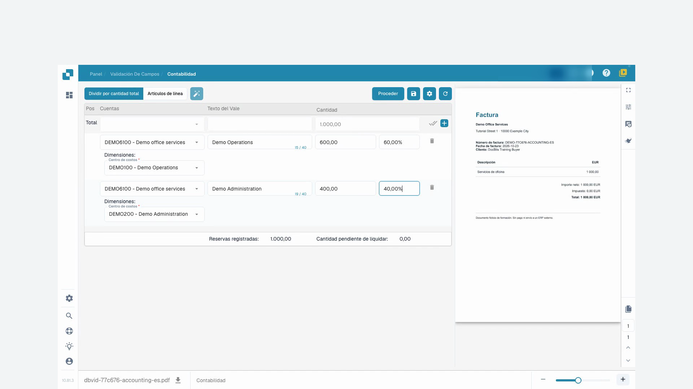
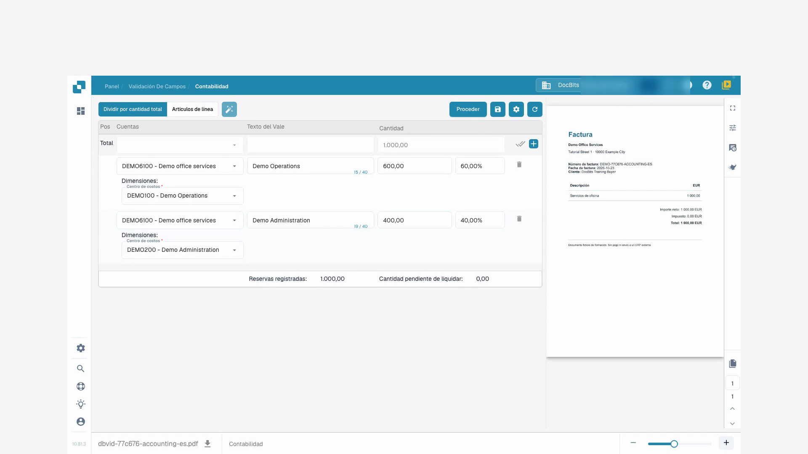

# Contabilidad para Factura de Costos y Ventas Indirectas

## Introducción

¡Bienvenido al módulo de Contabilidad para Factura de Costos y Ventas Indirectas! Este módulo está diseñado para ayudarte a gestionar y conciliar eficientemente tus transacciones financieras dentro de tu sistema ERP. Con características como la extracción automática de datos, la coincidencia de documentos y el seguimiento detallado, puedes asegurarte de que tus registros financieros sean precisos y estén actualizados.

<figure><figcaption></figcaption></figure>

## Comenzando

Para comenzar a usar el módulo de contabilidad, asegúrate de tener los permisos necesarios configurados por tu administrador del sistema. Necesitarás acceso tanto a los módulos de contabilidad de costos como de contabilidad de ventas dentro del sistema ERP.

## Requisitos del Sistema

* Acceso a los módulos de contabilidad de costos y contabilidad de ventas dentro del sistema ERP.
* Permisos de usuario apropiados para ver y procesar documentos financieros.

## Características Clave

1. **Extracción Automática de Datos**: Extrae e interpreta automáticamente datos de facturas digitales y otros documentos.
2. **Comparación de Datos**: Compara los datos extraídos de las facturas con los datos existentes de órdenes de compra.
3. **Verificación de Coincidencias**: Verifica coincidencias basadas en reglas y tolerancias predefinidas.
4. **Informe de Discrepancias**: Identifica e informa cualquier discrepancia entre facturas y órdenes de compra.
5. **Rastro de Auditoría**: Mantiene un registro de todas las acciones para cumplimiento y revisión.
6. **Entrenamiento de Documentos**: Entrena al sistema para reconocer nuevos documentos con un esfuerzo mínimo, típicamente solo una vez.
7. **División de Montos**: Divide montos por departamento para un seguimiento financiero detallado.
8. **Definición de Cuentas de Libro Mayor**: El equipo de APS (Sistema de Contabilidad y Adquisiciones) puede definir la cuenta de libro mayor una vez que los datos son extraídos.

## Interfaz de Usuario

La interfaz del módulo de contabilidad típicamente incluye los siguientes componentes:

* **Tablero**: Vista general del estado de facturas y ventas, y actividad reciente.
* **Herramientas de Búsqueda y Filtro**: Capacidades para buscar y filtrar facturas y registros de ventas.
* **Registros Coincidentes**: Sección que muestra registros coincidentes exitosamente.
* **Discrepancias**: Sección que muestra registros con discrepancias que necesitan revisión o acción.
* **Informes**: Acceso a informes detallados y opciones de exportación.

## Guía Paso a Paso para Usar el Módulo de Contabilidad

### 1. Acceder al Módulo de Contabilidad

Navega al módulo de contabilidad desde el menú principal de tu sistema ERP.

### 2. Importar o Acceder a Facturas

* **Importación Automatizada**: Si tu sistema está configurado para captura automática de datos, las facturas se importarán automáticamente al sistema.
* **Carga Manual**: Si es necesario, carga manualmente los archivos de facturas en el sistema usando la interfaz proporcionada.

### 3. Revisar Facturas Coincidentes Automáticamente

* Revisa las facturas que han sido coincidentes automáticamente con órdenes de compra.
* Verifica los detalles de la coincidencia, incluidos números de artículos, cantidades y precios.

### 4. Manejar Discrepancias

* Accede a la sección de Discrepancias para revisar cualquier factura que no pudo coincidir automáticamente.
* Ajusta manualmente las cantidades o precios según sea necesario, o marca la factura para una revisión adicional.

### 5. Coincidencia Manual

Para facturas no coincidentes automáticamente:

* Usa las herramientas de búsqueda y filtro para encontrar la orden de compra correspondiente.
* Verifica y coincide manualmente la factura con la orden de compra.

### 6. Entrenar al Sistema

* Para nuevos tipos de documentos, entrena al sistema para reconocerlos proporcionando una muestra.
* Típicamente, solo necesitas entrenar al sistema una vez para que reconozca con precisión documentos similares en el futuro.

### 7. Registrar Reservas

* Navega a la pestaña "Partidas" para ver y registrar reservas para cada factura.
* Asigna los montos a las cuentas, centros de costos y dimensiones apropiadas específicas para Infor LN/M3.

**Ejemplo: Registrar una Factura de Costos**

1. **Seleccionar Partida**: Elige la partida para la factura de costos.
2. **Asignar Cuenta**: Asigna la cuenta apropiada, como "71200 - Gasto No Operativo".
3. **Establecer Dimensiones**: Establece dimensiones adicionales como centro de costos, grupo de productos y proyecto.
4. **Dividir Monto**: Si es necesario, divide el monto por departamento para un seguimiento más detallado.
5. **Ingresar Monto**: Ingresa el monto para la partida.

### 8. Definir Cuentas de Libro Mayor

* Una vez que los datos son extraídos, el equipo de APS puede definir las cuentas de libro mayor.
* Esto asegura que cada transacción se registre bajo la cuenta correcta para un informe financiero preciso.

### 9. Generar Informes

* Accede a la sección "Informes" para generar informes detallados sobre transacciones financieras.
* Usa las opciones de exportación para guardar informes para análisis adicional o mantenimiento de registros.

### Ejemplo de Uso

1. **Cargar Documentos**: Los usuarios pueden cargar varios documentos (facturas, notas de entrega, etc.) al sistema.
2. **Coincidencia Automática**: El sistema coincide automáticamente los documentos cargados con las órdenes de compra existentes.
3. **Revisar Coincidencias**: Los usuarios pueden revisar las coincidencias, verificar detalles y ver indicadores de estado.
4. **Resolver Discrepancias**: Cualquier desajuste o discrepancia se resalta para que el usuario lo revise y corrija manualmente.
5. **Exportar Datos**: Los datos coincidentes pueden exportarse para procesamiento adicional o mantenimiento de registros.

## Videotutorial: Distribución de una factura de gastos


Distribución de una factura de gastos


[Ver con subtítulos y capítulos](https://docbits-videos.fra1.cdn.digitaloceanspaces.com/settings-assistant/cost-invoice-accounting-customer/v2/es.html)

Algunas etiquetas nativas pueden permanecer en otro idioma. Se conservan los identificadores técnicos de los campos.

En la interfaz grabada, «Reservas registradas» representa aquí el total imputado y «Cantidad pendiente de liquidar» el saldo que queda por repartir: estos rótulos no confirman una reserva ni un pago. Los nombres de las cuentas y centros de coste de demostración son valores configurados. Esta distribución no confirma una contabilización en el ERP.

Primero, compruebo nuestra factura de formación original. El proveedor, el número de factura y el importe deben coincidir con el documento. En este ejemplo, son mil euros sin impuestos. La factura no contiene ningún pedido de compra.

Abro la contabilización y trabajo con la distribución según el importe total. Las cuentas de mayor y los centros de coste disponibles fueron configurados previamente por nuestro administrador. Solo elijo valores que tengan sentido comercial para esta factura.

Con la función de división, creo dos sublíneas. DocBits comienza aquí con una distribución equitativa. Pero para nuestro ejemplo, necesito el sesenta y el cuarenta por ciento. El importe original de la factura sigue siendo de mil euros.

Para ambas sublíneas, selecciono la cuenta de mayor preparada para servicios de oficina. La primera línea pertenece al centro de coste operativo, la segunda a la administración. El centro de coste es un campo obligatorio en este ejemplo. También añado un texto de apunte contable claro.

En la primera línea, introduzco el sesenta por ciento y confirmo con Intro. Espero hasta que el importe muestre seiscientos euros. Luego confirmo el cuarenta por ciento en la segunda línea y espero a los cuatrocientos euros. Así compruebo cada recálculo antes de continuar.

Ahora compruebo juntos los dos importes, las cuentas de mayor y los centros de coste. Seiscientos más cuatrocientos suman mil euros. El total registrado también debe mostrar mil euros, y el saldo restante debe ser cero. Aclaro cualquier diferencia en los totales antes de guardar.

<figure><figcaption>
Centros de coste con un total comprobado de 1.000 euros
</figcaption></figure>

Guardo la contabilización y espero la confirmación. A continuación, vuelvo a cargar la factura. Ambos centros de coste, los porcentajes y los importes siguen ahí. También compruebo el total y el saldo restante después de recargar.

<figure><figcaption>
Imputación guardada y comprobada tras volver a abrir
</figcaption></figure>
