# Tabla AI

La **Tabla AI extraída** es la tabla de líneas de detalle que DocBits lee con IA cuando un proveedor no tiene reglas de tabla entrenadas. Aparece en la pantalla de validación, debajo de los campos de cabecera. Esta página explica todos los controles que la rodean: cómo corregir una columna incorrecta, cómo dar instrucciones a la IA, cómo probar un cambio antes de conservarlo, cómo ver lo que hizo la IA, qué puede y qué no puede hacer el Asistente por ti y quién puede guardar qué.

## Serie de vídeos

Vídeos cortos para el día a día. Míralos en orden o ve directamente al que necesites.

### 1. Leer la tabla AI



Qué ves en la tabla AI y qué hace cada botón. Unos 1,7 minutos.

### 2. Corregir una columna y enseñar a DocBits



Elegir la columna correcta, dar instrucciones a la IA, probar un cambio y conservarlo para las próximas facturas. Unos 1,9 minutos.

### 3. Dos problemas típicos



Precio por 1.000 o 100 y un descuento restado dos veces. Qué ves, qué escribir y cómo comprobar. Unos 1,3 minutos.

### 4. Lo que la IA lee bien



Cinco diseños que DocBits lee bien sin ayuda y qué hacer primero. Unos 1,3 minutos.

### 5. El Asistente y quién puede cambiar qué



Cómo ayuda el Asistente con la tabla AI, cómo sugerir una mejora al administrador y qué solo pueden cambiar los administradores. Unos 1,5 minutos.

## Cuándo obtienes la tabla AI

* Un administrador ha activado la **Extracción de tabla de IA** (Ajustes → Procesamiento de documentos → Clasificación y extracción; consulta [Ajustes para administradores](#ajustes-para-administradores)). Si está desactivada, el área de la tabla muestra *La tabla AI se mostrará aquí. Habilitar en …*.
* El proveedor **no tiene reglas guardadas**. En cuanto alguien entrena la tabla del proveedor y guarda las reglas, las reglas guardadas sustituyen a la tabla AI para ese proveedor. Las filas aparecen entonces en la pestaña **Tabla extraída** y la pestaña **Tabla AI extraída** queda en gris con el tooltip *IA de Tabla Desactivada: Se está utilizando una tabla entrenada personalizada.*
* Excepción: las columnas marcadas como **Utilizar IA** en la configuración de columnas de tabla las rellena la IA incluso en proveedores con reglas guardadas; consulta [Utilizar IA por columna](#utilizar-ia-por-columna).

El nivel de IA que lee la tabla (Fast, Full, Nexus) se establece por organización y se puede sobrescribir por proveedor; consulta Modelo de IA Específico del Proveedor para Extracción de Campos y Tablas.

## La tabla AI de un vistazo

<figure>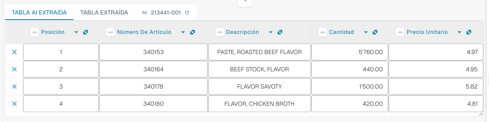<figcaption>
Las dos pestañas, la Tabla AI extraída y sus encabezados de columna.
</figcaption></figure>

* **Pestañas.** *Tabla AI extraída* es lo que ha leído la IA. *Tabla extraída* es la tabla clásica de las reglas entrenadas. La pestaña de IA se abre por defecto cuando el documento tiene una tabla AI.
* **Encabezado de columna.** Cada columna muestra su nombre, un pequeño símbolo de **origen** (pasa el cursor por encima: *IA · cartografía*, *IA · sinónimo*, etc. indican cómo hizo coincidir la IA la columna), un menú de **tres puntos** y, en una columna asignada, un **botón con el nombre** en el que puedes hacer clic para cambiar de qué columna se trata.
* **Botones de fila.** La **x** al principio de una fila elimina esa fila. Haz clic con el botón derecho en una fila para ver *Seleccionar como costo adicional* / *Remove as additional cost*.
* **Barra de herramientas del pie.** Los iconos de la parte inferior de la pantalla añaden o ocultan columnas y filas; consulta [Barra de herramientas del pie](#barra-de-herramientas-del-pie).
* **Tarjeta Instrucciones para la IA** debajo de la tabla: prompt, columnas adicionales, **Cambio de prueba**, **Aplicar**, **Guardar como entrenamiento**, **Borrar**, **Exportar**; consulta [Dar instrucciones a la IA](#dar-instrucciones-a-la-ia).


Los controles de columna solo funcionan cuando puedes editar el documento. Si aparecen en gris, el documento es de solo lectura o está bloqueado en otra sesión. Cuando el banner rojo indica que el documento está bloqueado por tu propio usuario en otra sesión, **Desbloquear** toma el bloqueo.


## Cambiar una columna

### Elegir la columna correcta (reasignar)

Úsalo cuando un valor está en la columna equivocada, por ejemplo cuando el importe neto está en *Importe total factura* o *Cantidad* está vacía aunque la factura la tenga.

1. Haz clic en el **nombre de la columna** en el encabezado.
2. Elige la columna de tabla configurada a la que pertenecen realmente los valores.

<figure>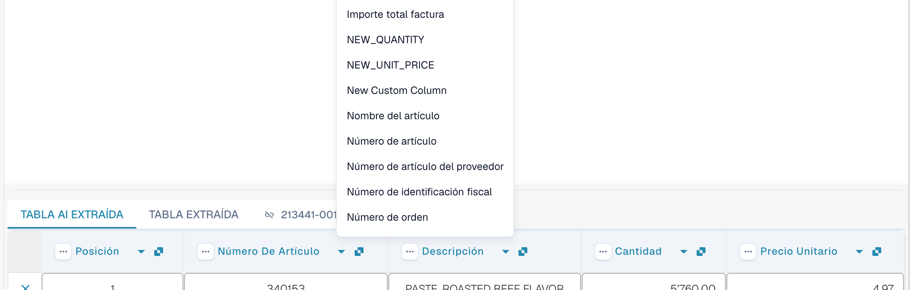<figcaption>
Haz clic en el nombre de la columna y elige cuál debe ser. La lista muestra todas las columnas de tabla configuradas.
</figcaption></figure>

DocBits reformatea la tabla de inmediato, solo para este documento. Si la columna que has elegido ya la usa otra columna, un diálogo *¿Reasignar "…"?* avisa de que la otra columna quedará sin asignar. Confirma para continuar; la otra columna muestra entonces el icono de error *Seleccione una columna para mapear desde el menú desplegable* para que también puedas elegirle una columna.

### El menú de tres puntos

<figure>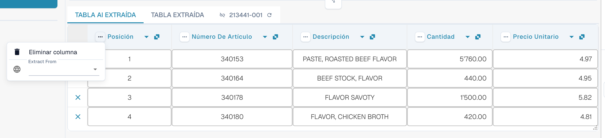<figcaption>
El menú de tres puntos de una columna.
</figcaption></figure>

| Entrada | Qué hace |
| --- | --- |
| **Eliminar columna** | Oculta la columna. Una confirmación indica *Las modificaciones se descartarán*; elige **Hecho**. La tabla se reconstruye sin la columna. Usa **Restaurar columna de tabla** en la barra de herramientas del pie para recuperar las columnas ocultas. |
| **Desactivar columna** | Para una columna que has añadido tú: la oculta sin volver a ejecutar la IA. |
| **Formato de cantidad** | Solo para columnas de importes. Elige cómo se leen los números (separadores de decimales y de miles). **Auto** deja que DocBits decida. |
| **Extract From** | Indica a la IA que tome el valor de la línea **Above** o **Below** de la etiqueta de la columna. Déjalo vacío si el valor está en el lugar habitual. |

### Barra de herramientas del pie

<figure><figcaption>
Los iconos de la tabla en el pie de la pantalla de validación, de izquierda a derecha.
</figcaption></figure>

| Icono (tooltip) | Qué hace |
| --- | --- |
| **Ir a la vista de extracción de tabla** | Abre el entrenamiento de tabla clásico. Si el documento tiene una tabla AI, DocBits avisa: *La tabla ya está extraída por la IA. ¿Quiere entrenar manualmente? En el futuro, la IA no extraerá la tabla de este proveedor.* |
| **Añadir columnas vacías** | Abre **Configuración de columnas** para añadir columnas configuradas que la IA no ha rellenado, de modo que puedas escribir los valores a mano. |
| **Mostrar columnas no asignadas** / **Ocultar columnas no asignadas** | Muestra u oculta las columnas que ha devuelto la IA y que no están asignadas a una columna configurada. Por defecto están ocultas. Esto solo cambia la vista de este documento. |
| **Extracción de la tabla de bloque para este proveedor** | Desactiva la extracción de tabla para el proveedor. |
| **Eliminar tabla** | Vacía la tabla en el editor. |
| **Agregar nueva columna de tabla** | Añade una columna personalizada. Solo administradores. |
| **Añadir nueva fila de tabla** | Añade una fila vacía. |
| **Ignorar validación de tabla** | Ignora la validación de tabla de este documento. |
| **Restaurar columna de tabla** | Recupera todas las columnas que has eliminado. |

<figure>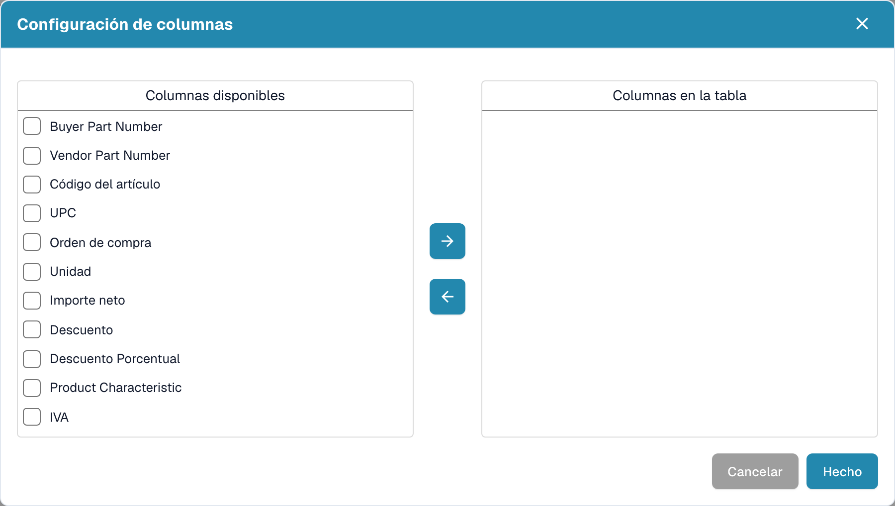<figcaption>
Configuración de columnas: mueve columnas de <em>Columnas disponibles</em> a <em>Columnas en la tabla</em> con los botones de flecha y elige después <strong>Hecho</strong>.
</figcaption></figure>

## Dar instrucciones a la IA

Debajo de la tabla, la tarjeta **Instrucciones para la IA** indica a la IA qué debe hacer de otra manera. Tiene dos campos y varios botones que usarás constantemente.

<figure>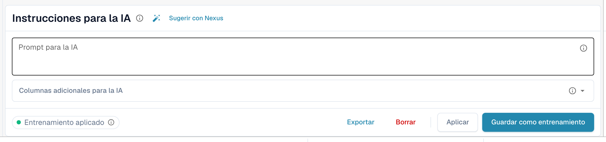<figcaption>
La tarjeta Instrucciones para la IA.
</figcaption></figure>

* **Prompt para la IA.** Escribe una instrucción por línea, en lenguaje sencillo. Escribe **@** para insertar el nombre de una columna, de modo que la IA sepa exactamente a qué columna te refieres.
* **Columnas adicionales para la IA.** Elige las columnas que la IA debe devolver además de las habituales.
* **Estado del entrenamiento.** El chip muestra **Entrenamiento aplicado** cuando se usó un entrenamiento guardado en la última ejecución, o el estado sin entrenamiento aplicado.

<figure>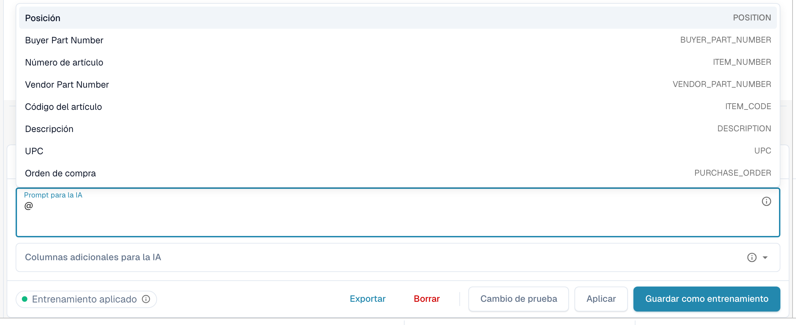<figcaption>
Escribe <strong>@</strong> en el prompt para elegir una columna. En cuanto algo cambia, <strong>Cambio de prueba</strong> aparece junto a <strong>Aplicar</strong>.
</figcaption></figure>


Un prompt modificado hace que la IA lea la tabla de nuevo y puede cambiar todas las columnas, no solo la que tenías en mente. Revisa después toda la tabla.


### Sugerir con Nexus

¿No sabes qué escribir? Haz clic en **Sugerir con Nexus**. DocBits analiza la extracción de este documento y propone instrucciones o columnas adicionales. No se aplica nada hasta que hagas clic en **Insertar** (añade la línea a tu prompt) o en **Add column**.

<figure>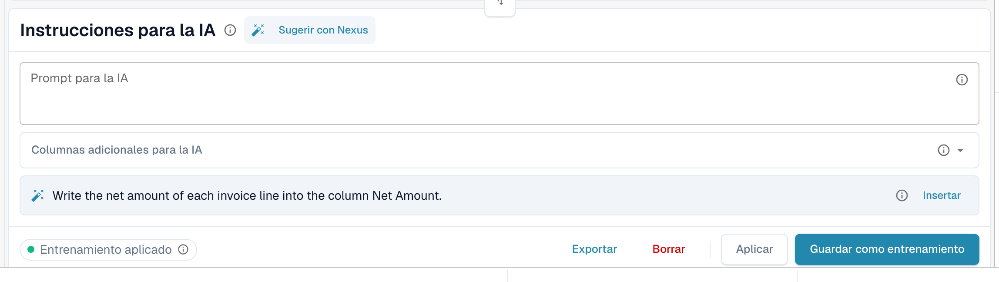<figcaption>
Una sugerencia de Nexus. <strong>Insertar</strong> la copia en el prompt.
</figcaption></figure>

Si tu organización ha desactivado el asesor de IA, DocBits te lo indica en lugar de sugerir.

### Probar, aplicar, guardar: qué hace cada botón

| Botón | Qué ocurre | ¿Se guarda para los próximos documentos? |
| --- | --- | --- |
| **Cambio de prueba** | Ejecuta tu cambio y muestra una comparación. **No se escribe nada**, ni en el documento ni como regla. | No |
| **Aplicar** | Vuelve a leer la tabla con tus cambios y pone el resultado en este documento en el editor. Solo es permanente cuando guardas el documento. | No |
| **Guardar como entrenamiento** (tooltip *Guardar reglas*) | Almacena el prompt, las columnas adicionales, la asignación de columnas, las columnas ocultas, los formatos de importe y los ajustes de **Extract From** para este diseño de proveedor. Los siguientes documentos con este diseño se leen de la misma manera. | Sí |
| **Borrar** (tooltip *Eliminar reglas*) | Elimina las reglas de tabla guardadas de este diseño de proveedor, sin confirmación adicional, y vuelve a ejecutar la IA sin ellas. También elimina el entrenamiento de tabla clásico guardado para el mismo diseño. | Las elimina |
| **Exportar** | Descarga la tabla como archivo CSV. | No |


Las reasignaciones de encabezado, **Eliminar columna**, **Formato de cantidad**, **Extract From** y **Restaurar columna de tabla** se comportan como **Aplicar**: reconstruyen la tabla de este documento de inmediato y se guardan con el documento, no como regla. Solo **Guardar como entrenamiento** enseña a DocBits para los próximos documentos.


Si el documento ya tiene líneas emparejadas con una orden de compra, Aplicar y Guardar avisan de que **podrías perder las conexiones con la OC**. Elige **Hecho** para continuar y vuelve a emparejar después.

<figure>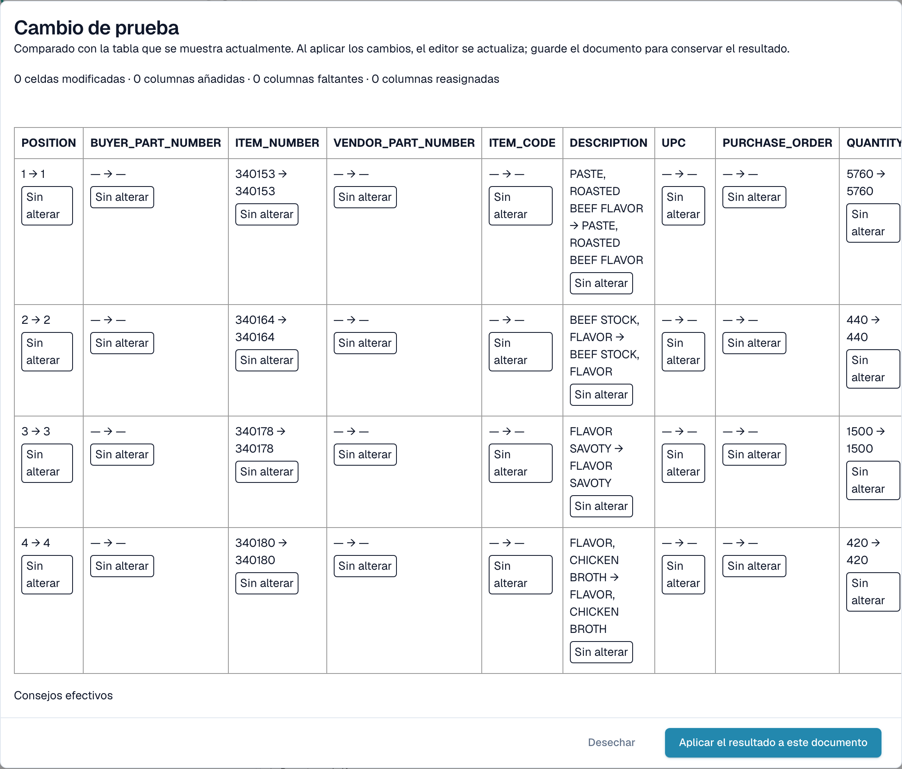<figcaption>
El diálogo <strong>Cambio de prueba</strong> compara el nuevo resultado con la tabla que ves ahora.
</figcaption></figure>

El diálogo **Cambio de prueba** cuenta lo que cambiaría: celdas modificadas, columnas añadidas, columnas faltantes y columnas reasignadas. Cada celda se marca como **Agregado**, **Cambió**, **Desaparecido**, **Reasignado** o **Sin alterar**. En la parte inferior, el diálogo enumera las pruebas de la ejecución: *Consejos efectivos*, *Formación seleccionada*, *Política de columnas* y *Anulaciones de solicitud utilizadas*. Elige **Aplicar el resultado a este documento** para adoptarlo (guarda después el documento) o **Desechar** para descartarlo. Si cambias el prompt después de probar, el resultado se marca como obsoleto y debes volver a probar.

Después de **Guardar como entrenamiento**, DocBits te indica que el entrenamiento se usará en el próximo reprocesamiento; la ejecución actual todavía no lo usó. Comprueba en el siguiente documento del proveedor que el chip indica **Entrenamiento aplicado**.

## Ver lo que hizo la IA

Cuatro botones debajo de la tabla explican la extracción.

<figure>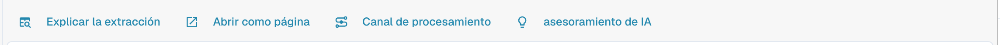<figcaption>
Los botones de explicación.
</figcaption></figure>

* **Explicar la extracción** abre *Cómo la tabla de IA llegó a sus valores*: el documento, la extracción de la IA (nivel, número de columnas sin procesar y de filas), el mapeo a tu estructura y el resultado por columna con el origen de cada columna.
* **Abrir como página** muestra la misma explicación en su propia ventana.
* **Canal de procesamiento** enumera los pasos de procesamiento del documento y dónde se detuvo.
* **asesoramiento de IA** pregunta a Nexus cómo se puede mejorar la extracción y enumera recomendaciones concretas, por ejemplo *Enable structured output* o *Add an instruction tag → Net Amount*. Es solo un consejo; la decisión es tuya.

<figure>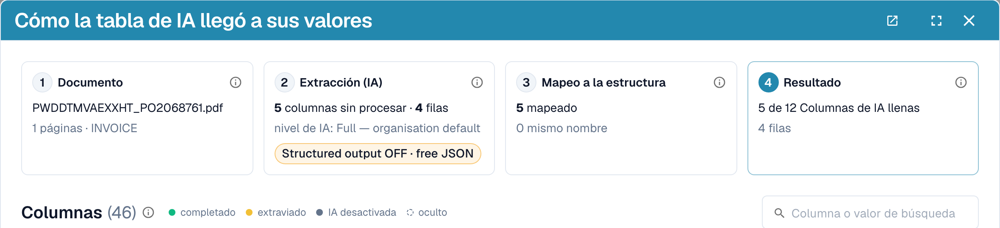<figcaption>
Explicar la extracción: cuatro pasos, del documento al resultado.
</figcaption></figure>

<figure>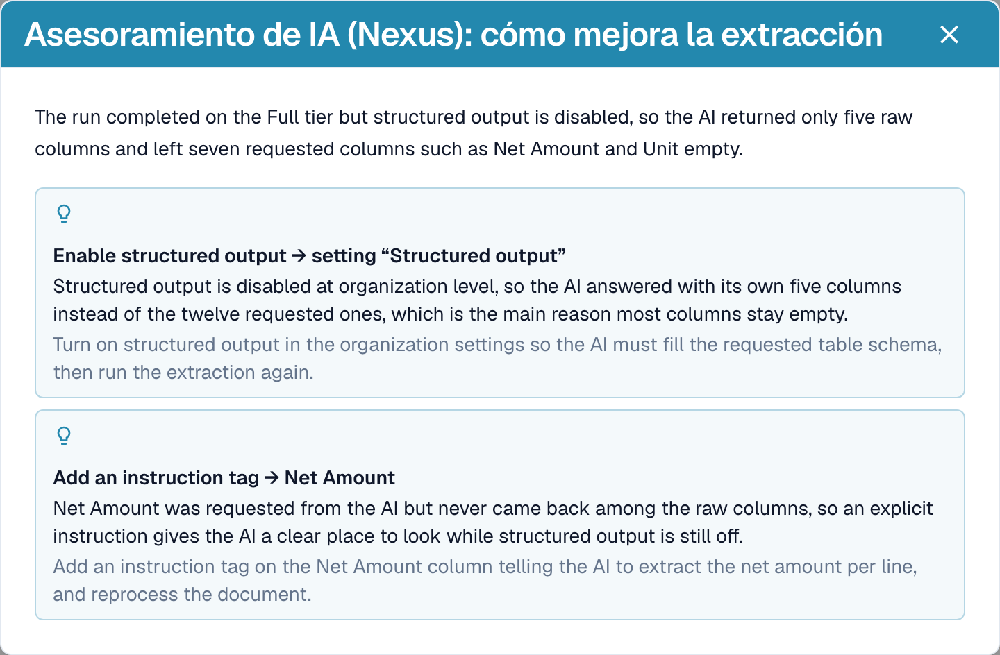<figcaption>
El asesoramiento de IA propone los siguientes pasos.
</figcaption></figure>

<figure>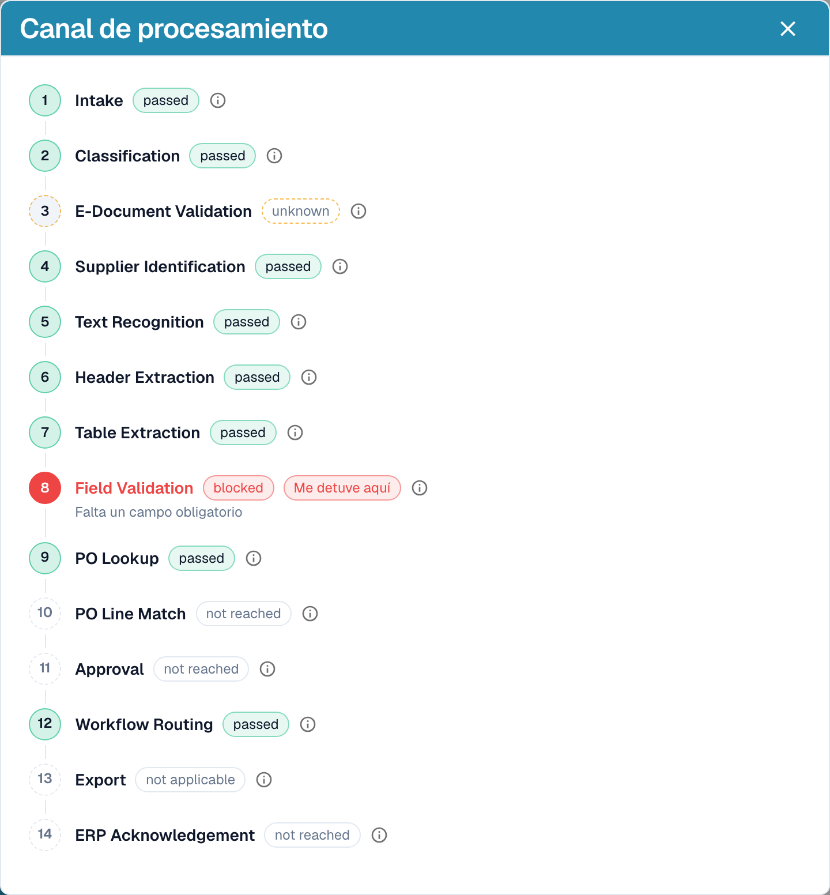<figcaption>
El canal de procesamiento muestra dónde se detuvo un documento, aquí en Field Validation.
</figcaption></figure>

Estas explicaciones pertenecen al módulo **Panel de análisis**. Sin la licencia del módulo, o cuando tu rol no tiene acceso a la pestaña Analítica, DocBits te indica qué pedir a tu administrador (activar el módulo en Ajustes → Módulos o conceder la pestaña a tu rol en Ajustes → Roles).

## Ejemplos prácticos

| Situación | Qué hacer |
| --- | --- |
| Un valor está en la columna equivocada, por ejemplo *Precio Unitario* está en *Importe neto* | Haz clic en el nombre de la columna y asígnala a la columna correcta. Después, **Guardar como entrenamiento** si el proveedor siempre la imprime así. |
| Una columna queda vacía en todas las filas, por ejemplo *Descuento* | Añade la columna en **Columnas adicionales para la IA** o escribe una instrucción con el término que usa la factura, como *Rellena la columna Descuento con la columna llamada "Rabatt" de la factura*. Comprueba con **Cambio de prueba** y luego **Aplicar**. |
| La IA no sabe qué hacer (no hay nada en el prompt) | Haz clic en **Sugerir con Nexus** e inserta lo que encaje. |
| Un precio debe dividirse o redondearse | Escribe la regla en el prompt, por ejemplo *El precio unitario es el importe neto dividido por la cantidad*. |
| Los importes se leen con separadores incorrectos (1.234,50 frente a 1,234.50) | Abre el menú de tres puntos de la columna, elige **Formato de cantidad** y selecciona el formato correcto. |
| La etiqueta está debajo del valor | Menú de tres puntos → **Extract From** → **Below**. |
| Una columna no se necesita para este proveedor | Menú de tres puntos → **Eliminar columna**. **Guardar como entrenamiento** la mantiene oculta para el proveedor. |
| Una fila es incorrecta o falta | Elimínala con la **x** o añade una con **Añadir nueva fila de tabla** y escribe los valores. |
| Se necesitan las mismas correcciones una y otra vez | Usa **Guardar como entrenamiento** para que los siguientes documentos de este proveedor salgan bien. Para diseños complejos, [entrena la tabla](../../../administration-and-setup/setup/document-training/training-line-fields-table-training/README.md). |


No todas las líneas de descripción que continúan en la línea siguiente se pueden reparar con una instrucción. Si las líneas de un mismo artículo se dividen en varias filas, edita las filas o usa el entrenamiento de tabla clásico.


## El Asistente y la tabla AI

Haz clic en el **Asistente** (icono de bombilla junto a Guardar en la pantalla de validación) para hacer preguntas sobre el documento.

<figure>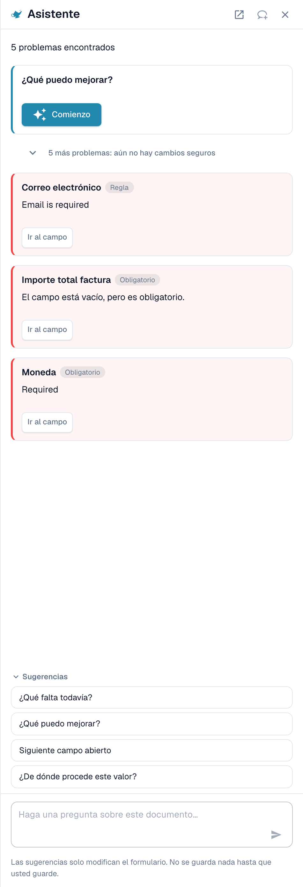<figcaption>
El Asistente enumera los problemas abiertos y ofrece preguntas que hacer.
</figcaption></figure>

**Qué hace el Asistente con las tablas.** Puede llevarte a una celda de la tabla y, si puedes editar el documento, establecer el valor de una celda o añadir una fila de tabla. Funciona tanto en la Tabla AI extraída como en la Tabla extraída. También responde a preguntas como *¿Qué falta todavía?* y *¿Qué puedo mejorar?*.

<figure>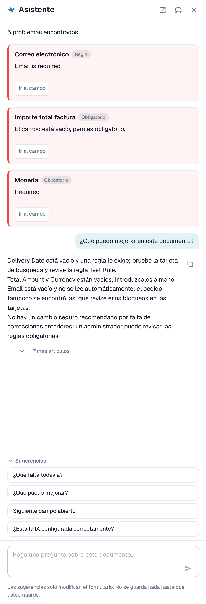<figcaption>
Pregunta <em>¿Qué puedo mejorar?</em> para obtener una lista breve de lo que corregir a continuación.
</figcaption></figure>

**Qué no hace.** El Asistente **no** cambia instrucciones de IA, columnas adicionales, asignación de columnas ni entrenamiento. Para eso usa la tarjeta **Instrucciones para la IA** (**Sugerir con Nexus**, **Cambio de prueba**, **Aplicar**, **Guardar como entrenamiento**). Los administradores pueden preguntar *¿Está la IA configurada correctamente?* para ver consejos de configuración, por ejemplo sobre combinar la lectura de tablas por IA con reglas de tabla guardadas.

### Sugerir una regla a tu administrador

Muchos problemas proceden de un **campo**, no de la tabla: un correo electrónico siempre obligatorio pero vacío, una fecha con formato incorrecto, un ID de proveedor que necesita una búsqueda. Para estos casos, cualquier persona que pueda abrir el documento puede enviar una propuesta a través del Asistente:

1. Pregunta *¿Qué puedo mejorar?* o abre una tarjeta de hallazgo en el Asistente.
2. Si eres administrador, la tarjeta ofrece **Aplicar**. Si no lo eres, indica *An administrator can review this proposal.* y muestra **Suggest improvement**. Haz clic en él.
3. DocBits muestra una confirmación de que tu sugerencia se envió a los administradores. Si alguien envió antes la misma sugerencia, tu solicitud se suma a ella en lugar de crear una segunda.
4. La tarjeta muestra entonces **Requested** y, más tarde, **Implemented** o **Declined** (con el motivo, si el administrador lo indicó).

La propuesta puede ser una **regla de transformación**, una **regla de validación** o una **búsqueda (lookup)**. La envías desde el documento y el servidor genera por sí mismo el borrador de la regla a partir del problema detectado, así que no tienes que escribir nada. El número de sugerencias está limitado a 20 por usuario y hora.


De esta manera no puedes proponer **instrucciones de tabla AI, asignación de columnas ni entrenamiento**. Si una tabla necesita una corrección, corrígela en el documento y avisa a un administrador, o pide a tu administrador que use **Guardar como entrenamiento** en un documento de ese proveedor. Los administradores pueden guardar reglas; consulta [Quién puede hacer qué](#quien-puede-hacer-que).


**Lo que ve el administrador.** Los administradores reciben una notificación con una tarea y un correo electrónico. Abren **Touchless Intelligence** y encuentran la propuesta en **Mejoras abiertas** (pestaña *Abiertas*, historial en *Historial*). Al hacer clic se abre el panel *Improvement suggestion* con documentos de ejemplo y una vista previa. El administrador puede **Aprobar** o **Rechazar**. Al aprobar, **Switch on right away** decide si la nueva regla se activa de inmediato; sin esta opción, la regla se crea inactiva y el administrador la activa en la lista de reglas. Al rechazar se pide un motivo y una nota opcional para quienes la solicitaron. Consulta [Touchless Intelligence](../../../administration-and-setup/touchless-intelligence.md).

<figure>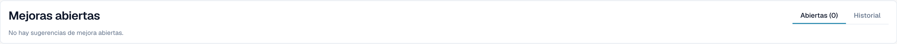<figcaption>
Los administradores encuentran las propuestas en <strong>Mejoras abiertas</strong>.
</figcaption></figure>

## Quién puede hacer qué

| Acción | Quién |
| --- | --- |
| Reasignar una columna, **Eliminar columna**, **Formato de cantidad**, **Extract From**, **Cambio de prueba**, **Aplicar**, editar filas | Cualquiera que pueda editar el documento |
| **Guardar como entrenamiento** | Cualquiera que pueda editar, salvo que esté activado el ajuste de organización **Guardar reglas de extracción (solo para administradores)**. En ese caso solo los administradores de la organización pueden guardar reglas; los demás reciben un mensaje de error. |
| **Agregar nueva columna de tabla** | Administradores |
| Sugerir una regla a través del Asistente | Cualquiera que pueda abrir el documento |
| Aprobar o rechazar una sugerencia | Administradores |
| **Explicar la extracción**, **asesoramiento de IA** | Usuarios cuyo rol tiene acceso al módulo Panel de análisis |

## Ajustes para administradores

Abre **Ajustes → Procesamiento de documentos → Tipos de documento → Clasificación y extracción**, pestaña **General**, sección **Extracción**.

<figure>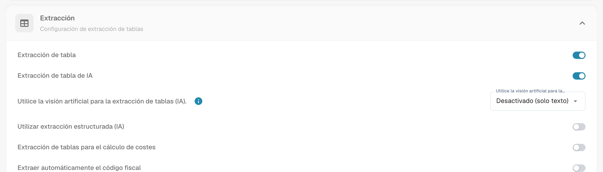<figcaption>
Los interruptores que deciden si existe la tabla AI.
</figcaption></figure>

* **Extracción de tabla** activa la tabla clásica.
* **Extracción de tabla de IA** activa o desactiva la tabla AI para la organización.
* **Utilizar extracción estructurada (IA)**: la IA devuelve la tabla en una estructura fija que se asigna directamente a tus columnas configuradas, en lugar de copiar los encabezados del proveedor. Los nombres de columna coinciden entonces siempre con tu configuración; una columna que el proveedor imprime pero que no has configurado no se extrae.
* **Guardar reglas de extracción (solo para administradores)**: cuando está activado, solo los administradores de la organización pueden guardar y exportar reglas de extracción.

<figure>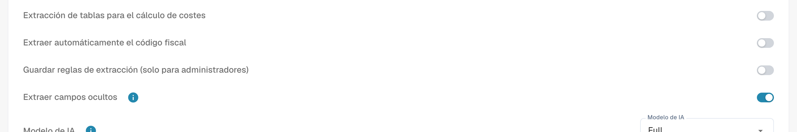<figcaption>
<strong>Guardar reglas de extracción (solo para administradores)</strong> controla quién puede usar <strong>Guardar como entrenamiento</strong>.
</figcaption></figure>

### Utilizar IA por columna

Cada columna de tabla tiene un indicador **Utilizar IA** (Ajustes → Ajustes globales → Tipos de documento → [Table Columns](../../../administration-and-setup/settings/global-settings/document-types/table-columns/README.md)). Con el indicador activado, la IA rellena esa columna aunque el proveedor tenga reglas guardadas; las demás columnas siguen viniendo de las reglas. Uso típico: una columna de descripción de texto libre que las reglas entrenadas capturan mal.

La IA entonces deduce esa columna a partir de toda la fila. Si pone sistemáticamente el valor equivocado, por ejemplo el total de línea en *Cargos*, desactiva **Utilizar IA** en esa columna o añade una instrucción que le diga a la IA qué es la columna.

## Páginas relacionadas

* [Etiquetas de la tabla AI](ai-table-tags.md)
* [Entrenamiento de Campos de Línea / Tabla de Entrenamiento](../../../administration-and-setup/setup/document-training/training-line-fields-table-training/README.md)
* [Touchless Intelligence](../../../administration-and-setup/touchless-intelligence.md)
