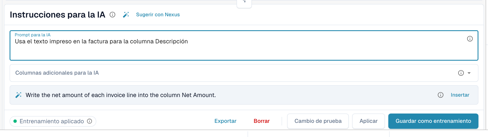

# Etiquetas e instrucciones de la tabla AI

Las etiquetas son la forma de decirle a la IA qué hacer con una tabla. En la tarjeta **Instrucciones para la IA** situada debajo de la tabla AI (consulta [Tabla AI](README.md)) das dos tipos de etiquetas:

| Tipo | Dónde lo introduces | Qué hace la IA con ello |
| --- | --- | --- |
| **Instrucción** | **Prompt para la IA**, una instrucción por línea | La sigue mientras lee la tabla, por ejemplo cómo calcular o qué término usar. |
| **Columna** | **Columnas adicionales para la IA** | Debe devolver esa columna además de las habituales, aunque el documento no la rotule con claridad. |

Ambas se almacenan juntas como etiquetas de IA del proveedor cuando haces clic en **Guardar como entrenamiento**.

<figure><figcaption>
Una instrucción por línea en <strong>Prompt para la IA</strong>.
</figcaption></figure>

## Añadir etiquetas paso a paso

1. Abre el documento en la pantalla de validación y permanece en la pestaña **Tabla AI extraída**.
2. En **Prompt para la IA** escribe lo que debe hacer la IA, una instrucción por línea. Escribe **@** para insertar una columna de tu configuración.
3. O abre **Columnas adicionales para la IA** y elige las columnas que la IA debe devolver.
4. ¿No sabes qué escribir? Haz clic en **Sugerir con Nexus** y usa **Insertar** o **Add column** en una sugerencia.
5. Haz clic en **Cambio de prueba** para comparar el resultado con la tabla actual. Todavía no se escribe nada.
6. ¿Conforme? Haz clic en **Aplicar** (o en **Aplicar el resultado a este documento** en el diálogo de prueba) para poner el resultado en este documento.
7. Si todos los documentos de este proveedor lo necesitan, haz clic en **Guardar como entrenamiento**. **Borrar** elimina las etiquetas y reglas guardadas del diseño del proveedor.


Cada línea de **Prompt para la IA** es una instrucción, incluso una sola palabra (DocBits añade un punto final para que la IA no la confunda con el nombre de una columna). Las columnas van en **Columnas adicionales para la IA**.


## Cómo escribir buenas instrucciones

* **Nombra la columna y el término del documento.** *Rellena la columna Descuento con la columna llamada "Rabatt"* funciona mejor que *busca el descuento*.
* **Una cosa por línea.** Las líneas cortas son más fáciles de probar y de eliminar.
* **Describe los cálculos con claridad.** *El precio unitario es el importe neto dividido por la cantidad*.
* **Indica qué debe dejarse como está.** *Ignora las líneas de envío al final de la tabla*.
* **Revisa toda la tabla.** Un prompt modificado vuelve a ejecutar la IA y puede cambiar todas las columnas.
* **No repitas lo que ya se conoce.** Una etiqueta de columna que duplica otra etiqueta, o que coincide con un campo de cabecera, se ignora.

## Ejemplos

| Problema | Etiqueta |
| --- | --- |
| La columna de descuento queda vacía | Columna adicional **Descuento** y la instrucción *Rellena la columna Descuento con la columna llamada "Rabatt"* |
| Cantidad y unidad están en una sola celda | *Pon el número en Cantidad y la unidad de medida en Unidad* |
| El precio unitario no está impreso | *El precio unitario es el importe neto dividido por la cantidad* |
| Las fechas deben estar en formato ISO | *Escribe todas las fechas como AAAA-MM-DD* |
| Importes en una moneda extranjera | *Redondea todos los importes a dos decimales* |

Las columnas que puedes elegir son las columnas de tabla configuradas para el tipo de documento; consulta [Table Columns](../../../administration-and-setup/settings/global-settings/document-types/table-columns/README.md).

## Antes de guardar

* Usa primero **Cambio de prueba**. Nunca escribe nada.
* **Guardar como entrenamiento** se aplica al diseño del proveedor, de modo que los siguientes documentos se leen con tus etiquetas. Comprueba en el siguiente documento que el chip indica **Entrenamiento aplicado**.
* Si **Guardar reglas de extracción (solo para administradores)** está activado, pide a un administrador de la organización que guarde.
* Las etiquetas cambian cómo lee la IA la tabla. Para posiciones de columna estables en un diseño recurrente, [entrena la tabla](../../../administration-and-setup/setup/document-training/training-line-fields-table-training/README.md) en su lugar.
