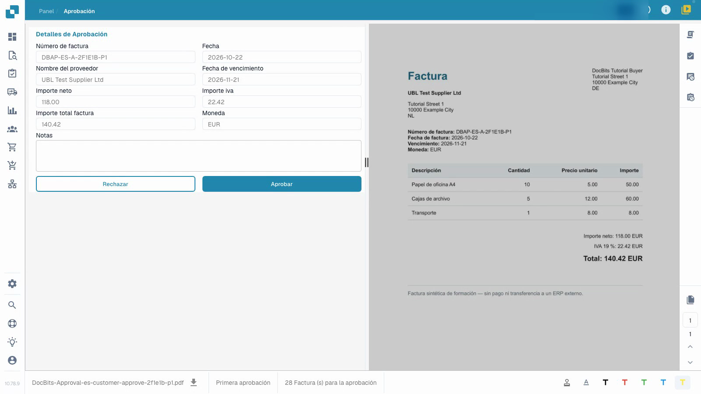
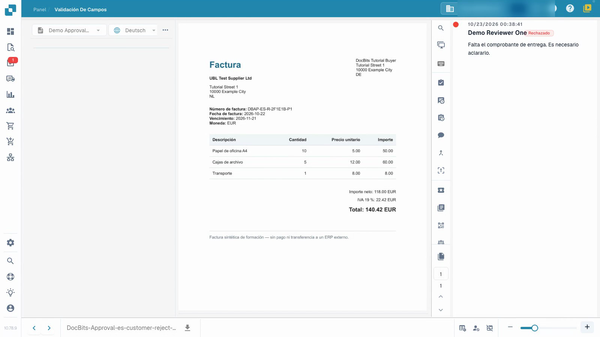

# Aprobar o rechazar una factura

El vídeo muestra la aprobación desde el punto de vista de una revisora.


Aprobar o rechazar una factura


[Ver video con subtítulos](https://docbits-videos.fra1.cdn.digitaloceanspaces.com/settings-assistant/invoice-approval-customer/v1/es.html)

Se muestra la aplicación real. Los nombres de las opciones pueden variar según la versión utilizada.

Utilice la aprobación para dejar constancia de su decisión tras revisar una factura que ya ha sido validada. Necesita acceso al documento y permiso para su etapa de aprobación actual. El video utiliza una cuenta normal de revisión, facturas sintéticas preparadas y una presentadora ficticia.

## Revisar y decidir

1. Abra la factura asignada a usted y verifique la etapa de aprobación actual.
2. Compare el número de factura, el proveedor, las fechas y el total con el original. Revise también las líneas de la factura y los impuestos. La validación técnica no reemplaza su revisión del contenido.
3. Registre una nota de revisión clara. Apruebe una factura correcta o rechácela con un motivo específico cuando necesite aclaración. Espere a que se complete la operación.
4. Vuelva a abrir el documento e inspeccione su historial de aprobación. Compruebe que la persona revisora, la hora, la decisión y la nota completa se hayan guardado correctamente.

<figure><figcaption>
Formulario de factura completado en comparación con el original.
</figcaption></figure>

<figure><figcaption>
Rechazo guardado con su motivo.
</figcaption></figure>

## Comprobar la siguiente etapa

Cuando se configura una segunda aprobación, su primera aprobación deja la factura esperando a otro revisor autorizado. Aún no está completamente aprobada. Un rechazo necesita aclaración del contenido; la corrección y la nueva presentación siguen su proceso configurado.

Una entrada en el historial de aprobación no prueba que los datos hayan llegado a un sistema ERP. En este ejemplo aislado, el canal de recuperación no tiene un destino ERP externo. El estado técnico `pending_data_fetch`, cuando se muestra, significa que el documento está esperando la recuperación de datos.

## Páginas relacionadas

- [Pantalla de validación](validation-screen/README.md)
- [Tareas de documentos](tasks.md)
