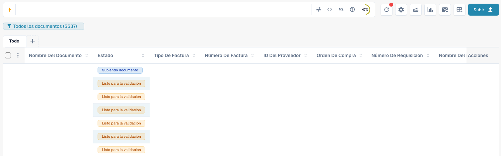
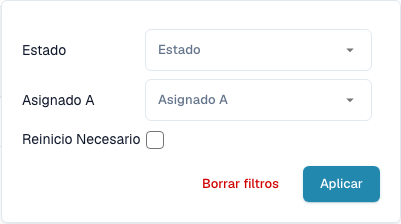
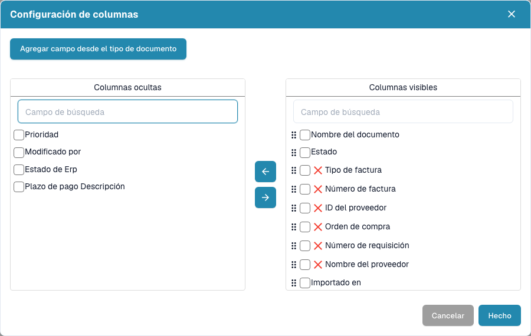
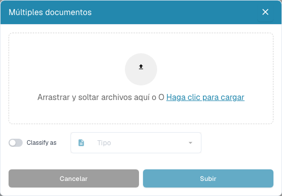

# Panel

El panel es su lista de trabajo diaria en DocBits. Encuentre documentos importados, consulte su estado, ábralos para validarlos y organice el trabajo de su equipo.


Las funciones disponibles dependen de sus permisos, del estado del documento y de los módulos de su organización. Algunos controles pueden no aparecer. En ventanas de escritorio más estrechas, las acciones adicionales se encuentran en **Más**.


<figure><figcaption>
El panel actual con búsqueda, herramientas, vistas guardadas, tipos de documento y tabla. Los valores de los documentos están ocultos por privacidad.
</figcaption></figure>

## La búsqueda en el trabajo diario en vídeo

Este breve ejemplo comienza en la oficina de una usuaria ficticia en Madrid. A continuación, la interfaz de DocBits en español ocupa toda la pantalla: introducir parte del nombre del archivo, pulsar Intro y comprobar el resultado. El segundo ejemplo muestra cómo incluir el contenido de los documentos cuando está activado el módulo de búsqueda de texto completo.



[Abrir el ejemplo con narración en español](https://docbits-videos.fra1.cdn.digitaloceanspaces.com/settings-assistant/dashboard-search-customer/v1/es.mp4) · [Subtítulos en español (VTT)](https://docbits-videos.fra1.cdn.digitaloceanspaces.com/settings-assistant/dashboard-search-customer/v1/es.vtt) · [Transcripción en español](https://docbits-videos.fra1.cdn.digitaloceanspaces.com/settings-assistant/dashboard-search-customer/v1/es.txt)

La usuaria y la oficina se han generado con IA. Las acciones y los resultados proceden de grabaciones reales en la cuenta de prueba de DocBits.

## Recorrido completo por el panel

La usuaria ficticia de Madrid muestra la búsqueda combinada con AND, los filtros de estado, la ayuda de búsqueda, la configuración de columnas, las estadísticas y la actualización. La interfaz española se ha grabado en DocBits con datos de prueba sintéticos. El personaje y la voz se han generado con IA.



[Abrir el reproductor con subtítulos](https://docbits-videos.fra1.cdn.digitaloceanspaces.com/settings-assistant/dashboard-tour-customer/v4/es.html) · [Subtítulos en español (VTT)](https://docbits-videos.fra1.cdn.digitaloceanspaces.com/settings-assistant/dashboard-tour-customer/v4/es.vtt) · [Transcripción](https://docbits-videos.fra1.cdn.digitaloceanspaces.com/settings-assistant/dashboard-tour-customer/v4/es.txt)

## Empezar el trabajo diario

1. Compruebe la organización activa y, si está disponible, la suborganización.
2. Seleccione un tipo de documento o mantenga **Todo**.
3. Busque y filtre los documentos que necesita.
4. Revise **Estado** y **Asignado a** y abra la fila para trabajar con el documento.
5. Actualice la lista después de procesar o importar documentos.

## Buscar y filtrar documentos

Introduzca un nombre de documento, número de factura u otro dato comercial y pulse **Intro**. El icono de filtros del buscador permite elegir **Estado**, **Asignado a** y **Reinicio requerido**. Confirme con **Aplicar**. Quite filtros individuales o utilice **Borrar filtros** si falta un documento. Las pestañas de tipos de documento y las vistas guardadas también limitan la lista.

La barra de búsqueda ofrece filtros estructurados, una vista de consulta directa y ayuda sobre campos y sintaxis. Copie los nombres de campo y los ejemplos de esa ayuda. Los nombres técnicos de los campos no cambian al cambiar el idioma. Las opciones avanzadas dependen de las capacidades de búsqueda habilitadas.

Con la búsqueda de texto completo habilitada, el menú de contenido controla las búsquedas de texto simple: el modo automático busca primero en los campos comerciales y recurre al contenido si no encuentra coincidencias; incluir contenido añade coincidencias del documento; solo campos limita la búsqueda a los campos. Un indicador identifica los resultados procedentes del contenido. Un `+` tras el número de resultados indica una ventana limitada: concrete más la búsqueda.

Si se muestra el control separado de fechas, elija un intervalo de importación predefinido o personalizado. Con la búsqueda de texto completo está oculto; utilice los campos de fecha disponibles en la barra de búsqueda.

<figure><figcaption>
Filtre por estado, persona asignada y necesidad de reinicio.
</figcaption></figure>

## Leer y organizar la tabla

Cada fila representa un documento. Según las columnas configuradas, verá nombre, estado, tipo, datos de factura, proveedor, persona asignada, fechas e importes. Pulse una cabecera ordenable para cambiar el orden. Desplácese horizontalmente para ver más columnas y utilice la paginación y el número de documentos por página para recorrer los resultados.

Si la agrupación está disponible, seleccione un campo sobre la tabla. Para fechas, elija día, semana o mes. Abra un grupo para ver sus documentos o quite la agrupación para volver a la lista normal.

Use **+** junto a las pestañas de tipos de documento para mostrar otras pestañas. Puede reordenarlas arrastrándolas. Quitar una pestaña solo cambia la vista; no elimina documentos.

Abra el engranaje y los ajustes de columnas. Mueva columnas entre las listas de ocultas y visibles y arrastre las visibles para ordenarlas. También puede añadir campos de un tipo de documento. Consulte [Cambiar columnas del documento](change-document-columns.md).

<figure><figcaption>
Seleccione y ordene la información de la tabla en los ajustes de columnas.
</figcaption></figure>

## Entender estados y acciones

Los estados de procesamiento indican pasos como OCR, clasificación o exportación. **Listo para la validación** significa que puede revisar el documento. Los estados de aprobación indican una aprobación pendiente. **Exportado** indica que la exportación del documento terminó. Pulse el estado **Error** para consultar los detalles disponibles.

Si hay tiempos de procesamiento, sitúe el puntero sobre el estado para ver las fases y su duración. Los documentos con posibles duplicados muestran un icono de duplicado; ábralo para comparar los documentos relacionados.

Abra la fila para trabajar en la pantalla de validación. El menú de acciones ofrece las operaciones permitidas, como asignar, descargar, consultar el historial o reiniciar el procesamiento. Las variantes de descarga dependen del documento y pueden incluir anotaciones o formatos de factura electrónica.

Marque varios documentos y abra el menú de la cabecera para las acciones masivas permitidas, como asignar, fusionar, reiniciar, reiniciar la exportación o eliminar. Compruebe la selección y cada confirmación. Estas acciones pueden modificar documentos; guardar una vista solo cambia la presentación de la lista.

## Guardar un panel personal

Abra el botón azul de vista situado bajo el buscador y elija **Crear nuevo panel**. Introduzca un nombre y decida si la vista es privada, visible para todos o compartida con grupos y usuarios concretos. Guarde filtros, orden y columnas para tareas recurrentes.

Seleccione las vistas guardadas desde el mismo menú. Guarde cambios posteriores cuando la vista sea suya y haya cambiado. No puede sobrescribir una vista compartida con usted: cree una propia. Compartir una vista no concede nuevos permisos sobre los documentos. Consulte [Paneles personales](personal-dashboards.md).

<figure><figcaption>
Cree un panel con nombre y elija quién puede verlo.
</figcaption></figure>

## Cargar documentos y utilizar las herramientas

Elija **Subir**, arrastre archivos al diálogo o selecciónelos en su equipo e inicie la carga. Si está disponible, use la opción de clasificación para indicar expresamente un tipo de documento. De lo contrario, DocBits clasifica los archivos automáticamente.

Los demás botones actualizan la lista, abren ajustes avanzados, inician un escáner, muestran estadísticas de estado, inician la importación de correo configurada o solicitan una exportación CSV/Excel. El escaneo y la exportación requieren configuración. Exportar la tabla es distinto de exportar un documento al ERP. Guarde los cambios de columnas de un panel personal antes de solicitar la exportación, ya que esta utiliza la configuración guardada. Consulte [Herramientas del panel](dashboard-tools.md).

<figure><figcaption>
Cargue archivos y, si lo necesita, seleccione su tipo antes de importarlos.
</figcaption></figure>

## Si falta un documento o un control

Compruebe organización, vista activa, tipo de documento, texto de búsqueda y filtros. Actualice la lista y revise otras páginas de resultados. Si sigue faltando una función, pida a su administrador que revise permisos y módulos.

**Ctrl/Cmd + K** abre la búsqueda rápida global; **Ctrl/Cmd + Q** actualiza el panel; **Ctrl/Cmd + H** abre la ayuda. El menú del engranaje contiene la referencia de atajos. El contador de documentos pendientes de toda la organización, si aparece, es un indicador para administradores, no su contador personal de tareas.

Use Ctrl en Windows/Linux y Cmd en macOS. Los atajos del navegador o sistema pueden tener prioridad.
