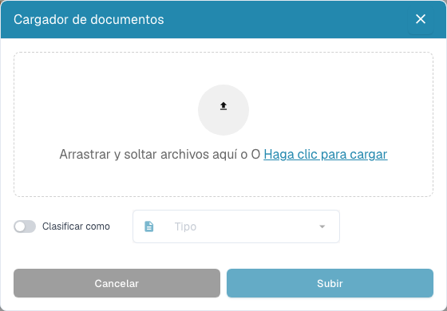

# Herramientas del panel

Las herramientas se encuentran junto al buscador. Pase el puntero por un icono para ver su etiqueta. En ventanas de escritorio más estrechas, abra **Más**.

| Herramienta | Uso |
| --- | --- |
| Actualizar | Vuelva a cargar la lista y los estados. Un indicador de cambios señala que hay datos más recientes. |
| Ajustes avanzados (engranaje) | Abra **Más ajustes**, la referencia **Atajos de teclado**, el **Registro de importación** y el diálogo **Configuración de columnas**. Los ajustes de toda la organización requieren permisos de administrador. |
| Escanear documento | Abra el diálogo si el escaneo está habilitado y hay un escáner compatible. Elija dispositivo y ajustes antes de empezar. |
| Análisis | Muestre estadísticas por estado y seleccione una categoría para filtrar la lista. |
| Iniciar importación de correo | Inicie una importación con la configuración de buzón existente. Esta acción no configura un buzón. |
| Exportar tabla | Solicite un CSV o Excel si está habilitado. Guarde antes los cambios de columnas de su panel personal: se utiliza la configuración guardada. |
| Subir | Seleccione o arrastre archivos, indique opcionalmente un tipo de documento e inicie la carga. |

<figure><figcaption>
Aún no hay archivos seleccionados en «Cargador de documentos». «Clasificar como» está desactivado y el campo «Tipo» está inactivo; «Cancelar» cierra el diálogo.
</figcaption></figure>

El registro permite revisar las importaciones de correo. Filtre por asunto o remitente y consulte la información disponible. La confirmación de una solicitud de exportación de tabla indica que el trabajo se ha enviado; no significa que se haya exportado un documento al ERP.

Consulte búsqueda, acciones y vistas guardadas en la [guía del panel](README.md).
