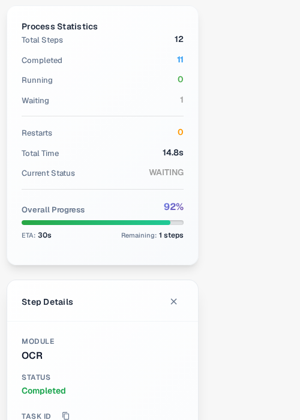

# Document Flow

**Document Flow** muestra los pasos de procesamiento de un documento. Utilícelo para ver qué pasos se han completado, cuál está en espera y cuánto tiempo ha tardado el procesamiento. El ejemplo siguiente utiliza una factura sintética en el Sandbox en inglés.

## Abrir desde el dashboard

En el **Dashboard**, localice el documento. En su columna **Actions**, seleccione los tres puntos y, a continuación, **Document flow**. Esta opción abre el flujo de ese documento; no modifica el documento.

<figure><figcaption>Elija Document flow en el menú Actions del documento.</figcaption></figure>

## Abrir desde Field Validation

Abra el documento. En **Field Validation**, seleccione los tres puntos de la barra de acciones derecha y, a continuación, **Document Flow** en **More options**.

<figure><figcaption>El mismo flujo está disponible desde la vista del documento.</figcaption></figure>

## Leer el flujo

**Process Statistics**, a la izquierda, resume el número de pasos, los pasos completados y en espera, los reinicios, el tiempo total, el estado actual y el progreso general. Cada tarjeta numerada muestra un paso de procesamiento y su estado actual. Desplácese hacia abajo para ver los pasos posteriores.

<figure><figcaption>Los primeros pasos del flujo de una factura sintética.</figcaption></figure>

<figure><figcaption>Desplácese para seguir la secuencia a través de los pasos posteriores.</figcaption></figure>

Seleccione la tarjeta de un paso para abrir **Step Details** a la izquierda. Muestra el módulo y su estado. También puede abrirse un panel **Task Logs** a la derecha; los detalles del registro dependen de lo que esté disponible para esa tarea. Seleccione **×** en Step Details para cerrar el panel.

<figure><figcaption>Step Details explica el estado del módulo seleccionado.</figcaption></figure>
