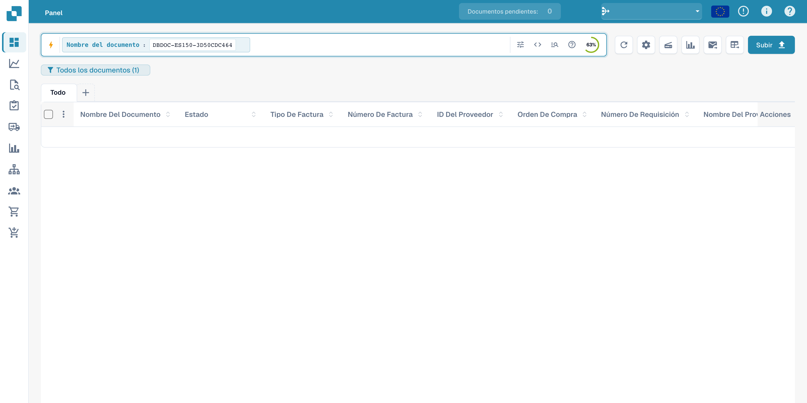
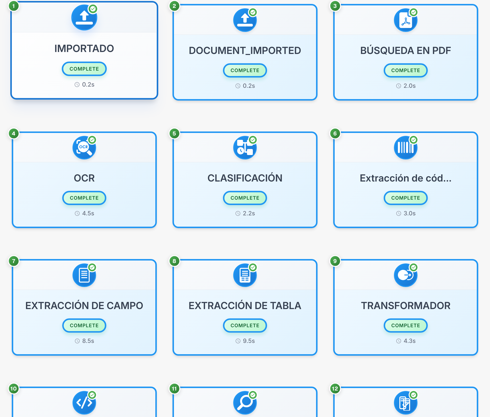

# Flujo de documentos

El flujo de documentos muestra el orden, estado y duración de las etapas de procesamiento. El ejemplo utiliza una factura ficticia.

## Abrir el flujo

Localice el documento en el panel. La consulta visible busca el ejemplo; los valores de la tabla están ocultos.

<figure><figcaption>
Búsqueda del documento ficticio; los valores de la tabla están ocultos.
</figcaption></figure>

Abra el documento en **Validación de campos**, abra las opciones de la barra derecha y seleccione **Flujo de documentos**.

<figure><figcaption>
Menú de opciones de validación con acceso al flujo del documento.
</figcaption></figure>

## Leer las etapas

Cada tarjeta representa una etapa, como importación, OCR, clasificación o extracción de campos. Siga los números para consultar su secuencia.

<figure><figcaption>
Tarjetas de procesamiento; los códigos técnicos de estado no cambian.
</figcaption></figure>

Los identificadores técnicos, por ejemplo `DOCUMENT_IMPORTED` y `COMPLETE`, permanecen sin traducir. `COMPLETE` identifica una etapa completada.

## Consultar detalles

Seleccione una tarjeta para consultar los detalles y registros disponibles.

| Detalle | Significado |
| --- | --- |
| Módulo | Componente de procesamiento de la etapa |
| Estado | Estado actual de esa etapa |
| Duración | Tiempo de procesamiento registrado |
| Registros | Mensajes técnicos disponibles |

Revise los mensajes de una etapa pendiente o fallida antes de reiniciar el procesamiento. Algunos títulos de diagnóstico pueden seguir apareciendo en inglés en el producto.

Los detalles de cada etapa muestran el componente de procesamiento, el estado, la duración y los registros técnicos disponibles.
