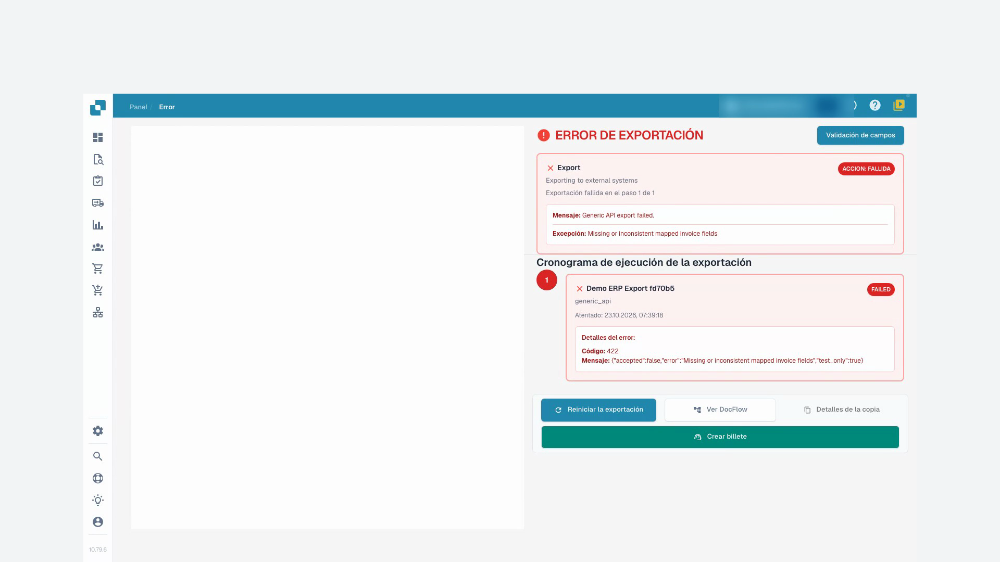
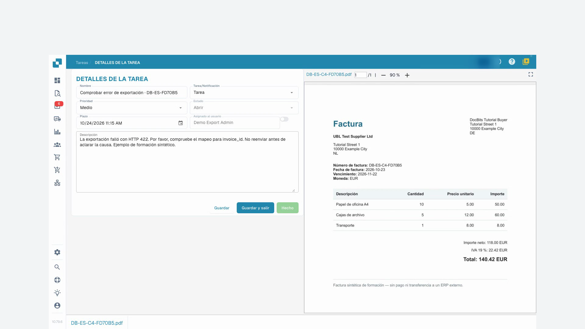

# Estado del documento

Los estados de procesamiento indican pasos como OCR, clasificación o exportación. **Listo para la validación** significa que puede revisar el documento. Los estados de aprobación indican una aprobación pendiente. **Exportado** indica que la exportación del documento terminó. Pulse el estado **Error** para consultar los detalles disponibles.

Si hay tiempos de procesamiento, sitúe el puntero sobre el estado para ver las fases y su duración. Los documentos con posibles duplicados muestran un icono de duplicado; ábralo para comparar los documentos relacionados.

Abra la fila para trabajar en la pantalla de validación. El menú de acciones ofrece las operaciones permitidas, como asignar, descargar, consultar el historial o reiniciar el procesamiento. Las variantes de descarga dependen del documento y pueden incluir anotaciones o formatos de factura electrónica.

Marque varios documentos y abra el menú de la cabecera para las acciones masivas permitidas, como asignar, fusionar, reiniciar, reiniciar la exportación o eliminar. Compruebe la selección y cada confirmación. Estas acciones pueden modificar documentos; guardar una vista solo cambia la presentación de la lista.

Consulte búsqueda, acciones y vistas guardadas en la [guía del panel](README.md).

## Videotutorial: Resolver facturas bloqueadas

El personaje y la voz son sintéticos. La grabación muestra la interfaz de pruebas real de DocBits con facturas de formación sintéticas.


Resolver facturas bloqueadas


[Ver con subtítulos y capítulos](https://docbits-videos.fra1.cdn.digitaloceanspaces.com/settings-assistant/blocked-invoices-customer/v1/es.html)

Algunas etiquetas nativas pueden permanecer en otro idioma. Se conservan los identificadores técnicos de los campos.

Abro la factura en la validación de campos. En este ejemplo, falta el número de factura. Los demás valores ya están rellenados. Los comparo con el original antes de cambiar nada.

Ahora introduzco el número de factura y salgo del campo. Después, guardo la factura. Espero la respuesta y vuelvo a cargar el documento. Así veo si la corrección realmente se mantiene.

El número sigue ahí después de abrirlo de nuevo. El error del campo obligatorio está resuelto. Sin embargo, guardar no significa que la factura haya sido aprobada o exportada al ERP.

Para una segunda factura, la lista muestra un error de exportación. Abro el estado y leo los detalles. El receptor de prueba rechazó los datos transmitidos con el código de error 422. Aquí hay que comprobar el mapeo técnico. No me limito a reiniciar la exportación varias veces.

<figure><figcaption>
Error de exportación y respuesta del receptor
</figcaption></figure>

En las tareas del documento, creo una tarea concreta para nuestro administrador de pruebas. Indico el código de error y le pido que revise el número de factura en el mapeo. Para esta formación, el envío de correos electrónicos permanece desactivado.

Tras volver a cargar, compruebo que la tarea está guardada y asignada a la persona adecuada. La tarea permanece abierta hasta que se aclare la causa. Crear una tarea no es todavía una exportación exitosa.

<figure><figcaption>
Tarea guardada y asignada al administrador
</figcaption></figure>
