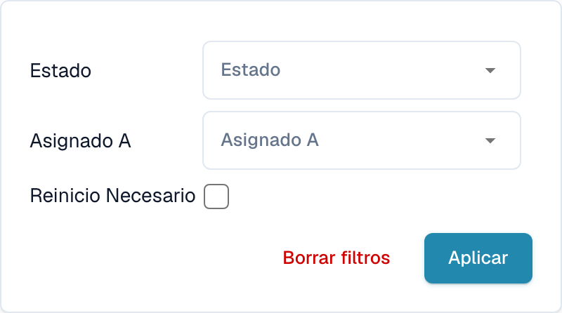

# Filtrar documentos

Abra el panel y seleccione el icono **Filtros** (tres barras deslizantes) al final derecho de la barra de búsqueda. Puede limitar la lista por **Estado**, **Asignado a** o **Reinicio necesario**.

<figure><figcaption>
Filtros del panel por asignación y necesidad de reinicio.
</figcaption></figure>

1. Seleccione el estado o responsable previsto.
2. Marque **Reinicio necesario** si solo desea revisar esos documentos.
3. Seleccione **Aplicar** para usar los filtros.
4. Use **Borrar filtros** para quitar las restricciones seleccionadas.

Las opciones de fecha dependen de la configuración y de la vista. Compruebe los filtros activos antes de interpretar el número de documentos.
