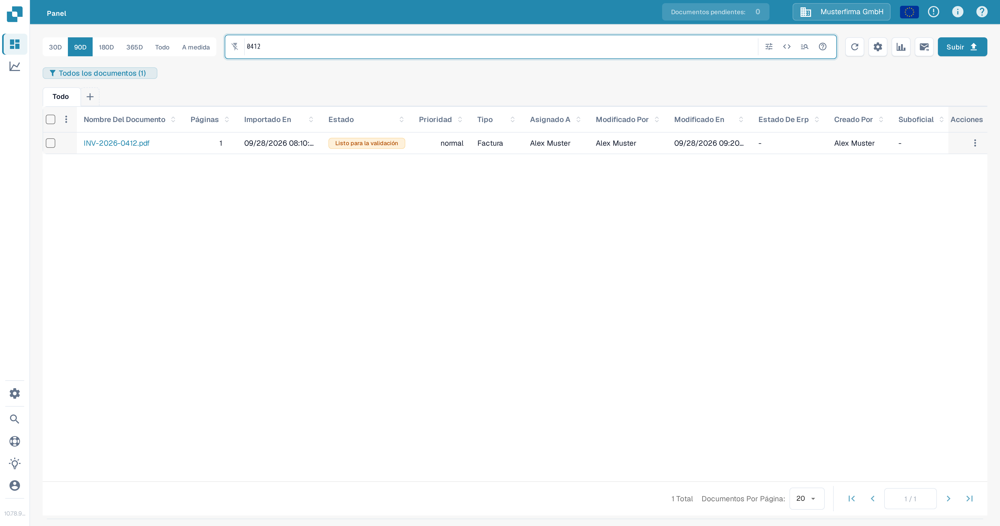
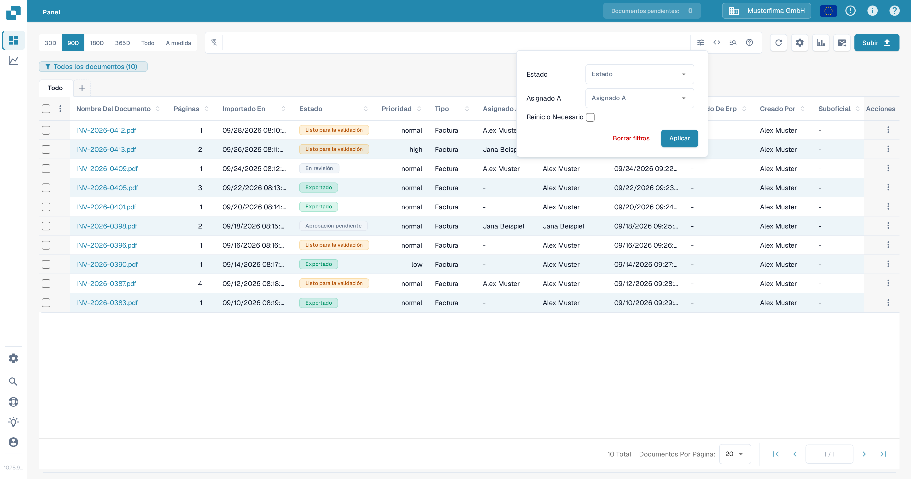
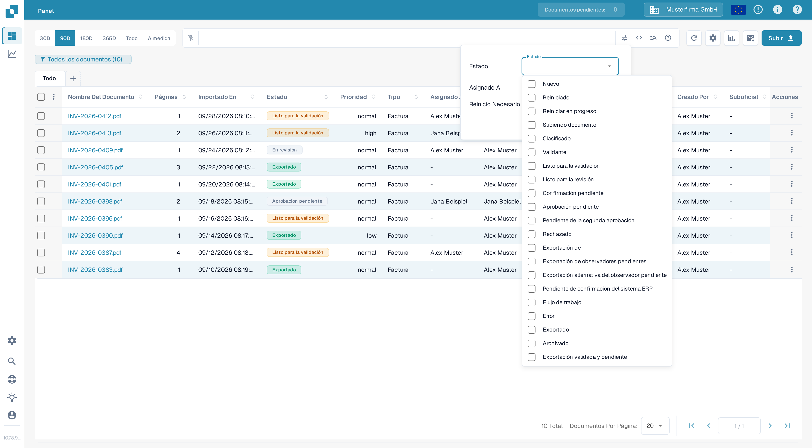
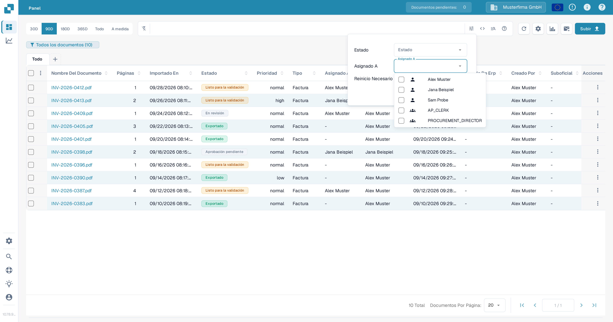
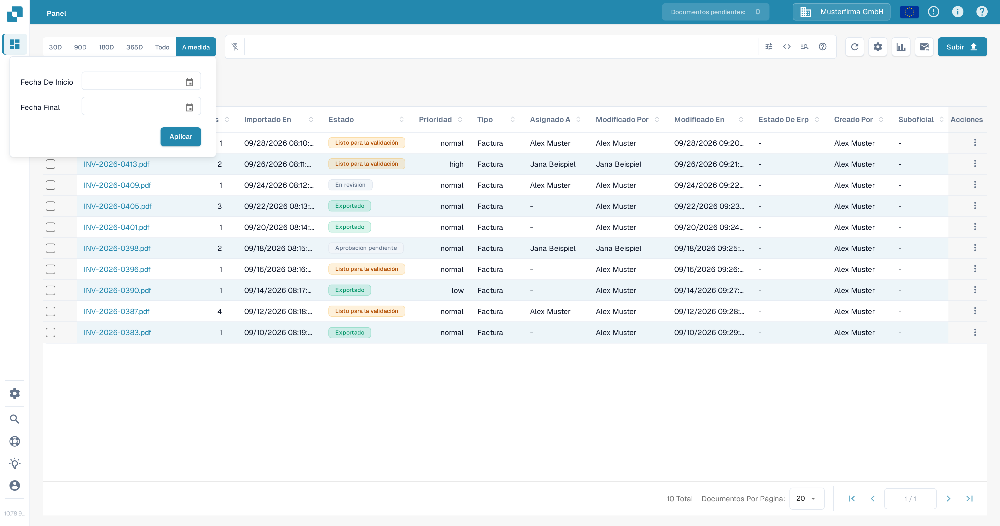
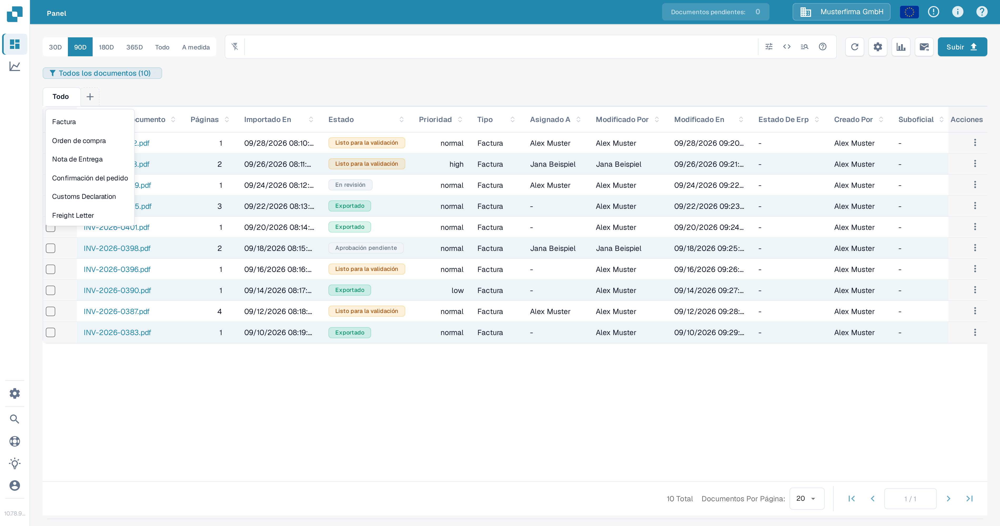
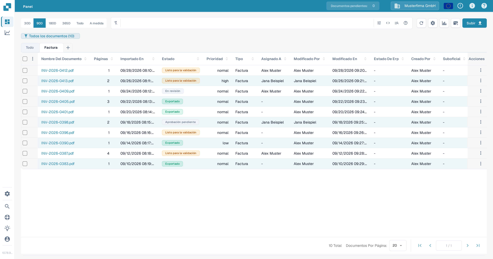

# Filtrado de documentos

Usa la barra de búsqueda del Panel, el panel de filtros, el rango de fechas y las pestañas de tipo de documento para acortar la lista de documentos. Los controles funcionan juntos: un documento debe coincidir con la búsqueda y los filtros activos para permanecer en la tabla.

## Buscar un documento por nombre

1. Abre el **Panel**.
2. Escribe parte del nombre de un documento en la barra de búsqueda situada encima de la tabla y pulsa **Enter**. El contador de la insignia del Panel y la tabla se actualizan para mostrar los documentos coincidentes.
3. Sustituye el término de búsqueda cuando quieras buscar otro documento. Para búsquedas por campo y la sintaxis de búsqueda, consulta [Búsqueda rápida](quick-search.md).

<figure><figcaption>Una búsqueda por nombre de documento acorta la lista de documentos de prueba.</figcaption></figure>

## Filtrar por estado, asignación o necesidad de reinicio

1. Selecciona el icono de **Filtros** (controles deslizantes) en el extremo derecho de la barra de búsqueda.
2. Elige uno o varios valores de **Estado**. Puedes seleccionar varios estados a la vez.
3. En **Asignado A**, selecciona los usuarios cuyos documentos quieres ver. Si tu organización tiene activados los permisos de grupo, los grupos también pueden aparecer en esta misma lista. No hay un campo **Asignado al grupo** aparte en este panel.
4. Selecciona **Reinicio Necesario** para mostrar los documentos que necesitan un reinicio.
5. Selecciona **Aplicar**. Selecciona **Borrar filtros** en este panel para quitar estas selecciones; el texto de búsqueda y el rango de fechas son controles independientes.

<figure><figcaption>El panel de filtros actual tiene tres criterios y dos acciones.</figcaption></figure>

<figure><figcaption>Selecciona los estados de procesamiento que necesites.</figcaption></figure>

<figure><figcaption>Selecciona un usuario en Asignado A.</figcaption></figure>

Para saber qué significa cada estado de procesamiento, consulta [Estado del Documento](document-status.md).

## Elegir un rango de fechas de importación

Encima de la barra de búsqueda, selecciona **30D**, **90D**, **180D**, **365D** o **Todo** para cambiar el rango de fechas de importación. Selecciona **A medida**, elige **Fecha De Inicio** y **Fecha Final** y, a continuación, selecciona **Aplicar** para un rango concreto. La opción actual aparece resaltada.

<figure><figcaption>Usa A medida cuando los rangos de fechas predefinidos no encajen.</figcaption></figure>

## Usar las pestañas de tipo de documento

1. Selecciona **+** junto a **Todo**. El menú muestra los tipos de documento disponibles para tu organización.
2. Selecciona un tipo, por ejemplo **Factura**, para añadir su pestaña. Después selecciona la nueva pestaña para filtrar la tabla por ese tipo. **Todo** elimina la restricción de tipo sin borrar la pestaña.
3. Para quitar la pestaña de un tipo, selecciona su **×**. La pestaña **Todo** no se puede quitar.

<figure><figcaption>Añade una pestaña de tipo de documento desde el menú del signo más.</figcaption></figure>

<figure><figcaption>Elige la pestaña para aplicar el filtro de tipo; usa × para quitar la pestaña.</figcaption></figure>

Si el menú **+** no muestra tipos, pide a un administrador que compruebe qué tipos de documento están activos para tu organización. Consulta [Document Types](../../../administration-and-setup/settings/global-settings/document-types/README.md). Para guardar una combinación de filtros y reutilizarla más tarde, consulta [Paneles personales](personal-dashboards.md).
