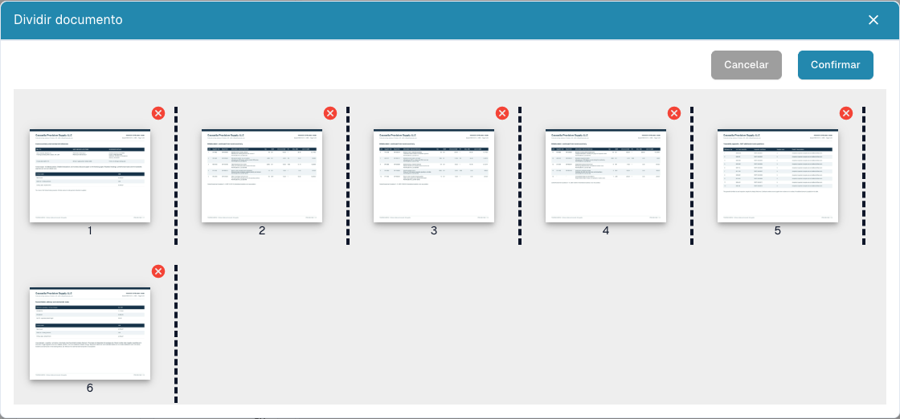

# Dividir un PDF y ordenar sus páginas

<figure><figcaption>
Miniaturas, separadores y controles de eliminación antes de enviar una división.
</figcaption></figure>

Utilice la división manual cuando un PDF contenga varios documentos independientes. Por ejemplo: factura A en páginas 1–3, factura B en páginas 4–7 y albarán en páginas 8–10. Cada documento debe continuar por separado.

## Antes de empezar

Necesita permisos de edición y un documento de varias páginas. Conserve el original. Resuelva cualquier bloqueo con la persona responsable antes de modificarlo.

## Paso a paso

1. Abra el documento desde el panel y revise todas las páginas originales.
2. En el visor, abra el menú de opciones adicionales y seleccione la división del documento.
3. Compruebe las miniaturas numeradas. Marque los separadores después de la última página de cada documento; en el ejemplo, después de las páginas **3** y **7**.
4. Arrastre las miniaturas para corregir su orden. Vuelva a comprobar orden y separadores.
5. Quite una página mediante la **cruz roja** solo si debe excluirse. Una página separadora vacía puede sobrar; un desglose fiscal o un anexo puede ser necesario.
6. Seleccione **Confirmar**, lea la confirmación y continúe cuando los grupos sean correctos. **Cancelar** permite salir sin enviar la división.
7. Abra cada documento resultante en el panel. Compruebe primera y última página, número de páginas, tipo y valores extraídos.

## Comprobar e investigar

Cada página original debe pertenecer a un documento previsto o haberse excluido deliberadamente. Dividir no demuestra que la extracción, aprobación o exportación al ERP haya terminado correctamente.

Si falta la opción, compruebe páginas, permisos, bloqueo y estado. Sin separadores ni cambios de orden o eliminaciones, puede aparecer un aviso de que no hay cambios seleccionados. Tras un error, revise el panel antes de repetir una operación de resultado incierto.

Consulte [Combinar documentos](document-merging.md) y [Clasificación y extracción](../../../administration-and-setup/settings/document-processing/classification-and-extraction/README.md) para la división automática por código de barras.
