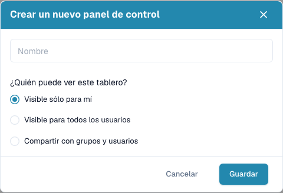

# Paneles personales

Un panel guardado es una vista con nombre de su lista de trabajo: búsqueda, filtros, tipo de documento, orden y columnas visibles. Al abrirlo se restaura todo a la vez, de modo que las tareas recurrentes no se configuran de nuevo. Un panel solo cambia cómo se muestran los documentos y nunca los documentos mismos.

## Crear un panel

1. Prepare la vista que desea conservar. Introduzca la búsqueda en la barra de búsqueda, use los **Filtros rápidos** del selector de campos, los **Filtros**, una pestaña de tipo de documento, el orden de la tabla y las columnas.

2. Abra el botón de vista bajo el campo de búsqueda. Muestra la vista activa y cuántos documentos coinciden ahora, por ejemplo **Todos los documentos (5986)**.

3. Elija **Crear un nuevo panel de control**.

4. Asigne un nombre claro y decida quién puede usar la vista:
   * **Visible sólo para mí** mantiene la vista privada.
   * **Visible para todos los usuarios** la pone a disposición de todas las personas de su organización.
   * **Compartir con grupos y usuarios** muestra las dos listas **Grupos** y **Seleccionar usuario**, para que indique grupos concretos o personas individuales.

5. Elija **Guardar**. El botón de vista cambia al nuevo panel y muestra su nombre y el número de documentos.

<figure><figcaption>
Cree un panel con nombre y elija quién puede verlo.
</figcaption></figure>

La visibilidad decide quién puede **usar** la vista. No concede acceso a documentos: cada persona sigue viendo solo los documentos para los que tiene permiso.

## Cambiar de vista o modificarla

Elija un panel guardado en el botón de vista o vuelva al **Panel de control predeterminado**, la vista no guardada de todos los documentos. El último panel abierto sigue activo al recargar la página.

Tras modificar un panel cargado —también si solo cambia columnas— el botón de vista ofrece **Guardar cambios en el panel**. Así guarda el cambio con el mismo nombre. La acción permanece desactivada si no hay cambios o si el panel pertenece a otra persona; una vista compartida no se puede sobrescribir, cree una propia.

## Cambiar el nombre de un panel o volver a compartirlo

Sitúe el puntero sobre un panel propio en el botón de vista para mostrar sus iconos **Editar** y **Borrar**. Seleccione el lápiz para abrir **Editar panel de control** y cambiar el nombre o la visibilidad. El diálogo muestra las mismas tres opciones que al crear el panel.

## Eliminar un panel

Seleccione el icono de la papelera de un panel propio y confirme con **Borrar**. Quitar una vista no elimina los documentos a los que hacía referencia. Un panel que otra persona ha compartido con usted se puede abrir y usar, pero no se puede modificar ni eliminar en su cuenta.
