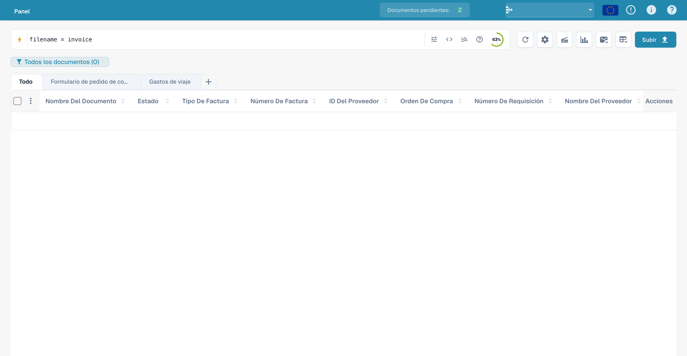
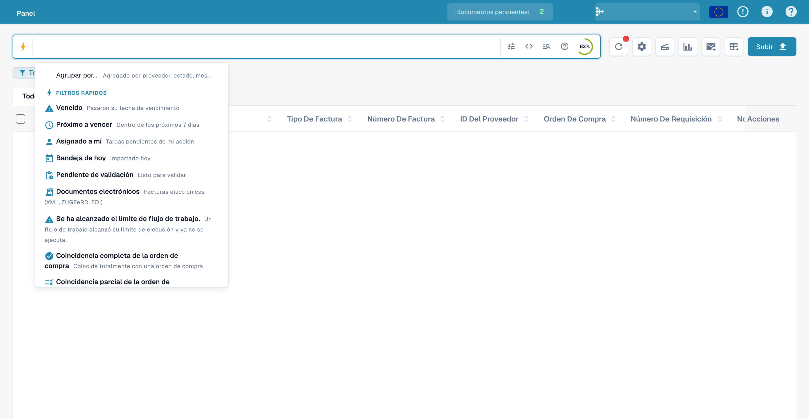
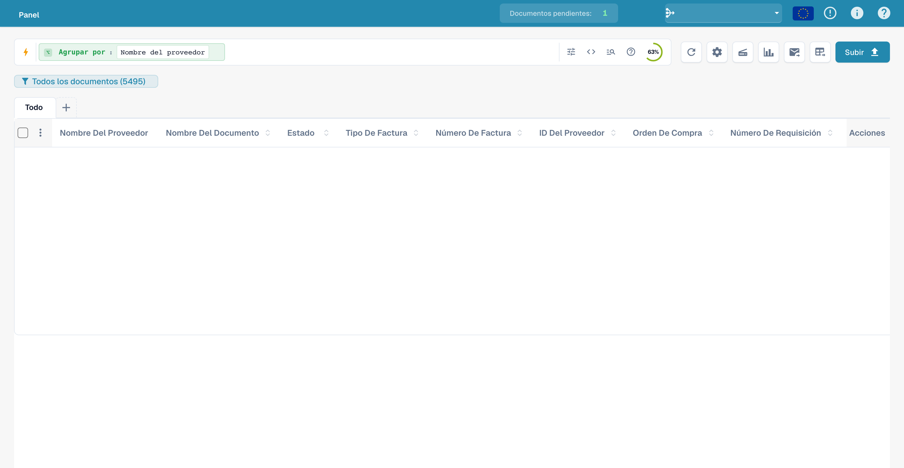
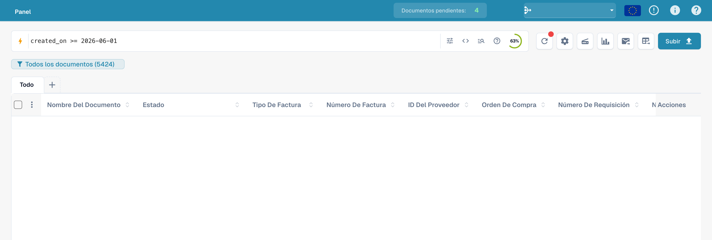
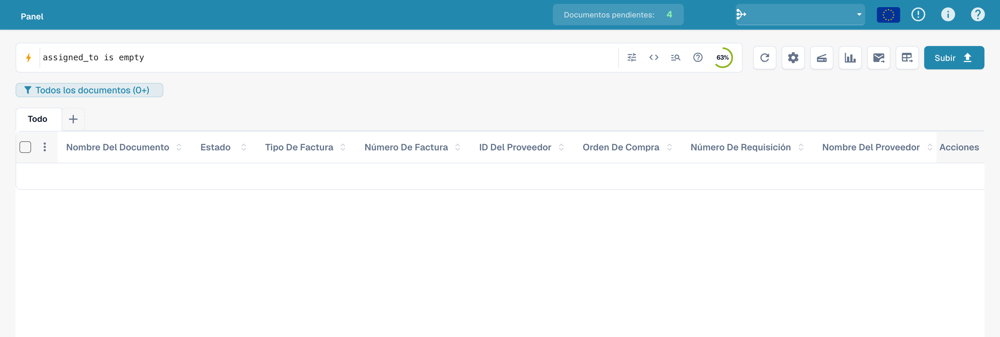
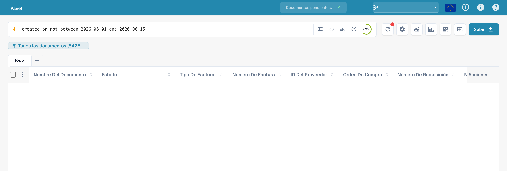
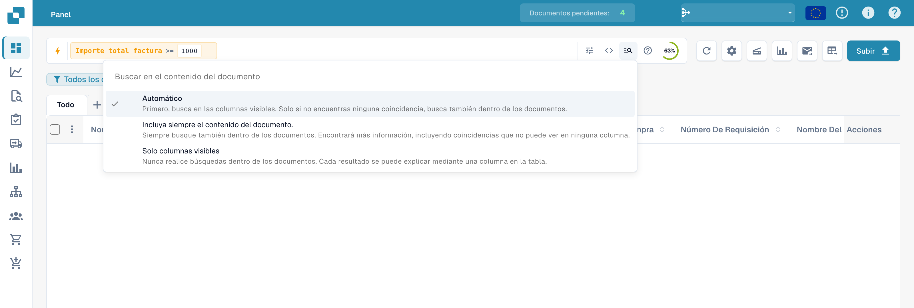
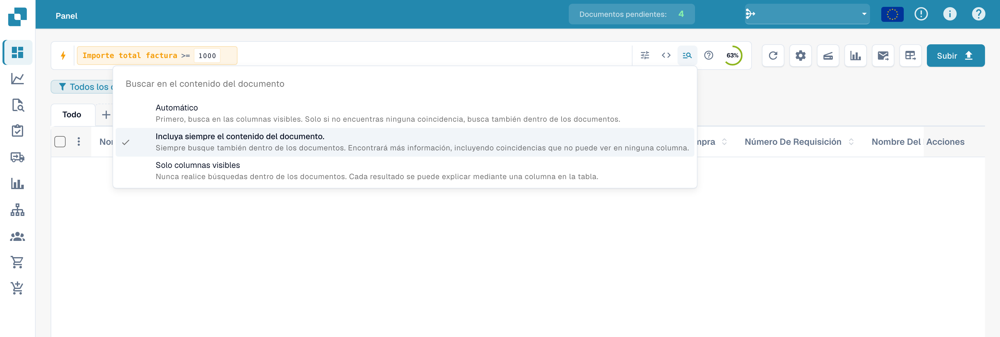
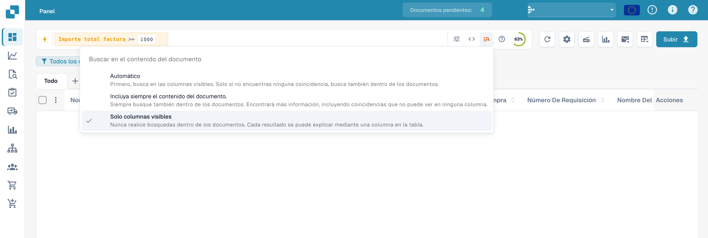

# Búsqueda rápida

La **Búsqueda rápida** (Quick Search) es la forma más rápida de encontrar documentos en el Dashboard. Usted
escribe lo que busca —un nombre, un estado, un importe, una fecha— y la
lista de documentos se filtra al instante.

Esta guía está organizada igual que se construye la búsqueda:

1. **Campos estándar** — las columnas que tiene todo documento (nombre del
   documento, estado, fechas). Siempre disponibles.
2. **Campos de texto completo** — contenido extraído (proveedor, pedido de
   compra, número de factura, importes, líneas). Disponibles cuando la búsqueda
   de texto completo está activada.
3. **Operadores, atajos y recetas** — la referencia completa para cuando ya se
   sienta cómodo con la búsqueda.

> No tiene que memorizar nada: haga clic en la barra de búsqueda y elija un campo y
> un valor de la lista; la Búsqueda rápida construye la consulta por usted. Los ejemplos siguientes
> muestran también la forma escrita, para que pueda copiarlos directamente.

<figure><figcaption><p>Búsqueda rápida en el panel en español.</p></figcaption></figure>

---

## Cómo funciona la barra de búsqueda — chips, barra de herramientas y vista en bruto

Antes de ver los campos, conviene saber cómo está organizada la barra.

### Las condiciones se convierten en chips

A medida que completa una condición (un campo, un operador y un valor), la Búsqueda rápida
la convierte en un **chip** —una pastilla de color dentro de la barra— y empieza
uno nuevo. Un chip muestra el **campo**, el **operador** y el **valor**, con una **×** para
quitarlo. Los chips tienen un color según dónde residen los datos:

| Color del chip | Tipo de campo |
|----------------|---------------|
| **Azul** | Columna estándar (nombre del documento, estado, fechas) |
| **Naranja** | Campo de texto completo / extraído (proveedor, importe, número de factura) |
| **Morado** | Búsqueda vectorial (semántica) |
| **Verde** | Búsqueda de texto OCR |

Haga clic en un chip para editarlo (vuelve a expandirse como texto); haga clic en la **×** para eliminarlo.
Varios chips combinados se leen como **AND** de forma predeterminada.

### La barra de herramientas

En el extremo derecho de la barra:

- **ⓘ Help** — abre la referencia integrada **Búsqueda en el panel de control: campos y sintaxis**
  con todos los campos, operadores y atajos disponibles en su espacio de trabajo.
- **Filters (tune)** — un panel rápido con los filtros habituales de Status / User / Restart,
  con **Borrar filtros** y **Aplicar**.
- **Resumen del índice** — un pequeño anillo de progreso que muestra qué parte de su índice de texto completo
  está construida (solo se muestra cuando la búsqueda de texto completo está activada).

### Vista estándar frente a vista en bruto

Normalmente la barra muestra su consulta como chips (**vista estándar**). Cambie a la **vista en bruto**
para ver y editar la consulta como texto sin formato (p. ej.
`status=ready_for_validation AND supplier_name=Test`); es útil para copiar,
compartir o escribir directamente una consulta larga. Su consulta se conserva al cambiar de vista y
se recuerda al recargar el Dashboard.

---

## Parte 1 — Campos estándar

Los campos estándar son las columnas propias del documento. Están **siempre disponibles**,
tenga o no activada la búsqueda de texto completo.

### Buscar documentos por nombre

El nombre del documento es la búsqueda más habitual. Hay tres maneras de comparar —
todas **sin distinguir mayúsculas de minúsculas**:

#### `=` → empieza por

```
filename=invoice
```

Encuentra los documentos cuyo nombre **empieza por** "invoice". La comparación ignora las mayúsculas y minúsculas, así que
todos estos coinciden con `filename=invoice`:

```
Invoice.pdf   iNVoice.pdf   iNvoiCE.pdf   INVOICE.pdf
Invoice.xml   iNVoice.xml   iNvoiCE.edi   …
```

**No** coincide con `XYZ_Invoice.pdf` (ahí "invoice" está en medio; use
`:` para eso).

<figure><figcaption><p>Entrada de una consulta por nombre de archivo.</p></figcaption></figure>

#### `:` → contiene (en cualquier posición)

```
filename:invoice
```

Utilice `:` para encontrar la palabra en **cualquier parte** del nombre: `2026_Invoice.pdf`,
`vietnam_einvoice_sample.xml`, `scan_invoice_copy.pdf`.

<figure><figcaption><p>Búsqueda por parte del nombre de archivo: filename:invoice.</p></figcaption></figure>

#### `="…"` → empieza *o* termina por

```
filename="invoice"
```

Las comillas hacen que `=` coincida con los nombres que **empiezan o terminan** con el valor;
resulta práctico para un código inicial o la terminación de un archivo.

> **Los tres en una línea:** `=` → empieza por · `:` → contiene · `="…"` →
> empieza o termina por. Todos ignoran las mayúsculas y minúsculas. Puede ver este resumen
> en cualquier momento con el **icono de ayuda** de la barra de búsqueda (siguiente sección).

### Buscar documentos por estado

```
status=ready_for_validation
```

El estado es una lista fija, por lo que `=` es una coincidencia **exacta** y la barra ofrece un selector de valores
cuando escribe `status=`.

<figure><figcaption><p>Filtro por el estado técnico ready_for_validation.</p></figcaption></figure>

### Buscar documentos por fecha

```
created_on>2026-05-25
```

Utilice `>`, `<`, `>=`, `<=` para rangos de fechas. También puede usar fechas **relativas**:
`today()`, `today()-7` (últimos 7 días), `today()+30` (próximos 30 días).

<figure><figcaption><p>Búsqueda de documentos posteriores al 25 de mayo de 2026.</p></figcaption></figure>

### Buscar documentos por subtipo de factura

```
invoice_sub_type="Cost Invoice"
```

El subtipo de factura es una lista fija (por ejemplo **Factura de costos** o **Purchase
Invoice**), por lo que `=` es una coincidencia **exacta** y la barra ofrece un selector de valores cuando
escribe `invoice_sub_type=`. Utilice `invoice_sub_type!="Cost Invoice"` para
todo excepto ese subtipo.

---

## Parte 2 — Campos de texto completo

Los campos de texto completo buscan en el **contenido extraído** de sus documentos: proveedor,
pedido de compra, número de factura, importes, líneas. Aparecen en **naranja**
y están disponibles cuando la **búsqueda de texto completo está activada** para su organización. Las
reglas de coincidencia son exactamente las mismas que para los campos de texto estándar
(`=` empieza por, `:` contiene, `="…"` empieza o termina por).

### Buscar documentos de un proveedor

```
supplier_name=Test
```

Empieza por, sobre el nombre de proveedor extraído. Utilice `supplier_name:Ejemplo` para buscar
en cualquier posición, o `supplier_name:"Proveedor Ejemplo"` para escribir entre comillas un valor con espacios.

<figure><figcaption><p>Ejemplo de consulta de proveedor: supplier_name=Test.</p></figcaption></figure>

### Buscar documentos por pedido de compra

```
purchase_order=PO
```

Empieza por, sobre el número de pedido extraído; ideal para un prefijo de pedido.

<figure><figcaption><p>Ejemplo de consulta de pedido: purchase_order=PO.</p></figcaption></figure>

### Buscar documentos por importe

```
total_amount>5000
```

Utilice `>`, `<`, `>=`, `<=` o `between 100 and 500` para un intervalo.

<figure><figcaption><p>Búsqueda de importes totales superiores a 5000.</p></figcaption></figure>

Para una ventana de valores, utilice `between`:

```
total_amount between 1000 and 5000
```

Es una forma abreviada de `total_amount>=1000 AND total_amount<=5000`.

<figure><figcaption><p>Intervalo de importe total entre 1000 y 5000.</p></figcaption></figure>

### Encontrar lo que falta

```
supplier_name=""
```

`=""` significa "este campo **no está establecido**"; `supplier_name!=""` significa "tiene
algún proveedor".

<figure><figcaption><p>Búsqueda de documentos sin nombre de proveedor.</p></figcaption></figure>

La misma comprobación de presencia funciona con cualquier campo; por ejemplo, documentos que todavía
no tienen un código de asignación AP:

```
ap_assignment_code=""
```

<figure><figcaption><p>Búsqueda de documentos sin asignación AP.</p></figcaption></figure>

---

## Filtros inteligentes — con un clic

En la parte superior del menú desplegable de la Búsqueda rápida (haga clic en la barra de búsqueda) encontrará los
**Filtros rápidos**: búsquedas predefinidas que se aplican con un solo clic. Cada una
es simplemente un atajo de una consulta que también podría escribir usted mismo:

| Smart Filter | Encuentra | Equivale a escribir |
|--------------|-----------|---------------------|
| ⚠️ **Vencido** | Vencidos | `invoice_due_date<today()` |
| 🕐 **Próximo a vencer** | Dentro de los próximos 7 días | `invoice_due_date<=today()+7` |
| 👤 **Asignado a mí** | Elementos que esperan su acción | `assigned_to=<you>` |
| 📅 **Bandeja de hoy** | Importados hoy | `imported_on>=today()` |
| 📋 **Pendiente de validación** | Listos para validar | `status=ready_for_validation` |
| 🧾 **Documentos electrónicos** | Facturas electrónicas (XML, ZUGFeRD, EDI) | `is_edoc=true` |
| ✅ **Coincidencia completa de la orden de compra** | Totalmente conciliados con un pedido de compra | `po_match_status=full_matched` |
| ➗ **Coincidencia parcial de la orden de compra** | Parcialmente conciliados con un pedido de compra | `po_match_status=partial_matched` |
| 📉 **Bajo coincidencia de PO** | Cantidad o precio unitario por debajo del pedido de compra | `po_match_status=under_matched` |

Los tres filtros de **PO match** y los campos de texto completo requieren que la búsqueda de texto completo
esté activada para su organización.

<figure><figcaption><p>Ayuda de consultas y filtros de la búsqueda rápida.</p></figcaption></figure>

---

## Agrupar resultados

En lugar de una lista plana, puede **agrupar** los resultados por cualquier campo: proveedor,
estado, tipo de documento, suborganización o un intervalo de fechas. Añada una agrupación desde
la barra de búsqueda:

```
group by supplier_name
```

La lista muestra entonces **encabezados de grupo** plegables, cada uno con el nombre del grupo y
un **recuento** (p. ej. *Proveedor Ejemplo (12)*). Haga clic en un encabezado para expandir o contraer ese
grupo. En los campos de fecha puede agrupar por **día, semana o mes**.

<figure><figcaption><p>Entrada de una consulta con agrupación por proveedor.</p></figcaption></figure>

La agrupación se combina con cualquier filtro: `status=ready_for_validation group by
supplier_name` agrupa solo los documentos que coinciden. Al hacer clic en un grupo se **profundiza**:
se aplica el valor de ese grupo como filtro y vuelve a la
lista plana de esa selección.

---

## Parte 3 — Operadores, conectores, atajos

### La ayuda integrada

El **icono de ayuda** de la barra de búsqueda abre una referencia completa de todos los campos,
operadores y atajos disponibles en su espacio de trabajo, incluido cuáles son
estándar y cuáles de texto completo.

<figure><figcaption><p>La ayuda integrada <strong>Dashboard Search — Fields &#38; Syntax</strong>, con todos los operadores y la forma en que se comparan los valores.</p></figcaption></figure>

### Cómo coincide `=`, según el tipo de campo

Toda la comparación de texto ignora las mayúsculas y minúsculas.

| Tipo de campo | Ejemplo | `=` significa |
|---------------|---------|---------------|
| Texto (nombre, proveedor, pedido de compra) | `filename=invoice` | **empieza por** |
| Texto, en cualquier posición | `filename:invoice` | **contiene** |
| Texto, al principio *o* al final | `filename="invoice"` | **empieza o termina por** |
| Estado / tipo / PO match (listas fijas) | `status=finished` | **exacto** |
| Identificadores (número de factura, id de proveedor) | `invoice_number=INV-100` | **exacto** |
| Número | `total_amount>5000` | rango (`> < >= <= between`) |
| Fecha | `created_on>2026-01-01` | rango + `today()±N` |

### Operadores

| Operador | Significado |
|----------|-------------|
| `=` | empieza por (texto) / exacto (lista, número, fecha) |
| `:` | contiene (texto, en cualquier posición) |
| `="…"` | empieza o termina por (texto) |
| `!=` | lo contrario de `=` |
| `>` `<` `>=` `<=` | mayor / menor que |
| `between … and …` | rango inclusivo |
| `field=""` / `field!=""` | está vacío / está establecido |
| `today()`, `today()-7`, `today()+30` | fechas relativas |

### Conectores

Combine condiciones con **AND** (ambas verdaderas), **OR** (cualquiera de las dos), **NOT** y
paréntesis `( … )` para agrupar:

```
status=ready_for_validation AND supplier_name=Test
(status=error OR status=failed) AND created_on>today()-1
```

<figure><figcaption><p>Combinación de condiciones de estado y proveedor con AND.</p></figcaption></figure>

### Atajos

Formulaciones más cortas de las mismas consultas; utilice la que le resulte más legible:

| Atajo | Equivale a | Descripción |
|-------|------------|-------------|
| `total_amount gt 5000` | `total_amount>5000` | Alias en palabras para los operadores de comparación (`gt`/`gte`/`lt`/`lte`/`eq`/`ne`) |
| `due_date > today` | `due_date>today()` | `today` / `yesterday` / `tomorrow` sin paréntesis |
| `imported_on this_week` | `imported_on>=today()-7 AND imported_on<=today()` | Periodos relativos (`this_week`, `last_week`, `this_month`, …) |
| `ap_assignment_code is empty` | `ap_assignment_code=""` | Si un campo tiene algún valor |
| `status:open` | `status=ready_for_validation` | Etiqueta de estado sencilla (`open`/`closed`/`failed`/`done`) |
| `total_amount not between 100, 200` | `total_amount<100 OR total_amount>200` | Valor fuera de una ventana |
| `status in (finished, error)` | `status=finished OR status=error` | Coincide con cualquier valor de una lista |
| `not status=finished` | `status!=finished` | Niega cualquier predicado |
| `filename contains rechnung` | `filename:rechnung` | Comparación de cadenas (`contains`/`starts_with`/`ends_with`) |
| `total_amount > 5k` | `total_amount>5000` | Sufijo de importe `k` (×1 000), `M` (×1 000 000) |
| `overdue` | `invoice_due_date<today() AND status!=finished` | Facturas sin pagar y vencidas |
| `#INV-1234` | `invoice_id:INV-1234` | Prefijo al estilo Twitter para el id de factura |
| `@User` | `assigned_to:User` | Prefijo al estilo Twitter para el responsable asignado |
| `$5000+` | `total_amount>=5000` | Prefijo `$` para umbrales de importe |

### Ejemplos de consultas

Las imágenes muestran las consultas introducidas en la interfaz española. Los datos de los documentos están ocultos. Una imagen de la barra de filtros no demuestra un número concreto de resultados.

#### Operador de comparación escrito

```
created_on gt 2026-05-25
```

<figure><figcaption><p>Operador gt en una consulta de fecha.</p></figcaption></figure>

#### Antes de hoy

```
created_on < today()
```

<figure><figcaption><p>Comparación de created_on con today().</p></figcaption></figure>

#### Desde una fecha de creación

```
created_on >= 2026-06-01
```

<figure><figcaption><p>Filtro de fecha desde el 1 de junio de 2026.</p></figcaption></figure>

#### Sin responsable asignado

```
assigned_to is empty
```

<figure><figcaption><p>Búsqueda de documentos sin responsable asignado.</p></figcaption></figure>

#### Filtro por estado

```
status=ready_for_validation
```

<figure><figcaption><p>Ejemplo de filtro de estado en la búsqueda rápida.</p></figcaption></figure>

#### Fuera de un intervalo de fechas

```
created_on not between 2026-06-01 and 2026-06-15
```

<figure><figcaption><p>Búsqueda de fechas fuera del intervalo indicado.</p></figcaption></figure>

#### Estados alternativos

```
status=ready_for_validation OR status=exported
```

<figure><figcaption><p>Combinación de dos estados técnicos con OR.</p></figcaption></figure>

#### Excluir una condición de proveedor

```
NOT supplier_name=Test
```

<figure><figcaption><p>Exclusión de un proveedor con NOT.</p></figcaption></figure>

#### Parte del nombre de archivo

```
filename:invoice
```

<figure><figcaption><p>Búsqueda de un término dentro del nombre de archivo.</p></figcaption></figure>

#### Consulta por número de factura

```
invoice_number=INV
```

<figure><figcaption><p>Ejemplo de consulta por invoice_number.</p></figcaption></figure>

#### Asignación vacía

```
assigned_to=""
```

<figure><figcaption><p>Filtro por responsable vacío: assigned_to=&quot;&quot;.</p></figcaption></figure>

#### Consulta por moneda

```
currency=EUR
```

<figure><figcaption><p>Búsqueda de documentos en euros: currency=EUR.</p></figcaption></figure>

#### Vencimiento anterior a hoy

```
invoice_due_date<today()
```

<figure><figcaption><p>Filtro por fecha de vencimiento anterior a today().</p></figcaption></figure>

#### Umbral de importe

```
total_amount>=1000
```

<figure><figcaption><p>Filtro por un importe total mínimo de 1000.</p></figcaption></figure>

## Incluir el contenido del documento

El menú **Buscar en el contenido del documento** determina si la búsqueda incluye el contenido del documento. Esta elección es independiente de prefijos técnicos como `vector:`, `ocr:` o `ai:`.

### Automático

Busca primero en las columnas visibles. Si no encuentra coincidencias, incluye el contenido cuando la organización dispone de las funciones necesarias.

<figure><figcaption><p>Inclusión automática del contenido de los documentos en la búsqueda.</p></figcaption></figure>

### Incluir siempre el contenido

Incluye explícitamente el contenido de los documentos. La organización debe disponer de las funciones de búsqueda correspondientes.

<figure><figcaption><p>Inclusión permanente del contenido de los documentos en la búsqueda.</p></figcaption></figure>

### Solo columnas visibles

Limita la búsqueda a las columnas visibles del panel.

<figure><figcaption><p>Búsqueda limitada a las columnas visibles.</p></figcaption></figure>

### Recetas

| Quiere… | Escriba esto |
|---------|--------------|
| Listos para validar, totalmente conciliados | `status=ready_for_validation AND po_match_status=full_matched` |
| Este proveedor, esta semana | `supplier_name=Test AND created_on>today()-7` |
| Facturas vencidas de alto importe | `total_amount>5000 AND invoice_due_date<today()` |
| Dos proveedores a la vez | `supplier_name=EjemploA OR supplier_name=EjemploB` |
| Documentos con error de hoy | `(status=error OR status=failed) AND created_on>today()-1` |
| Notas de crédito electrónicas | `is_edoc=true AND sub_doc_type=CREDIT_NOTE` |
| Por prefijo de pedido de compra | `purchase_order=PO-2026` |

> Los campos en naranja (texto completo) requieren que la **búsqueda de texto completo** esté activada para su
> organización. Un `%` o `_` literal en un valor se trata como un carácter normal.
