# Búsqueda rápida

La **Búsqueda rápida** (Quick Search) es la forma más rápida de encontrar documentos en el Dashboard. Usted
escribe lo que busca —un nombre, un estado, un importe, una fecha— y la
lista de documentos se filtra al instante.

Esta guía está organizada igual que se construye la búsqueda:

1. **Campos estándar** — las columnas que tiene todo documento (nombre del
   documento, estado, fechas). Siempre disponibles.
2. **Campos de texto completo** — contenido extraído (proveedor, pedido de
   compra, número de factura, importes, líneas). Disponibles cuando la búsqueda
   de texto completo está activada.
3. **Operadores, atajos y recetas** — la referencia completa para cuando ya se
   sienta cómodo con la búsqueda.

> No tiene que memorizar nada: haga clic en la barra de búsqueda y elija un campo y
> un valor de la lista; la Búsqueda rápida construye la consulta por usted. Los ejemplos siguientes
> muestran también la forma escrita, para que pueda copiarlos directamente.

<figure>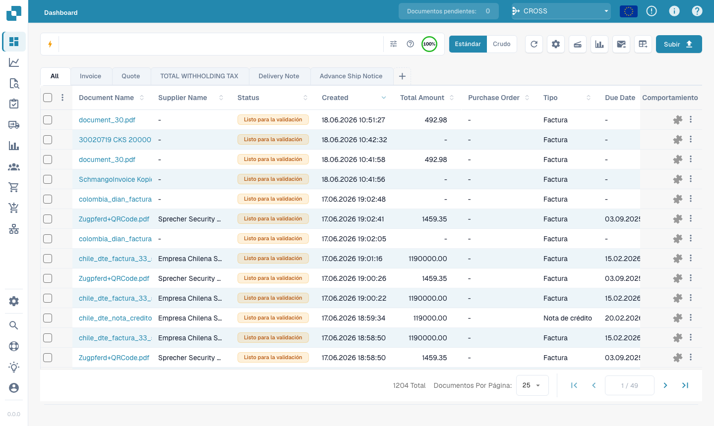<figcaption><p>La barra de Búsqueda rápida en la parte superior del Dashboard.</p></figcaption></figure>

---

## Cómo funciona la barra de búsqueda — chips, barra de herramientas y vista en bruto

Antes de ver los campos, conviene saber cómo está organizada la barra.

### Las condiciones se convierten en chips

A medida que completa una condición (un campo, un operador y un valor), la Búsqueda rápida
la convierte en un **chip** —una pastilla de color dentro de la barra— y empieza
uno nuevo. Un chip muestra el **campo**, el **operador** y el **valor**, con una **×** para
quitarlo. Los chips tienen un color según dónde residen los datos:

| Color del chip | Tipo de campo |
|----------------|---------------|
| **Azul** | Columna estándar (nombre del documento, estado, fechas) |
| **Naranja** | Campo de texto completo / extraído (proveedor, importe, número de factura) |
| **Morado** | Búsqueda vectorial (semántica) |
| **Verde** | Búsqueda de texto OCR |

Haga clic en un chip para editarlo (vuelve a expandirse como texto); haga clic en la **×** para eliminarlo.
Varios chips combinados se leen como **AND** de forma predeterminada.

### La barra de herramientas

En el extremo derecho de la barra:

- **ⓘ Help** — abre la referencia integrada **Dashboard Search — Fields & Syntax**
  con todos los campos, operadores y atajos disponibles en su espacio de trabajo.
- **Filters (tune)** — un panel rápido con los filtros habituales de Status / User / Restart,
  con **Clear filters** y **Apply**.
- **Index ring** — un pequeño anillo de progreso que muestra qué parte de su índice de texto completo
  está construida (solo se muestra cuando la búsqueda de texto completo está activada).

### Vista estándar frente a vista en bruto

Normalmente la barra muestra su consulta como chips (**vista estándar**). Cambie a la **vista en bruto**
para ver y editar la consulta como texto sin formato (p. ej.
`status=ready_for_validation AND supplier_name=Test`); es útil para copiar,
compartir o escribir directamente una consulta larga. Su consulta se conserva al cambiar de vista y
se recuerda al recargar el Dashboard.

---

## Parte 1 — Campos estándar

Los campos estándar son las columnas propias del documento. Están **siempre disponibles**,
tenga o no activada la búsqueda de texto completo.

### Buscar documentos por nombre

El nombre del documento es la búsqueda más habitual. Hay tres maneras de comparar —
todas **sin distinguir mayúsculas de minúsculas**:

#### `=` → empieza por

```
filename=invoice
```

Encuentra los documentos cuyo nombre **empieza por** "invoice". La comparación ignora las mayúsculas y minúsculas, así que
todos estos coinciden con `filename=invoice`:

```
Invoice.pdf   iNVoice.pdf   iNvoiCE.pdf   INVOICE.pdf
Invoice.xml   iNVoice.xml   iNvoiCE.edi   …
```

**No** coincide con `XYZ_Invoice.pdf` (ahí "invoice" está en medio; use
`:` para eso).

<figure>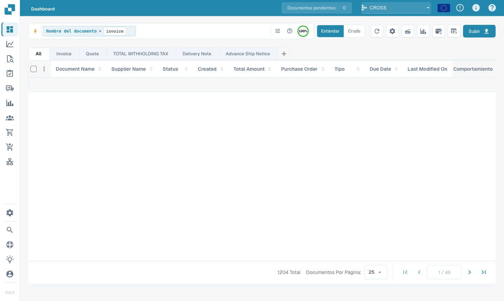<figcaption><p><code>filename=invoice</code> — solo los nombres que <strong>empiezan por</strong> "invoice", con cualquier combinación de mayúsculas y minúsculas (<code>Invoice.pdf</code>, <code>iNVoice.pdf</code>, <code>INVOICE_2026.pdf</code> … todos coinciden). Compárelo con <code>:</code> más abajo.</p></figcaption></figure>

#### `:` → contiene (en cualquier posición)

```
filename:invoice
```

Utilice `:` para encontrar la palabra en **cualquier parte** del nombre: `2026_Invoice.pdf`,
`vietnam_einvoice_sample.xml`, `scan_invoice_copy.pdf`.

<figure>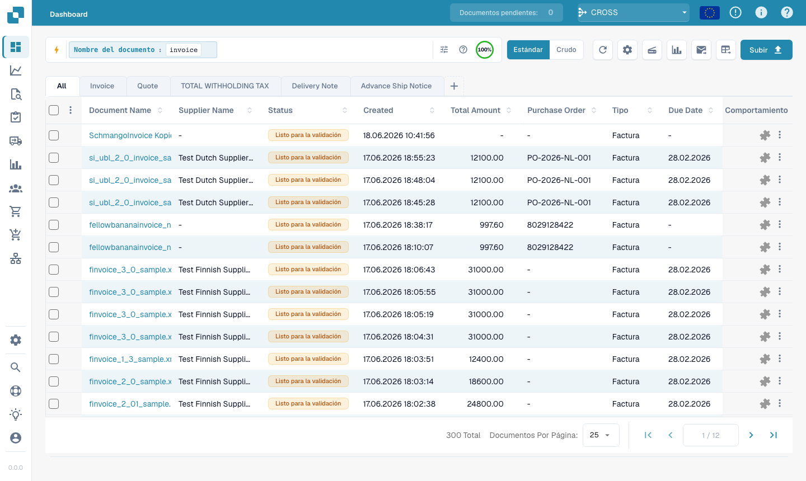<figcaption><p><code>filename:invoice</code> — coincide con la palabra en cualquier parte del nombre del documento.</p></figcaption></figure>

#### `="…"` → empieza *o* termina por

```
filename="invoice"
```

Las comillas hacen que `=` coincida con los nombres que **empiezan o terminan** con el valor;
resulta práctico para un código inicial o la terminación de un archivo.

> **Los tres en una línea:** `=` → empieza por · `:` → contiene · `="…"` →
> empieza o termina por. Todos ignoran las mayúsculas y minúsculas. Puede ver este resumen
> en cualquier momento con el **icono de ayuda** de la barra de búsqueda (siguiente sección).

### Buscar documentos por estado

```
status=ready_for_validation
```

El estado es una lista fija, por lo que `=` es una coincidencia **exacta** y la barra ofrece un selector de valores
cuando escribe `status=`.

<figure>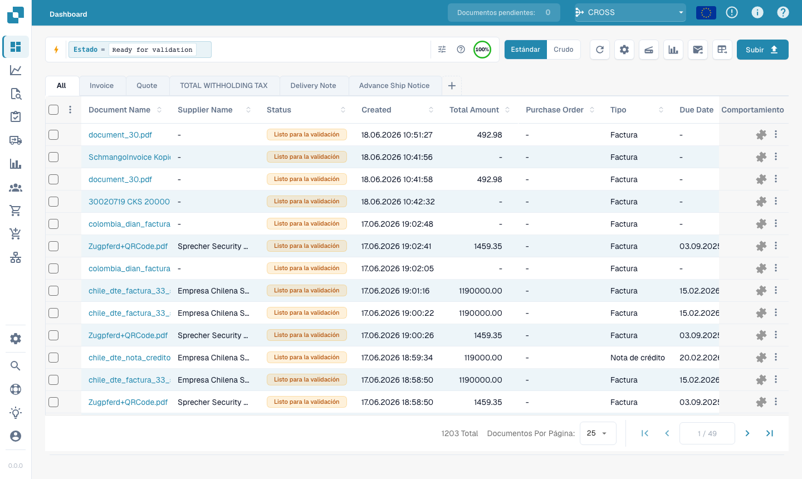<figcaption><p><code>status=ready_for_validation</code> — coincidencia exacta en un campo de lista fija.</p></figcaption></figure>

### Buscar documentos por fecha

```
created_on>2026-05-25
```

Utilice `>`, `<`, `>=`, `<=` para rangos de fechas. También puede usar fechas **relativas**:
`today()`, `today()-7` (últimos 7 días), `today()+30` (próximos 30 días).

<figure>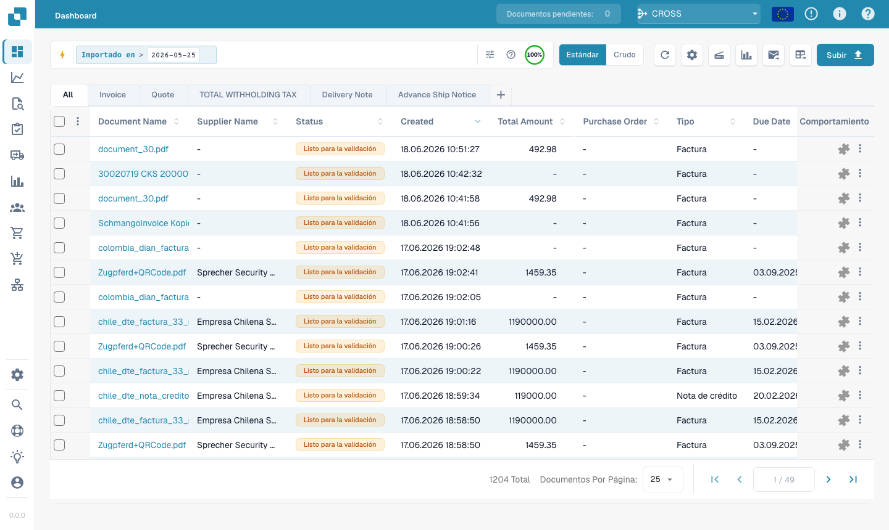<figcaption><p><code>created_on&#62;2026-05-25</code> — documentos creados después de una fecha.</p></figcaption></figure>

### Buscar documentos por subtipo de factura

```
invoice_sub_type="Cost Invoice"
```

El subtipo de factura es una lista fija (por ejemplo **Cost Invoice** o **Purchase
Invoice**), por lo que `=` es una coincidencia **exacta** y la barra ofrece un selector de valores cuando
escribe `invoice_sub_type=`. Utilice `invoice_sub_type!="Cost Invoice"` para
todo excepto ese subtipo.

---

## Parte 2 — Campos de texto completo

Los campos de texto completo buscan en el **contenido extraído** de sus documentos: proveedor,
pedido de compra, número de factura, importes, líneas. Aparecen en **naranja**
y están disponibles cuando la **búsqueda de texto completo está activada** para su organización. Las
reglas de coincidencia son exactamente las mismas que para los campos de texto estándar
(`=` empieza por, `:` contiene, `="…"` empieza o termina por).

### Buscar documentos de un proveedor

```
supplier_name=Test
```

Empieza por, sobre el nombre de proveedor extraído. Utilice `supplier_name:fuji` para buscar
en cualquier posición, o `supplier_name:"Ruiz Foods"` para escribir entre comillas un valor con espacios.

<figure>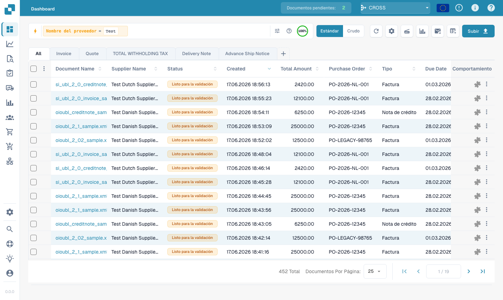<figcaption><p><code>supplier_name=Test</code> — el proveedor de cada resultado empieza por "Test".</p></figcaption></figure>

### Buscar documentos por pedido de compra

```
purchase_order=PO
```

Empieza por, sobre el número de pedido extraído; ideal para un prefijo de pedido.

<figure><figcaption><p><code>purchase_order=PO</code> — documentos cuyo número de pedido empieza por "PO".</p></figcaption></figure>

### Buscar documentos por importe

```
total_amount>5000
```

Utilice `>`, `<`, `>=`, `<=` o `between 100 and 500` para un intervalo.

<figure>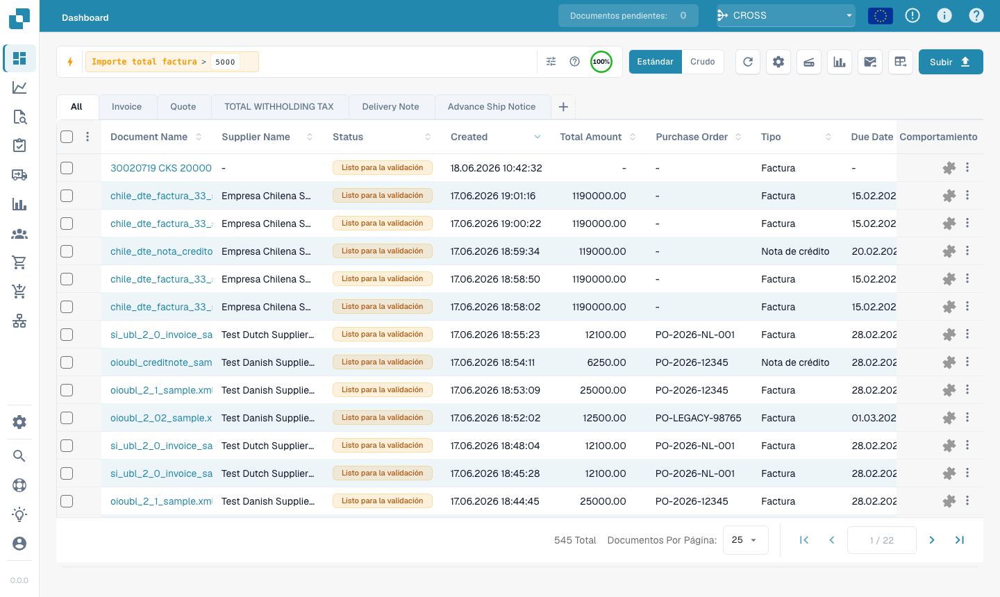<figcaption><p><code>total_amount&#62;5000</code> — facturas por encima de 5.000.</p></figcaption></figure>

Para una ventana de valores, utilice `between`:

```
total_amount between 1000 and 5000
```

Es una forma abreviada de `total_amount>=1000 AND total_amount<=5000`.

<figure>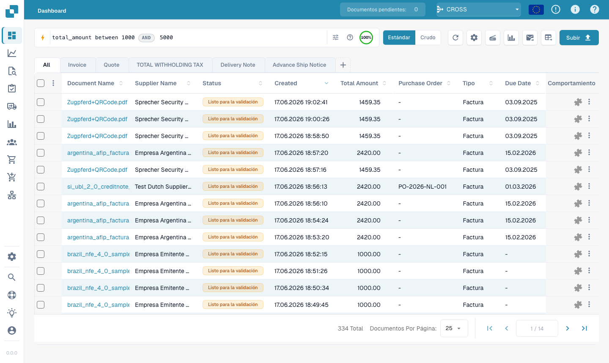<figcaption><p><code>total_amount between 1000 and 5000</code> — todos los resultados quedan dentro de la ventana.</p></figcaption></figure>

### Encontrar lo que falta

```
supplier_name=""
```

`=""` significa "este campo **no está establecido**"; `supplier_name!=""` significa "tiene
algún proveedor".

<figure>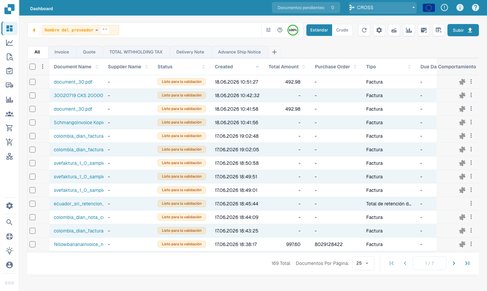<figcaption><p><code>supplier_name=""</code> — documentos que todavía no tienen proveedor.</p></figcaption></figure>

La misma comprobación de presencia funciona con cualquier campo; por ejemplo, documentos que todavía
no tienen un código de asignación AP:

```
ap_assignment_code=""
```

<figure>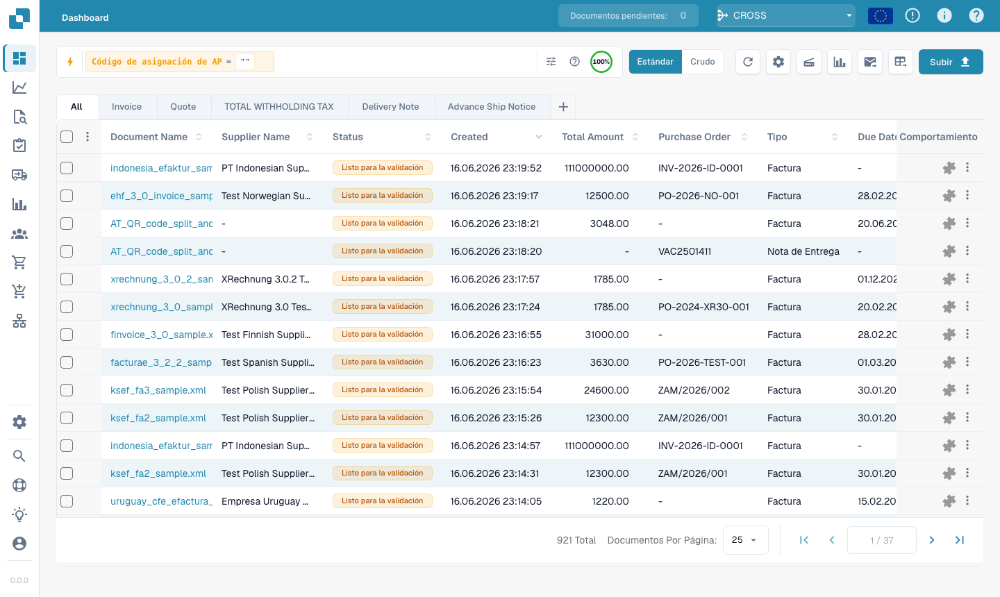<figcaption><p><code>ap_assignment_code=""</code> — documentos que no tienen código de asignación AP. Utilice <code>ap_assignment_code!=""</code> para los que sí lo tienen.</p></figcaption></figure>

---

## Filtros inteligentes — con un clic

En la parte superior del menú desplegable de la Búsqueda rápida (haga clic en la barra de búsqueda) encontrará los
**Smart Filters**: búsquedas predefinidas que se aplican con un solo clic. Cada una
es simplemente un atajo de una consulta que también podría escribir usted mismo:

| Smart Filter | Encuentra | Equivale a escribir |
|--------------|-----------|---------------------|
| ⚠️ **Overdue** | Vencidos | `invoice_due_date<today()` |
| 🕐 **Due soon** | Dentro de los próximos 7 días | `invoice_due_date<=today()+7` |
| 👤 **Assigned to me** | Elementos que esperan su acción | `assigned_to=<you>` |
| 📅 **Today's inbox** | Importados hoy | `imported_on>=today()` |
| 📋 **Pending validation** | Listos para validar | `status=ready_for_validation` |
| 🧾 **Electronic documents** | Facturas electrónicas (XML, ZUGFeRD, EDI) | `is_edoc=true` |
| ✅ **Full PO match** | Totalmente conciliados con un pedido de compra | `po_match_status=full_matched` |
| ➗ **Partial PO match** | Parcialmente conciliados con un pedido de compra | `po_match_status=partial_matched` |
| 📉 **Under PO match** | Cantidad o precio unitario por debajo del pedido de compra | `po_match_status=under_matched` |

Los tres filtros de **PO match** y los campos de texto completo requieren que la búsqueda de texto completo
esté activada para su organización.

<figure><figcaption><p>Los Smart Filters en la parte superior del menú desplegable de la Búsqueda rápida: un clic aplica el filtro (Overdue, Due soon, Assigned to me, Today's inbox, Pending validation, Electronic documents, Full / Partial / Under PO match).</p></figcaption></figure>

---

## Agrupar resultados

En lugar de una lista plana, puede **agrupar** los resultados por cualquier campo: proveedor,
estado, tipo de documento, suborganización o un intervalo de fechas. Añada una agrupación desde
la barra de búsqueda:

```
group by supplier_name
```

La lista muestra entonces **encabezados de grupo** plegables, cada uno con el nombre del grupo y
un **recuento** (p. ej. *Ruiz Foods (12)*). Haga clic en un encabezado para expandir o contraer ese
grupo. En los campos de fecha puede agrupar por **día, semana o mes**.

<figure>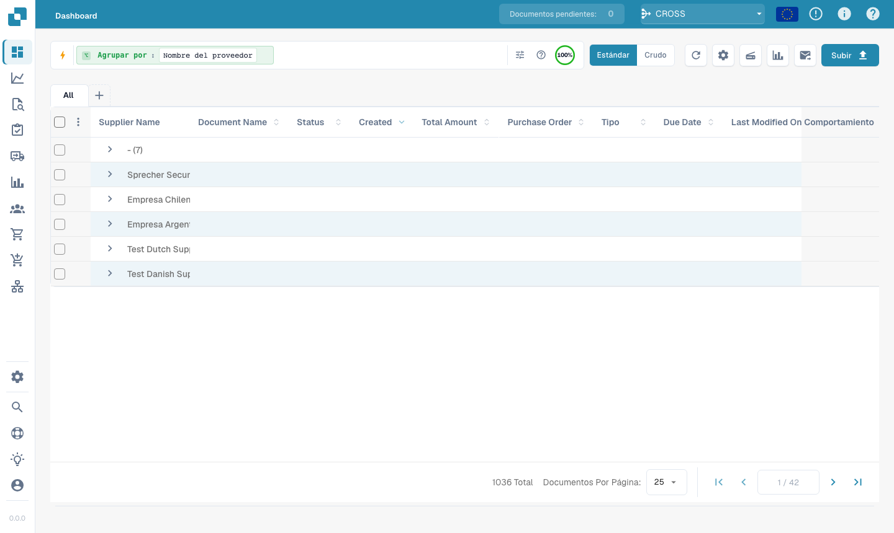<figcaption><p><code>group by supplier_name</code> — los resultados se agrupan en un encabezado expandible por proveedor.</p></figcaption></figure>

La agrupación se combina con cualquier filtro: `status=ready_for_validation group by
supplier_name` agrupa solo los documentos que coinciden. Al hacer clic en un grupo se **profundiza**:
se aplica el valor de ese grupo como filtro y vuelve a la
lista plana de esa selección.

---

## Parte 3 — Operadores, conectores, atajos

### La ayuda integrada

El **icono de ayuda** de la barra de búsqueda abre una referencia completa de todos los campos,
operadores y atajos disponibles en su espacio de trabajo, incluido cuáles son
estándar y cuáles de texto completo.

<figure><figcaption><p>La ayuda integrada <strong>Dashboard Search — Fields &#38; Syntax</strong>, con todos los operadores y la forma en que se comparan los valores.</p></figcaption></figure>

### Cómo coincide `=`, según el tipo de campo

Toda la comparación de texto ignora las mayúsculas y minúsculas.

| Tipo de campo | Ejemplo | `=` significa |
|---------------|---------|---------------|
| Texto (nombre, proveedor, pedido de compra) | `filename=invoice` | **empieza por** |
| Texto, en cualquier posición | `filename:invoice` | **contiene** |
| Texto, al principio *o* al final | `filename="invoice"` | **empieza o termina por** |
| Estado / tipo / PO match (listas fijas) | `status=finished` | **exacto** |
| Identificadores (número de factura, id de proveedor) | `invoice_number=INV-100` | **exacto** |
| Número | `total_amount>5000` | rango (`> < >= <= between`) |
| Fecha | `created_on>2026-01-01` | rango + `today()±N` |

### Operadores

| Operador | Significado |
|----------|-------------|
| `=` | empieza por (texto) / exacto (lista, número, fecha) |
| `:` | contiene (texto, en cualquier posición) |
| `="…"` | empieza o termina por (texto) |
| `!=` | lo contrario de `=` |
| `>` `<` `>=` `<=` | mayor / menor que |
| `between … and …` | rango inclusivo |
| `field=""` / `field!=""` | está vacío / está establecido |
| `today()`, `today()-7`, `today()+30` | fechas relativas |

### Conectores

Combine condiciones con **AND** (ambas verdaderas), **OR** (cualquiera de las dos), **NOT** y
paréntesis `( … )` para agrupar:

```
status=ready_for_validation AND supplier_name=Test
(status=error OR status=failed) AND created_on>today()-1
```

<figure>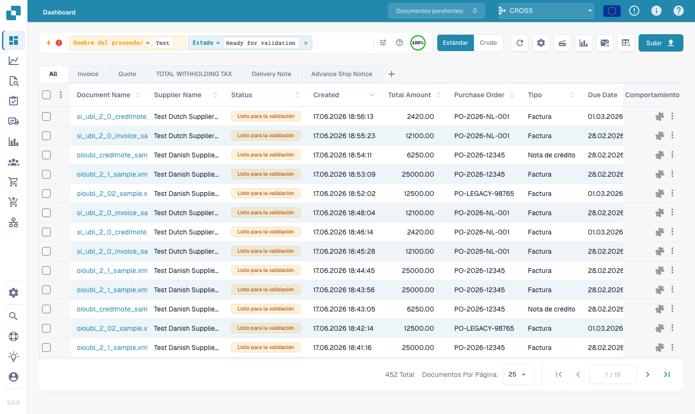<figcaption><p><code>status=ready_for_validation AND supplier_name=Test</code> — dos condiciones combinadas.</p></figcaption></figure>

### Atajos

Formulaciones más cortas de las mismas consultas; utilice la que le resulte más legible:

| Atajo | Equivale a | Descripción |
|-------|------------|-------------|
| `total_amount gt 5000` | `total_amount>5000` | Alias en palabras para los operadores de comparación (`gt`/`gte`/`lt`/`lte`/`eq`/`ne`) |
| `due_date > today` | `due_date>today()` | `today` / `yesterday` / `tomorrow` sin paréntesis |
| `imported_on this_week` | `imported_on>=today()-7 AND imported_on<=today()` | Periodos relativos (`this_week`, `last_week`, `this_month`, …) |
| `ap_assignment_code is empty` | `ap_assignment_code=""` | Si un campo tiene algún valor |
| `status:open` | `status=ready_for_validation` | Etiqueta de estado sencilla (`open`/`closed`/`failed`/`done`) |
| `total_amount not between 100, 200` | `total_amount<100 OR total_amount>200` | Valor fuera de una ventana |
| `status in (finished, error)` | `status=finished OR status=error` | Coincide con cualquier valor de una lista |
| `not status=finished` | `status!=finished` | Niega cualquier predicado |
| `filename contains rechnung` | `filename:rechnung` | Comparación de cadenas (`contains`/`starts_with`/`ends_with`) |
| `total_amount > 5k` | `total_amount>5000` | Sufijo de importe `k` (×1 000), `M` (×1 000 000) |
| `overdue` | `invoice_due_date<today() AND status!=finished` | Facturas sin pagar y vencidas |
| `#INV-1234` | `invoice_id:INV-1234` | Prefijo al estilo Twitter para el id de factura |
| `@User` | `assigned_to:User` | Prefijo al estilo Twitter para el responsable asignado |
| `$5000+` | `total_amount>=5000` | Prefijo `$` para umbrales de importe |

### Consulta de atajo + galería de resultados

Estos ejemplos muestran cada patrón de atajo con la consulta que se escribe y el resultado que muestra el Dashboard. El primer grupo utiliza campos estándar y funciona incluso cuando la búsqueda de texto completo no está activada. El segundo grupo utiliza campos exclusivos de texto completo, como el importe o la fecha de vencimiento de la factura.

#### Funciona sin texto completo

##### Alias de operadores

- Consulta: `created_on gt 2026-05-25`
- Equivale a: `created_on>2026-05-25`
- Resultado: filtra por Created posterior al 25 de mayo de 2026.

<figure>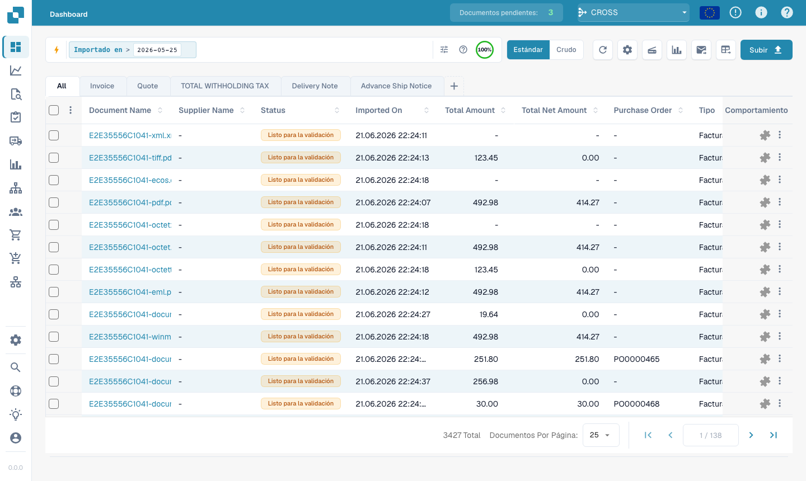<figcaption><p><code>created_on gt 2026-05-25</code> - Filtra por Created posterior al 25 de mayo de 2026.</p></figcaption></figure>

##### Palabras de fecha sin paréntesis

- Consulta: `created_on < today`
- Equivale a: `created_on<today()`
- Resultado: expande la palabra today a today().

<figure><figcaption><p><code>created_on &lt; today</code> - Expande la palabra today a today().</p></figcaption></figure>

##### Periodo relativo

- Consulta: `created_on this_month`
- Equivale a: `created_on>=first day of this month AND created_on<=last day of this month`
- Resultado: expande this_month a una ventana de fechas.

<figure>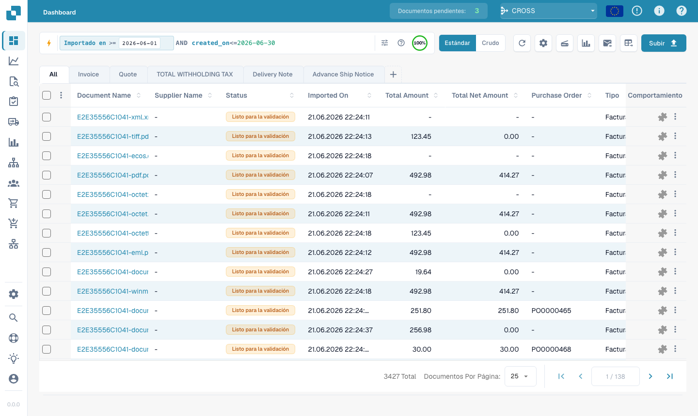<figcaption><p><code>created_on this_month</code> - Expande this_month a una ventana de fechas.</p></figcaption></figure>

##### Palabras para vacío o establecido

- Consulta: `assigned_to is empty`
- Equivale a: `assigned_to=""`
- Resultado: encuentra los documentos sin responsable asignado.

<figure>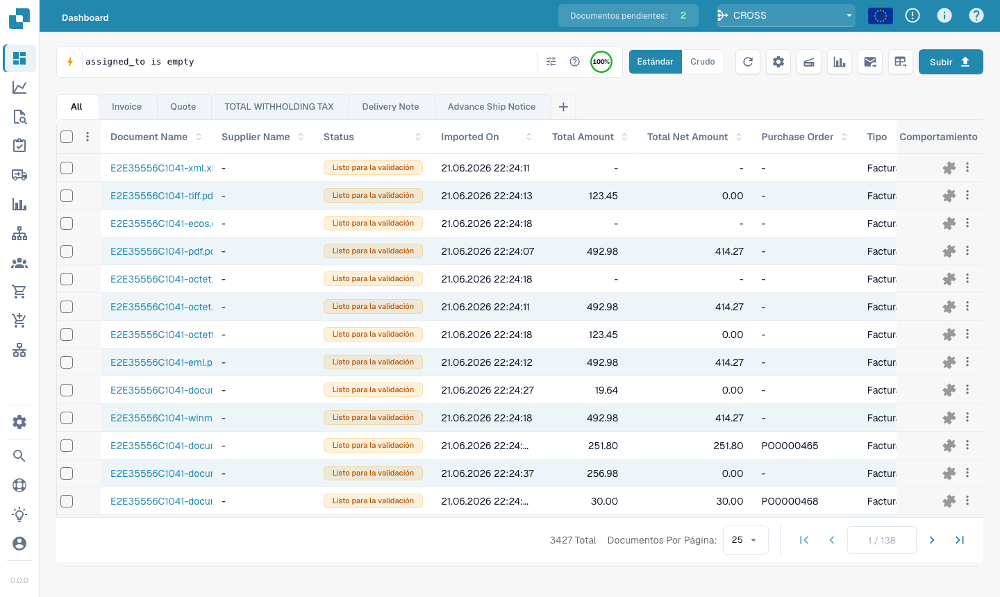<figcaption><p><code>assigned_to is empty</code> - Encuentra los documentos sin responsable asignado.</p></figcaption></figure>

##### Estado sencillo

- Consulta: `status:open`
- Equivale a: `status=ready_for_validation`
- Resultado: asigna open al estado de validación.

<figure>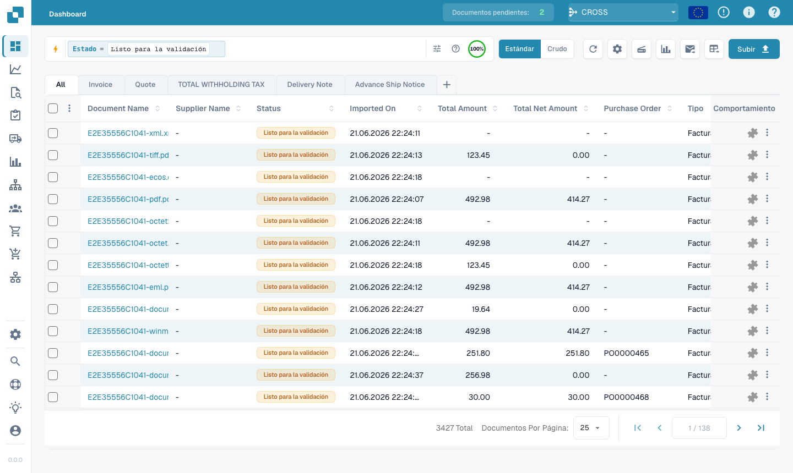<figcaption><p><code>status:open</code> - Asigna open al estado de validación.</p></figcaption></figure>

##### Not between

- Consulta: `created_on not between 2026-06-01, 2026-06-15`
- Equivale a: `(created_on<2026-06-01 OR created_on>2026-06-15)`
- Resultado: encuentra los valores fuera de una ventana de fechas.

<figure>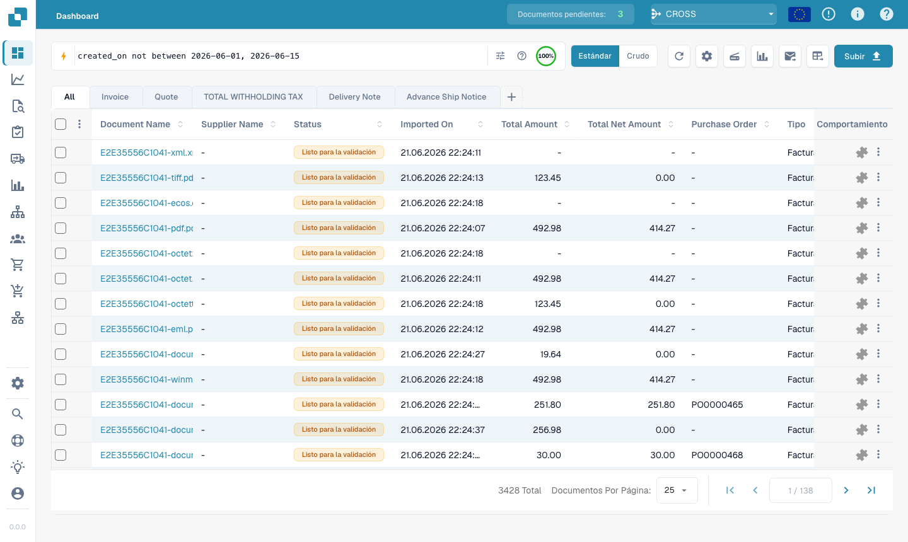<figcaption><p><code>created_on not between 2026-06-01, 2026-06-15</code> - Encuentra los valores fuera de una ventana de fechas.</p></figcaption></figure>

##### In-list

- Consulta: `status in (ready_for_validation, exported)`
- Equivale a: `status=ready_for_validation OR status=exported`
- Resultado: coincide con cualquiera de los estados indicados.

<figure><figcaption><p><code>status in (ready_for_validation, exported)</code> - Coincide con cualquiera de los estados indicados.</p></figcaption></figure>

##### Prefijo de negación

- Consulta: `not status=finished`
- Equivale a: `status!=finished`
- Resultado: invierte el predicado del estado finished.

<figure>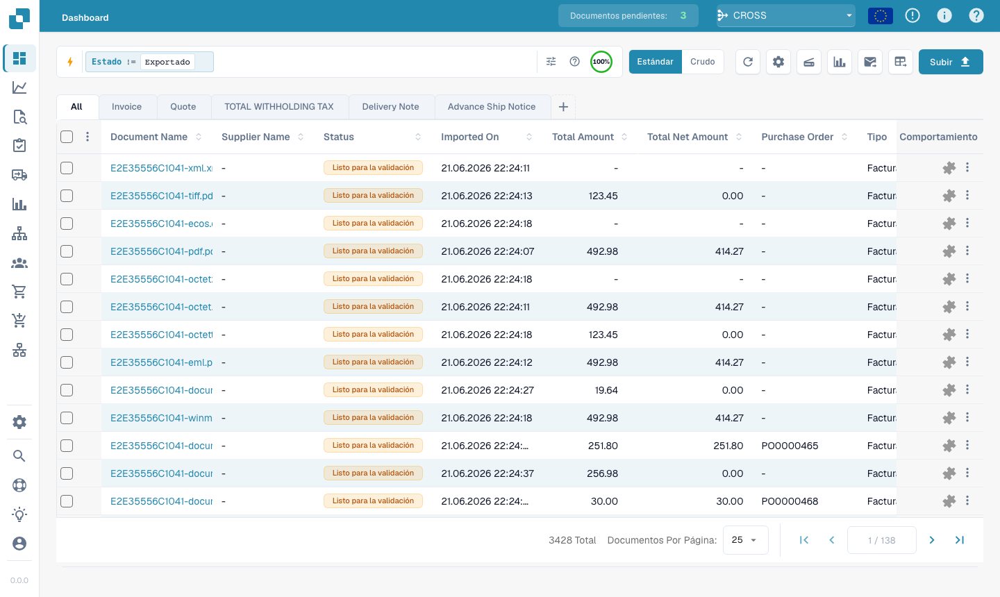<figcaption><p><code>not status=finished</code> - Invierte el predicado del estado finished.</p></figcaption></figure>

##### Cadena contiene

- Consulta: `filename contains E2E`
- Equivale a: `filename:E2E`
- Resultado: utiliza contains como búsqueda de subcadena en el nombre de archivo.

<figure><figcaption><p><code>filename contains E2E</code> - Utiliza contains como búsqueda de subcadena en el nombre de archivo.</p></figcaption></figure>

##### Prefijo de factura

- Consulta: `#INV-1234`
- Equivale a: `invoice_id:INV-1234`
- Resultado: asigna #... a una búsqueda por id de factura.

<figure>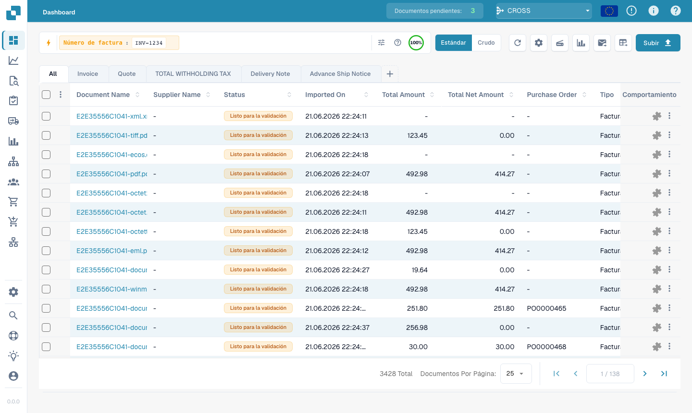<figcaption><p><code>#INV-1234</code> - Asigna #... a una búsqueda por id de factura.</p></figcaption></figure>

##### Prefijo de responsable

- Consulta: `@Daniel`
- Equivale a: `assigned_to:"Daniel"`
- Resultado: asigna @... a una búsqueda por nombre del responsable asignado.

<figure>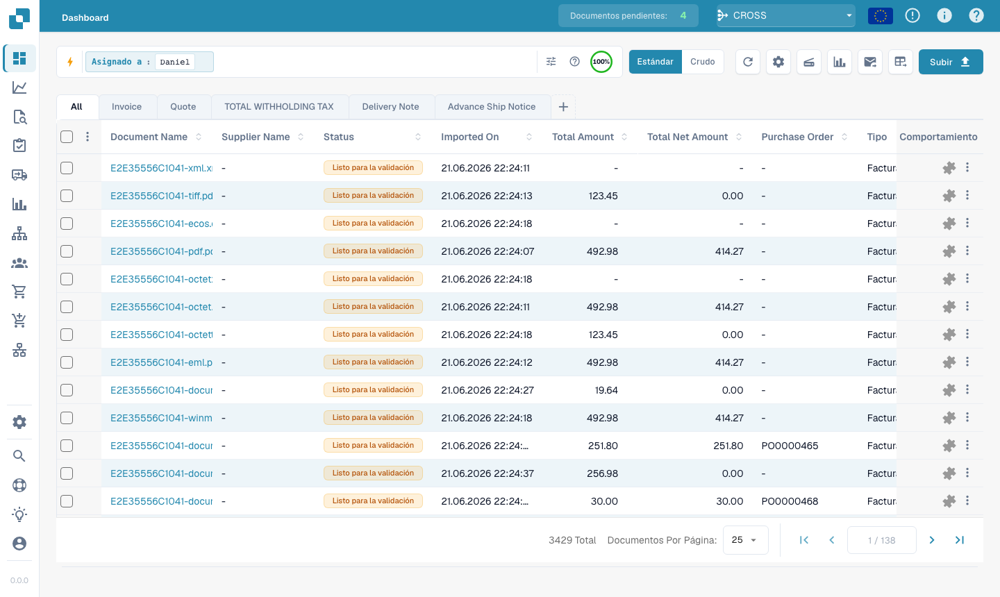<figcaption><p><code>@Daniel</code> - Asigna @... a una búsqueda por nombre del responsable asignado.</p></figcaption></figure>

#### Requiere búsqueda de texto completo

Si utiliza el mismo atajo con un campo exclusivo de texto completo, la consulta sigue requiriendo texto completo. Por ejemplo, `ap_assignment_code is empty` utiliza el mismo atajo de vacío/establecido que `assigned_to is empty`, pero el campo de asignación AP es exclusivo de texto completo.

##### Sufijo de importe

- Consulta: `total_amount > 5k`
- Equivale a: `total_amount>5000`
- Resultado: expande k a miles en un campo de importe.

<figure>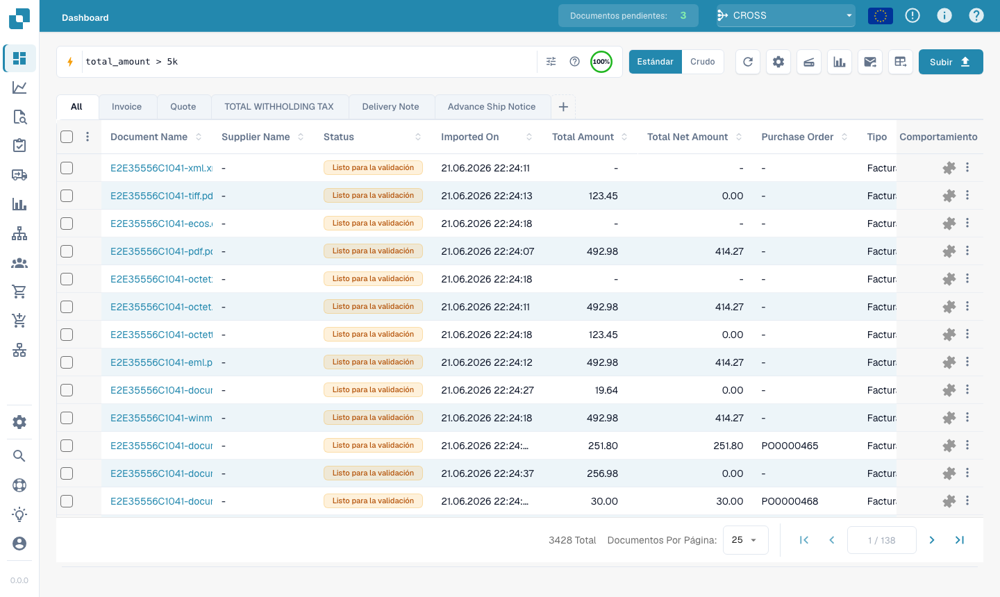<figcaption><p><code>total_amount &gt; 5k</code> - Expande k a miles en un campo de importe.</p></figcaption></figure>

##### Atajo overdue

- Consulta: `overdue`
- Equivale a: `invoice_due_date<today() AND status!=finished`
- Resultado: encuentra las facturas no finalizadas cuya fecha de vencimiento ya pasó.

<figure>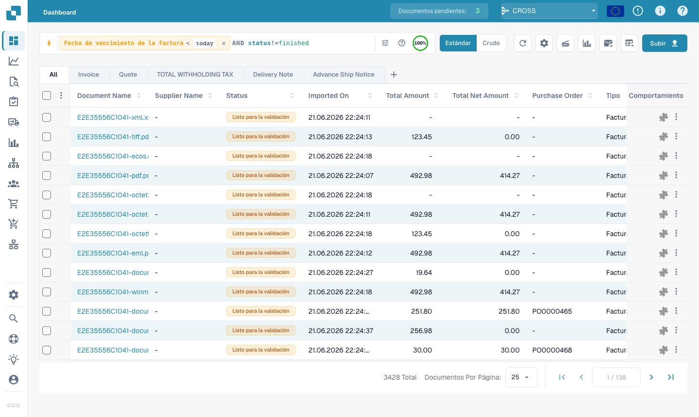<figcaption><p><code>overdue</code> - Encuentra las facturas no finalizadas cuya fecha de vencimiento ya pasó.</p></figcaption></figure>

##### Prefijo de importe

- Consulta: `$5000+`
- Equivale a: `total_amount>=5000`
- Resultado: asigna $...+ a un umbral de importe.

<figure><figcaption><p><code>$5000+</code> - Asigna $...+ a un umbral de importe.</p></figcaption></figure>

---

## Parte 4 — Modos de búsqueda avanzados

Además de la búsqueda por campos, tres modos con prefijo buscan en el propio contenido del documento.

### Búsqueda vectorial (semántica) — `vector:`

Busca por **significado**, no por texto exacto; es útil para "encontrar documentos sobre XYZ".
Requiere el módulo Vector; se aplica al contenido del documento.

```
vector: invoices about office supplies
vector: shipping delays with Hamburg port
```

<figure>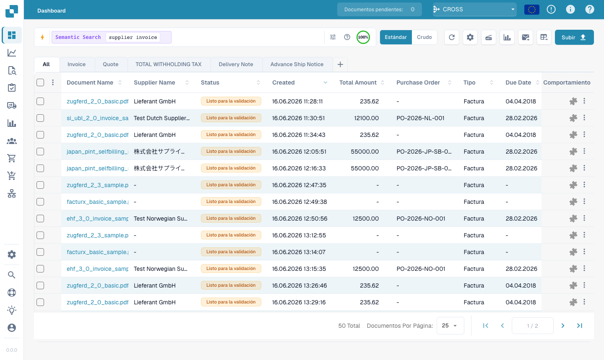<figcaption><p><code>vector: supplier invoice</code> — documentos relacionados semánticamente, incluso sin esas palabras exactas.</p></figcaption></figure>

### Búsqueda de texto OCR — `ocr:`

Busca **dentro del texto de las páginas** que extrajo el motor OCR, no solo en las columnas
estructuradas. Es útil cuando el valor que recuerda está en el cuerpo del documento.

```
ocr: Versandkosten
ocr: "purchase order PO-12345"
ocr: Hamburg AND doc_type=INVOICE
ocr: IBAN
```

<figure>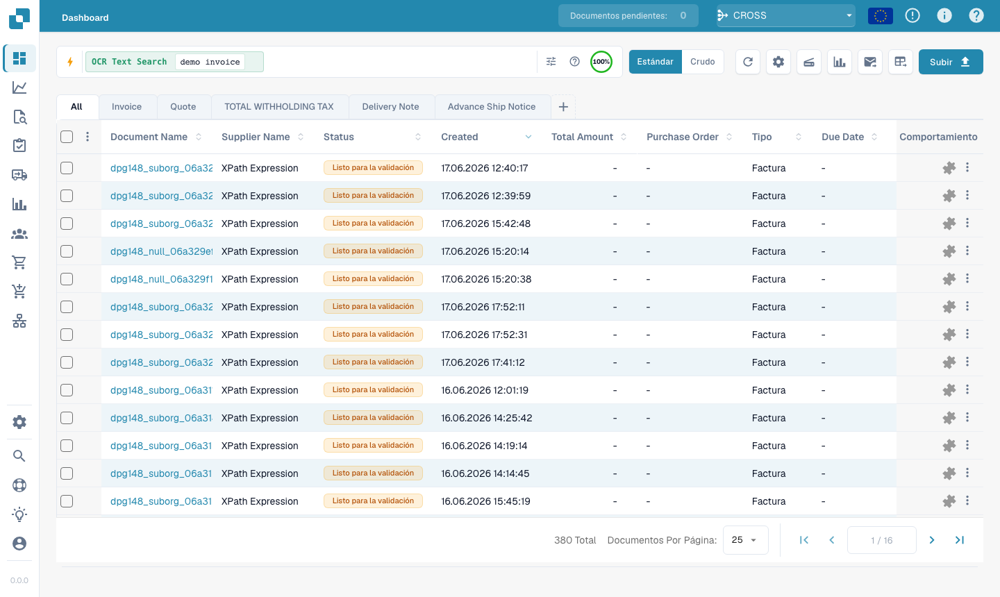<figcaption><p><code>ocr: demo invoice</code> — coincide con el texto que aparece en cualquier parte de las páginas del documento.</p></figcaption></figure>

### Búsqueda en lenguaje natural (IA) — `ai:`

Describa lo que quiere en lenguaje sencillo; la IA lee su frase y extrae
filtros (proveedor, fechas, importes) para convertirlos en una consulta estructurada. A diferencia de Vector,
**construye una consulta** en lugar de buscar documentos similares.

```
ai: invoices from Ruiz over 1000 last quarter
ai: overdue invoices waiting on approval
ai: shipping documents from Hamburg last month
```

<figure>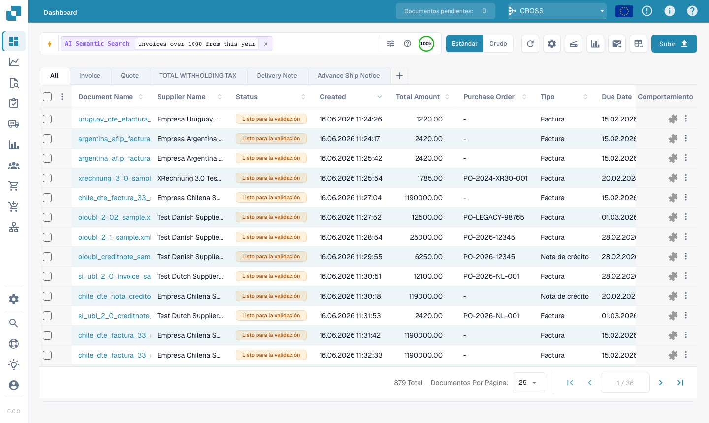<figcaption><p><code>ai: invoices over 1000 from this year</code> — la IA convierte la frase en filtros automáticamente.</p></figcaption></figure>

---

### Recetas

| Quiere… | Escriba esto |
|---------|--------------|
| Listos para validar, totalmente conciliados | `status=ready_for_validation AND po_match_status=full_matched` |
| Este proveedor, esta semana | `supplier_name=Test AND created_on>today()-7` |
| Facturas vencidas de alto importe | `total_amount>5000 AND invoice_due_date<today()` |
| Dos proveedores a la vez | `supplier_name=fuji OR supplier_name=acme` |
| Documentos con error de hoy | `(status=error OR status=failed) AND created_on>today()-1` |
| Notas de crédito electrónicas | `is_edoc=true AND sub_doc_type=CREDIT_NOTE` |
| Por prefijo de pedido de compra | `purchase_order=PO-2026` |

> Los campos en naranja (texto completo) requieren que la **búsqueda de texto completo** esté activada para su
> organización. Un `%` o `_` literal en un valor se trata como un carácter normal.
