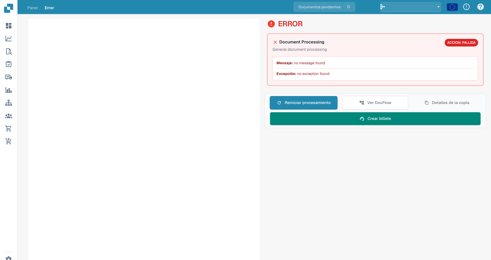
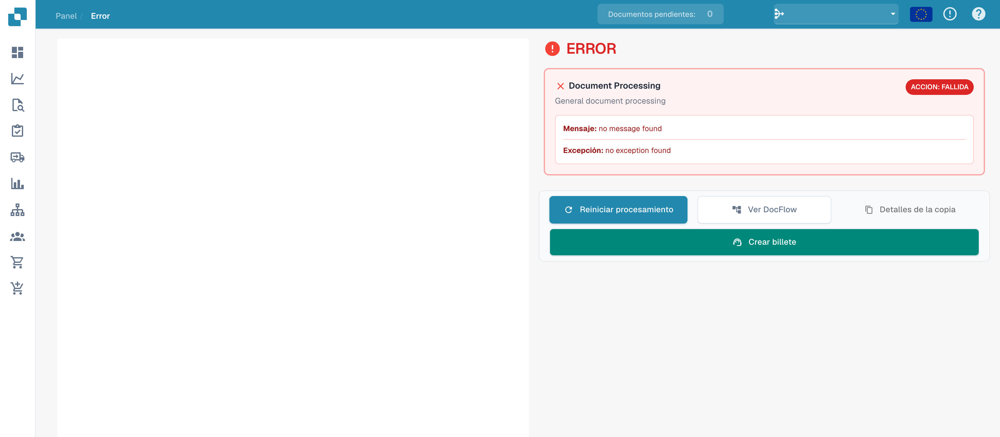

# Vista de errores

Si falla el procesamiento, la vista **Error** permite consultar la etapa afectada, el mensaje y la excepción disponibles.

## Revisar los detalles

<figure><figcaption>
Secciones de mensaje y excepción sin un mensaje de error concreto.
</figcaption></figure>

Este ejemplo explica la interfaz sin un error almacenado. Los textos `no message found` y `no exception found` no son un diagnóstico de un incidente. Para un fallo real, revise los mensajes disponibles y el flujo del documento.

## Acciones disponibles

<figure><figcaption>
Acciones de la vista de errores sin detalles de error almacenados.
</figcaption></figure>

| Acción | Uso |
| --- | --- |
| Reiniciar procesamiento | Repetir el procesamiento tras comprobar o corregir la causa. |
| Ver DocFlow | Consultar las etapas y sus estados. |
| Copiar detalles | Recopilar los datos técnicos disponibles. |
| Crear ticket | Preparar una solicitud de soporte. |

Los controles de documento y vista previa dependen de que el documento pueda cargarse. La antigua barra de herramientas PDF no es un componente fiable de esta vista.

Si el error vuelve a aparecer, facilite a soporte el ID del documento, el mensaje exacto, la hora y las comprobaciones realizadas. Revise los detalles antes de compartir información confidencial.
