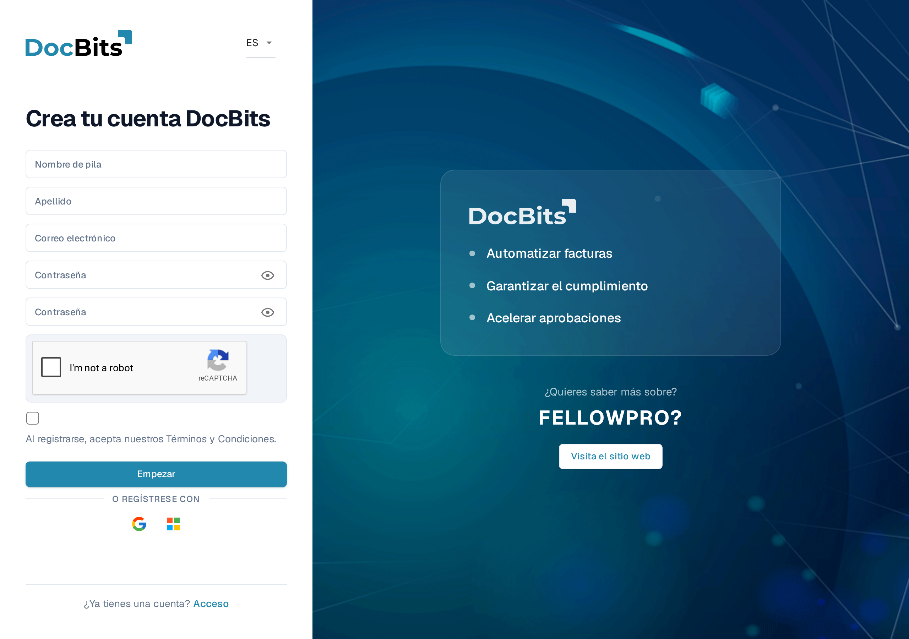
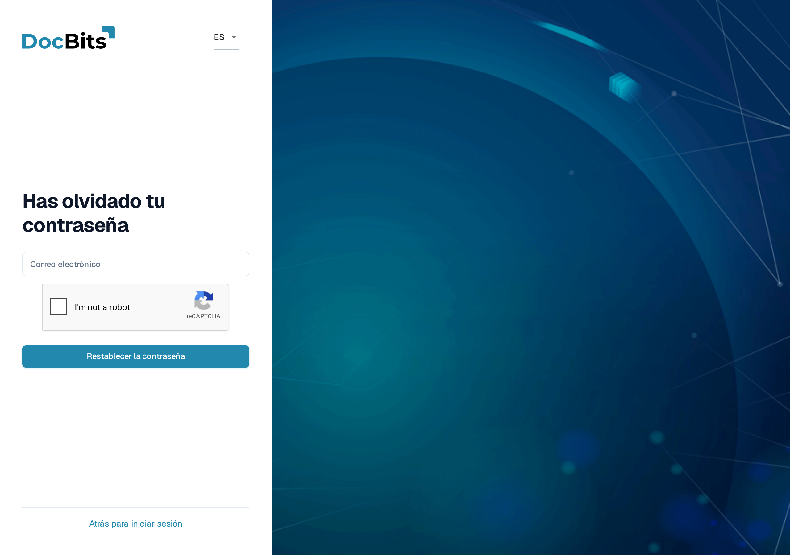
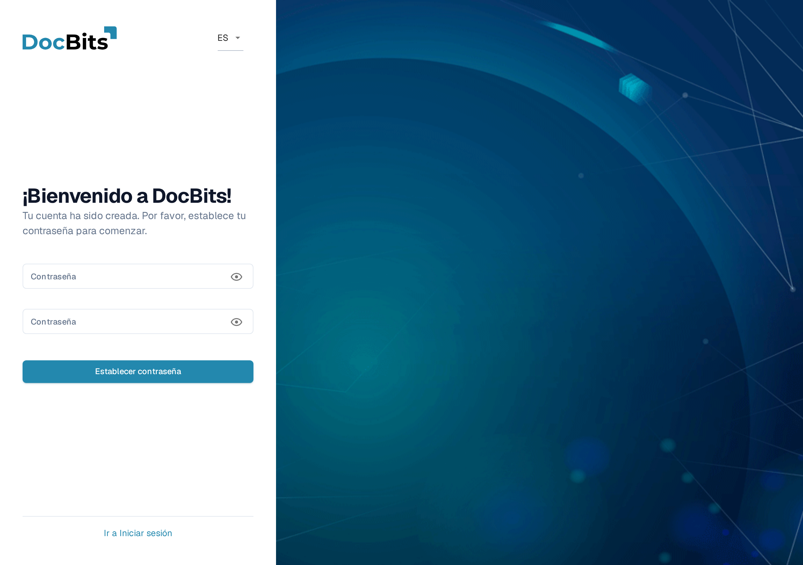

# Obtener acceso e iniciar sesión

Esta página explica cómo obtener una cuenta de DocBits y cómo iniciar sesión cuando no tienes tu contraseña:

* [Registro](getting-access-and-signing-in.md#registro) — crea tu propia cuenta de DocBits.
* [Contraseña olvidada](getting-access-and-signing-in.md#contraseña-olvidada) — restablece tu contraseña con un enlace de restablecimiento.
* [Primera contraseña para cuentas creadas por el administrador](getting-access-and-signing-in.md#primera-contraseña-para-cuentas-creadas-por-el-administrador) — establece la primera contraseña de una cuenta que tu administrador creó para ti.

El inicio de sesión con una cuenta existente y la Autenticación de Dos Factores se tratan en [Autenticación de Dos Factores (2FA)](../../overview-and-basics/two-factor-authentication.md). Usa el menú de idioma en la esquina superior derecha de estos formularios si necesitas otro idioma de visualización.

## Registro

Puedes crear tú mismo una cuenta de DocBits en la página de registro. Ábrela desde el enlace **Registrarse** en la pantalla de inicio de sesión, o navega a `https://app.docbits.com/register` (usa la dirección web que se indicó a tu organización).

<figure><figcaption>
El formulario de registro. Todos los campos son obligatorios salvo donde se indique lo contrario.
</figcaption></figure>

Rellena el formulario:

1. **Nombre de pila** y **Apellido** — tu nombre tal como debe aparecer en DocBits.
2. **Correo electrónico** — tu dirección de correo electrónico de trabajo. Es tu identificador de inicio de sesión.
3. **Contraseña** y **Confirmar contraseña** — consulta las reglas de contraseña más abajo. Una lista de verificación bajo el campo de contraseña muestra qué reglas ya cumple tu contraseña.
4. Si la página muestra un widget de **reCAPTCHA**, complétalo. El widget solo aparece cuando tu despliegue de DocBits tiene la protección contra bots activada.
5. Marca la casilla para confirmar que aceptas los **Términos y Condiciones**.
6. Haz clic en **Empezar**. Si ya tienes una cuenta, haz clic en **Acceso** en la parte inferior para volver a la página de inicio de sesión. **Visita el sitio web** abre el sitio web de DocBits para obtener información del producto.

Usa el icono del ojo junto a un campo de contraseña para mostrar u ocultar los caracteres que escribiste.

### Reglas de contraseña

Tu contraseña debe:

* tener entre **8 y 20 caracteres** de longitud,
* contener al menos una letra **mayúscula** y una **minúscula**,
* contener al menos un **dígito**,
* contener al menos un **carácter especial** (`!@#$%^&*()_+=\[{]\};:,.<>?/\|~-`).

Solo se permiten letras, dígitos y estos caracteres especiales.

### Registrarse con Google o Microsoft

En lugar de una contraseña, puedes hacer clic en el botón **Google** o **Microsoft** bajo **O regístrese con**. DocBits crea tu cuenta a través de tu proveedor de identidad, y más adelante inicias sesión de la misma manera.

### Confirma tu dirección de correo electrónico

Después de enviar el formulario, DocBits muestra una página de confirmación y envía un **correo de verificación** a la dirección que introdujiste. Abre el correo y haz clic en el enlace interior — te lleva a una página de confirmación que verifica tu dirección. Si el correo no llega, la página de confirmación ofrece una opción de **reenvío**. Una vez verificada la dirección, haz clic en **Iniciar sesión** e inicia sesión con tu correo y contraseña.

## Contraseña olvidada

Si olvidaste tu contraseña:

1. En la pantalla de inicio de sesión, haz clic en **¿Has olvidado tu contraseña?**.
2.  En la página **Has olvidado tu contraseña**, introduce tu dirección de **Correo electrónico** y haz clic en **Restablecer la contraseña**. Si se muestra un widget de reCAPTCHA, complétalo primero.

    <figure><figcaption>
La página Has olvidado tu contraseña. Introduce el correo de tu cuenta y DocBits te enviará un enlace de restablecimiento.
</figcaption></figure>

    Si no quieres restablecer tu contraseña, haz clic en **Atrás para iniciar sesión** para volver al inicio de sesión.
3. DocBits te envía por correo un **enlace de restablecimiento de contraseña**. Abre el correo y haz clic en el enlace — se abre la página de restablecimiento.
4. Introduce tu **nueva contraseña dos veces**. Se aplican las mismas reglas de contraseña que durante el [registro](getting-access-and-signing-in.md#reglas-de-contraseña), y una lista de verificación muestra qué reglas se cumplen.
5. Haz clic en **Restablecer la contraseña**. DocBits confirma el cambio y te devuelve a la pantalla de inicio de sesión, donde puedes iniciar sesión con la nueva contraseña.


Los enlaces de restablecimiento caducan tras un breve periodo. Si el enlace ya no funciona, repite los pasos anteriores para solicitar uno nuevo.


## Primera contraseña para cuentas creadas por el administrador

Cuando tu administrador te añade como usuario (consulta [Usuarios](../../administration-and-setup/settings/global-settings/groups-users-and-permissions/users/)), recibes un correo con tus datos de inicio de sesión y un enlace para establecer tu **primera contraseña**. El enlace abre la página **Establecer contraseña**:

<figure><figcaption>
La página Establecer contraseña, que se muestra después de que un administrador creara tu cuenta.
</figcaption></figure>

1. Haz clic en el enlace del correo de invitación. La página te saluda con "¡Bienvenido a DocBits! Tu cuenta ha sido creada. Por favor, establece tu contraseña para comenzar."
2. Introduce tu contraseña dos veces — se aplican las mismas [reglas de contraseña](getting-access-and-signing-in.md#reglas-de-contraseña).
3. Haz clic en **Establecer contraseña**. Después puedes iniciar sesión con tu correo y esta contraseña.

Los iconos del ojo muestran u ocultan lo que escribiste. Si sales antes de establecer una contraseña, **Ir a Iniciar sesión** te devuelve al inicio de sesión.

El enlace está vinculado a tu cuenta y funciona una sola vez. Si caduca antes de que lo uses, pide a tu administrador que reenvíe la invitación o usa **¿Has olvidado tu contraseña?** con tu dirección de correo.
