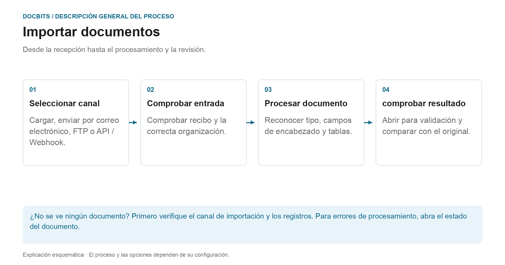

# Cómo Importar Documentos

## Del recibo a un documento listo para revisión

<figure><figcaption>
Desde la recepción hasta el procesamiento y la revisión. El diagrama es esquemático; La configuración activa de su organización determina el comportamiento real.
</figcaption></figure>

Primero seleccione la ruta de importación. Enviar con éxito un correo electrónico o enviar una solicitud API no prueba que el documento se haya procesado por completo. Consulta su recibo en DocBits y luego su estado documental.

1. **Seleccione el canal de importación:** Utilice la carga manual para archivos individuales o un canal automático configurado para entradas regulares.
2. **Verificar recibo:** Ubique el documento en la organización correcta. Para correos electrónicos entrantes, verifique los registros de importación si es necesario; ¿Las reglas de formato y remitente admiten el archivo adjunto?
3. **Esperar procesamiento:** DocBits procesa el documento según el tipo de documento y la configuración activa. Para PDFs, OCR o PDF existente, se puede utilizar el texto; Los documentos electrónicos pueden proporcionar datos estructurados. No todas las importaciones pasan por el mismo camino de extracción.
4. **Abrir el resultado:** Una vez que el documento esté listo para su validación, compare los valores reconocidos con el original. Importar un documento no lo aprueba ni lo exporta al ERP.

### Encuentre la ruta de importación adecuada

| Entrada | Instrucciones |
| --- | --- |
| Cargar documentos individuales | [Importación manual](manual-import.md) |
| Conectar buzón o reenviar correos electrónicos | [Importación de correo electrónico](email/README.md) |
| Recuperar archivos a través de un canal FTP configurado | [FTP](ftp.md) |
| Transferir documentos desde una aplicación | [Webhook / API](webhook.md) |

**Si falta algo:** Primero verifique el canal de entrada. Si el documento ya existe en DocBits, [Estado del documento](../dashboard/document-status.md) y [Flujo de documentos](../dashboard/document-flow.md) ayudan a encontrar el paso de procesamiento afectado.


DocBits Tutorial de importación: cargar documentos, arrastrar y soltar + clasificación manual versus automática


Una guía para subir documentos a DocBits.
