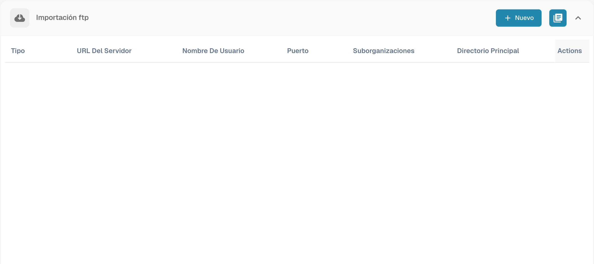
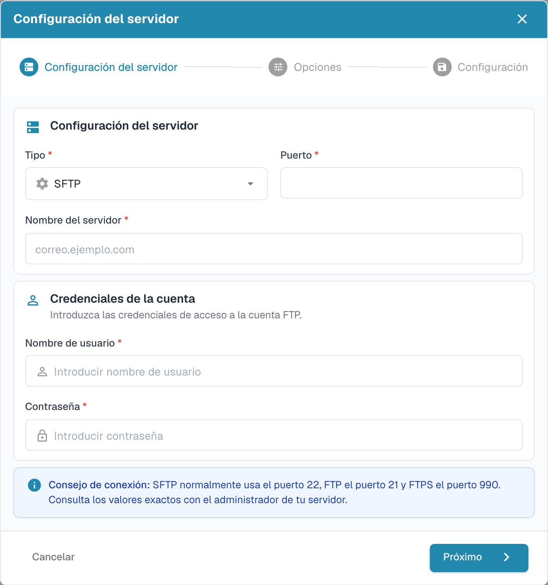

# Importación FTP y SFTP

La importación automática requiere datos de conexión aprobados y una carpeta accesible para la cuenta del servidor.

## Crear una conexión

Abra **Ajustes → Importar** y seleccione **Nuevo** en **Importación ftp**.

<figure><figcaption>
Conexiones de importación FTP con los datos de conexión ocultos.
</figcaption></figure>

El asistente empieza con **Configuración del servidor**. Seleccione el protocolo, servidor, puerto y credenciales previstos. Use los valores facilitados por el administrador del servidor.

<figure><figcaption>
Primer paso del asistente FTP: configuración del servidor.
</figcaption></figure>

Continúe con **Opciones** y **Configuración**. Revise la conexión completa antes de guardarla.

## Archivo de los documentos

Si la conexión ofrece archivado, configúrelo en las opciones de importación. Compruebe que la cuenta pueda escribir en el directorio de archivo y pruebe el comportamiento con un documento de ejemplo. El formulario de archivo separado de versiones anteriores ha sido sustituido por el asistente actual.
