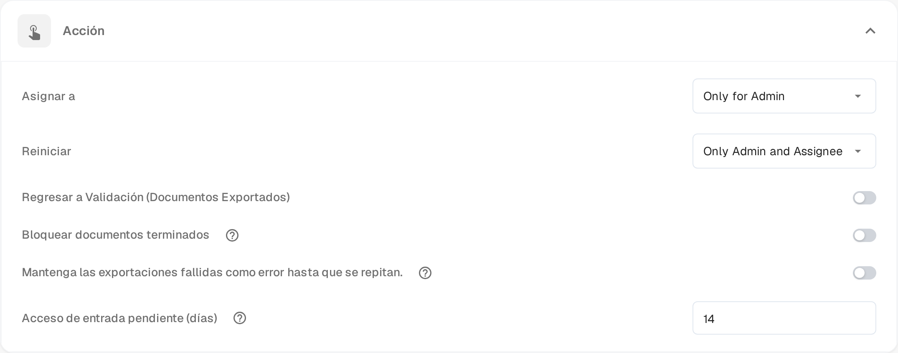

# Pending Input

**Pending Input** detiene un documento mientras espera la respuesta de un compañero. Usted plantea la pregunta en el flujo de actividad del documento y etiqueta a las personas que deben responder. El documento sale de la cola activa hasta que responden, y las personas etiquetadas pueden abrirlo en modo de solo lectura mediante un enlace recibido por correo electrónico.

El estado aparece en el [panel](dashboard/README.md) como **Pending Input**, y puede filtrar la lista de trabajo por él.

## Solicitar una entrada

1. Abra el documento en una pantalla que ofrezca el flujo de actividad —las pantallas de aprobación y de revisión lo ofrecen— y seleccione el icono de burbuja de diálogo en la barra de herramientas.
2. Escriba su pregunta y teclee **@** seguido del nombre de la persona a la que quiere preguntar. Elíjala en la lista que aparece. La etiqueta es lo que concede el acceso: solo las personas etiquetadas reciben el enlace al documento.
3. Cuando una persona está etiquetada, aparece un recuadro bajo el campo de escritura con dos opciones:

* **Comment only** (solo comentario): la pregunta se publica en el flujo de actividad y el estado no cambia. Úsela cuando solo necesita una respuesta y no quiere retener el documento.
* **Send & set to Pending Input** (enviar y pasar a Pending Input): la pregunta se publica y el documento queda en espera. Sale de la cola activa y permanece detenido hasta que la persona etiquetada responda.

Las personas etiquetadas reciben un correo con un enlace al documento. **Intro** o el icono de envío siguen publicando un comentario normal sin conceder acceso; **Mayús+Intro** empieza una línea nueva. En un documento que ya está detenido, o en uno que todavía no puede detenerse, el recuadro ofrece la pregunta sin la opción de pausa.

## Responder a una solicitud

Se le pide una entrada cuando un compañero le etiqueta en el flujo de actividad.

* Abra el enlace del correo. La página **Pending Input** muestra a la izquierda las páginas del documento y a la derecha el flujo de actividad, con la etiqueta **Pending Input**.
* Su acceso es de solo lectura: puede leer el documento y responder en el flujo de actividad, pero no puede cambiar campos ni exportar.
* Escriba su respuesta en el flujo de actividad y envíela. Se avisa a quien preguntó y la conversación permanece en el historial del documento.
* La cabecera de la página indica cuánto dura su acceso, por ejemplo **Read-only access until 09.11.2026**. El acceso también finaliza en cuanto el documento avanza.

Si abre el enlace después de que la solicitud se haya respondido o después de que su acceso haya terminado, la página le indica que la solicitud está resuelta o ha caducado y que no hace falta ninguna acción.

## Cerrar la solicitud

El documento permanece detenido hasta que la persona asignada retome la respuesta.

1. Abra el documento desde el panel. Un documento detenido se abre directamente en su página **Pending Input**.
2. Lea la respuesta en el flujo de actividad.
3. Seleccione **Resolve & Proceed** (resolver y continuar). El documento continúa en el estado siguiente de su flujo de trabajo, de modo que llega directamente a la pantalla en la que sigue trabajando.

Solo la persona asignada al documento, o un miembro del grupo al que está asignado, puede cerrar la solicitud. Los administradores y aprobadores pueden abrir un documento detenido en modo de solo lectura para ver por qué espera.

## Definir el periodo de acceso

La función está disponible en todas las organizaciones. Lo que puede configurar es cuánto tiempo conserva el acceso al documento una persona a la que se le pidió una entrada:

1. Abra **Ajustes → Panel**.
2. Despliegue **Acción**.
3. En **Acceso de entrada pendiente (días)** introduzca un número entero de días. El valor predeterminado es **14** y se requiere al menos un día.
4. Guarde los cambios.

El plazo empieza cuando se envía la solicitud. Termina antes si el documento se cierra o pasa a otro estado.

<figure><figcaption>
Acceso de entrada pendiente (días) en la sección Acción de los ajustes del panel. Los valores de permiso que aparecen encima se siguen mostrando en inglés en el producto.
</figcaption></figure>
