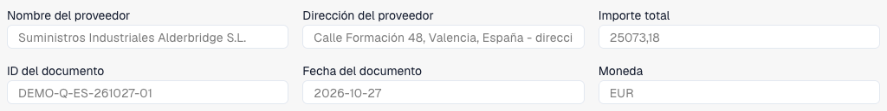
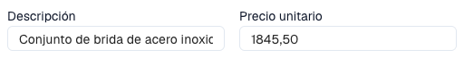

# Revisar posiciones y precios de una oferta

La vista de ofertas se utiliza con documentos configurados para ese proceso. Tipo, diseño, permisos y flujo determinan campos y acciones disponibles. Es una vista distinta de la conciliación de pedidos.

<figure><figcaption>
Cabecera de un presupuesto ficticio español de tres páginas en DocBits: proveedor, referencia, fecha, moneda y total. Se muestran los seis primeros campos.
</figcaption></figure>

Descargar el presupuesto ficticio de tres páginas (PDF)



## Revisar y corregir posiciones

<figure><figcaption>
Descripción y precio unitario de la primera posición seleccionada. No se ha cambiado ni guardado ningún valor.
</figcaption></figure>

1. Abra la oferta correcta. Compare proveedor, referencia, fecha y moneda con el original.
2. Compare artículos, descripciones, cantidades, unidades, precios e importes. Un artículo coincidente no demuestra un precio o unidad coincidente.
3. Seleccione una posición para ver sus detalles bajo la tabla.
4. Utilice la consulta de datos maestros configurada cuando esté disponible. Compruebe selección y valores incorporados; investigue las advertencias.
5. Corrija la posición y seleccione **Guardar** o **Guardar y siguiente**. **Cancelar** cierra el editor sin enviar esos cambios de la posición.
6. Use la opción de copiar valores predeterminados a la siguiente posición solo cuando correspondan. Revise los valores copiados.
7. Reabra documento y posición para comprobar los valores guardados. En una posición rechazada, lea la nota disponible y resuelva el motivo comercial.

## Casos especiales

Añadir una posición crea una línea manual cuando se permite editar. Compárela con el original y complete los campos obligatorios. Quitar una posición manual es una acción independiente; no elimine una posición real para cuadrar los totales.

Si el documento es de solo lectura, compruebe permisos, bloqueo y fase. Si faltan posiciones, revise original, extracción y diseño.

Las comprobaciones automáticas frente a precios gestionados, últimos o contratados se configuran con [Tarjetas de comparación de ofertas](../../administration-and-setup/workflow/cards-overview/quote-comparison-guide.md). Guardar no demuestra que se ejecutaran esas comprobaciones, se aprobara la oferta o terminara la exportación.
