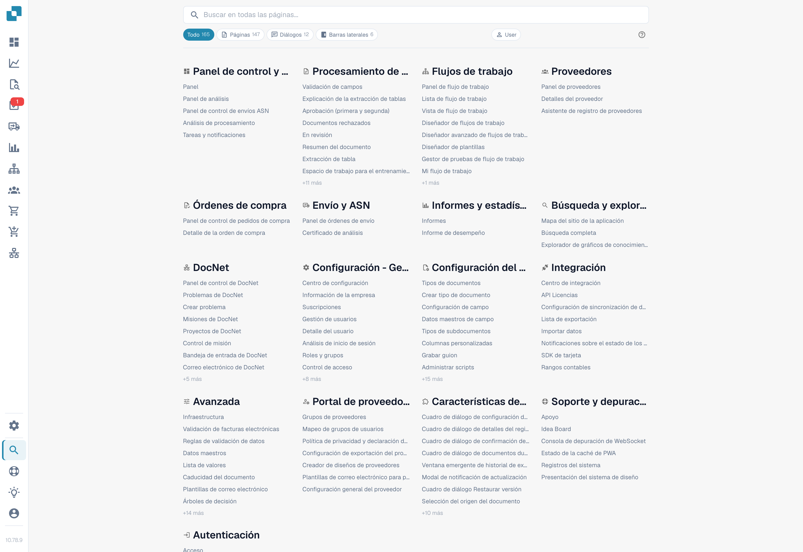
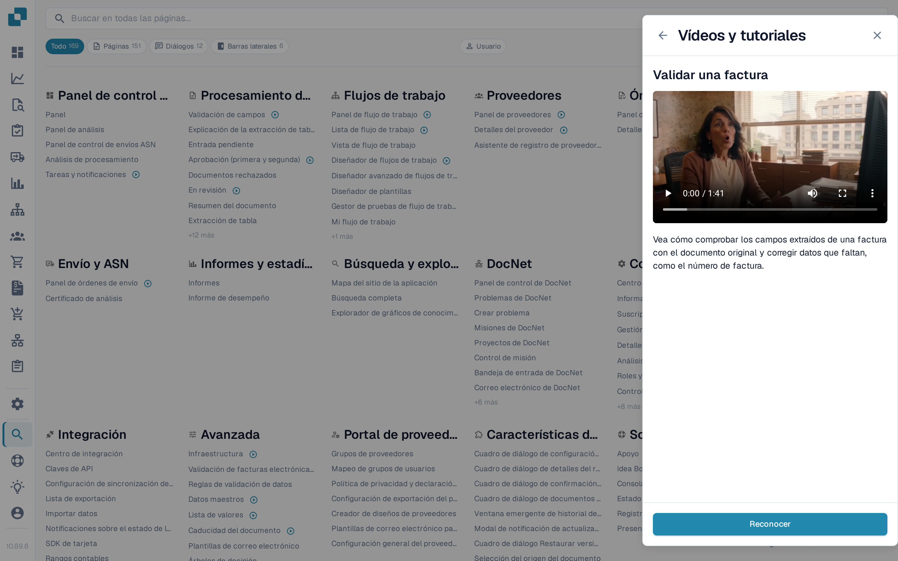

# Mapa del sitio

La Sitemap es el índice completo y consultable de todo lo que DocBits ofrece — cada página, diálogo, entrada de barra lateral, acción y función dentro de la página, agrupados por categoría. Es el complemento extenso de la [Búsqueda Rápida Global](global-quick-search.md).

## Cómo acceder

Abra la Sitemap desde la barra lateral (entrada cercana al final) o pulse <kbd>Cmd</kbd>/<kbd>Ctrl</kbd> + <kbd>K</kbd> y elija **Ver todos los resultados**. La URL directa es `/sitemap`.

<figure><figcaption>
Parte visible del catálogo de páginas en español. «API Licencias» es una etiqueta incorrecta para las claves de API; se conservan las etiquetas reales de la aplicación.
</figcaption></figure>

## Explorar el catálogo

La Sitemap se agrupa en categorías que reflejan la estructura de la aplicación — Configuración, Procesamiento de documentos, Workflow, Validación y demás. Cada categoría enumera primero sus páginas y, a continuación, las funciones dentro de la página agrupadas por subcategoría.

Las entradas están coloreadas según su tipo:

* **Página** — una ruta navegable completa.
* **Diálogo** — un modal que se abre desde otro punto de la aplicación.
* **Barra lateral / Panel / Menú** — una superficie de navegación o contexto.
* **Acción** — un botón o atajo que ejecuta algo sin navegar.

Haga clic en cualquier entrada para saltar directamente a ella. Las entradas que necesitan un parámetro (como un tipo de documento o un identificador) incluyen un selector incrustado — elija el valor antes de hacer clic.

## Vídeos de formación en la lista

Las entradas de páginas que tienen un vídeo de formación muestran un icono de vídeo después del nombre — no solo en Ajustes, sino en todo el catálogo, por ejemplo en el Panel, en la Validación de campos o en las páginas de Workflow. Seleccione el icono para reproducir el vídeo de esa página en el panel **Vídeos y tutoriales** sin salir del mapa del sitio.

<figure><figcaption>
Las entradas con vídeo de formación llevan un icono de vídeo; al seleccionarlo se abre el vídeo en el panel.
</figcaption></figure>

El panel sigue listando cada vídeo por tema, así que también puede recorrer y buscar toda la biblioteca desde el icono de la barra superior. Consulte [Vídeos y tutoriales](videos-and-tutorials.md).

## Búsqueda y filtros

La cabecera fija arriba de la página alberga el cuadro de búsqueda y los filtros en forma de píldoras. Escriba unos caracteres para filtrar la lista en vivo por nombre y descripción. Use las píldoras de tipo para restringir a un único tipo de entrada — por ejemplo, solo **Diálogo**.

La búsqueda y el filtro actuales se añaden a la URL, por lo que una vista filtrada se puede guardar como marcador o compartir.

<mark>La Sitemap respeta los mismos permisos que el resto de DocBits. Las páginas a las que no tiene acceso no aparecen.</mark>

## Modo desarrollador

Un conmutador **Usuario / Dev** en la cabecera activa información adicional para desarrolladores asociados:

* La ruta interna de cada entrada.
* Etiquetas de parámetros (`:docType`, `:docId`, claves de enlace profundo).

El modo desarrollador se recuerda en su navegador. Vuelva al modo Usuario para la vista de lectura habitual.

## Volver arriba

La Sitemap es larga. Una vez que pase la primera pantalla, aparece un botón Volver arriba en la esquina inferior derecha.
