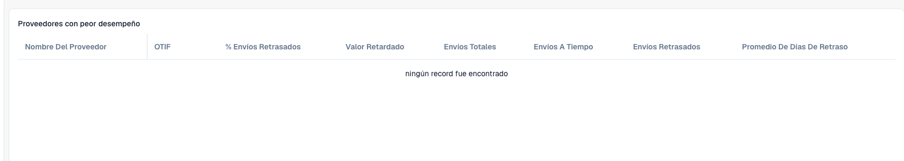

# Interpretar las estadísticas de entrega de proveedores

Utilice las estadísticas de proveedores para detectar entregas que requieren investigación. El administrador debe activar el módulo y deben existir datos de envíos pertinentes. Los indicadores dependen de los registros de su organización.

<figure><figcaption>
Columnas de las estadísticas de proveedores en una organización sin registros de envíos. Una tabla vacía no demuestra un buen rendimiento de entrega.
</figcaption></figure>

## Revisar un proveedor

1. Abra **Estadísticas de proveedores**. Si no está disponible, solicite comprobar módulo y acceso.
2. Identifique al proveedor en la tabla de peores resultados.
3. Compare envíos totales, puntuales y retrasados antes de valorar porcentajes. Dos envíos y dos mil representan muestras distintas.
4. Revise conjuntamente **OTIF**, porcentaje de retrasos, valor retrasado y días medios de retraso. OTIF significa *On Time In Full*: entregar a tiempo no demuestra que se haya entregado todo.
5. Compare los gráficos OTIF y envíos retrasados. Utilice proveedores por página y los controles de paginación para ver otras filas.
6. Investigue los envíos concretos: fechas prometidas/reales, cantidades, identificadores y moneda antes de contactar con el proveedor.

## Interpretar e investigar

Los recuentos explican el tamaño de la muestra; los días medios, la duración; el valor retrasado, el importe afectado. No deduzca OTIF únicamente del número de entregas puntuales ni sume monedas distintas sin una conversión acordada.

Una tabla vacía o un gráfico a cero no demuestra entregas perfectas. Compruebe datos y sincronización. El resumen no explica por sí solo un envío individual.

Ante discrepancias, conserve identificador del proveedor, envíos pertinentes, fechas y cálculo esperado. Solicite revisar los datos de origen y la base del indicador.

Consulte [Módulos](../../administration-and-setup/settings/document-processing/module/README.md) y [Sincronización de datos](../../administration-and-setup/settings/log-settings/data-synchronization.md).
