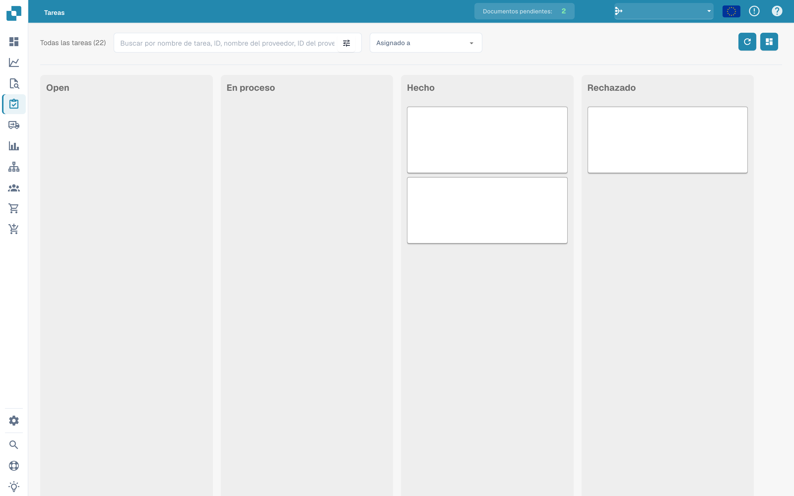
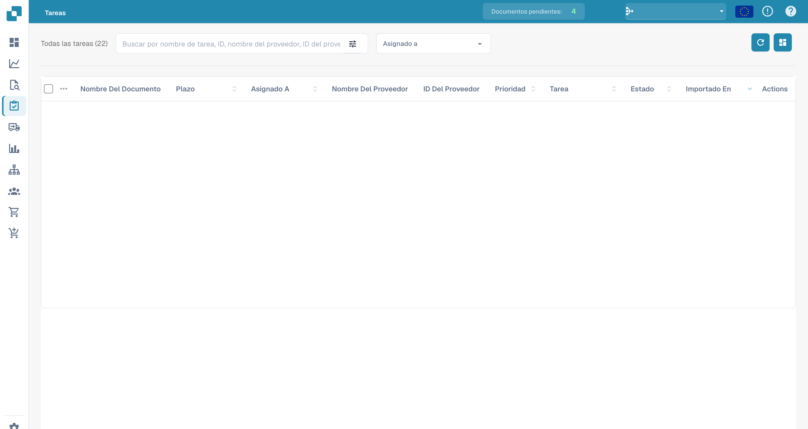

# Tareas


DocBits Tutorial de tareas y notificaciones: asignar trabajo, realizar un seguimiento del estado y gestionar tareas de flujo de trabajo


Aquí es donde puedes mantener un ojo en tus tareas. Puedes elegir entre dos diseños diferentes: uno es un poco más detallado que el otro. También puedes filtrar tareas por diferentes criterios, como si están asignadas a ti o el estado de la tarea.

<figure><figcaption>
Tablero de tareas por estado; el contenido de las tareas está oculto.
</figcaption></figure>

<figure><figcaption>
Lista de tareas con los datos de los documentos ocultos.
</figcaption></figure>
