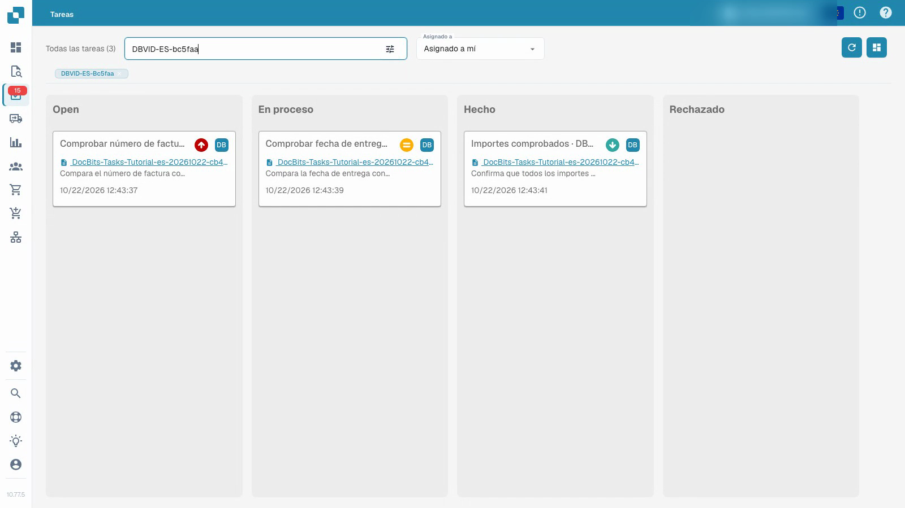
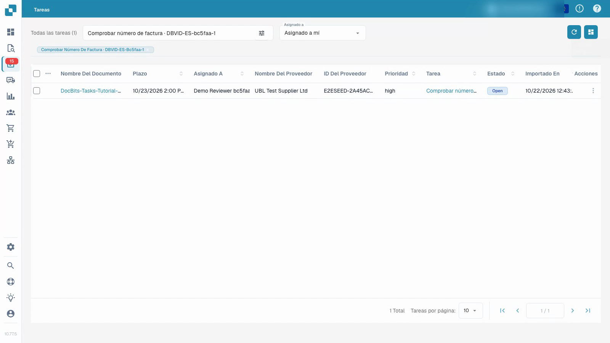

# Tareas

El video muestra a un usuario de prueba ordinario trabajando en una tarea con documentos sintéticos.


Tareas


[Ver con subtítulos](https://docbits-videos.fra1.cdn.digitaloceanspaces.com/settings-assistant/document-tasks-customer/v1/es.html)

Nota: Es posible que algunas etiquetas de productos nativos no estén traducidas. La grabación conserva la interfaz de usuario real.

Utilice el resumen de tareas para encontrar el trabajo asignado y seguir su progreso. El tablero agrupa las tareas por estado; la lista proporciona más detalles. Filtre por asignación y use la búsqueda para localizar una tarea en particular. La prioridad y la fecha límite ayudan a planificar el orden del trabajo.

## Trabajar en una tarea de documento asignada

1. Abra una tarea y lea su descripción y asignación.
2. Inspeccione el documento original vinculado. Un título de tarea por sí solo no prueba que el documento sea correcto.
3. Establezca la tarea en progreso y guarde mientras realiza el trabajo.
4. Registre el resultado en la descripción de la tarea.
5. Complete la tarea, guárdela y vuelva a cargarla para confirmar el estado y los comentarios almacenados. Compruebe su posición en el resumen de tareas.

El video utiliza un usuario de prueba ordinario y documentos sintéticos. Completar una tarea es independiente de aprobar o exportar su factura. Las acciones disponibles dependen de los permisos de la cuenta.

## Cuando no puede marcar una tarea como hecha

Su organización puede limitar quién puede cerrar tareas, es decir, ponerlas en **Hecho** o **Rechazado**. En ese caso, para las tareas que usted no puede cerrar no se ofrecen el botón **Hecho**, los estados **Hecho** y **Rechazado** ni **Marcar como hecho**, y el tablero de tareas no le permite soltar una de esas tareas en la columna **Hecho** o **Rechazado**. Las tareas asignadas a usted puede seguir editándolas, guardándolas y moviéndolas entre **Abierto** y **En proceso**.

Un administrador de su organización decide quién puede cerrar y eliminar tareas. Consulte [Tareas y notificaciones](../../administration-and-setup/settings/document-processing/module/tasks-and-notifications.md).

<figure><figcaption>
Resumen de tareas utilizando datos sintéticos.
</figcaption></figure>

<figure><figcaption>
Lista de tareas con datos de demostración sintéticos.
</figcaption></figure>

## Grabación adicional


Tareas

