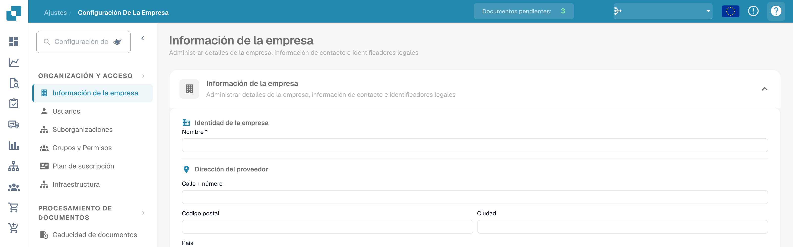

# Iconos de ayuda

Se han colocado iconos de ayuda en todo DocBits para ayudarte a aprender y comprender lo que realmente hace una función y cómo puede ayudarte con el procesamiento de tus documentos.

Estos iconos de ayuda se ven de la siguiente manera

<figure><figcaption>
Icono de ayuda en la parte superior derecha de los ajustes.
</figcaption></figure>
