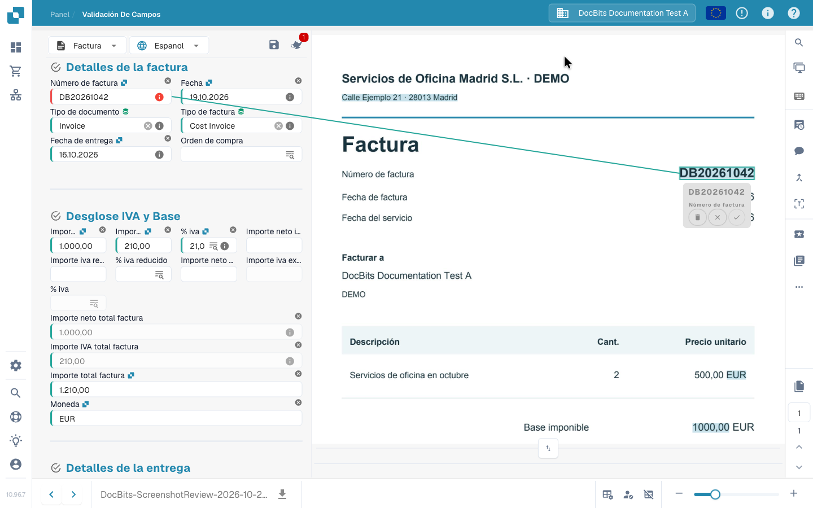

# Pantalla de Validación

## Corregir y guardar una factura como revisora

Compare la factura original con los campos y sus tres líneas, corrija el número, guarde y recargue para comprobar el valor almacenado. La grabación utiliza una factura electrónica sintética y una cuenta de revisión normal. Guardar esta corrección es distinto del entrenamiento de extracción, la aprobación y la exportación.



[Ver con subtítulos](https://docbits-videos.fra1.cdn.digitaloceanspaces.com/settings-assistant/invoice-validation-customer/v1/es.html)

## Revisar una factura y completar su comprobación

Sigue una factura desde el panel hasta su entrega al siguiente paso: compara proveedor, fechas, número, importes y moneda con el original y consulta un aviso de campo obligatorio. Selecciona el número directamente en el documento, confirma su asociación y conserva la regla de extracción con **Save Rules**. En este ejemplo, la factura revisada se envía después para su aprobación. Las acciones disponibles dependen de tus permisos y del proceso de tu empresa.



## Abrir y utilizar la pantalla de validación

Abre un documento desde el panel. En la **validación de campos**, compara los campos editables con el documento original mostrado al lado. El tipo de documento y el diseño configurado determinan los campos, tablas y botones disponibles. Mueve el separador para dar más espacio a los campos o al documento.

Utiliza los controles de página para documentos de varias páginas y el zoom para leer texto pequeño. Las flechas inferiores cambian de documento; son distintas de los controles de página.

### Origen del documento

Comprueba el **origen del documento** antes de revisar fechas e importes. Determina cómo se interpretan sus formatos; no traduce el documento ni cambia el idioma de la interfaz. Elige el origen correspondiente al documento y compara los valores con el original.

Al cambiar el origen se abre un diálogo de confirmación. Si continúas, se reinicia el procesamiento del documento. Cuando termine, revisa los valores extraídos de nuevo.

## Corregir un campo y enseñar a DocBits dónde leerlo

Si el número de factura no se ha leído correctamente:

1. Selecciona el campo **Número de factura**.
2. Haz doble clic en el número completo del original o selecciona el área que lo contiene.
3. Revisa el campo propuesto y confirma la asociación con la marca de verificación cuando se solicite.
4. Comprueba el valor y el área de origen resaltada. Repite la selección si el número está incompleto o corresponde a otro campo.
5. Guarda el documento. Para conservar el aprendizaje de extracción, utiliza también **Save Rules** y confirma el diálogo.

<figure><figcaption>
El número seleccionado en el original y su asociación al campo. Confirma la asociación antes de guardar la regla.
</figcaption></figure>


Escribir un valor de reemplazo corrige este documento, pero no crea la asociación al área de origen necesaria para este aprendizaje. Selecciona el valor en el original, confirma la asociación y guarda la regla para reutilizarla en documentos correspondientes de este proveedor. Este aprendizaje a partir de la imagen no está disponible para documentos leídos directamente como datos de factura electrónica.


## Guardar, conservar las reglas y continuar

| Acción | Resultado |
| --- | --- |
| **Guardar** — disquete encima de los campos | Guarda los cambios del documento actual. Por sí sola no lo aprueba ni lo exporta. |
| **Save Rules** | Conserva reglas de extracción basadas en el documento y sus asociaciones al original. Es distinto de guardar los valores. |
| **Exportar / Export**, aprobación u otra acción configurada | Envía el documento al siguiente paso configurado tras los controles pertinentes. La acción y el estado resultante dependen del proceso y de tus permisos. |

En el vídeo, la factura revisada se envía para su aprobación. Un botón **Export** no garantiza que la factura ya haya llegado al ERP de destino. Comprueba su nuevo estado en el panel y los posibles errores de procesamiento.

## Campos obligatorios y mensajes de validación

Un borde rojo o un icono de aviso llama la atención sobre un campo. Lee su mensaje: puede faltar un valor obligatorio, ser necesario revisar la extracción o haber fallado un control configurado. Que un valor sea visible no demuestra por sí solo que sea válido.

Compara proveedor, número, fechas, importes y moneda con el original. Para los totales, revisa los campos de cabecera afectados y las líneas correspondientes. Corrige la causa indicada antes de continuar. Los controles dependen del tipo de documento y de la configuración de la organización; consulta [Comprobaciones automáticas](automatic-checks-on-the-validation-screen.md).

## Utilizar el asistente

El botón **Asistente** situado encima de los campos muestra los problemas de validación pendientes. Ábrelo y utiliza **Ir al campo** para revisar el campo afectado. Las preguntas y sugerencias IA dependen de su activación para la organización y de tus permisos. Si no están disponibles, lee el aviso del panel. Las sugerencias cambian el formulario: revísalas y guarda el documento para conservar los cambios.

## Seleccionar datos maestros

Los campos con una búsqueda configurada pueden consultar proveedores, pedidos u otros datos maestros. Abre la búsqueda del campo, filtra los resultados y selecciona el registro correcto. La selección puede rellenar varios campos relacionados: revísalos también. Estos valores proceden de los datos maestros y pueden diferir del texto impreso. Consulta [Datos difusos](fuzzy-data.md).

## Revisar las líneas de factura

Si el diseño incluye tablas, compara filas, descripciones, cantidades, precios e importes con el documento. **TABLA EXTRAÍDA** y **TABLA AI EXTRAÍDA** son vistas de extracción diferentes. Su disponibilidad depende de los métodos activados y del diseño. Una pestaña vacía o ausente no explica por sí sola un problema de extracción.

Corrige celdas y filas que falten o estén duplicadas con los controles disponibles. Los cambios afectan al documento actual. El entrenamiento reutilizable de tablas, las etiquetas de IA y el entrenamiento de cabeceras son operaciones distintas. Consulta [Etiquetas de tablas IA](../ai-table/ai-table-tags.md) y [Entrenamiento de tablas](../../../administration-and-setup/setup/document-training/training-line-fields-table-training/README.md).

Lee los avisos sobre columnas obligatorias, cálculos de línea y totales. Antes de aplicar otra extracción IA o volver a extraer una tabla, lee la confirmación: puede ser necesario eliminar y rehacer las asociaciones existentes con pedidos.

## Visor y colaboración

Pasa el cursor sobre un icono para leer su nombre. Algunas herramientas dependen de módulos, tipos de documento o permisos.

| Herramienta | Uso |
| --- | --- |
| **Lupa** — «Gafas de aumento» en la interfaz — y zoom | Examinar detalles pequeños del original. |
| **Abra la imagen en la nueva ventana** | Mostrar la misma imagen en otra ventana, por ejemplo en un segundo monitor. La interfaz la identifica como función de Chrome. |
| **Atajos de teclado** | Abrir la ayuda; consulta [Atajos de teclado](keyboard-shortcuts.md). |
| **Tareas** | Crear y seguir trabajo interno asignado a una persona o grupo. |
| **Actividad** | Consultar las actividades registradas del documento. |
| **Historial de aprobaciones** | Consultar aprobaciones y rechazos cuando la función esté activada. |
| **Modo de anotación** | Añadir notas al documento si las anotaciones están activadas. |
| **Combinar / añadir páginas** | Combinar documentos o añadir páginas que falten mediante el diálogo disponible. Revisar las páginas seleccionadas antes de confirmar. |
| **Vista de OCR** | Consultar texto ya reconocido. Abrirla no inicia otra extracción OCR. No está disponible para ciertos documentos electrónicos. |
| **Soporte (icono de ticket)** | Preparar una solicitud de soporte con el contexto del documento y la descripción del problema. Las tareas internas se gestionan aparte. |
| **Registros de scripts** — «Documento Script Logs» en la interfaz | Consultar mensajes de los scripts del documento si el módulo está activado. Es un visor de registros, no un editor de scripts. |

## Más opciones y ajustes de administración

En las facturas, **Más opciones → Flujo de documentos** abre el recorrido de procesamiento. Según permisos y configuración, el menú también puede incluir división de documentos, acceso a la plantilla de diseño y preferencias de extracción del proveedor.

**Utilice E-Text si está disponible**, **Utilizar extracción estructurada (IA)** y **Modelo de IA** son ajustes de extracción del proveedor, no correcciones normales de campos. Solo los administradores autorizados pueden modificarlos. Sigue la confirmación de reinicio cuando sea necesario volver a procesar el documento. Una plantilla de diseño configura el formulario de validación; no modifica el diseño impreso de la factura. Consulta [Modelo IA por proveedor](supplier-specific-ai-model-for-field-and-table-extraction.md).

## Si no puedes editar o continuar

Lee el motivo mostrado: el documento puede estar bloqueado, ser de solo lectura, estar en otro estado o tener restricciones por tu rol. Resuelve los mensajes y consulta a la persona responsable o al administrador sobre acceso y configuración. Si el error persiste, consulta [Solución de problemas](troubleshooting/README.md) o prepara un ticket con el documento y el mensaje exacto.
