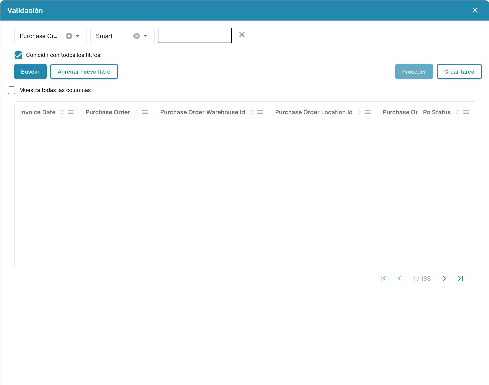

# Datos Difusos

### **Descripción general**

Los campos de Datos Difusos (Fuzzy Data) permiten a los usuarios rellenar campos relacionados a partir de coincidencias aproximadas con los datos maestros. Estos campos se identifican por un **icono azul** junto a ellos.

<figure><figcaption></figcaption></figure>

### **Funcionamiento**

#### **¿Qué hacen los campos de Datos Difusos?**

* Rellenan campos relacionados en función de su valor o de la entrada del usuario.
* Los tres campos estándar que utilizan Datos Difusos son:
  * **Número de pedido**
  * **Proveedor**
  * **Vendor ID**

#### **Uso de los campos de Datos Difusos**

1. **Selección de un Purchase Order**
   *   Al hacer clic en el **icono azul** junto al campo Purchase Order se abre una **ventana de selección**.

       <figure><figcaption>
Diálogo de consulta de datos maestros con los registros ocultos.
</figcaption></figure>
   * Esta ventana contiene una tabla con todos los pedidos de compra de la **tabla de consulta de datos maestros**.
   * Al activar la opción **"Display all columns"** se muestran detalles adicionales.
   * Seleccione un **Número de pedido** y haga clic en **Proceder**:
     * Si el sistema encuentra un Purchase Order en el documento, filtra por él automáticamente.
     * Si no se encuentra ninguna coincidencia, puede **crear filtros personalizados** para encontrar el Purchase Order correcto.
     * Se pueden añadir varios filtros; al activar **"Match all filters"** se garantiza que se cumplan todas las condiciones.
     * Opciones de filtro disponibles:
       * **Smart**
       * **Contiene**
       * **exacto**
       * **Comienza con**
       * **Termina con**
   * Un botón situado junto a **Proceder** permite a los usuarios **crear una nueva tarea/notificación**.
2. **Selección de un Supplier o Vendor ID**
   * El proceso es el mismo que para los Purchase Orders.
   * La diferencia es que los campos **Supplier y Vendor ID utilizan la tabla de datos maestros de proveedores** en lugar de la tabla de datos maestros de cabeceras de pedidos de compra.

#### **Indicación de relleno de campos**

* Si un campo se rellena mediante Datos Difusos en lugar de extraerse del documento, aparece una **pequeña indicación o icono de información** que señala que los datos **no se extrajeron del documento**, sino que se rellenaron a partir de los datos maestros.

### **Configuración del administrador**


[fuzzy-data-configuration-with-master-data.md](../../../administration-and-setup/setup/document-types/fuzzy-data-configuration-with-master-data.md)



[fuzzy-data-configuration-with-list-of-values.md](../../../administration-and-setup/setup/document-types/fuzzy-data-configuration-with-list-of-values.md)



