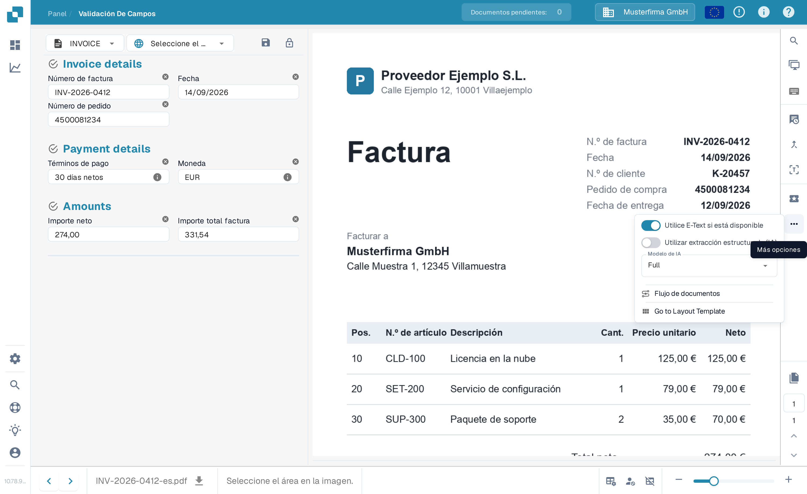
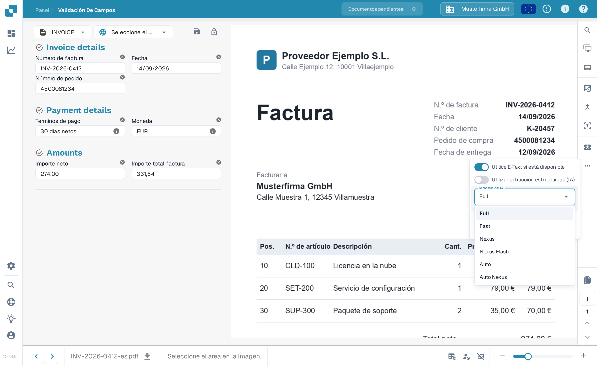

# Modelo de IA Específico del Proveedor para Extracción de Campos y Tablas

En las herramientas de la pantalla de validación puede elegir el modelo de extracción de campos y tablas para el contexto de la plantilla actual. La preferencia se guarda por organización y plantilla (`tfidf_id`); no modifica automáticamente todas las plantillas o documentos históricos del mismo proveedor. Sin una preferencia específica se utiliza la configuración aplicable de la organización.

Abra **Más opciones** y el selector del modelo de IA. El menú ofrece **Full**, **Fast**, **Nexus**, **Nexus Flash**, **Auto** y **Auto Nexus**. Consulte la disponibilidad y los costes actuales de su entorno y las condiciones contratadas. Ninguna opción es siempre la más precisa o rápida; Fast no es un valor predeterminado universal.

Un cambio puede requerir confirmación y reiniciar la extracción. Compruebe primero el documento y el ámbito del cambio. Abrir el menú no cambia la preferencia; las ilustraciones no demuestran un cambio de modelo ejecutado.

<figure><figcaption>
Vista de ejemplo existente con una factura sintética: Más opciones abre el menú Modelo de IA para el contexto de la plantilla actual. Los títulos de grupos y Go to Layout Template permanecen en inglés en este ejemplo.
</figcaption></figure>

<figure><figcaption>
Vista de ejemplo existente del menú Modelo de IA con Full, Fast, Nexus, Nexus Flash, Auto y Auto Nexus. Son nombres de niveles del producto; los títulos de grupos del ejemplo permanecen en inglés. No se ejecutó ningún cambio de modelo.
</figcaption></figure>

Compare los modelos con documentos de prueba autorizados y compruebe valores, tiempos y costes. Cambiar de modelo puede volver a procesar un documento y no garantiza una mejora. Para configurar el valor de la organización o revisar preferencias de plantillas, consulte la documentación relacionada.

[**aquí**](../../../administration-and-setup/settings/document-processing/classification-and-extraction/ai-model.md)
