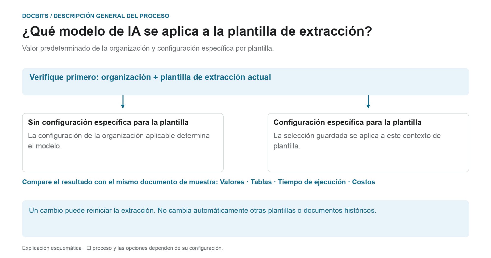

# Modelo de IA Específico del Proveedor para Extracción de Campos y Tablas

## Del estándar organizacional al modelo efectivo

<figure><figcaption>
Valor predeterminado de la organización y configuración específica por plantilla. El diagrama es esquemático; La configuración activa de su organización determina el comportamiento real.
</figcaption></figure>

La entrada en la pantalla de validación se denomina modelo de IA específico del proveedor. Sin embargo, el **contexto de la plantilla de extracción actual** es crucial: la configuración específica se guarda por organización y plantilla. Un proveedor puede tener varias plantillas con diferentes configuraciones.

1. **Determinar el contexto:** Revise la organización, el documento y la plantilla de extracción actual antes de modificar un modelo.
2. **Anulación de verificación:** Si se almacena un modelo para esta plantilla, esta selección surte efecto dentro de su alcance. Si falta una configuración específica, se aplica la configuración de organización aplicable.
3. **Confirma el cambio deliberadamente:** Selecciona solo una opción disponible en tu entorno. Un cambio puede requerir confirmación y desencadenar la extracción nuevamente. Abrir el menú por sí solo no cambia la selección.
4. **Comparar resultados:** Verifique los valores de campo, tablas, tiempo de ejecución y costos con una muestra fija. Un nivel de modelo diferente no garantiza una mejor extracción, una validación exitosa o una coincidencia PO.

**Ejemplo:** El proveedor A utiliza las plantillas “Factura nacional” y “Factura extranjera”. Una configuración específica de "Factura nacional" no cambia todas las facturas de ese proveedor. Para otro documento, verifique nuevamente su plantilla y configuración efectiva.

El gráfico muestra la jerarquía de selección, no una recomendación para un nivel de modelo específico. La información sobre el diagnóstico [Estándar organizacional y configuraciones específicas](../../../administration-and-setup/settings/document-processing/classification-and-extraction/ai-model.md) y [¿Qué ruta de extracción se utilizó?](../../../overview-and-basics/faq/document-processing/which-extraction-path-was-used.md) ayuda a clasificar el resultado real.

En las herramientas de la pantalla de validación puede elegir el modelo de extracción de campos y tablas para el contexto de la plantilla actual. La preferencia se guarda por organización y plantilla (`tfidf_id`); no modifica automáticamente todas las plantillas o documentos históricos del mismo proveedor. Sin una preferencia específica se utiliza la configuración aplicable de la organización.

Abra **Más opciones** y el selector del modelo de IA. El menú ofrece **Full**, **Fast**, **Nexus**, **Nexus Flash**, **Auto** y **Auto Nexus**. Consulte la disponibilidad y los costes actuales de su entorno y las condiciones contratadas. Ninguna opción es siempre la más precisa o rápida; Fast no es un valor predeterminado universal.

Un cambio puede requerir confirmación y reiniciar la extracción. Compruebe primero el documento y el ámbito del cambio. Abrir el menú no cambia la preferencia; las ilustraciones no demuestran un cambio de modelo ejecutado.

<figure><figcaption>
Vista de ejemplo existente con una factura sintética: Más opciones abre el menú Modelo de IA para el contexto de la plantilla actual. Los títulos de grupos y Go to Layout Template permanecen en inglés en este ejemplo.
</figcaption></figure>

<figure><figcaption>
Vista de ejemplo existente del menú Modelo de IA con Full, Fast, Nexus, Nexus Flash, Auto y Auto Nexus. Son nombres de niveles del producto; los títulos de grupos del ejemplo permanecen en inglés. No se ejecutó ningún cambio de modelo.
</figcaption></figure>

Compare los modelos con documentos de prueba autorizados y compruebe valores, tiempos y costes. Cambiar de modelo puede volver a procesar un documento y no garantiza una mejora. Para configurar el valor de la organización o revisar preferencias de plantillas, consulte la documentación relacionada.

[**aquí**](../../../administration-and-setup/settings/document-processing/classification-and-extraction/ai-model.md)
