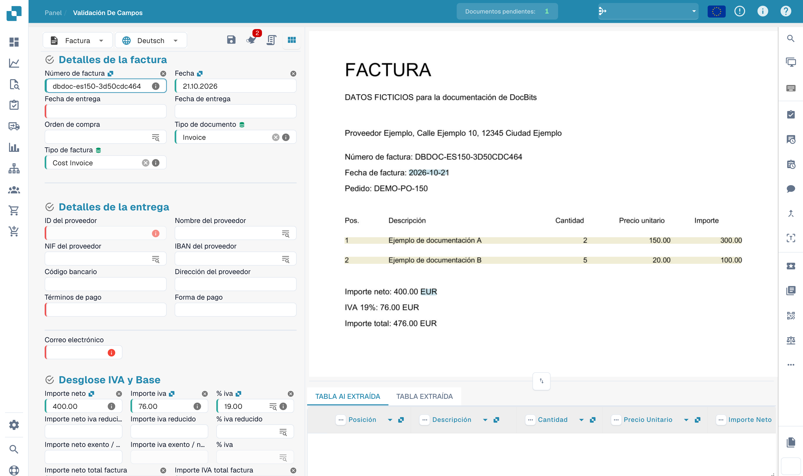
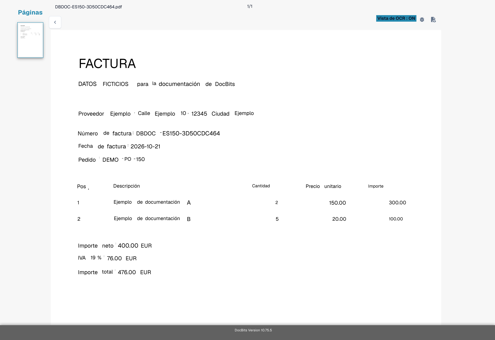
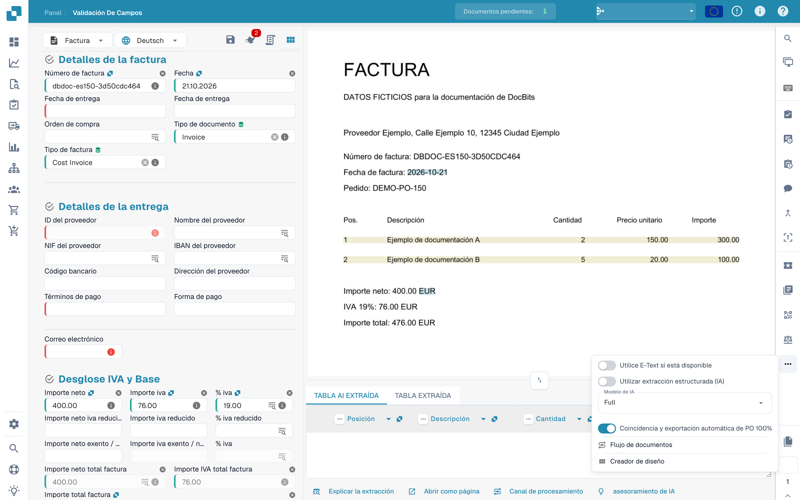
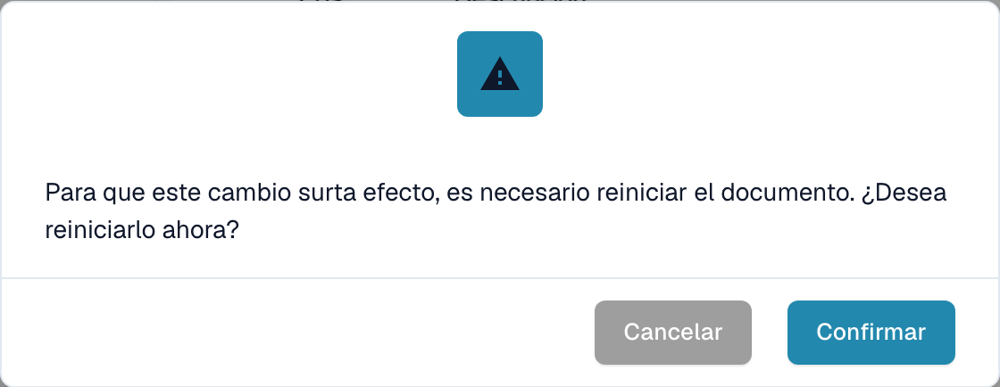
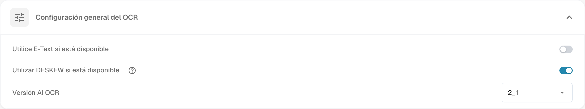
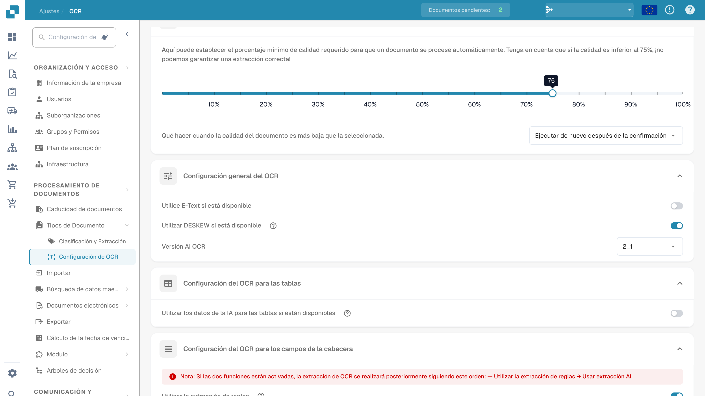

# Texto faltante en la extracción de OCR

## **Problema**

En algunos casos, el texto puede parecer estar faltante en la **Vista de OCR**, lo que impide que se extraiga utilizando la función de extracción.

<figure><figcaption>
Comprobación de campos extraídos en una factura ficticia.
</figcaption></figure>

Para verificar esto, haga clic en el botón **Vista de OCR** en la barra de herramientas a la derecha. Si el texto no aparece allí, significa que no está disponible para la extracción.

<figure><figcaption>
Vista OCR del texto reconocido de la factura ficticia.
</figcaption></figure>

## **Causa**

La causa más probable es que el texto que está intentando extraer es parte de una imagen (por ejemplo, un logo o una sección escaneada) dentro del documento.\
Cuando la función E-Text está habilitada, el texto que aparece en imágenes o logos no se incluye en la capa de texto extraído. Como resultado, este texto no puede ser accedido o extraído a través de la lógica de extracción estándar.

## **Solución**

Para resolver este problema, desactive la función E-Text—ya sea para el [proveedor específico](missing-text-in-ocr-extraction.md#desactivar-e-text-para-un-proveedor-especifico) o para [toda la organización](missing-text-in-ocr-extraction.md#desactivar-e-text-para-toda-la-organizacion). Una vez que E-Text esté desactivado, DocBits dependerá únicamente de OCR, que es capaz de extraer texto de imágenes y logos dentro del documento.

### **Desactivar E-Text para un Proveedor Específico**

1. Abra un documento del proveedor específico en la **Validación de Campo**.
2.  Haga clic en el menú de tres puntos en la barra de herramientas a la derecha.

<figure><figcaption>
Acceso a las opciones adicionales de la validación.
</figcaption></figure>

3.  Desmarque **Utilice E-Text si está disponible**.

<figure><figcaption>
Opción de utilizar E-Text cuando esté disponible.
</figcaption></figure>

4.  Haga clic en **Confirmar** para reiniciar el procesamiento del documento.

<figure><figcaption>
Diálogo de confirmación antes de cambiar el uso de E-Text.
</figcaption></figure>

### Desactivar E-Text para toda la Organización

1.  Vaya a **Ajustes → Procesamiento de documentos → Configuración de OCR**.

<figure><figcaption>
Configuración de OCR en español.
</figcaption></figure>

2.  En **Configuración general del OCR**, desmarque la opción **Utilice E-Text si está disponible**.

<figure><figcaption>
Configuración general de OCR y uso de E-Text.
</figcaption></figure>

Las imágenes usan una factura ficticia con texto OCR disponible. Muestran comprobaciones de la interfaz, no un incidente reproducido de texto ausente.
