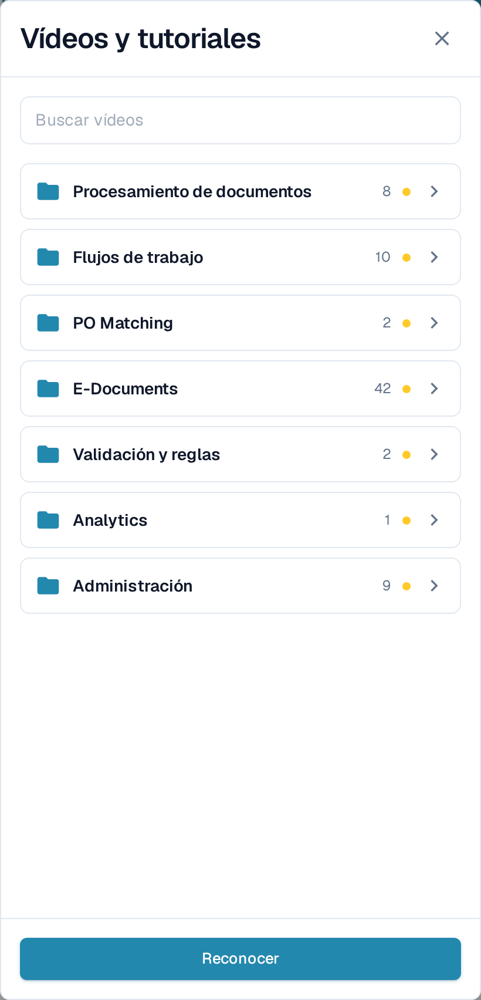
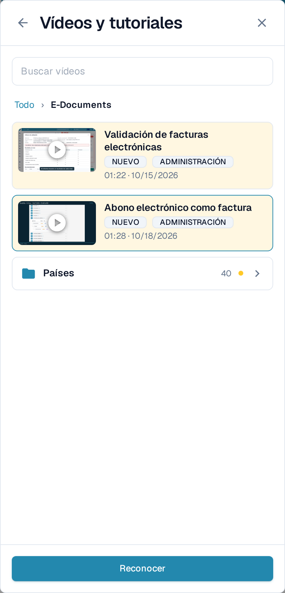
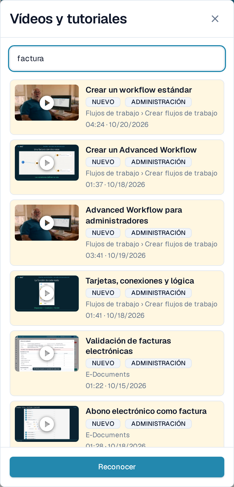
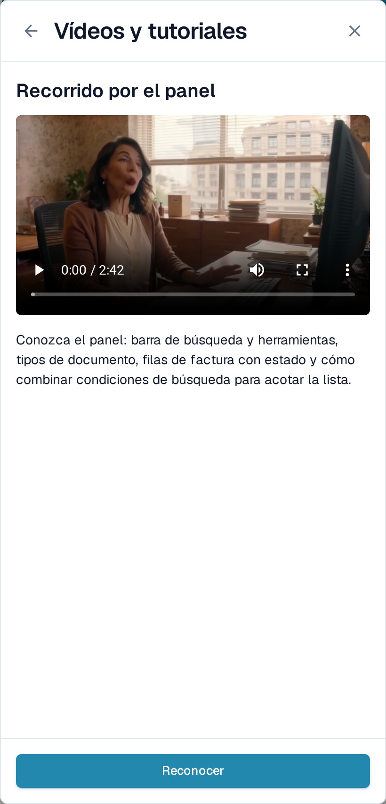

# Vídeos y tutoriales

**Vídeos y tutoriales** reproduce vídeos breves de DocBits sin que tenga que salir de la página en la que está trabajando. Los vídeos están agrupados por tema, de modo que encuentre rápidamente el que corresponde a su tarea.

## Abrir el panel

El icono de vídeo se encuentra en el extremo derecho de la barra superior, después del icono de ayuda.

<figure><figcaption>
El icono de vídeo es el último icono de la barra superior.
</figcaption></figure>

* El icono es **amarillo con un punto pequeño** mientras haya al menos un vídeo sin marcar como visto.
* Adopta el color de los demás iconos de la barra en cuanto haya marcado todos los vídeos.

Seleccione el icono para abrir **Vídeos y tutoriales** como panel en la parte derecha.

<figure><figcaption>
El panel se abre con la lista de temas. Cada tema es una carpeta con su número de vídeos.
</figcaption></figure>

## Recorrer un tema

El panel se abre con las **carpetas de temas**, por ejemplo **Procesamiento de documentos**, **Flujos de trabajo**, **E-Documents** o **Administración**. Una carpeta indica cuántos vídeos contiene y muestra la marca **NUEVO** mientras contenga un vídeo que todavía no haya marcado como visto.

Seleccione una carpeta para abrirla. Dentro encontrará los vídeos de ese tema y, cuando el tema es extenso, otras carpetas que los agrupan, como **Países** dentro de **E-Documents**. La ruta de navegación de la parte superior y la flecha de retroceso le llevan un nivel hacia arriba. Un vídeo que haya abierto desde una carpeta vuelve a esa carpeta al cerrarlo.

<figure><figcaption>
Abra un tema para ver sus vídeos y sus subcarpetas.
</figcaption></figure>

## Buscar un vídeo

Escriba en **Buscar vídeos** para consultar todos los temas a la vez. Cada resultado indica la carpeta a la que pertenece, por ejemplo **Flujos de trabajo › Crear flujos de trabajo**, de modo que sepa dónde está el vídeo. La búsqueda también encuentra nombres de temas y de carpetas, y no distingue mayúsculas ni acentos.

<figure><figcaption>
La búsqueda abarca todos los temas y muestra la carpeta de cada resultado.
</figcaption></figure>

Vacíe el campo de búsqueda para volver a las carpetas de temas.

## Ver un vídeo y marcarlo como visto

Seleccione un vídeo para reproducirlo en el panel. El título y una breve descripción indican qué contenido cubre.

<figure><figcaption>
Reproduzca el vídeo en el panel y márquelo después como visto.
</figcaption></figure>

Seleccione **Reconocer** cuando haya visto el vídeo. Con ello queda marcado como visto solo para su usuario: la marca **NUEVO** desaparece para usted en el vídeo y en su carpeta, y el icono de la barra superior pasa a gris en cuanto no quede nada pendiente. Los demás usuarios siguen viendo sus propios vídeos pendientes.

## Vídeos para administradores y para usuarios

* Los vídeos con la marca **ADMINISTRACIÓN** están dirigidos a administradores. Los administradores ven en el panel tanto los vídeos de administración como los de usuario final; los usuarios finales solo ven estos últimos.
* Si un vídeo no está disponible en el idioma de su interfaz, se muestra la versión en inglés con un código de idioma como **EN**.


Las capturas de pantalla muestran la organización de prueba de DocBits con la aplicación configurada en español.

