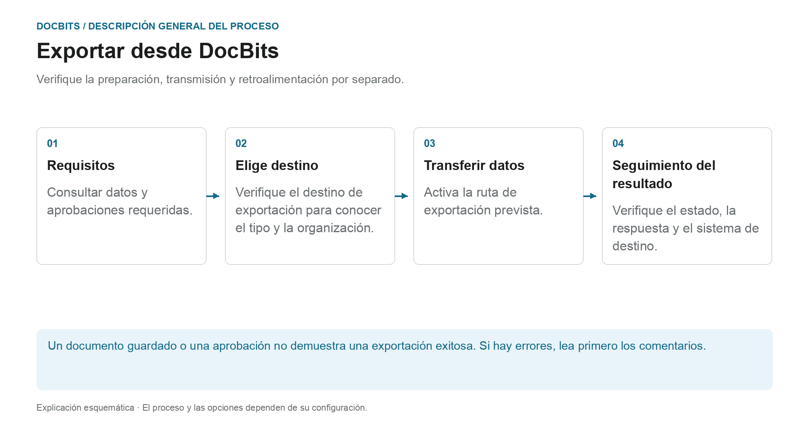

# Exportación en DocBits

## Del documento verificado al sistema de destino

<figure><figcaption>
Verifique la preparación, transmisión y retroalimentación por separado. El diagrama es esquemático; La configuración activa de su organización determina el comportamiento real.
</figcaption></figure>

Al exportar, DocBits transfiere documentos y datos a una conexión establecida. El hecho de que una exportación se ofrezca o se active automáticamente depende del tipo de documento, el estado, el flujo de trabajo y la configuración de exportación.

1. **Consulta prerrequisitos:** Revisa los datos de los documentos, tareas abiertas y aprobaciones que requiere tu proceso. La coincidencia exitosa de PO no reemplaza estos pasos.
2. **Aclarar destino de exportación:** Verifique qué configuración aplica al tipo de documento y organización o suborganización. La gestión de exportaciones admite Infor, Infor & IDM, Webhook y SFTP, entre otros. El volumen de suministro real depende de la conexión establecida.
3. **Activar transferencia:** Utilice la acción del documento prevista o el flujo de trabajo configurado. Se configura una exportación alternativa por separado; su estado de disponibilidad no es el estado que se establecerá después de la exportación.
4. **Consultar comentarios:** Verifique el estado del documento y las respuestas disponibles de los destinatarios. Para una verificación de un extremo a otro, también verifica el proceso asociado en el sistema de destino. Para Infor, pueden seguir pasos de procesamiento adicionales en ION y ERP.

### Si la exportación falla

Abra los detalles del error antes de volver a exportar. El envío repetido no resolverá una asignación incorrecta o un rechazo por parte del destinatario. Utilice la respuesta para verificar los valores del documento, la asignación y la configuración de destino, y verificar si ya se ha creado una transacción en el sistema de destino.

### Instrucciones adicionales

- [Módulo de exportación](export-module.md): Introducción a la administración.
- [Exportar configuración](../../administration-and-setup/settings/document-processing/export.md): Conexiones y alcances.
- [Exportación alternativa](alternate-export.md): ruta de exportación separada por tipo y estado de documento.
- [Exportar a Infor](../exporting-to-infor/README.md): procesamiento Infor aguas abajo.

Una guía para exportar documentos en DocBits.
