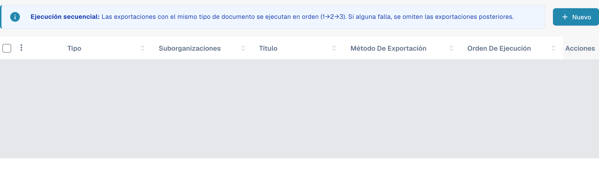
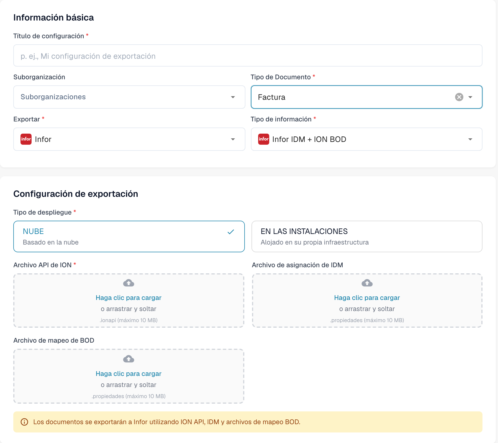

# Crear un endpoint de ION API para exportaciones de DocBits

Un administrador de Infor configura el endpoint de API Gateway para el entorno y la organización de DocBits correspondientes. Utilice la URL de destino, la clave de API y el documento OpenAPI aprobados para ese entorno. Las antiguas imágenes de esta página mostraban un tenant histórico y un formulario de exportación anterior. Esta guía utiliza las instrucciones oficiales de Infor y dos vistas actuales de DocBits en español.

## Antes de empezar

Solicite al administrador de la integración la URL de la API de DocBits, la clave de API autorizada y el nombre de su cabecera, la URL de OpenAPI y los entornos de Infor y DocBits de destino. No incluya claves ni archivos `.ionapi` en capturas, tickets o repositorios. Compruebe que una prueba no pueda enviar documentos a producción.

## Configurar Infor API Gateway {#configuracion-de-infor}

1. En **Available APIs**, cree una suite **Custom or Non-Infor** para el entorno de destino. Siga las [instrucciones de Infor para crear una suite](https://docs.infor.com/inforos/2025.x/en-us/useradminlib_cloud/apigatewayag_cloud/gyy1489512842881.html).
2. Añada un endpoint con la **Target Endpoint URL** aprobada. Elija el tipo de autenticación que requiera ese destino. Para **API Key**, indique **Key Name** y **Key Value** con el nombre definido por el contrato de la API de DocBits y la clave emitida para esta organización. Consulte los [campos del endpoint](https://docs.infor.com/inforos/2024.x/en-us/useradminlib_cloud/apigatewayag_cloud/bmg1489588707659.html). No copie claves de otro entorno.
3. En **Documentation**, añada la URL de OpenAPI/Swagger del entorno siguiendo las [instrucciones de documentación del endpoint](https://docs.infor.com/inforos/2025.x/en-us/useradminlib_cloud/apigatewayag_cloud/tzr1489597424134.html). Compruebe que las operaciones aparezcan en los [metadatos de API Gateway](https://docs.infor.com/inforos/2025.x/en-us/useradminlib_cloud/apigatewayag_cloud/tdr1489674063627.html).
4. Con el administrador de Infor, revise la URL de destino, la autenticación y la ruta del proxy, y realice una llamada de prueba segura fuera de producción antes de usar el endpoint en un flujo de documentos de ION. Guardar una suite de API no demuestra que un documento se haya entregado.

## Configurar la exportación en DocBits {#configuracion-de-exportacion-de-docbits}

En la organización correcta de DocBits, abra **Configuración → Exportar** y seleccione **Nuevo**.

<figure><figcaption>
Nuevo abre una configuración sin guardar. Los datos de las configuraciones existentes están cubiertos en esta captura.
</figcaption></figure>

Introduzca un **Título de configuración**, elija el **Tipo de Documento** y seleccione una **Suborganización** solo si corresponde. En **Exportar**, elija **Infor**; en **Tipo de información**, elija **Infor IDM + ION BOD**. La captura utiliza **Factura** como tipo de documento.

Seleccione el **Tipo de despliegue** adecuado: **NUBE** o **EN LAS INSTALACIONES**. El formulario actual muestra **Archivo API de ION** (`.ionapi`, obligatorio), **Archivo de asignación de IDM** (`.properties`) y **Archivo de mapeo de BOD** (`.properties`). Solicite al administrador los archivos correspondientes al tenant. La captura deja los tres campos de carga vacíos y no contiene un título ni una suborganización guardados.

<figure><figcaption>
Formulario nativo de Infor IDM + ION BOD en español. NUBE está seleccionado; el título, la suborganización y las tres cargas están vacíos. La vista se cerró con Cancelar sin guardar.
</figcaption></figure>

Después de que el administrador valide la ruta de ION, guarde la configuración y pruebe un documento fuera de producción. Compruebe su estado tanto en DocBits como en Infor ION. Un formulario guardado o una entrada en los metadatos no prueban que la exportación haya finalizado correctamente.

Para esta revisión de la documentación se consultaron la lista y el formulario nuevo en español, sin cargar archivos, guardar, activar configuraciones, probar conexiones ni exportar documentos. No se inició sesión en un tenant de Infor ni se configuró un endpoint o flujo de documentos.
