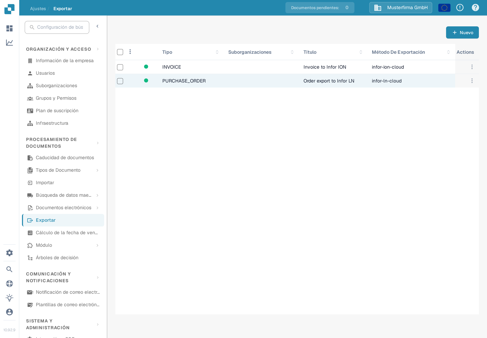
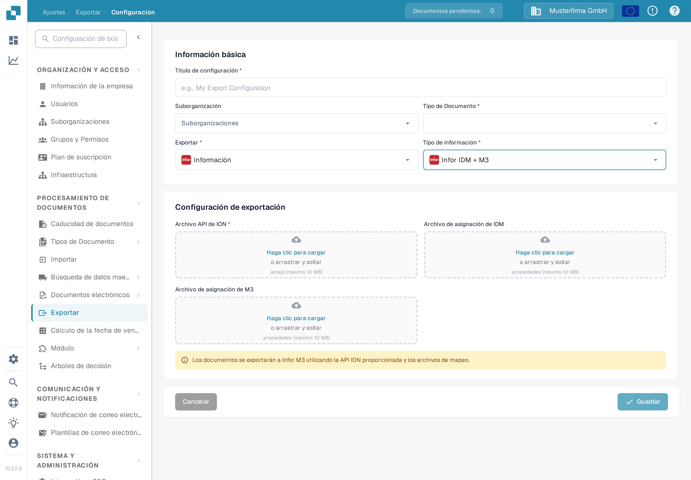

# Configurar una exportación a Infor M3

Esta página explica las comprobaciones que conectan una configuración de exportación de DocBits con un flujo de documentos de Infor ION para M3. La página anterior contenía 38 capturas de pantalla de un tenant antiguo de Infor, incluidos ajustes de API y de mapeo específicos del entorno. No pueden establecer la configuración de su tenant, por lo que la guía actual enlaza con las instrucciones de Infor y muestra el formulario verificado de DocBits. No se probó ninguna conexión con Infor ni ninguna exportación de facturas para esta actualización.

## Preparar el tenant de Infor

Solicite al administrador de Infor el **endpoint de la API de ION** aprobado, un archivo `.ionapi` específico del tenant, los archivos `.properties` de **mapeo de IDM** y de **mapeo de M3**, y los nombres de los mapeos de BOD que utiliza el flujo de facturas de esta empresa. El archivo `.ionapi` contiene credenciales; manténgalo fuera de capturas de pantalla, adjuntos de Jira y Git. Su valor `ci` es el identificador de cliente, como se describe en la [referencia de campos de credenciales de Infor](https://docs.infor.com/crm/9.4.x/en-us/webclient/upi1639111995644.html).

En ION Desk, el administrador debe:

1. Importar y aprobar las versiones de mapeo que requiera el tenant actual. Verifique los nombres de BOD de entrada y salida del mapeo en lugar de reutilizar nombres de una captura antigua.
2. Revisar los puntos de conexión de DocBits y M3, sus identificadores lógicos específicos del entorno, las suscripciones de documentos y los permisos.
3. Construir el flujo de documentos con los mapeos aprobados y los filtros necesarios. Infor explica los [puntos de conexión, mapeos y flujos de documentos](https://docs.infor.com/inforos/2024.x/en-us/useradminlib_cloud/iondeskceug_cloud_osm/lnj1556623308383.html).
4. Guardar, revisar y [activar el flujo de documentos](https://docs.infor.com/depm/2024.x/en-us/depmolh/configuring_ion/jex1510174562552.html) solo después de comprobar las rutas. La activación es distinta de una exportación de documentos correcta.

Para un ejemplo histórico de ION resuelto paso a paso, consulte [Exportación a Infor M3](README.md). Compare cada pantalla de Infor con las de su tenant antes de seguirlo.

## Configurar la exportación en DocBits

En la organización de DocBits prevista, abra **Ajustes → Exportar** y seleccione **Nuevo**. La organización Sandbox Test A en español que se muestra aquí no tiene ninguna configuración de exportación guardada.

Introduzca un **Título de configuración**, elija el **Tipo de documento** (Factura para este flujo) y seleccione una **Suborganización** solo si es necesario. Elija **Infor** en **Exportar** y **Infor IDM + M3** en **Tipo de información**. El formulario actual solicita un **Archivo API de ION** (`.ionapi`, obligatorio), un **Archivo de asignación de IDM** (`.properties`) y un **Archivo de asignación de M3** (`.properties`). Obtenga solo archivos de este tenant y revíselos antes de guardar. La captura de pantalla deja deliberadamente todas las cargas vacías.

Cuando el flujo de Infor esté activo, haga una prueba con una factura que no sea de producción. Compruebe su resultado en DocBits, ION y M3. Una configuración guardada o un flujo activado por sí solos no demuestran que la factura haya llegado.
