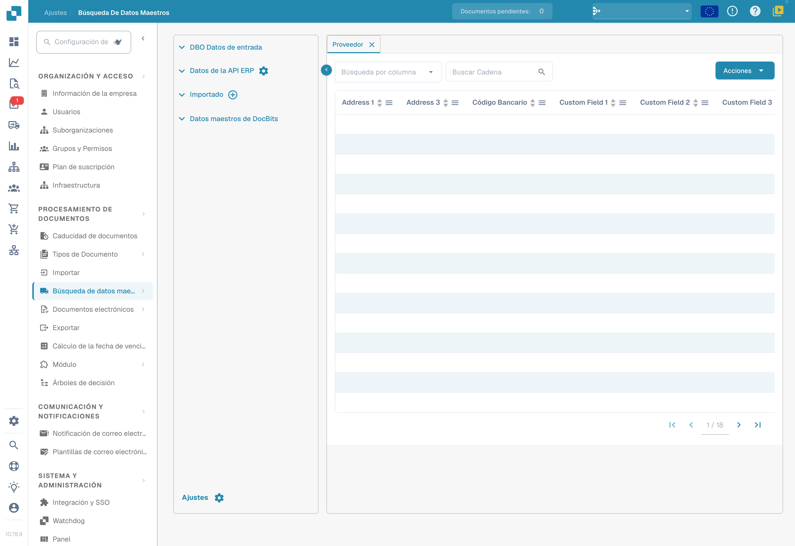
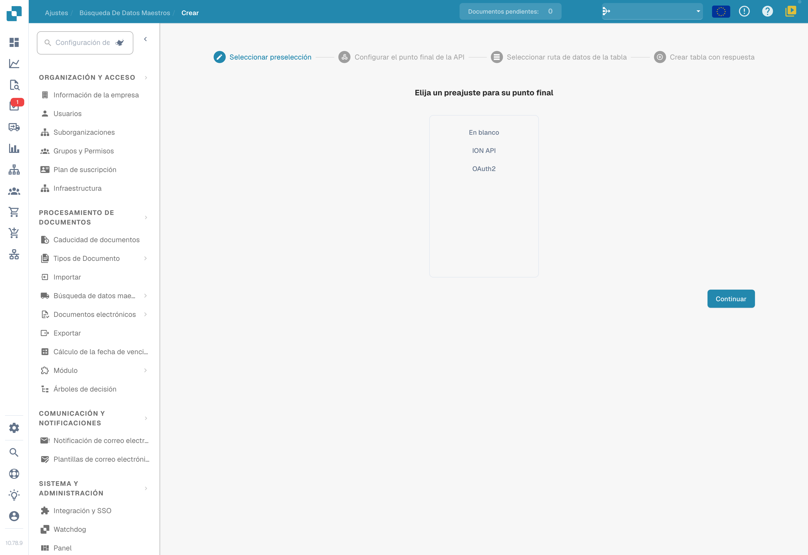
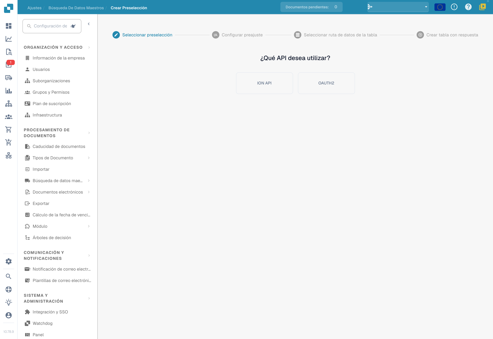

# Datos maestros personalizados

Utilice los datos maestros personalizados para preparar los conjuntos que necesite su organización. Compruebe el origen, los permisos de acceso y la estructura de los datos antes de crear una configuración.

## Acceso

Abra **Ajustes → Módulo → Integración de documentos** y revise **Datos maestros personalizados**. Habilite la función únicamente si lo requiere su configuración. Para estas imágenes no se cambió ningún interruptor.

<figure><figcaption>
Módulos de integración de documentos: scripts, escaneo, extracción de códigos de barras y datos maestros personalizados.
</figcaption></figure>

Abra **Ajustes → Búsqueda de datos maestros** y localice los conjuntos de su organización. Las filas y los nombres privados están ocultos en el ejemplo; esto no significa que las listas estén vacías.

<figure><figcaption>
Fuentes y tabla de datos maestros con los valores ocultos. La etiqueta «DBO Datos de entrada» contiene el acrónimo incorrecto: se trata de BOD. Address y Custom Field son nombres de columnas de la fuente.
</figcaption></figure>

## Crear un conjunto a partir de un preajuste

En el asistente de creación, elija la base adecuada: **En blanco**, **ION API**, **OAuth2** o un preajuste autorizado de su organización. La imagen muestra solo esta selección inicial; no acredita una conexión API ni una tabla creada.

<figure><figcaption>
Paso inicial del asistente de datos maestros con En blanco, ION API y OAuth2. Los nombres de preajustes de la organización están ocultos. No se seleccionó ningún preajuste ni se creó una tabla.
</figcaption></figure>

Siga las etapas que ofrece el asistente: configuración del endpoint de la API, selección de la ruta de datos de la tabla y creación a partir de la respuesta. Revise la URL, el método, la autenticación y los parámetros de su origen. Compruebe la respuesta y la correspondencia de columnas antes de crear el conjunto.

Si la configuración requiere una ruta de datos, utilice el formato que admita ese campo y verifíquelo con la respuesta real. Consulte la [referencia de expresiones JSONPath](https://docs.hevodata.com/sources/engg-analytics/streaming/rest-api/writing-jsonpath-expressions/) para distinguir la sintaxis de rutas y las estructuras de ejemplo.

## Preparar una preselección reutilizable

La pantalla **Crear Preselección** permite empezar por **ION API** u **OAUTH2**. Seleccione el método adecuado para el servicio y complete la configuración y la asignación de datos que solicite el asistente.

<figure><figcaption>
Paso inicial de Crear Preselección con las opciones ION API y OAUTH2. Son nombres de protocolos. No se introdujeron credenciales ni se guardó una preselección.
</figcaption></figure>

Las credenciales y los valores de API pertenecen al entorno y a la organización correspondientes. No los copie de una captura de ejemplo. Durante esta revisión no se eligió ninguna API, no se introdujeron credenciales, no se continuó el asistente ni se guardó ninguna tabla o preselección.
