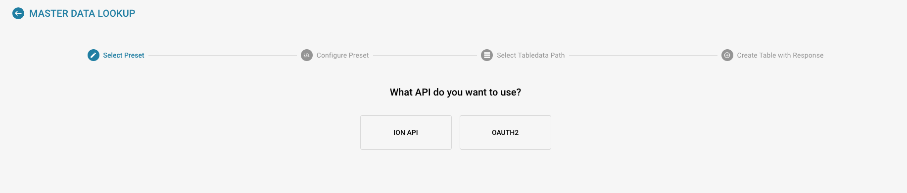

# Custom Master Data

#### Activar Custom Master Data 

Desde el Dashboard, navegue a Settings → Document Processing → Module.

.png>)

<figure><figcaption></figcaption></figure>

En Module, active Custom Master Data pulsando el control deslizante, como se muestra a continuación.

<figure><figcaption></figcaption></figure>

#### Descripción general de la función 

Para añadir sus propios datos maestros a DocBits, navegue a Master Data Lookup en Settings.

<figure><figcaption></figcaption></figure>

Haga clic en “Custom Master Data”.

<figure><figcaption></figcaption></figure>

A continuación, tendrá la opción de crear una plantilla (Template) o un endpoint (Endpoint).

<figure><figcaption></figcaption></figure>

#### Crear una plantilla 

El primer paso es elegir entre utilizar el archivo ION API de su organización o utilizar OAuth2 e introducir los datos necesarios.

<figure><figcaption></figcaption></figure>

A continuación, configuraremos los valores predefinidos. Aquí introducirá el nombre de la tabla de datos maestros y la URL de la llamada a la API.

<figure><figcaption></figcaption></figure>

Después deberá introducir la ruta JSON mediante notación de puntos; para obtener más información sobre la notación de puntos, haga clic [aquí](https://docs.hevodata.com/sources/engg-analytics/streaming/rest-api/writing-jsonpath-expressions/).

Por último, deberá asignar los datos a las columnas que desea crear, como en el ejemplo siguiente.

<figure><figcaption></figcaption></figure>

Una vez hecho esto, haga clic en Done para que se cree y se rellene su nuevo dato maestro.

#### Crear un endpoint 

El primer paso es elegir entre utilizar el archivo ION API de su organización, utilizar OAuth2 o dejarlo en blanco e introducir los datos necesarios.

<figure><figcaption></figcaption></figure>

A continuación, configuraremos los valores predefinidos. Aquí introducirá el nombre de la tabla de datos maestros y la URL de la llamada a la API.

<figure><figcaption></figcaption></figure>

Después deberá introducir la ruta JSON mediante notación de puntos; para obtener más información sobre la notación de puntos, haga clic [aquí](https://docs.hevodata.com/sources/engg-analytics/streaming/rest-api/writing-jsonpath-expressions/).

Por último, deberá asignar los datos a las columnas que desea crear, como en el ejemplo siguiente.

<figure><figcaption></figcaption></figure>

Una vez hecho esto, haga clic en Done para que se cree y se rellene su nuevo dato maestro.
