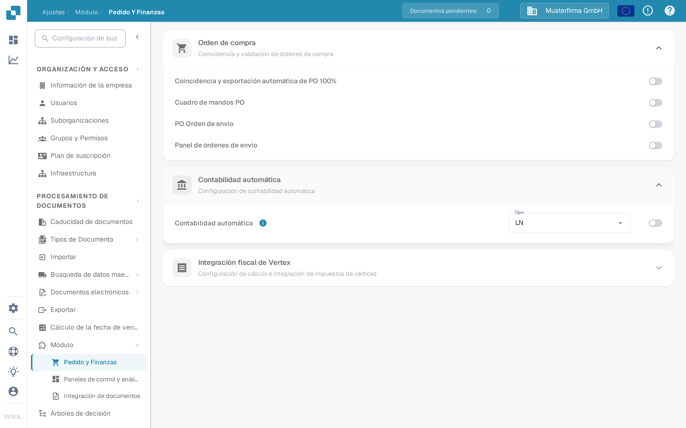

# Contabilidad automática con Infor LN

Use esta guía cuando un administrador de Infor LN quiera que DocBits use los datos maestros financieros importados para la contabilidad automática. La página anterior mostraba 48 pantallas de un inquilino de Infor concreto. Los nombres de puntos de conexión, las asignaciones, las credenciales y las direcciones de punto de conexión de ese inquilino no son una configuración reutilizable.

## Buscar la opción en DocBits

Abra **Ajustes → Módulo → Pedido y Finanzas → Contabilidad automática** con una cuenta de administrador. El menú **Tipo** ofrece **LN** y **M3**. Para una integración con LN, compruebe que el tipo seleccionado es **LN**. Active el interruptor solo después de verificar la sociedad LN prevista, el flujo de BOD y los datos maestros importados. Cambiar el tipo o el interruptor puede afectar al comportamiento contable, así que siga el proceso de cambios de su organización.

Las siguientes capturas de pantalla provienen del entorno de pruebas sintético **DocBits Documentation Test A**. En esta organización, **LN** estaba seleccionado y la contabilidad automática estaba **desactivada**. El menú se abrió sin seleccionar otro valor; no se guardó ninguna configuración.

<figure><figcaption>
Localice la contabilidad automática y compruebe el tipo seleccionado antes de activarla.
</figcaption></figure>

<figure><figcaption>
LN y M3 son los tipos disponibles en este entorno de pruebas; no se cambió ninguna selección.
</figcaption></figure>

## Preparar LN e ION

1. Confirme la sociedad LN, la unidad contable, la organización de DocBits y el entorno de destino. Acuerde con su administrador de DocBits qué operación de API actual y qué asignación de campos recibirán cuentas y dimensiones. Guarde las credenciales de API en el almacén de secretos aprobado, nunca en una captura de pantalla ni en un adjunto de Jira.
2. Configure la publicación de BOD en LN y valide la configuración de datos de publicación. Infor documenta **BOD Parameters (tcbod0100m000)** y **Validate Publishing Data Setup (tcbod0300m000)** en su [guía de publicación de BOD de LN](https://docs.infor.com/ln/10.7.in/en-us/lnolh/help/tc/onlinemanual/000520.html).
3. Compruebe qué sustantivos (nouns) requieren su versión de LN y la operación de recepción de DocBits. El ejemplo anterior usaba `Sync.ChartOfAccounts` y `Sync.CodeDefinition` para los datos del plan de cuentas y de las dimensiones. La página de Infor [Publish Financial Master Data (tfbia0200m000)](https://docs.infor.com/ln/2025.x/en-us/lnolh/tfolh/help/tf/bia/tfbia0200m000.html) enumera las opciones Chart of Accounts y CodeDefinition. Algunas pestañas de CodeDefinition aparecen solo después de que la asignación de dimensiones se haya especificado y aprobado. Confirme las versiones de documento y los campos exactos en su inquilino antes de dirigirlos.
4. En **ION Desk → Connect → Connection Points**, conecte el origen LN con el destino de API de DocBits aprobado. En **Data Flows**, dirija los documentos seleccionados, revise los filtros y la asignación y, después, guarde y active. Infor distingue entre [guardar y activar un flujo](https://docs.infor.com/inforos/latest/en-us/useradminlib_cloud/iondeskceug/lsm1436532178755.html).
5. En LN, use un identificador de prueba no sensible. En **Publish Financial Master Data**, use primero **Count** o **Simulate** para inspeccionar la selección y haga **Publish** solo dentro del cambio aprobado por el administrador. La acción de publicación no depende del destino: Infor indica que entrega a todos los suscriptores. Siga la pista de ese identificador y de los posibles errores en [ION OneView](https://docs.infor.com/inforos/latest/en-us/useradminlib_cloud/iondeskceug/lsm1436532196155.html).

## Confirmar el resultado en DocBits

Pida al administrador de DocBits que verifique el registro recibido, la organización y los campos contables en los registros de importación o de API actuales. Cuando la tabla de búsqueda correspondiente esté accesible, busque el mismo identificador en **Ajustes → Procesamiento de documentos → Búsqueda de datos maestros**. Un flujo de ION activado con éxito no demuestra por sí solo que DocBits haya aceptado un registro. Si falta un valor, compare el BOD de origen, la asignación de ION, la respuesta de la API y la organización de destino antes de activar la contabilidad automática.

No había ningún inquilino de LN ni transferencia real de BOD financiero disponible para una prueba de extremo a extremo. Las nuevas capturas del entorno de pruebas solo verifican los controles actuales de DocBits. El administrador del inquilino debe validar la asignación final y el resultado contable.
