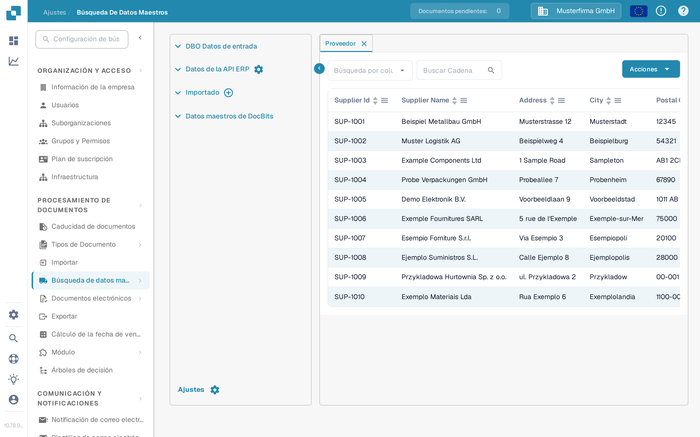
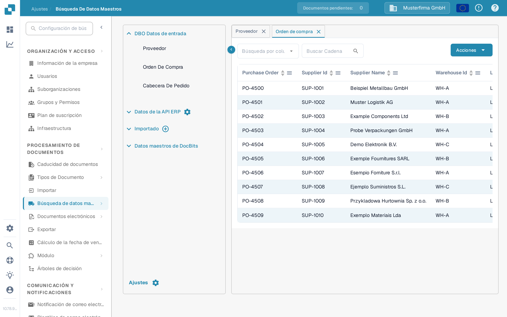

# Importar desde Infor M3 a DocBits via API

Utilice esta guía cuando un administrador de Infor M3 necesite entregar BODs seleccionados a DocBits a través de Infor ION y API Gateway. La versión anterior de esta página contenía 42 capturas de pantalla de un tenant antiguo de Infor y direcciones fijas de la API de Sandbox. Esas pantallas y direcciones no son una plantilla de configuración segura para otro tenant.

La ruta que se debe comprobar es **M3 publica un BOD → ION lo enruta → API Gateway llama a la API de DocBits → DocBits muestra el registro importado**. Cada etapa tiene su propio estado. Ver un registro en DocBits es la comprobación final; un flujo de datos activo en ION, por sí solo, no demuestra una importación.

## Antes de configurar el flujo

1. Confirme la empresa de M3, el tenant de ION, la organización de DocBits y el entorno que desea conectar. Pida a un administrador de DocBits la URL base actual de la API y la operación de API requerida en la descripción OpenAPI de ese entorno. Los hosts regionales pueden diferir; no copie un host ni una ruta de proxy de API Gateway de una captura de pantalla antigua.
2. Acuerde qué tipos de documento necesita la organización. Los datos maestros de proveedores y pedidos de compra pueden comprobarse en DocBits. Añada documentos de entrega y de contabilidad solo cuando su caso de uso y su operación de recepción estén confirmados.
3. Prepare una cuenta de servicio de Infor con permiso para la operación de API seleccionada y una credencial de API de DocBits con el acceso mínimo necesario. Introduzca las credenciales solo en la pantalla de configuración autorizada. No pegue un archivo `.ionapi` completo ni una clave de API en una página de documentación, un issue de Jira o una captura de pantalla.
4. Guarde un identificador de prueba no confidencial para cada BOD elegido, para poder seguir el mismo registro en M3, ION OneView y DocBits.

## Elija el documento y la operación de recepción

El ejemplo del tenant antiguo utilizaba estos BODs. Utilice los metadatos actuales de la API y su diseño de integración para confirmar cada asignación antes de crear un punto de conexión:

| BOD en el ejemplo antiguo                                                                   | Datos previstos en DocBits                             | Dónde comprobar el formato de recepción                                                                              |
| ------------------------------------------------------------------------------------------- | ------------------------------------------------------ | -------------------------------------------------------------------------------------------------------------------- |
| `Sync.SupplierPartyMaster`, `Sync.RemitToPartyMaster`                                       | Datos maestros de proveedores                          | [Importación del BOD de proveedores](../importing-via-the-api/supplier-bod.md)                                       |
| `Sync.PurchaseOrder`                                                                        | Pedidos de compra                                      | [Importación del BOD de pedidos de compra](../importing-via-the-api/purchase-order-bod.md)                           |
| `Sync.ReceiveDelivery`                                                                      | Datos de entregas                                      | [Importación del BOD de Receive Delivery](../importing-via-the-api/receive-delivery-bod.md)                          |
| `Sync.AdvanceShipNotice`, `Sync.ChartOfAccounts`, `Sync.CodeDefinition-AccountingDimension` | Datos maestros adicionales para funciones configuradas | [Importación XML de datos maestros](../importing-via-the-api/master-data-xml.md) y los metadatos de API de su tenant |

`Acknowledge.SupplierInvoice` pertenece a un flujo de confirmación de facturas y debe configurarse aparte de una importación de datos maestros de M3 a DocBits. La página anterior mezclaba estas direcciones e incluía un cuerpo de solicitud específico de un tenant; no copie ese cuerpo en un flujo nuevo sin revisar el contrato del endpoint y los controles de acceso.

## Configure Infor OS e ION

1. En Infor OS, prepare el destino de API Gateway para la operación de API de DocBits **confirmada**. Compruebe la URL de destino, el método de solicitud, el formato de la solicitud y la autenticación con el administrador de DocBits. Utilice la [guía actual de Infor API Gateway](https://docs.infor.com/inforos/2025.x/en-us/useradminlib_cloud/apigatewayag_cloud/ionapi_2025.x_apigatewayag_cloud_en-us.pdf) para los controles de la Gateway.
2. En **ION → Connect → Connection Points**, cree o seleccione el punto de conexión para la API de DocBits. Añada solo los BODs elegidos en **Documents**, seleccione la operación de Gateway correspondiente y configure la carga de solicitud que espera la operación. Las [instrucciones del elemento API](https://docs.infor.com/inforos/latest/en-us/useradminlib_cloud/iondeskceug/hqg1491985489422.html) de Infor explican la cuenta de servicio y los ajustes de solicitud.
3. En **ION → Connect → Data Flows**, conecte el origen M3 y el destino de API. Revise la lista de documentos, los filtros y las asignaciones; después guarde y active el flujo. Infor distingue entre [guardar y activar un flujo de datos](https://docs.infor.com/inforos/latest/en-us/useradminlib_cloud/iondeskceug/lsm1436532178755.html).
4. Publique desde M3 un BOD de prueba aprobado. En **ION OneView**, busque ese identificador y confirme qué punto de conexión, asignación y llamada de API lo procesaron. Consulte [Infor OneView](https://docs.infor.com/inforos/latest/en-us/useradminlib_cloud/iondeskceug/lsm1436532196155.html). Si no se muestra ninguna ruta o aparece un error, corrija el flujo de ION antes de comprobar DocBits.

## Verifique el resultado en DocBits

Abra **Ajustes → Procesamiento de documentos → Búsqueda de datos maestros**. Expanda **DBO Datos de entrada**, elija el tipo relevante y busque el identificador de prueba. Las pestañas **Proveedor** y **Orden de compra** que se muestran a continuación son vistas actuales en español de la organización sintética **DocBits Documentation Test A**. Sus filas de demostración existentes **no son prueba de una importación desde M3**.

<figure><figcaption>
Elija Proveedor, seleccione una columna de búsqueda e introduzca el identificador de proveedor de prueba.
</figcaption></figure>

<figure><figcaption>
Elija Orden de compra y busque el pedido de prueba; las filas de la imagen son datos de demostración sintéticos.
</figcaption></figure>

En cualquiera de las dos pestañas, el menú desplegable de columnas elige el campo, el cuadro de búsqueda acepta el identificador y la lupa ejecuta la búsqueda. Las cabeceras de la tabla ordenan las filas visibles; las flechas de la parte inferior avanzan entre páginas. **Acciones** abre las operaciones de la tabla y no es necesaria para esta comprobación de solo lectura. La **×** de una pestaña la cierra. El botón «más» de **Importado** sirve para subir CSV, no para recibir un BOD de ION.

Si el BOD aparece en OneView pero el registro falta en DocBits, compruebe la operación de API y su respuesta, la organización/entorno, el tipo de documento, el formato de la carga y el identificador usado en la búsqueda. Pida al administrador de DocBits el registro de importación correspondiente. No deduzca el éxito de una llamada HTTP ni de una captura de pantalla de una fila de demostración sin relación.

Esta página se actualizó con los controles actuales de DocBits Sandbox y la documentación de Infor. No había disponible un tenant de Infor ni una transferencia real de BOD de M3 a DocBits para una prueba de extremo a extremo; un administrador del tenant debe validar la asignación y el resultado finales.
