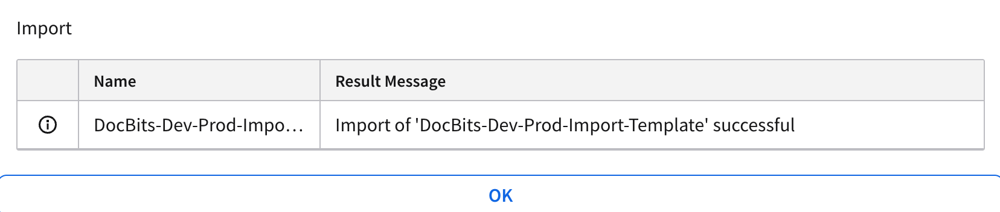

# M3\_OLD

## Importar una plantilla de conexión API en Infor M3

Esta guía explica cómo importar una plantilla de conexión API para configurar rápidamente los ajustes clave de la integración con Infor M3. El uso de una plantilla permite establecer una configuración de conexión predefinida, lo que simplifica el proceso y garantiza la coherencia.

<mark style="color:red;">**Nota**</mark>: Para la configuración detallada de áreas específicas como Auto Accounting, la integración de proveedores, las órdenes de compra o la extracción de tablas para elementos de costes, consulte la documentación correspondiente:

* [Auto Accounting](m3/auto-accounting.md)
* [Suppliers and Purchase Order](m3/suppliers-and-purchase-orders.md)
* [How to import all suppliers](m3/how-to-import-all-suppliers.md)
* [Table Extraction for costing element](m3/table-extraction-for-costing-element.md)

### **Descargar la plantilla**

Antes de importar, descargue la plantilla de conexión necesaria con el siguiente archivo:



### Importar la plantilla

#### Pasos para importar una plantilla de conexión

1. **Acceda a Infor ION Desk:**
   *   Navegue a **InforOS** → **ION Desk** → **Connect** → **Connection Points**.

       
2. **Importe la plantilla:**
   *   Haga clic en el botón **Import**.

       <figure><figcaption></figcaption></figure>
   * Seleccione el **archivo de plantilla** adecuado de su sistema local.
   *   Haga clic en **OK** para iniciar el proceso de importación.

       <figure><figcaption></figcaption></figure>
3. **Confirmación:**
   *   Si la importación se realiza correctamente, se mostrará un mensaje de confirmación.

       <figure><figcaption></figcaption></figure>
4. **Configuración posterior a la importación:**
   * Después de importar la plantilla, puede personalizar los ajustes de conexión específicos según sea necesario.
   * No olvide importar o configurar su **Service Account** para la autenticación y el control de acceso.

<figure><figcaption></figcaption></figure>
