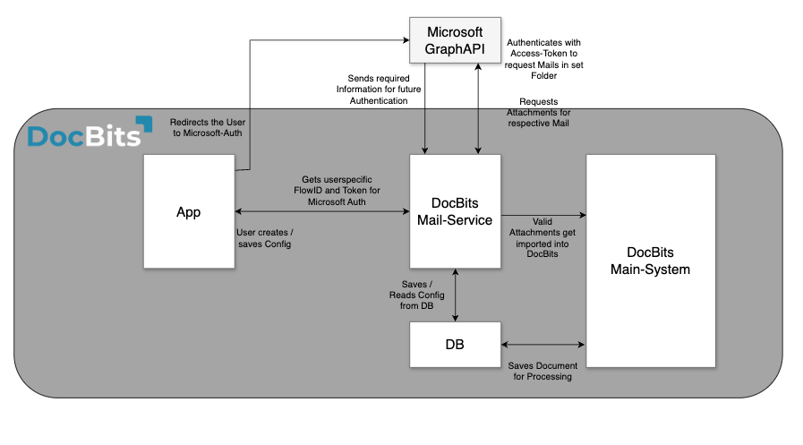

# Arquitectura

## **Cliente de DocBits Cloud**

<figure><figcaption></figcaption></figure>

## DocBits en instalación local

<figure><figcaption></figcaption></figure>

Doc**Bits** se integra sin problemas con Infor LN/M3 a través de ION API, ION Desk y los BODs estándar de Infor. Nuestra integración API nos permite exportar datos a Infor y realizar la validación de datos maestros en Doc**Bits**.

## **Arquitectura de DocBits Operator**

Todas las conexiones entre componentes están protegidas mediante protocolos de cifrado estándar del sector. SSH, HTTPS y otros canales seguros garantizan la integridad y la confidencialidad de los datos en todo el sistema.

**En la instalación local:**

<figure><figcaption></figcaption></figure>


[prefect-local-setup-requirements.md](prefect-local-setup-requirements.md)


**Cloud**:

<figure><figcaption></figcaption></figure>

## Exportación de datos a Infor

Utilizamos la ION API para enviar el PDF con atributos a IDM y el BOD Sync.CaptureDocument a ION Desk. En ION Desk, transformamos el [Sync.CaptureDocument](../../infor-integration-and-configuration/exporting-in-docbits/) en los BODs de destino deseados según el tipo de documento que se esté procesando. Estos BODs de Infor transformados se importan automáticamente a LN o M3.


Exportar a [Infor](../../infor-integration-and-configuration/exporting-to-infor/)


## Validación de datos maestros en DocBits

Para identificar al proveedor o comparar/igualar líneas de pedidos de compra, activamos un disparador en LN/M3 que envía los BODs Sync.RemitToPartyMaster, Sync.SupplierPartyMaster y Sync.PurchaseOrder a Doc**Bits**. Configuramos este proceso en ION Desk definiendo el flujo de datos hacia un punto de conexión específico de Doc**Bits**.

<figure><figcaption></figcaption></figure>


[Validación de datos maestros](../../infor-integration-and-configuration/importing-customer-master-data/)


## Importación de correo electrónico con OAuth Office365

<figure><figcaption></figcaption></figure>
