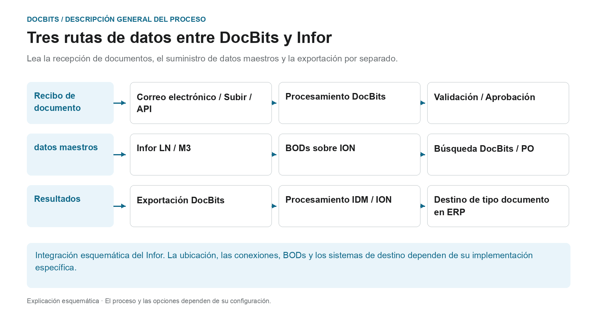

# Arquitectura

## La arquitectura como tres rutas de datos separadas.

<figure><figcaption>
Lea la recepción de documentos, el suministro de datos maestros y la exportación por separado. El diagrama es esquemático; La configuración activa de su organización determina el comportamiento real.
</figcaption></figure>

La arquitectura contiene varios flujos de datos con diferentes propósitos. Los documentos se importan para su procesamiento; los datos maestros provienen de la integración ERP; Los resultados reconocidos y revisados ​​se devuelven a través de la ruta de exportación configurada. Estas rutas son conexiones separadas y deben rastrearse por separado durante el diagnóstico.

| Ruta de datos | Dirección y propósito | Punto de control |
| --- | --- | --- |
| **Recepción del documento** | Correo electrónico, carga o interfaz → DocBits. Los documentos se envían al proceso de procesamiento previsto. | ¿Llegó el documento correcto a la organización adecuada? |
| **Suministro de datos maestros** | Flujo de datos LN/M3 → BODs y ION → DocBits. Los proveedores y los pedidos se ponen a disposición para su identificación y conciliación. | ¿DocBits ha transferido y aceptado el conjunto de datos requerido? |
| **Exportación de resultados** | DocBits → conexión Infor configurada → IDM o ION y ERP. Los documentos y los datos comerciales pueden tomar diferentes caminos posteriores. | ¿Está acreditado el traslado y la respectiva tramitación en destino? |

En la exportación Infor que se describe aquí, PDF y sus atributos se envían a IDM y `Sync.CaptureDocument` se envía a ION Desk. ION lo transforma en el destino requerido BODs según el tipo de documento. La aceptación por parte de LN o M3 debe verificarse en el respectivo sistema de destino; un paso DocBits por sí solo no prueba todos los pasos del procesamiento posterior.

**Utilice la descripción general para investigar errores:** Si falta un documento, comience con la importación. Si faltan proveedores o líneas de orden de compra, siga la ruta de datos maestros. Si la transferencia de devolución falla, verifique la configuración de exportación, la respuesta del destinatario y el procesamiento de ION/ERP. Los diagramas de arquitectura a continuación agregan detalles de implementación y componentes a esta descripción general del proceso.

Además: [Importar documentos](../../end-user-and-partner-section/end-user-section/how-to-import-documents/README.md), [Importar datos maestros de clientes](../../infor-integration-and-configuration/importing-customer-master-data/README.md) y [Exportar desde DocBits](../../infor-integration-and-configuration/exporting-in-docbits/README.md).

## **Cliente de DocBits Cloud**

<figure><figcaption></figcaption></figure>

## DocBits en instalación local

<figure><figcaption></figcaption></figure>

Doc**Bits** se integra sin problemas con Infor LN/M3 a través de ION API, ION Desk y los BODs estándar de Infor. Nuestra integración API nos permite exportar datos a Infor y realizar la validación de datos maestros en Doc**Bits**.

## **Arquitectura de DocBits Operator**

Todas las conexiones entre componentes están protegidas mediante protocolos de cifrado estándar del sector. SSH, HTTPS y otros canales seguros garantizan la integridad y la confidencialidad de los datos en todo el sistema.

**En la instalación local:**

<figure><figcaption></figcaption></figure>


[prefect-local-setup-requirements.md](prefect-local-setup-requirements.md)


**Cloud**:

<figure><figcaption></figcaption></figure>

## Exportación de datos a Infor

Utilizamos la ION API para enviar el PDF con atributos a IDM y el BOD Sync.CaptureDocument a ION Desk. En ION Desk, transformamos el [Sync.CaptureDocument](../../infor-integration-and-configuration/exporting-in-docbits/) en los BODs de destino deseados según el tipo de documento que se esté procesando. Estos BODs de Infor transformados se importan automáticamente a LN o M3.


Exportar a [Infor](../../infor-integration-and-configuration/exporting-to-infor/)


## Validación de datos maestros en DocBits

Para identificar al proveedor o comparar/igualar líneas de pedidos de compra, activamos un disparador en LN/M3 que envía los BODs Sync.RemitToPartyMaster, Sync.SupplierPartyMaster y Sync.PurchaseOrder a Doc**Bits**. Configuramos este proceso en ION Desk definiendo el flujo de datos hacia un punto de conexión específico de Doc**Bits**.

<figure><figcaption></figcaption></figure>


[Validación de datos maestros](../../infor-integration-and-configuration/importing-customer-master-data/)


## Importación de correo electrónico con OAuth Office365

<figure><figcaption></figcaption></figure>
