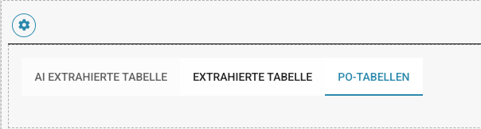
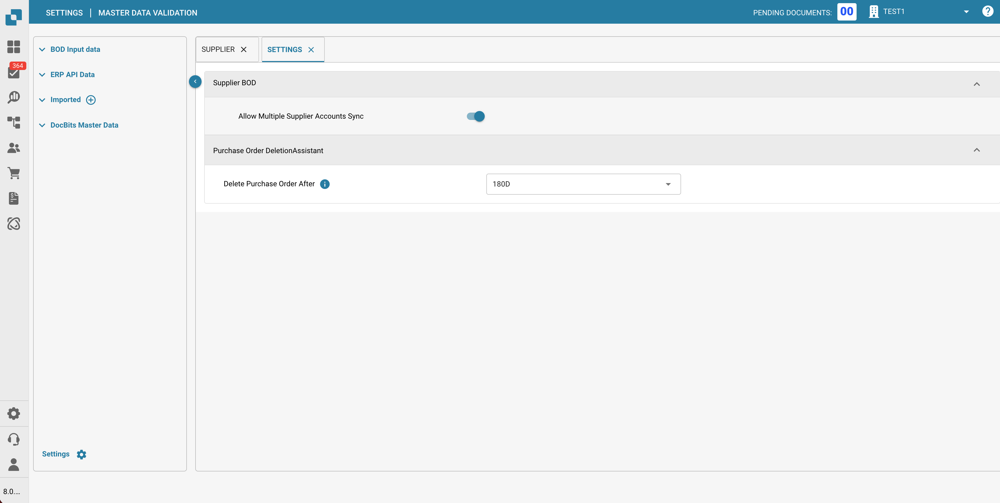
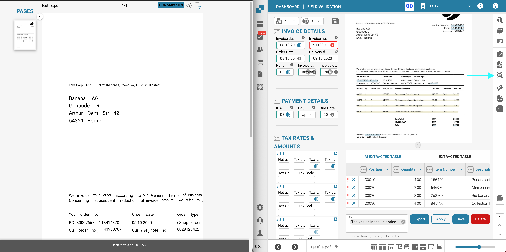
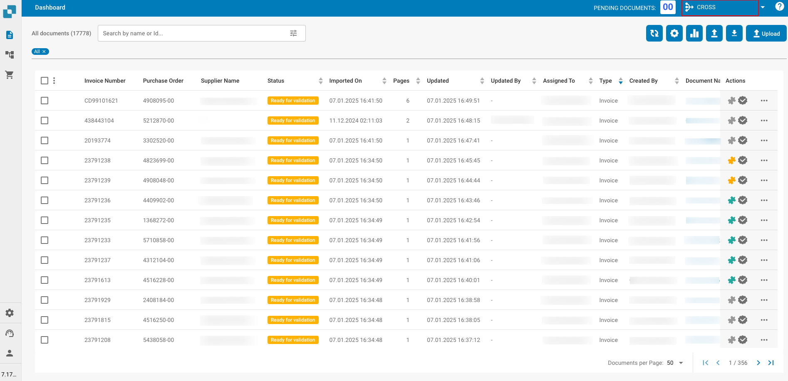
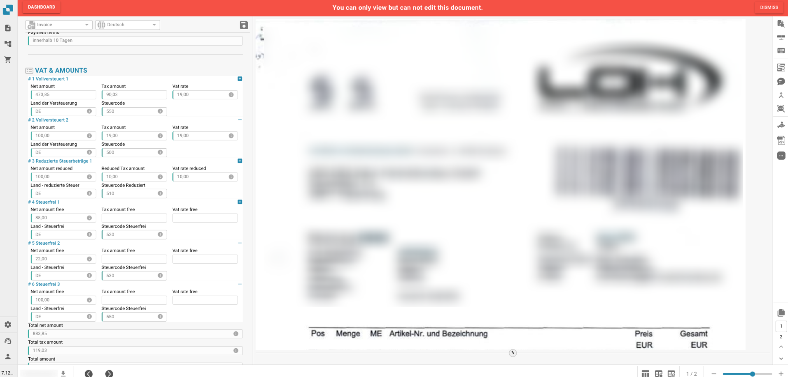
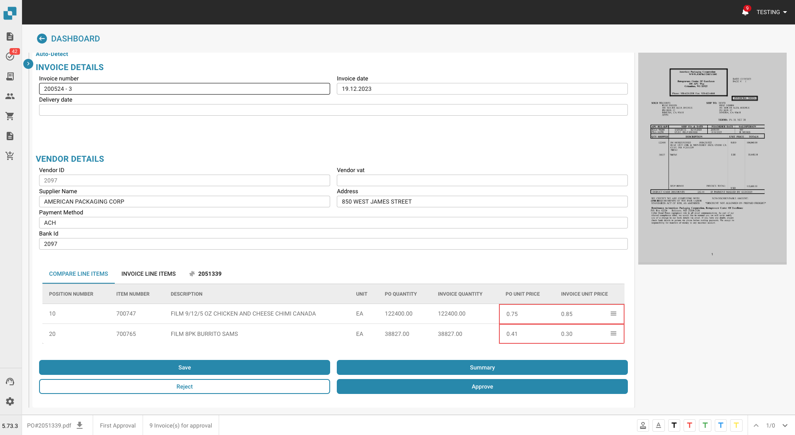
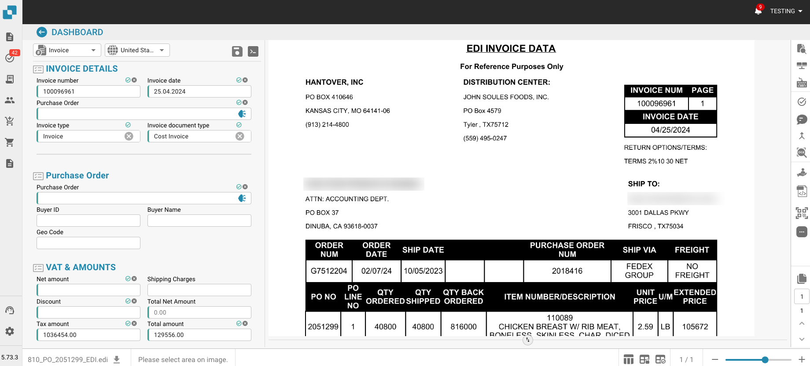

# Notas de la versión

**Disponibilidad de NOVA R1.1:** Disponible en el entorno de pruebas desde el **16 de octubre de 2026**. El lanzamiento en producción está previsto para el **4 de noviembre de 2026**.



**DocBits es el producto. NOVA es el nombre del ciclo de versiones.** [Ver el vídeo sobre la nueva versión de DocBits](https://docbits-videos.fra1.cdn.digitaloceanspaces.com/settings-assistant/nova-release/v1/es.mp4) · [Subtítulos](https://docbits-videos.fra1.cdn.digitaloceanspaces.com/settings-assistant/nova-release/v1/es.vtt).

Elija un canal de versiones para ver qué cambios se aplican a su equipo. **El ciclo NOVA incorpora la nueva versión principal de DocBits con capacidades adicionales para clientes. Los hotfixes de VESTA mejoran la versión de producción actual.** Consulte el [ciclo de vida de versiones](../docbits-release-lifecycle-strategy.md) para conocer la disponibilidad y el cambio entre canales.

**Las antiguas funciones beta de VESTA están incluidas en el entorno de pruebas de NOVA.** Todas las funciones anteriormente disponibles como beta en VESTA forman parte del conjunto de funciones estándar de NOVA y pueden probarse antes del lanzamiento previsto en producción. También se incorporarán al conjunto de funciones estándar de VESTA con el [siguiente hotfix, previsto para el **11 de noviembre de 2026**](vesta-hotfix-11-november-2026.md).

| Canal de versiones | Notas de la versión | Enfoque |
| --- | --- | --- |
| **NOVA – Versión principal** | [Novedades para clientes](nova-major-release.md) · **4 de noviembre de 2026 (previsto)** | Todas las funciones que antes estaban en beta en VESTA, además de nuevas capacidades y extensiones en comparación con VESTA R1.0.15. |
| **VESTA — Siguiente hotfix (planificado)** | [11 de noviembre de 2026](vesta-hotfix-11-november-2026.md) | Introduce todas las funciones que antes estaban en beta en VESTA en el conjunto de funciones regular de VESTA. |
| **VESTA — Versión hotfix** | [14 de octubre de 2026 — R1.0.15](incremental-updates-14-october-2026.md) | Mejoras y correcciones para la versión de producción actual de VESTA. |

## NOVA – Versión principal 4 de noviembre de 2026

### Qué obtiene su equipo con NOVA

* **Use las funciones que antes estaban en beta en VESTA como funciones regulares de NOVA.** Todas las funciones que antes se ofrecían en beta en VESTA están incluidas en NOVA, incluidos los controles de gestión de reglas y diseños. La configuración de la organización, los interruptores por tipo de documento y los permisos siguen aplicándose.
* **Resuelva bloqueos de documentos con el Asistente de validación.** Pregunte qué impide procesar un documento, acceda al campo relevante y revise las correcciones sugeridas sin salir del documento.
* **Convierta correcciones repetidas en mejoras de automatización revisadas.** Los revisores pueden enviar solicitudes de mejora; los administradores pueden evaluar propuestas de reglas aprendidas, revisar los documentos afectados y medir el resultado tras la activación.
* **Comprenda y actúe ante errores de facturas electrónicas.** Utilice informes agrupados por nivel de validación, revise las políticas por tipo de documento y su historial, y rechace una factura elegible con un motivo registrado.
* **Configure y controle importaciones por FTP/SFTP.** Utilice el asistente de conexión, siga los pasos de importación por archivo, configure reintentos y notificaciones de fallo, y opcionalmente elimine los archivos de origen tras una importación exitosa.
* **Concilie líneas de entrega con menos acciones repetidas.** Seleccione primero las líneas de documento o de pedido de compra y vincúlelas en cualquier dirección. Las exportaciones configuradas pueden conservar detalles de sublíneas y agrupar registros por valores de línea.
* **Mantenga el trabajo exportado separado del trabajo completado.** Utilice el estado Exported para el procesamiento de seguimiento y opcionalmente bloquee los documentos Finished contra la reapertura ordinaria.
* **Acceda directamente a los controles de reglas y diseños.** Abra los paneles de gestión sin un enlace beta, busque y previsualice diseños, y abra el editor de diseños desde un documento.
* **Controle la extracción y la administración rutinaria.** Reinicie un documento con un número de páginas elegido, decida si se extraen campos ocultos, utilice acciones adicionales del Asistente de configuración y limite las reglas de notificación a una suborganización.

### Guías para configurar reglas

* [**Reglas de transformación**](../../administration-and-setup/settings/global-settings/document-types/transformation-rules.md): limpie y reescriba los valores extraídos, construya una secuencia de pasos y previsualice el resultado. **Ver:** [Ver vídeo](https://docbits-videos.fra1.cdn.digitaloceanspaces.com/settings-assistant/transformation-rules/v1/es.mp4).
* [**Reglas de validación personalizadas**](../../administration-and-setup/settings/global-settings/document-types/custom-validation-rules.md): defina comprobaciones para campos y filas de tablas, elija condiciones y gravedad, y pruebe sus reglas. **Ver:** [Ver vídeo](https://docbits-videos.fra1.cdn.digitaloceanspaces.com/settings-assistant/custom-validation-rules/v1/es.mp4).
* [**Reglas de conciliación de pedidos**](../../administration-and-setup/settings/global-settings/document-types/more-settings/purchase-order/purchase-order-matching-rules.md): configure tipos de coincidencia, tolerancias y orden de ejecución, y gestione versiones de reglas. **Vídeo relacionado — Elija la automatización adecuada:** [Ver vídeo](https://docbits-videos.fra1.cdn.digitaloceanspaces.com/settings-assistant/choose-automation/v1/es.mp4).

[Ver todos los vídeos de funciones](nova-major-release.md#watch-the-feature-videos), incluidos diseños, Touchless Intelligence, Validación de facturas electrónicas y la serie de seis partes de AI Table.

[Lea la comparación completa de funciones de NOVA](nova-major-release.md), incluidos los requisitos de activación, mejoras adicionales y todas las **16 versiones de servicio**.

**La línea base de VESTA incluye funcionalidad existente y funciones beta:** el Asistente de configuración original, advertencias básicas de estado de importación, niveles de IA, Header Field Check, panel de Touchless Intelligence, motores de reglas, transformaciones después de la búsqueda de datos maestros y registros básicos de ejecución de reglas. Las notas de NOVA distinguen el paso de beta a disponibilidad regular de las adiciones adicionales a estas capacidades.

## VESTA — Lanzamientos de hotfix <a href="#vesta-hotfix-releases" id="vesta-hotfix-releases"></a>

**Siguiente hotfix planificado: [11 de noviembre de 2026](vesta-hotfix-11-november-2026.md).** Todas las funciones previamente disponibles como beta en VESTA, y ahora incluidas en NOVA, se convertirán en funciones regulares de VESTA en este hotfix.

**Hotfix más reciente publicado: [14 de octubre de 2026 — R1.0.15](incremental-updates-14-october-2026.md).** Este hotfix de VESTA introdujo el Asistente de configuración, niveles de IA actualizados, el Header Field Check, mejoras en el inicio de sesión y mejoras en la conciliación de cargos de órdenes de compra.

Notas de hotfix anteriores de VESTA:

* [15 de septiembre de 2026 — R1.0.13](incremental-updates-15-september-2026.md)
* [8 de septiembre de 2026](incremental-updates-8-september-2026.md)
* [12–25 de agosto de 2026](incremental-updates-12-25-august-2026.md)
* [29 de julio – 12 de agosto de 2026](incremental-updates-29-july-12-august-2026.md)
* [14–29 de julio de 2026](incremental-updates-14-29-july-2026.md)
* [4–14 de julio de 2026](incremental-updates-4-14-july-2026.md)
* [3–4 de julio de 2026](incremental-updates-3-4-july-2026.md)
* [30 de junio – 3 de julio de 2026](incremental-updates-30-june-3-july-2026.md)
* [26–30 de junio de 2026](incremental-updates-26-30-june-2026.md)
* [21–25 de junio de 2026](incremental-updates-21-25-june-2026.md)

Los anuncios de lanzamiento originales se mantienen a continuación como referencia.

## **Release R1.0 13/14 de junio de 2026**

> **Disponibilidad en Sandbox:** 28 de abril de 2026

### Nuevas funciones:

* **Activity Logging / Access Audit:**\
  Registro detallado de actividad y auditoría de accesos en toda la aplicación para cumplimiento normativo y monitorización. Diferentes tipos de logging para todos los microservicios y basados en rango de tiempo.
* **Búsqueda rápida global:**\
  Pulse Cmd+K / Ctrl+K desde cualquier parte de la aplicación para buscar entre más de 200 rutas y más de 40 funciones dentro de la página. Muestra los 8 mejores resultados con coincidencia difusa (fuzzy), navegación con flechas del teclado y enlaces a la App Index Page completa.
* **Sitemap (App Index Page):**\
  Página de índice buscable que cataloga cada página navegable y cada función dentro de la página (diálogos, barras laterales, paneles) en DocBits. Organizada en 18 categorías con filtros por tipo, píldoras de categoría, búsqueda sincronizada por URL y entradas con control de permisos que aparecen bloqueadas para usuarios no administradores.
* **Analytics Dashboard:**\
  Analíticas exhaustivas de procesamiento de documentos con Executive Overview, API Metrics, Quality Metrics, Processing Performance, Document Flow Analytics, Activity Log, Event Log y Audit Trail.
* **Funcionalidad de exportación del dashboard:**\
  Nueva funcionalidad de exportación del dashboard que permite exportar listas en formato CSV o XLSX.
* **Full-Text Search / DocSearch:**\
  Búsqueda vectorial impulsada por IA sobre todos los documentos indexados, con filtrado de proveedores en tiempo real, función "Find Similar" y ajustes de indexación configurables.
* **Supplier Delivery Statistics:**\
  Nuevas vistas que aportan información sobre las métricas de procesamiento de documentos relacionadas con proveedores.
* **Debug Collector:**\
  Pulse Ctrl+Shift+P para capturar un snapshot completo de depuración que incluye llamadas API, estado de WebSocket, errores, logs de consola, métricas de rendimiento e información de entorno. Los snapshots pueden copiarse al portapapeles o enviarse directamente como ticket de soporte con un informe en formato HTML y un archivo JSON adjunto.
* **AI Agents (DocNet):**\
  Agentes autónomos en segundo plano que procesan automáticamente los correos electrónicos entrantes: clasifican, extraen y enrutan documentos sin intervención manual. Los agentes trabajan en las tareas asignadas de forma independiente y escalan a los usuarios mediante solicitudes de aprobación cuando se requiere juicio humano. Incluye un panel dedicado para agentes para monitorizar actividad y rendimiento.
* **Nuevos E-Documents:**\
  Más de 80 nuevos tipos de e-invoice globales y más de 40 nuevos formatos, incluyendo XRechnung 3.0.2, ZUGFeRD 2.2/2.3.2, variantes Factur-X y Asia-Pacific PINT Credit Notes. 100 % de cobertura de clasificación y extracción.
* **AI Script Chat:**\
  Asistente de chat impulsado por IA para el desarrollo básico de scripts, con respuestas en streaming en tiempo real.
* **Script Versioning:**\
  Historial completo de versiones para scripts con seguimiento de cambios, comparación y capacidades de restauración. Proporciona gestión de versiones para scripts similar a cómo se gestionan las versiones de los E-Docs.
* **Historial de exportación en las Dashboard Actions:**\
  Acceso al historial de exportación de un documento directamente desde el menú de acciones del dashboard.
* **Generic API Exporter (APS450, GLS840):**\
  Destino de exportación API genérico configurable mediante una configuración Mapping-File, para una integración flexible con sistemas externos. Se implementó el soporte para APS450 y GLS840.
* **Múltiples configuraciones de exportación:**\
  Soporte para múltiples configuraciones de exportación activas por tipo de documento, con orden de ejecución y un botón de re-exportación para reintentar desde el paso fallido.
* **Nueva versión de Watchdog:**\
  Rediseño completo de la página WatchDog Settings. Se añadieron nuevas funciones de calidad de vida, incluyendo el estado actual de WatchDog, guía y comandos para la instalación, configuración de plantillas XSLT y un ajuste para actualización automática. También se implementó la funcionalidad para que WatchDog gestione múltiples configuraciones simultáneamente.
* **Integración con Vertex:**\
  Integración de Consumer Use Tax mediante Vertex para el cálculo automatizado de impuestos y el cumplimiento normativo durante el procesamiento de documentos.
* **Rediseño de la UI y reestructuración de ajustes:**\
  Renovación integral de la UI en toda la aplicación. Páginas de login y autenticación rediseñadas. Área de ajustes rediseñada con barra lateral plegable, subcategorías organizadas, navegación basada en anclajes, panel de ayuda contextual y badges de seguimiento de estado. Cambios en la UI de Document scripts. Nueva UI para Document flow. UI mejorada de List of Values.
* **Idea Board:**\
  Tablero de solicitudes de funciones donde los usuarios pueden enviar, discutir y votar nuevas funciones, mejoras, bugfixes necesarios, etc., con editor de texto enriquecido y soporte para imágenes.
* **API Key Management:**\
  Página de ajustes dedicada para crear, ver y gestionar múltiples claves API.
* **Funcionalidad de búsqueda en Master Data Lookup:**\
  Capacidad de búsqueda de Master Data mejorada, proporcionando opciones de búsqueda adecuadas en función de los campos seleccionados.
* **User Activity Chart:**\
  Gráfico visual que muestra patrones de actividad de usuarios y métricas de engagement. Dashboard de actividad de login con gráficos de comparación de tendencias, agregación diaria/semanal y geolocalización basada en GeoLite2.
* **User Login History:**\
  Users Detail View con historial de login.
* **Barra lateral personalizable:**\
  Reordenación mediante drag-and-drop, conmutador para mostrar/ocultar y pin-to-top para los elementos de la barra lateral. Las preferencias se guardan por usuario, con una opción "Reset to default". Respeta los feature flags.
* **Video Carousel:**\
  Carousel de vídeos con reproducción automática en la página prepare-dashboard que muestra breves vídeos animados con consejos del producto (Global Search, Keyboard Shortcuts, Document Upload, Table Customization). Diseño de dos columnas con vídeos a la izquierda y la preparación del dashboard a la derecha. La redirección automática se pausa mientras los usuarios navegan los vídeos.
* **Advanced Workflow Designer:**\
  Constructor de automatización visual basado en nodos con lienzo drag-and-drop para pipelines de procesamiento de múltiples pasos. Soporta wait steps, rutas paralelas, plantillas reutilizables, Or condition cards, botón manual de test/run, ejecución parcial "Test from Here" y logs de ejecución por nodo con resaltado visual del flujo mostrando exactamente qué nodos se ejecutaron.
* **Workflow KPI Dashboard:**\
  Dashboard de métricas clave para monitorizar la ejecución de workflows.
* **Workflow Partner Card SDK:**\
  SDK para desarrolladores externos que permite crear tarjetas de workflow personalizadas, con revisión impulsada por IA, validación en sandbox y documentación de inicio.
* **Workflow Test Manager:**\
  Gestor de tests automatizados para workflows, que permite a los administradores crear y ejecutar tests de forma individual o en bloque.

### Mejoras:

* **Base de datos (todos los módulos) — Migración de columnas ID:**\
  Todas las columnas "ID" de la base de datos de DocBits se migraron internamente de cadenas a un tipo ID dedicado (UUID7). La base de datos Postgres subyacente se migró a V18 para soportar esta mejora.
* **Procesamiento de documentos — Mejoras adicionales:**\
  Se ha cambiado la lógica de exportación relacionada con la cantidad máxima de páginas a considerar: ahora se exportará el documento completo. Durante la validación del documento, el usuario tendrá la opción de anular el límite máximo de páginas predeterminado para ese documento específico. Se ha mejorado el cálculo del Pending Document Counter.
* **Versiones, estado y fecha de despliegue de los servicios:**\
  Estado de disponibilidad de los servicios proporcionado en el popup "Service Versions".
* **Expansión de idiomas:**\
  Soporte ampliado a 22 idiomas con selector de idioma actualizado.
* **Diseño de Access Control a nivel de campo:**\
  Control de acceso rediseñado/mejorado con un estado de activación más claro, acceso a nivel de campo, gestión de reglas consistente y permisos simplificados basados en grupos. Corrige reglas conflictivas entre Access Control y View Permissions, muestra el propietario de la importación en la UI y aplica el control de acceso de forma consistente en la validación de campos, las tablas extraídas por IA y todas las vistas.
* **Activity Stream para todas las pantallas:**\
  El Activity Stream ahora está disponible en todas las pantallas de procesamiento de documentos (Ready for Validation, PO Matching, Accounting, Quote Details, Reject) — no solo en Pending Approval. Se movió a una posición consistente en el panel derecho de todas las pantallas.
* **Página de Document Flow:**\
  Página dedicada para visualizar y seguir el flujo de procesamiento de documentos, mostrando las transiciones de estado y el progreso a través de la pipeline.
* **Dual Monitor Mode (ajuste global de usuario):**\
  Dual Monitor Mode se ha movido a un ajuste global de usuario, persistente entre sesiones.
* **Mejoras del Layout Builder:**\
  Soporte para campos ocultos y de solo lectura con indicadores visuales, divisor de panel redimensionable y ajustes de longitud de campo. Aplique el Default Layout a múltiples Origins sin tener que visitar cada uno individualmente.

## **Release HotFix 3 16 de abril de 2026**

### Mejoras de DocBits:

* **Extracción de códigos QR para facturas polacas:**\
  DocBits ahora admite la extracción de códigos QR específicamente para facturas polacas, mejorando la captura automatizada de datos para documentos procedentes de Polonia.

### Corrección de errores:

* Se corrigió un problema en el que la exportación automática fallaba cuando el PO Matching ya había tenido lugar pero la orden de compra no estaba asociada al documento.
* Se corrigió un problema en el que los precios unitarios se redondeaban incorrectamente en facturas con unidades de embalaje (Verpackungseinheiten / VPE).
* Se corrigió un problema en el que los mensajes de error de exportación desde ION/MEC (p. ej., fallos de Acknowledge.PurchaseOrder) no se mostraban en DocBits, apareciendo el estado "Exported" pese a que la exportación había fallado.
* Se corrigió un problema en el que el precio unitario en la pantalla de aprobación era incorrecto cuando se usaba la extracción de tablas con IA.
* Se corrigió un problema en el que el script Total Matching lanzaba un error en la pantalla de validación.
* Se corrigió un problema en el que el procesamiento de documentos fallaba con un error ("UserAuthentication object has no setter for 'org\_id'").
* Se corrigió un problema en el que el entrenamiento de tablas no funcionaba para proveedores específicos, con columnas que acababan en columnas ocultas en lugar de en los campos asignados.
* Se corrigió un problema en el que el PO Matching fallaba en facturas grandes (más de 10 páginas) debido a que se superaba el límite de tamaño de la solicitud multipart.
* Se corrigió un problema en el que los valores de columna poblados por scripts no se conservaban tras un reinicio del documento.
* Se corrigió un problema en el que el toggle "Ignore Table Validation" se mostraba como activo (verde) en la UI, pero en realidad estaba desactivado en segundo plano.
* Se corrigió un problema en el que la calidad del documento se degradaba significativamente tras la importación.
* Se corrigió un problema en el que las versiones de microservicios y las fechas de despliegue mostradas en la aplicación eran inconsistentes entre entornos tras un despliegue completo.
* Se corrigió un problema en el que la extracción de códigos de barras fallaba debido a un error al construir el objeto de autenticación de usuario a partir de los datos de la tarea.
* Se corrigió un problema en el que los datos de contacto del proveedor se vaciaban al guardar en el Supplier Portal.
* Se corrigió un problema en el que los documentos encontraban un error NoneType durante la exportación.
* Se corrigió un problema en el que el cuerpo del correo electrónico no se incluía cuando el primer archivo adjunto era una imagen PNG o JPEG.
* Se corrigió un problema en el que faltaba el cuerpo del correo electrónico en varios documentos.
* Se corrigió un problema en el que el DocBits Operator "ai-exporting" no producía resultados de exportación en los sistemas de destino (LN/D3).

## **Release HotFix 2 31 de marzo de 2026**

### Mejoras de DocBits:

* **Procesamiento híbrido de PDF — Extracción XML controlada por el usuario:**\
  Cuando un PDF contiene datos XML incrustados, los usuarios ahora pueden elegir si DocBits debe usar el XML incrustado para la extracción o procesar el documento como un PDF estándar. Esto otorga a las organizaciones control total sobre cómo se manejan los documentos híbridos, asegurando que se aplique el método de extracción más adecuado para su flujo de trabajo.
* **AP Assignment Code en la pantalla de Approval:**\
  La página de AP Manager Approval ahora incluye un campo de AP Assignment Code, integrado con Infor M3 CRS620. Esto permite a los aprobadores revisar y confirmar los códigos de asignación directamente durante el proceso de aprobación sin cambiar a sistemas externos.
* **Coincidencia del total de PO con el total del documento:**\
  DocBits ahora admite la comparación del total de la orden de compra con el total del documento, proporcionando una capa de validación adicional durante el PO Matching para detectar discrepancias más temprano en el proceso.
* **Actualización de número de artículo del proveedor y VPE:**\
  DocBits ahora admite la actualización de los campos de número de artículo del proveedor y VPE (Verpackungseinheit / unidad de embalaje) durante el procesamiento de documentos, con los valores sincronizados de vuelta a M3 en la exportación.
* **Clasificación mejorada del layout de documentos:**\
  El ID de layout del documento (tfidf\_id) ahora se genera basándose únicamente en el texto del encabezado, excluyendo el texto del pie de página. Esto mejora la precisión de la clasificación al evitar que el contenido del pie de página influya en la detección del tipo de documento.
* **Botón Export & Next:**\
  Se ha añadido un nuevo botón "Export & Next", que permite a los usuarios exportar el documento actual y pasar inmediatamente al siguiente en la cola, agilizando el flujo de trabajo de revisión y exportación.
* **Proceso de aprobación para facturas de costos:**\
  El proceso de aprobación para facturas de costos se ha mejorado con una lógica de enrutamiento y validación optimizada.

### Corrección de errores:

* Se corrigió un problema en el que la exportación Infor SFTP fallaba con un error debido a un comando de biblioteca incorrecto.
* Se corrigió un problema en el que las casillas de verificación booleanas no podían mostrarse en la pantalla de aprobación.
* Se corrigió un problema en el que se enviaban mensajes UNMU aunque no hubiera discrepancias en la unidad de compra.
* Se corrigió un problema en el que el impuesto sobre las ventas se clasificaba incorrectamente como cargo en la pantalla de PO Matching, lo que resultaba en un importe pendiente negativo.
* Se corrigió un problema en el que la exportación fallaba cuando la unidad de compra no estaba establecida en la confirmación de pedido pero estaba presente en la orden de compra.
* Se corrigió un problema en el que faltaba el cuerpo del correo electrónico en varios documentos.
* Se corrigió un problema en el que el número de artículo del proveedor no era visible en la pantalla de aprobación y las actualizaciones no se enviaban a M3.
* Se corrigió un problema en el que la exportación de proveedores a Infor devolvía un error.
* Se corrigió un problema en el que PO Matching producía errores durante el procesamiento.
* Se corrigió un problema en el que la función `findAll` no funcionaba correctamente en los scripts de documentos.
* Se corrigió un problema en el que la columna "Updated By" de Watchdog mostraba incorrectamente el usuario Fellow Admin en lugar del usuario real.
* Se corrigió un problema en el que BOD-Mapping no podía configurarse en la interfaz de Watchdog.
* Se corrigió un problema en el que los cargos se mostraban incorrectamente como importes pendientes en lugar de mostrarse como cargos.
* Se corrigió un problema en el que el emparejamiento automático no funcionaba para facturas multilínea a pesar de tener una configuración de emparejamiento establecida.
* Se corrigió un problema en el que un guion ("-") en el número de artículo se consideraba durante el PO Matching para la orden de compra pero se ignoraba en la factura, causando una discrepancia falsa.
* Se corrigió un problema en el que tanto archivos PDF como XML se cargaban en la carpeta de exportación incluso cuando el interruptor "Export PDF" estaba desactivado.
* Se corrigió un problema en el que un estado faltante en la tarjeta de workflow impedía que los documentos progresaran a través del flujo de trabajo.
* Se corrigió un problema en el que la calidad del documento se degradaba significativamente después de la importación.
* Se corrigió un problema en el que la pantalla de PO Match generaba un error ("Cannot read properties of null").
* Se corrigió un problema en el que la lista de valores predeterminada no podía editarse.
* Se corrigió un problema en el que el workflow no podía leer el estado del campo correctamente, causando un enrutamiento incorrecto.
* Se corrigió un problema en el que las importaciones de correo electrónico entrante fallaban con un error.
* Se corrigió un problema en el que las líneas faltantes no llegaban correctamente a M3 durante la exportación.
* Se corrigió un problema en el que las facturas codificadas y aprobadas ocasionalmente no se actualizaban al estado "aprobado" en M3 a través de la API APS110.
* Se corrigió un problema con la configuración de Multi Banking que no funcionaba correctamente.
* Se corrigieron múltiples problemas con la visualización y el comportamiento de guardado de dashboards compartidos.
* Se corrigió un problema en el que el campo de número de artículo del proveedor estaba limitado a 30 caracteres, impidiendo el almacenamiento de valores más largos.
* Se corrigió un problema en el que los valores de precio unitario y precio unitario por unidad causaban un error durante la exportación.
* Se corrigió un problema en el que las líneas de PO con un estado excluido (p. ej., "Closed") aún podían arrastrarse y emparejarse en la pantalla de PO Matching a pesar de estar excluidas por las reglas de emparejamiento.

### Cambios de configuración:

* Se actualizaron las plantillas de correo electrónico para eliminar el botón "Go to Task".
* Se ajustaron los scripts y la configuración de campos obligatorios en los elementos de costos.

## **Release HotFix 1 16 de marzo de 2026**

### Mejoras de DocBits:

* **Historial de documentos en la exportación SFTP:**\
  DocBits ahora permite incluir el historial completo del documento como parte del payload XML exportado al exportar a SFTP. Esta función es configurable a través de Export Settings y proporciona a los sistemas posteriores un registro de auditoría completo de cada cambio de estado y acción realizada sobre un documento dentro de DocBits — incluyendo quién realizó el cambio, cuándo ocurrió y cuáles eran los estados anterior y actual. Esto es particularmente valioso para el cumplimiento normativo, la trazabilidad y el análisis operativo.
* **Actualización de cargos en confirmación de pedido para Infor On Premise:**\
  Los clientes de Infor On Premise ahora pueden procesar confirmaciones de pedido que incluyen cargos directamente en DocBits. Los cargos se actualizan completamente a través de la exportación, haciendo que el proceso de confirmación de pedido de extremo a extremo sea fluido y eliminando la necesidad de ajustes manuales posteriores.
*   **Aplicar Layout predeterminado a todos los Origins:**\
    Se ha introducido un nuevo botón **Apply Default Layout to Origins** en la pantalla de configuración de layout. Los administradores ahora pueden enviar el layout predeterminado a todos los origins dentro de una organización en una sola acción, eliminando el laborioso proceso manual de copiar y pegar JSON de layout en cada origin individualmente. Esto es especialmente útil durante la incorporación de nuevos clientes donde múltiples origins necesitan ser configurados de manera consistente.

    <figure><figcaption></figcaption></figure>
*   **Selección de tipo de documento para importación FTP:**\
    Las configuraciones de importación FTP ahora admiten la asignación de tipo de documento por carpeta. Al configurar una importación FTP, los usuarios pueden especificar qué tipo de documento — como Factura o Confirmación de Pedido — debe aplicarse a todos los documentos importados desde esa carpeta. Los documentos se clasifican automáticamente en la importación, eliminando la necesidad de asignación manual del tipo de documento después de la ingesta. Esto admite organizaciones que gestionan múltiples tipos de documentos en diferentes suborganizaciones y carpetas.

    <figure><figcaption></figcaption></figure>
* **Exportación a GLS840 para Infor On Premise**:\
  DocBits ahora admite la exportación de documentos al programa GLS840 para clientes de Infor On Premise, ampliando la gama de destinos de exportación admitidos para entornos on-premise.
*   **Mejoras de UI para Watchdog y configuración de exportación:**\
    Las pantallas de configuración de Watchdog y configuración de exportación se han actualizado con una interfaz de usuario mejorada, ofreciendo un diseño más limpio y una experiencia más intuitiva para los administradores que gestionan estas configuraciones.

    <figure><figcaption></figcaption></figure>

    <figure><figcaption></figcaption></figure>

### Corrección de errores:

* Se corrigió un problema en el que los usuarios con derechos de visualización válidos no podían ver documentos — la lógica de permisos se ha refactorizado con una verificación de nivel de acceso que reemplaza el enfoque anterior de filtrado basado en grupos.
* Se mejoró el manejo de excepciones en múltiples áreas de la aplicación para mayor estabilidad.
* Se resolvió un problema en el que las columnas de tipo booleano no se manejaban correctamente durante la extracción de campos.
* Se corrigió un problema de autenticación asíncrona en el endpoint de carga de archivos.
* Se resolvieron problemas de visualización de la UI para la tabla de PO en la pantalla de validación.
* Se actualizó la plantilla de scripts para incluir comentarios de seguimiento de cambios para mejor auditabilidad.
* Se corrigió un problema con los campos desplegables que no se comportaban correctamente en la pantalla de validación.
* Se corrigió un problema en el que el campo de suborganización no se rellenaba previamente al actualizar las asignaciones de documentos desde el dashboard.

## **Release Winter Summit 10 de diciembre de 2025**

### Mejoras de DocBits:

*   **Personalización mejorada de reglas de coincidencia de OC:**\
    DocBits ahora proporciona un control más granular y personalizable sobre las reglas de coincidencia de órdenes de compra. Los administradores pueden configurar con precisión qué columnas deben evaluarse durante el proceso de coincidencia para cada tipo de documento, asegurando que solo se consideren los campos más relevantes. Además, se pueden definir tolerancias a nivel de columna, lo que permite una mayor flexibilidad al manejar discrepancias menores. Cada regla también puede configurarse para aplicarse a la coincidencia manual, la coincidencia automática o ambas, brindando a los equipos la capacidad de adaptar el flujo de trabajo de coincidencia a sus requisitos operativos exactos. Estas mejoras mejoran significativamente la adaptabilidad y precisión del proceso de coincidencia de órdenes de compra.

    <figure><figcaption></figcaption></figure>
*   **Soporte para múltiples cuentas financieras de proveedores:**\
    DocBits ahora admite la gestión de múltiples cuentas financieras para proveedores a través del RemitToPartyMaster BOD proporcionado por Infor. Esta mejora permite a las organizaciones mantener varios registros de cuentas de remisión para un solo proveedor, mejorando la flexibilidad y precisión en el procesamiento de pagos. Se ha introducido una nueva configuración para habilitar o deshabilitar esta capacidad, permitiendo a los administradores activar la función según sus necesidades operativas.

    <figure><figcaption></figcaption></figure>
*   **Agregar acceso de usuario a resultados de extracción OCR:**\
    El botón **OCR View** en la pantalla de validación de campos ahora está disponible para todos los usuarios que tienen acceso de validación, en lugar de estar limitado a los administradores. Con esta actualización, cualquier usuario autorizado puede revisar los resultados de extracción OCR directamente, facilitando la validación de la precisión de los datos y monitoreando el rendimiento general del OCR. Esta mejora promueve una mayor transparencia y mejora la eficiencia del flujo de trabajo de validación.

    <figure><figcaption></figcaption></figure>
* **Representación dinámica de columnas en pantallas de aprobación:**\
  Vistas de aprobación mejoradas para mostrar dinámicamente solo las columnas configuradas para comparación en las preferencias de base de datos de cada organización. Anteriormente, algunas columnas específicas de la organización aparecían vacías cuando no estaban configuradas para comparación, causando confusión. Ahora, las vistas de aprobación solo muestran campos que se están comparando activamente. Esto proporciona pantallas de aprobación más claras y específicas de la organización sin columnas vacías o irrelevantes.
* **Campo de tipo de pedido agregado a la búsqueda de datos maestros**:\
  La lista de encabezados de órdenes de compra ahora incluye una columna "Order Type" en la búsqueda de datos maestros, proporcionando capacidades adicionales de categorización.
* **Mejoras del panel de control de filtros personalizados:**\
  La funcionalidad de compartir panel de control se ha mejorado para proporcionar mayor flexibilidad a los usuarios compartidos. Las personas que tienen paneles compartidos con ellos ahora pueden ajustar y editar los filtros del panel, permitiéndoles adaptar la información mostrada a sus necesidades específicas. Esta mejora admite una experiencia de visualización más personalizada e interactiva, asegurando que los usuarios puedan refinar fácilmente los conocimientos de datos más relevantes para sus tareas.
* **Prefijos personalizables para columnas de pantalla de aprobación:**\
  Se ha introducido una nueva opción configurable para mostrar prefijos antes de las columnas de documentos en las pantallas de aprobación. Esta función se puede gestionar directamente dentro del constructor de diseño, otorgando a los administradores control total sobre si se muestran los prefijos y a qué tipos de documentos se aplican. Al habilitar esta opción, los usuarios obtienen un contexto más claro y una mejor legibilidad al revisar documentos durante el proceso de aprobación.

### Mejoras generales

* Se mejoró el registro de errores para tablas mal entrenadas en la extracción de tablas.
* Se agregó un límite de compartición para paneles de hasta 10 usuarios o 5 grupos, junto con un mensaje de error claro cuando se alcanza el límite.
* Se mejoró el manejo de errores para paneles personalizados cuando un usuario intenta crear un panel con un nombre que ya existe.

### Correcciones de errores:

* Se corrigió un problema donde los correos electrónicos parecían enviarse exitosamente desde la sección Detalles del Proveedor pero no se entregaban a los destinatarios.
* Se corrigió un problema donde los campos desplegables agregados a las pantallas de aprobación/rechazo no se mostraban.
* Se corrigió un problema donde todos los documentos exportados estaban marcados como actualizados por última vez por el usuario incorrecto.
* Se corrigió un problema donde los documentos mostraban el estado "Workflow in Progress" pero no se ejecutaban flujos de trabajo y el registro permanecía vacío.
* Se corrigió un problema donde usuarios no relacionados eran asignados a documentos en el momento de la exportación sin realizar ningún trabajo en ellos.
* Se corrigió un problema donde usuarios con permisos correctos no podían rechazar documentos asignados y recibían errores.
* Se corrigió un problema donde los iconos de flujo de documentos no se mostraban para algunas organizaciones.
* Se corrigió un problema donde aparecía una ventana emergente al cargar documentos con arrastrar y soltar en el panel.
* Se corrigió un problema donde las banderas E-TEXT se mostraban como habilitadas en la interfaz de usuario aunque la respuesta de la API mostraba todos los valores como falsos.
* Se corrigió un problema donde ocurría un error al cargar documentos que contenían páginas en blanco.
* Se resolvió un problema donde los hipervínculos de tareas en las notificaciones por correo electrónico no redirigían a los usuarios a la pantalla de aprobación correcta.
* Se resolvió un problema donde la selección de la sub-organización cruzada causaba que la Búsqueda de Datos Maestros no mostrara proveedores. Los usuarios ahora pueden ver correctamente los datos de proveedores entre organizaciones.

## Release Autumn Summit 22 de octubre de 2025

### Mejoras de DocBits:

*   **Mejoras en el diseño de plantillas de correo electrónico:**

    El editor de plantillas de correo electrónico ha sido rediseñado para proporcionar una estructura más clara y una experiencia más fluida. Ahora es más intuitivo seleccionar campos de documentos, y los adjuntos se pueden incluir directamente dentro de las plantillas. Estas mejoras hacen que sea más rápido y fácil crear correos electrónicos profesionales y personalizados.

    <figure><figcaption></figcaption></figure>
*   **Mejoras del dashboard:**

    El dashboard se ha ampliado para mejorar la navegación y la personalización. Con nuevas pestañas, los usuarios pueden cambiar más rápidamente entre diferentes tipos de documentos, reduciendo el tiempo dedicado a buscar la vista correcta.

    <figure><figcaption></figcaption></figure>
*   **Dashboards con filtros personalizados:**\
    Además, los dashboards ahora se pueden personalizar y filtrar según las preferencias individuales. Estos dashboards personalizados también se pueden compartir con colegas, lo que facilita la creación de vistas de informes consistentes para todo el equipo.

    <figure><figcaption></figcaption></figure>
*   **Registros de notificaciones por correo electrónico:**

    Una nueva función de registro está disponible para todas las notificaciones por correo electrónico. Los usuarios ahora pueden revisar un historial de notificaciones enviadas, lo que facilita verificar las entregas y solucionar problemas si los correos electrónicos no se reciben.
*   **Soporte para facturas electrónicas: e-SLOG 1.6 y 2.0:**

    Se ha introducido soporte para formatos adicionales de facturas electrónicas. El sistema ahora puede procesar y generar las versiones e-SLOG 1.6 y 2.0, ampliando la compatibilidad con socios y requisitos regulatorios.
*   **Mejoras en la detección de duplicados:**

    La detección de duplicados se ha mejorado con dos potentes opciones de configuración. El **Duplicate Detection Interval** le permite definir un rango de tiempo para verificar duplicados de manera más precisa, mientras que la configuración **Disallow Export of Duplicates** evita automáticamente la exportación de documentos detectados como duplicados. Juntas, estas mejoras brindan más control y garantizan una mayor precisión de los datos.

    <figure><figcaption></figcaption></figure>
*   **Mejoras en los árboles de decisión:**

    Los árboles de decisión son ahora más versátiles, con la capacidad de devolver valores de campos de documentos. Esto permite una lógica de automatización más avanzada, lo que permite a los flujos de trabajo tomar decisiones basadas en datos reales de documentos.
*   **Nuevas tarjetas de workflow:**

    Dos nuevas tarjetas de workflow amplían las capacidades de automatización. La primera le permite verificar si un documento pertenece a una suborganización específica, lo que facilita el manejo de configuraciones multi-entidad. La segunda introduce una verificación de tolerancia de fecha de entrega, que compara las fechas de entrega con la fecha actual en días laborables para ayudar a gestionar y hacer cumplir los requisitos de entrega de manera más efectiva.
*   **Mejoras en la exportación CSV:**

    La función de exportación CSV se ha mejorado significativamente. En lugar de exportar solo los documentos mostrados en la página actual, el sistema ahora exporta todos los documentos de un conjunto de datos. Cada exportación crea una entrada de registro, y el CSV resultante se envía automáticamente por correo electrónico, lo que proporciona un proceso de exportación más completo y fiable.
*   **Plazo de eliminación de órdenes de compra:**

    Una nueva opción de configuración permite a los administradores definir un plazo para la eliminación de órdenes de compra. Esta mejora añade flexibilidad y control sobre las políticas de retención de datos, asegurando que las órdenes de compra solo se eliminen cuando sea apropiado.

### Corrección de errores

* Se corrigió un problema donde se incluían datos antiguos al exportar documentos.
* Se corrigió el filtro de Export Errors, que anteriormente mostraba también otros estados.
* Se resolvió una discrepancia de validación de tabla donde "Unit Price" provocaba errores pero "Unit Price Per" no, a pesar de que los valores eran correctos.
* Se corrigió un problema donde agregar una nueva columna al dashboard fallaba.
* Se corrigió un problema donde las tareas no eran visibles en la columna de tareas del dashboard.
* Se corrigió el comportamiento de ordenación aleatoria para que las listas sigan ahora un orden consistente.
* Se resolvió un problema donde no se podía detener el cambio de tamaño de columna.
* Se corrigió un error que impedía la coincidencia manual de líneas en la pantalla de PO-Matching.
* Se corrigió un problema donde la opción de adjuntos de correo electrónico se restablecía después de guardar.
* Se corrigió un problema donde auto accounting mostraba inicialmente IDs de base de datos al abrirse por primera vez.
* Se corrigió el comportamiento de los campos fuzzy para que los valores ya no se sobrescriban incorrectamente.
* Se corrigió un problema donde los campos en auto account desaparecían después de eliminar el contenido.
* Se corrigió un error donde el usuario no podía cambiar el nombre de "First Name" y "Last Name" en el popup de ajustes.
* Se resolvió un problema donde los documentos podían quedar atascados en "workflow in progress".
* Se corrigió un problema de color de icono de menú donde los colores de organización seleccionados no se aplicaban correctamente.
* Se corrigió un problema donde a veces los códigos QR no eran reconocidos.
* Se corrigió un problema donde las cuentas no se podían eliminar con retroceso para introducir una diferente.
* Se resolvió una confusión de idioma después de iniciar sesión tras el despliegue a producción.

## Release **Summer Bloom** julio de 2025

### Mejoras de DocBits:

* **Opción de filtro para el registro de importación de correo electrónico:**\
  Los usuarios ahora pueden filtrar los registros de importación y ordenar la tabla para obtener una visión más clara y eficiente. Esta mejora agiliza la identificación y gestión de las entradas de correo electrónico, mejorando la resolución de problemas y la gestión general de registros.
*   **Soporte multilingüe para List of Values:**\
    Hemos ampliado las capacidades multilingües a la función List of Values. Los administradores ahora pueden definir etiquetas en varios idiomas, de modo que la etiqueta correcta se muestra automáticamente según la configuración de idioma del sistema del usuario. Esta mejora promueve una mayor accesibilidad y localización, facilitando que los usuarios de todo el mundo interactúen con la plataforma en su idioma nativo.

    <figure><figcaption></figcaption></figure>
* **Mejoras en los detalles de usuario en Settings:**\
  La interfaz de ajustes ahora muestra información completa del usuario. Los administradores pueden ver fácilmente las pertenencias a grupos, los detalles de la suborganización y otros datos clave, lo que permite una mejor gestión de los roles de usuario y una comprensión más clara de las estructuras de equipo. Además, los administradores ahora pueden crear un System Admin para la organización.
* **Información de auto accounting en la pantalla de aprobación:**\
  La pantalla de aprobación ahora presenta los detalles de auto accounting junto con la información de la factura. Esta mejora proporciona una visión más profunda de los datos de la transacción, facilitando procesos de revisión más fluidos y decisiones más informadas sobre las facturas.
* **Contador de tareas para documentos en la vista del dashboard:**\
  Los documentos del dashboard ahora pueden indicar las tareas abiertas asociadas a ellos y mostrar el número total de tareas pendientes. Esta función ofrece a los usuarios una visión rápida de las acciones pendientes, mejorando la gestión de tareas y la eficiencia del flujo de trabajo.
* **Selección del modelo de IA por proveedor:**\
  Los usuarios ahora pueden seleccionar el modelo de IA utilizado para la extracción de datos proveedor por proveedor. Esta mejora permite una optimización más fina, asegurando una mejor precisión de extracción para distintos proveedores y mejorando los resultados generales del procesamiento de datos. [Más información](https://docs.docbits.com/end-user-and-partner-section/end-user-section/validation-screen#supplier-based-ai-model)
* **Logs de workflow mejorados para las tarjetas de árbol de decisión:**\
  Los logs ahora muestran la salida del árbol de decisión, lo que facilita seguir y comprender cómo se tomaron las decisiones dentro de los workflows.
*   **Introducción de una nueva configuración de pruebas automáticas para mejorar la funcionalidad y la estabilidad del sistema:**

    Nos complace anunciar la implementación de un nuevo sistema de pruebas automatizadas diseñado para mejorar la funcionalidad y la fiabilidad general de nuestra plataforma. Esta nueva configuración ejecutará comprobaciones consistentes y exhaustivas en nuestro sistema para identificar cualquier problema antes de que afecte a su experiencia. Al automatizar estas pruebas, podemos garantizar respuestas más rápidas ante posibles problemas y mantener los más altos estándares de calidad de nuestro sistema.
* **Implementación de una arquitectura de microservicios:**\
  Hemos reestructurado la plataforma dividiendo los componentes principales en microservicios dedicados. Este cambio arquitectónico mejora la escalabilidad, aumenta el rendimiento del sistema y permite ciclos de desarrollo y despliegue más rápidos y modulares.
*   **Walkthrough:**\
    Ahora hay disponible un recorrido guiado para ayudar a los usuarios a navegar y comprender más fácilmente las distintas partes de la aplicación. Resulta especialmente útil para incorporar a nuevos usuarios o explorar funciones desconocidas.

    <figure><figcaption></figcaption></figure>
* **Mejoras del árbol de decisión:**\
  Se han realizado mejoras en la interfaz del árbol de decisión, incluida una función más intuitiva para añadir filas — ahora ubicada en la parte superior del árbol — para simplificar el mantenimiento y la edición.
* **DocOperator**\
  Nuevas herramientas impulsadas por IA como DocOperator ayudan a automatizar tareas repetitivas, mejorando la eficiencia y reduciendo el esfuerzo manual en los flujos de trabajo de documentos.
*   **Opción de vista previa de documentos electrónicos:**\
    Se ha añadido una función de vista previa para documentos electrónicos (eDocs), que permite a los usuarios probar y ver los cambios directamente en los ajustes antes de desplegarlos.\\

    <figure><figcaption></figcaption></figure>
* **Nuevo idioma compatible – chino:**\
  DocBits ahora admite chino, ampliando las opciones de accesibilidad y localización para los usuarios de los mercados globales.
* **Task Dashboard mejorado:**\
  El Task Dashboard se ha mejorado para mostrar un mayor número de tareas a la vez, ofreciendo a los usuarios una visión más clara y mejorando el seguimiento de tareas.
*   **Mejoras de PO Matching:**

    Se añadieron indicadores visuales para los distintos estados de coincidencia

    Nuevo ajuste para ignorar las líneas de PO ya emparejadas por tipo de documento

    Comprobación automática mejorada de las actualizaciones de PO para garantizar la coherencia
* **Mejoras del Layout Builder:**\
  Ahora puede buscar tanto por nombres de campo como por títulos de campo, lo que hace más rápido y sencillo configurar y localizar componentes del layout.
* **Botón Export and Next en la pantalla de aprobación:**\
  Se ha añadido a la pantalla de aprobación un nuevo botón que permite a los usuarios exportar un documento y pasar automáticamente al siguiente de la cola "Ready for Validation".
* **Nuevas tarjetas de workflow:**\
  Se han introducido nuevas tarjetas de workflow, incluidas algunas para ejecutar workflows con nuevas órdenes de compra y eventos relacionados con cotizaciones. Estas ofrecen más opciones de automatización.
*   **Mejoras de Watchdog:**\
    La configuración de Watchdog se ha movido a la UI principal de la aplicación, lo que facilita su gestión. También se han introducido funcionalidades adicionales para un mejor monitoreo y control.\\

    <figure><figcaption></figcaption></figure>
* **Mejoras en el rechazo de líneas:**\
  Rechazar una línea ahora requiere que los usuarios indiquen un motivo, lo que garantiza una mejor trazabilidad y responsabilidad en los flujos de trabajo de revisión.
* **Lista de modelos de IA por proveedor en Settings:**\
  Una nueva vista de ajustes muestra los modelos de IA asignados a proveedores específicos, junto con una opción para restablecerlos. Esto mejora la transparencia y la capacidad de gestión de las configuraciones de IA por proveedor.
*   **Mejoras del registro de documentos:**\
    Los registros de documentos ahora incluyen información más detallada para facilitar la auditoría y la resolución de problemas.

    <figure><figcaption></figcaption></figure>
* **Compatibilidad con PNG y JPG:**\
  Ahora puede cargar archivos PNG y JPG, que se convertirán automáticamente a formato PDF para su procesamiento.
* **Configuración del formato de documento de exportación IDM:**\
  El formato de exportación de PDF en IDM ahora puede configurarse, lo que da a los usuarios más control sobre cómo se generan los documentos.
* **Nuevo tipo de eDoc – EDIFACT INVOIC02:**\
  Ahora admitimos el tipo de documento electrónico EDIFACT INVOIC02, ampliando la compatibilidad con formatos de factura estandarizados.
*   **Opciones de notificaciones y plantillas de correo electrónico**

    DocBits ahora ofrece un mayor control sobre las notificaciones por correo electrónico, incluyendo:

    * **Reenvío temporizado:** reenvía automáticamente los correos de notificación tras un periodo definido si no se realiza ninguna acción, asegurando que no se pasen por alto las tareas.
    * **Reenvío al reasignar:** las notificaciones también pueden activarse cuando se reasignan las tareas, manteniendo a los usuarios al día de los cambios de responsabilidad.
    * **Plantillas de correo personalizadas:** los administradores ahora pueden crear y gestionar plantillas de correo para personalizar los asuntos, el contenido del mensaje y el formato. Esto permite notificaciones personalizadas y contextuales que se ajustan al estilo de comunicación de su organización.

    Estas adiciones mejoran la eficiencia de la comunicación y reducen los retrasos en los flujos de trabajo de gestión de documentos.
*   **Estado de PO en el dashboard**

    El dashboard ahora incluye una opción para mostrar el **estado de las órdenes de compra (PO) vinculadas** directamente en las vistas generales de documentos. Esta mejora ofrece a los usuarios una visión inmediata del progreso de la PO — por ejemplo, recibida o facturada — lo que permite tomar decisiones más rápido y alinear mejor los documentos con los procesos de compras.

### Corrección de errores

* Se resolvió un problema por el que las tareas no aparecían en la pantalla de validación/aprobación.
* Se corrigió la posición del botón Siguiente/Anterior para que permanezca estática.
* Se corrigieron problemas de desplazamiento en las vistas de script y árbol de decisión, asegurando que los botones de acción permanezcan fijos durante el desplazamiento.
* Se eliminó el campo de país de origen de las e-invoices.
* Se corrigió un problema por el que el contador de tareas mostraba un número inexacto de tareas.
* Se añadieron traducciones que faltaban.
* Se corrigieron los campos personalizados para que muestren nombres descriptivos en lugar de IDs.
* Se resolvió un problema por el que los documentos se descargaban con un nombre de archivo incorrecto.
* Se corrigieron inconsistencias de ordenación en la tabla de líneas de factura dentro de PO Matching.
* Se corrigió un problema que afectaba a la funcionalidad de creación de tareas.
* Se corrigió un problema en PO Matching por el que la ordenación de la tabla de facturas se restablecía al emparejar una línea.
* Se resolvieron problemas de auto accounting asegurando que las referencias de contabilización se dividan correctamente cuando se divide un importe.
* Se actualizó la información del host de ClickHouse.
* Se resolvió un problema por el que los documentos duplicados no se reconocían como duplicados.
* Se corrigieron problemas de exportación causados por referencias de contabilización demasiado largas.
* Se corrigieron las predicciones ofrecidas por auto accounting.
* Se resolvió un problema por el que las casillas de verificación de solo lectura no eran de solo lectura
* Se corrigió un problema por el que los usuarios podían añadirse dos veces a una suborganización
* Se corrigió un problema por el que cambiar la suborganización de un documento provocaba que se restableciera el usuario o grupo asignado
* Se resolvieron algunos problemas con la pantalla de auto.accounting
* Se corrigió un problema por el que los usuarios no podían añadir una configuración FTP
* Se corrigió un problema con el inicio de sesión SSO
* Se corrigieron algunos problemas relacionados con los correos entrantes
* Se corrigió un problema por el que los documentos recibían un nombre incorrecto al descargarlos
* Se corrigió un problema por el que el árbol de decisión devolvía un resultado incorrecto

## Release Hot Fix Winter Frost 10 de abril de 2025

### Mejoras de DocBits:

* **Función de script `set_column_date_value` mejorada:**\
  La función `set_column_date_value` ahora incluye soporte para la opción `skip_weekend`, lo que permite que los valores de fecha omitan automáticamente los fines de semana al aplicarse.
* **Mejor soporte de carga de archivos:**\
  Los archivos PNG y JPEG ahora pueden cargarse directamente y se convierten automáticamente a formato PDF para un manejo de documentos más ágil.
* **Mejoras de funcionalidad de Watchdog:**
  * Ahora admite la exportación a **Enaio** para una mejor integración de sistemas.
  * Capacidades de análisis mejoradas para extraer información de las estructuras XML de `Sync.ContentDocument`, lo que permite un procesamiento de datos más eficiente.

### Corrección de errores

* Se corrigió un problema en una función de script.
* Se resolvió un problema por el que las órdenes de compra tenían un estado incorrecto después de ser actualizadas

## Release Hot Fix Winter Frost 17 de marzo de 2025

### Corrección de errores

* Se mejoraron los atajos de teclado.

## Release Hot Fix Winter Frost 11 de marzo de 2025

### Mejoras de DocBits:

* **Extracción de datos mejorada:** Se añadió una opción para extraer el **Purchase Order** o el **Item Number** de una línea superior o inferior.
* **Acceso ampliado a Cross Sub-Organizations:** Los usuarios no administradores ahora también pueden acceder a la función **Cross Sub-Organizations**. [Más información](https://docs.docbits.com/administration-and-setup/settings/global-settings/groups-users-and-permissions/sub-organizations#cross-sub-organisations-access)

### **Corrección de errores:**

* Se corrigió un problema por el que no se podía añadir usuarios a un grupo.
* Se corrigió un problema con los fallos de importación de correo electrónico.
* Se resolvió un problema con el entrenamiento de campos en documentos de más de una página
* Se corrigió un problema por el que los scripts no funcionaban correctamente.
* Se resolvió un problema por el que los datos del documento no se mostraban correctamente
* Se corrigió un problema con el ajuste de actualización automática de la orden de compra
* Se corrigió un problema por el que los tokens de suscripción se mostraban incorrectamente
* Se resolvió un problema por el que la pantalla de tareas mostraba una versión desactualizada del documento
* Se corrigió un problema que hacía que los documentos no cambiaran de estado

## Release Hot Fix Winter Frost 3 de febrero de 2025

### **Mejoras de DocBits:**

* **Compatibilidad con ISO-8859-1 para ZUGFeRD:** Mejor compatibilidad con facturas que usan la codificación de caracteres ISO-8859-1.
* **Sistema de logging optimizado:** Seguimiento y diagnóstico mejorados para identificar y resolver problemas más rápidamente.

## Release Winter Frost 22 de enero de 2025

#### Nuevas funciones

### Compatibilidad con ZUGFeRD 2.1 y versiones posteriores

DocBits ahora incluye soporte completo para las versiones 2.1 y posteriores de ZUGFeRD, lo que permite gestionar y procesar sin fricciones facturas electrónicas conformes con ZUGFeRD. La integración garantiza:

* **Compatibilidad**: DocBits es capaz de gestionar facturas ZUGFeRD tanto en su formato estructurado (XML) como no estructurado (PDF), manteniendo el cumplimiento de estándares de la UE como EN 16931 para la facturación electrónica.
* **Eficiencia**: Los usuarios pueden importar, validar y extraer datos de e-invoices ZUGFeRD sin esfuerzo, minimizando la entrada manual de datos y reduciendo el tiempo de procesamiento.
* **Flexibilidad**: Ya trabaje con los perfiles básico, comfort o extendido del estándar ZUGFeRD, DocBits ofrece herramientas para gestionar cada nivel de complejidad de la factura.
* **Preparación para el futuro**: Con el soporte de las versiones más recientes, DocBits garantiza que las empresas sigan cumpliendo la normativa cambiante de facturación electrónica en los Estados miembros de la UE y más allá.

Al incorporar ZUGFeRD 2.1 y los estándares posteriores, DocBits simplifica las transacciones transfronterizas y se alinea con las necesidades empresariales modernas, convirtiéndose en una herramienta esencial para las organizaciones que priorizan la transformación digital y el cumplimiento normativo. [Explore las versiones de ZUGFeRD y sus mapeos en DocBits](https://docs.docbits.com/administration-and-setup/settings/global-settings/document-types/edi/zugferd)

### Integración de API externa para un procesamiento de documentos mejorado

DocBits introduce una capacidad avanzada para aprovechar API externas durante el procesamiento de documentos, mejorando la integridad y la precisión de los datos extraídos. Esta función reduce significativamente la entrada manual al rellenar los campos que faltan con información precisa y actualizada, obtenida en tiempo real de fuentes de confianza. Garantiza que los documentos se procesen más rápido y con mayor consistencia.

### Acceso a Cross Sub-Organizations

Para las organizaciones con varias suborganizaciones habilitadas, DocBits introduce ahora la función Cross Sub-Organizations. Esta mejora permite a los usuarios administrativos agilizar su gestión de documentos en todas las suborganizaciones bajo un único paraguas. Los usuarios administradores ahora pueden acceder y ver todos los documentos de cada suborganización sin necesidad de cambiar de suborganización. Esta visibilidad centralizada permite a los administradores ver todos los documentos de todas las suborganizaciones, lo que facilita localizar archivos concretos sin perder la visión de conjunto. [Más información](https://docs.docbits.com/administration-and-setup/settings/global-settings/groups-users-and-permissions/sub-organizations#cross-sub-organisations-access)

<figure><figcaption></figcaption></figure>

### Visibilidad de documentos basada en permisos de grupo

DocBits introduce controles de visibilidad de documentos mejorados que permiten una gestión de accesos más precisa para los usuarios no administradores mediante permisos basados en grupos. Esta función permite a los administradores definir qué documentos son visibles para usuarios o grupos específicos, garantizando flujos de trabajo más ágiles y una mayor seguridad de los datos. Los usuarios administradores pueden asignar documentos a grupos específicos, concediendo visibilidad solo a los usuarios de esos grupos. Así, los usuarios ven únicamente los documentos relevantes para su rol o equipo, lo que reduce el desorden y mejora la concentración. [Más información](https://docs.docbits.com/administration-and-setup/settings/global-settings/groups-users-and-permissions/groups-and-permissions)

<figure><figcaption></figcaption></figure>

### Workflow secuencial e historial de aprobaciones

DocBits introduce una potente función de Sequential Workflow y Approval History, diseñada para mejorar la eficiencia y la responsabilidad en el procesamiento de documentos. Al permitir que los documentos sigan un árbol de decisión predefinido, esta función garantiza una revisión y aprobación ordenadas, manteniendo al mismo tiempo un registro completo de las acciones realizadas. Gestión de workflow secuencial:

* Los documentos pueden asignarse a varios usuarios en una secuencia predefinida, garantizando que cada etapa de revisión o validación se realice en el orden correcto.
* Cada usuario del workflow recibe una notificación cuando le toca actuar sobre el documento, lo que reduce la confusión y los retrasos.
* Los workflows pueden personalizarse para adaptarse a procesos de negocio específicos

**Historial de aprobaciones:**

* En las vistas de Validación y Aprobación hay disponible un registro completo de todas las acciones realizadas sobre el documento. Esto incluye:
  * Acciones del usuario (p. ej., "approved" "rejected")
  * Marcas de tiempo de cada acción
  * Comentarios o notas añadidos por los usuarios durante la revisión
* El historial garantiza la transparencia y proporciona una pista de auditoría para el cumplimiento normativo y la resolución de problemas. [Más información](https://docs.docbits.com/administration-and-setup/settings/global-settings/document-types/more-settings/approval-history)

<figure><figcaption></figcaption></figure>

### Mejora del archivo de documentos SFTP/FTP

La mejora del archivo de documentos SFTP/FTP en DocBits se basa en la funcionalidad de importación existente e introduce un método fluido para archivar los archivos una vez procesados. Un nuevo ajuste en la configuración de importación FTP permite a los usuarios activar o desactivar el archivado de archivos. Una vez que los archivos se han ingerido y procesado correctamente en DocBits, se archivarán automáticamente en una carpeta designada del servidor SFTP/FTP si la opción está activada. Así se conservan los archivos procesados para fines de registro sin saturar los directorios de importación activos. [Más información](https://docs.docbits.com/end-user-and-partner-section/end-user-section/how-to-import-documents/ftp)

<figure><figcaption></figcaption></figure>

### Varias secciones de impuestos por tipo de impuesto y exportación a LN

Esta función mejora el tratamiento de los impuestos al permitir la clasificación detallada y la exportación de la información fiscal a Infor ERP / SAP (Full Tax, Reduced Tax, Tax Free). Esto permite una mejor alineación con estructuras fiscales complejas y garantiza una integración fluida con los sistemas contables.

**Varias secciones de impuestos por tipo**:

* DocBits ahora admite la adición de varias secciones de impuestos bajo cada tipo de impuesto, como:
  * Full Tax: tipos estándar de IVA o de impuesto sobre las ventas.
  * Reduced Tax: tipos inferiores para bienes o servicios específicos (p. ej., artículos esenciales).
  * Tax-Free: exenciones para transacciones que cumplan los requisitos.
* Estas secciones permiten una categorización precisa de los importes fiscales, garantizando el cumplimiento de la normativa fiscal y de los estándares contables.

**Integración dinámica con Auto Accounting**:

* En función de los datos extraídos durante el procesamiento del documento, las secciones de impuestos relevantes se muestran automáticamente en la Auto Accounting Screen.
* Así, los usuarios pueden validar y ajustar rápidamente las entradas fiscales sin cálculos manuales ni reintroducción de datos, agilizando el flujo de trabajo.

**Exportación a Infor ERP / SAP**:

* Los datos fiscales, incluidas todas las secciones y clasificaciones relevantes, se exportan sin fricciones a Infor ERP / SAP, garantizando la coherencia entre el procesamiento de documentos en DocBits y el sistema de planificación de recursos empresariales (ERP).
* Los datos exportados se vinculan a las líneas de coste correspondientes en Infor ERP / SAP, manteniendo una trazabilidad clara y una información financiera precisa.

<figure><figcaption></figcaption></figure>

<figure><figcaption></figcaption></figure>

### Mejoras del dashboard

DocBits ha introducido importantes actualizaciones en el dashboard, centradas en la usabilidad, la eficiencia y una mejor visibilidad de los datos. Estas mejoras incluyen un nuevo filtro "Assigned To Group" y una UI optimizada para Document Logs, que facilita a los usuarios interactuar con sus documentos y gestionarlos.

### Mejoras de PO Matching

DocBits introduce varias mejoras de usabilidad en la PO Matching Screen, diseñadas para agilizar el proceso de emparejar las líneas de orden de compra (PO) con las facturas. Estas mejoras ofrecen controles más intuitivos para la selección de varias líneas y proporcionan indicadores visuales claros para tratar los datos de PO desactualizados.

**Ctrl + clic para la selección individual de líneas**:

* Los usuarios ahora pueden mantener pulsada la tecla Ctrl y hacer clic en líneas concretas para seleccionar varias filas no contiguas en la pantalla de PO Matching.

**Shift + clic para la selección de rangos**:

* Los usuarios pueden seleccionar un rango de filas manteniendo pulsada la tecla Shift, haciendo clic en la primera fila y después en la última. Todas las filas entre la primera y la última selección se seleccionarán automáticamente.

**Detección automática de datos desactualizados**:

* Si los datos de PO asociados a una factura son antiguos (según los ajustes del sistema), se mostrará un icono para avisar al usuario. Este indicador visual garantiza que los usuarios sean conscientes de los datos obsoletos que podrían no reflejar las últimas actualizaciones de la orden de compra.

### Corrección de errores

* Se resolvió un problema para garantizar que todos los valores posibles se muestren correctamente durante los procesos de auto accounting
* Se mejoró la interfaz de usuario de Workflow Logs para que la navegación y la usabilidad sean más intuitivas
* Se actualizaron los campos del documento para mostrar información adicional, como los indicadores de obligatorio y oculto, directamente en la interfaz de usuario
* Se añadió la visibilidad de las descripciones de grupo en los ajustes de grupo
* Se muestran las restricciones de longitud de los nombres de grupo durante la creación para evitar errores
* Se abordaron problemas en la funcionalidad de pruebas del árbol de decisión y se resolvieron inconsistencias de traducción
* Se mejoró la funcionalidad de búsqueda en Workflow Logs para obtener resultados más precisos y eficaces
* Se corrigió un problema para evitar que los usuarios eliminen por error borradores de e-document
* Se resolvieron errores en el proceso de importación de correo electrónico para garantizar una integración y un manejo de datos sin fricciones
* Se corrigieron problemas al guardar las etiquetas generadas por IA, garantizando una retención de datos coherente
* Se corrigió un problema de ordenación que ocurría al aplicar la ordenación en diferentes páginas del dashboard
* Se mejoró el contador de documentos para mostrar con precisión el número de documentos procesados por DocBits
* Se mejoraron las traducciones en toda la aplicación para aumentar la usabilidad en distintos idiomas

## Release Hot Fix Feast 17 de diciembre de 2024

### **Mejoras de DocBits:**

#### Mejoras de la importación por correo electrónico

* Los usuarios ahora pueden importar archivos XML y EDI sin fricciones mediante la función Email Import.

## Release Hot Fix Feast 27 de noviembre de 2024

### Mejoras de DocBits:

#### Optimización mejorada de PO

* **Mecanismo de guardado optimizado**: El proceso de guardado se ha simplificado para que ocurra solo después de que el usuario complete el emparejamiento, reduciendo los guardados redundantes y mejorando la eficiencia.
* **Exportación asíncrona mejorada**: La funcionalidad de exportación ahora se ejecuta de forma asíncrona, garantizando operaciones más fluidas y una mejor experiencia general del usuario.

#### Mejoras de workflow

La funcionalidad de workflow se ha mejorado para ofrecer una mejor experiencia de usuario:

* **Logs mejorados**: Los logs de workflow ahora presentan una interfaz más limpia e intuitiva, lo que facilita revisar y comprender los detalles del proceso.
* **Mayor capacidad de respuesta**: Los procesos de ejecución de workflow están optimizados para un rendimiento más rápido y fiable, lo que permite completar las tareas antes y reduce los retrasos.

#### Caché de aplicación mejorada

Hemos implementado estrategias de caché avanzadas en toda la aplicación para optimizar la recuperación de datos y reducir los tiempos de carga. Estas mejoras aumentan la usabilidad general al garantizar una navegación más fluida y una experiencia más ágil, especialmente en las funciones de acceso frecuente.

#### Mejoras del dashboard y de la UI

* **Mejoras del dashboard**: El dashboard se ha renovado con un diseño mejorado y funciones adicionales para simplificar la navegación y mejorar la visibilidad de las métricas clave.
* **Mejoras de la UI**: La interfaz de usuario de toda la aplicación se ha refinado para ofrecer una experiencia más moderna, intuitiva y fácil de usar, que facilita a los usuarios realizar sus tareas con el mínimo esfuerzo.

### Corrección de errores:

1. Se mejoró la lógica fuzzy para garantizar una población de datos más precisa y fiable tras la extracción.
2. Se corrigieron errores conocidos que afectaban a grupos y permisos, garantizando una gestión de accesos y una funcionalidad de roles sin fricciones.
3. Se abordaron inconsistencias en las traducciones de la aplicación, mejorando la claridad y la localización.
4. Se resolvieron problemas relacionados con el layout, garantizando una interfaz de usuario coherente y optimizada en todas las configuraciones.
5. Se corrigieron errores en la funcionalidad de master data lookup, garantizando una recuperación de datos precisa y fiable.
6. Se resolvieron problemas de la funcionalidad de importación de correo electrónico en todas las opciones disponibles, garantizando operaciones fluidas y sin errores.

## Release Feast 4 de noviembre de 2024

### Nuevas funciones:

#### Mejoras de la importación por correo electrónico

Se han configurado los ajustes de correo IMAP para enviar automáticamente notificaciones con los resultados de la importación. Las notificaciones de importación correcta confirmarán los archivos procesados, mientras que las alertas de fallo incluirán los nombres de archivo y los detalles específicos del error para una resolución rápida de problemas.

<figure><figcaption><p>Configuraciones de Email Import</p></figcaption></figure>

#### Renovación de Master Data Lookup

Se han renovado los ajustes de master data lookup con una categorización más refinada, lo que permite una recuperación más rápida y precisa de diversos tipos de datos maestros. Esta mejora agiliza el acceso a los datos al organizar los datos maestros en categorías distintas, aumentando significativamente la eficiencia y la precisión de la búsqueda. Los usuarios ahora pueden localizar los datos relevantes más rápidamente, mejorando la productividad y la toma de decisiones en toda la aplicación

<figure><figcaption><p>Master Data</p></figcaption></figure>

#### Mejoras de rendimiento

Se ha implementado un robusto mecanismo de caché para aumentar significativamente el rendimiento de la aplicación, especialmente con cargas de solicitudes elevadas. Esta mejora reduce el tiempo de procesamiento del servidor al almacenar temporalmente los datos de acceso frecuente, lo que permite tiempos de respuesta más rápidos y una experiencia de usuario más fluida. El nuevo sistema de caché gestiona eficientemente el aumento del tráfico, garantizando un rendimiento fiable y escalable incluso en los periodos de máximo uso

#### Mejora de la función de bloqueo de documentos

Se ha mejorado la funcionalidad de bloqueo de documentos para evitar ediciones simultáneas, garantizando la integridad de los datos y minimizando los conflictos. Ahora, los documentos se bloquean automáticamente durante la edición activa, proporcionando a los usuarios indicadores claros cuando un documento está en uso e impidiendo que otros realicen cambios hasta que finalice la sesión de edición. Esta mejora agiliza los flujos de trabajo colaborativos y reduce el riesgo de sobrescritura de datos.

#### Mejoras de navegación y experiencia de usuario

* **Navegación con migas de pan**: Se añadieron rutas de migas de pan (breadcrumbs) en las páginas de la aplicación para mejorar la navegación, permitiendo a los usuarios seguir y volver fácilmente a secciones anteriores para una experiencia de navegación más intuitiva.
* **Interfaz de usuario simplificada**: Se eliminó la notificación emergente de "nueva versión" para crear un flujo de trabajo más fluido e ininterrumpido, reduciendo las distracciones y mejorando la usabilidad general.

### Corrección de errores:

* Se resolvieron problemas específicos de usuarios, como los fallos de adjuntos en correos cifrados o firmados.
* Se corrigieron problemas de visualización de tarjetas y de flujo.
* Se corrigieron problemas de enrutamiento con los botones Siguiente/Anterior.
* Se abordaron errores relacionados con las tablas del árbol de decisión.
* Se actualizó la UI del campo de contraseña para mejorar la usabilidad.
* Se corrigieron problemas con el contador de tareas que no se mostraba correctamente.
* Se corrigió un problema de interfaz de usuario con la tabla de IA.
* Se resolvieron errores en la extracción de documentos durante el entrenamiento de tablas.
* Se añadió una advertencia cuando se empareja una PO durante el reformateo, y se aseguró de que se eliminen las filas emparejadas.
* Se corrigió el formato de fecha, garantizando que los datos se carguen correctamente con los filtros de día y semana, y se aseguró de que los tipos de documento se muestren correctamente.
* Se corrigió la visualización de documentos en monitores duales.
* Se corrigió un problema por el que desvincular una línea de PO eliminaba todas las líneas.
* Se resolvieron traducciones incorrectas en toda la aplicación.
* Se corrigió el problema por el que las descripciones largas en la gestión de reglas provocaban desplazamiento en la lista.
* Feast: se restauró la funcionalidad "Assign-To" que faltaba para los usuarios no administradores.

## Release Harvest 9 de septiembre de 2024

#### Nuevas funciones

### Gestión de facturas duplicadas

Esta función permite a los usuarios identificar si hay documentos duplicados en su sistema. Funciona analizando campos del documento que el usuario puede configurar. Al seleccionar campos específicos, los usuarios pueden personalizar los criterios de detección según sus necesidades, asegurando que solo se marquen los duplicados relevantes. Esto ayuda a mantener la integridad de los datos y reduce el desorden de documentos redundantes, agilizando los procesos de gestión documental.



### Árbol de decisión

El árbol de decisión es una herramienta que se utiliza para automatizar la toma de decisiones en un workflow mediante el mapeo de opciones y sus resultados. Al integrar árboles de decisión, puede garantizar decisiones coherentes basadas en criterios específicos, agilizar procesos y reducir errores. Este enfoque mejora la eficiencia al automatizar puntos de decisión complejos dentro del workflow.



### Elección de modelos de IA

DocBits ahora permite a los usuarios cambiar entre distintos modelos de IA para adaptarse mejor a sus necesidades. Puede elegir el modelo de IA que mejor se ajuste a su caso de uso específico, ya sea para análisis de documentos, extracción de datos o clasificación de texto. Esta flexibilidad le permite optimizar el rendimiento y lograr resultados más precisos, adaptando las capacidades de la IA a los requisitos únicos de su organización.



### Elección de la versión de OCR

DocBits ahora ofrece la posibilidad de cambiar la versión de OCR (reconocimiento óptico de caracteres) utilizada dentro de la plataforma. Los usuarios pueden seleccionar distintas versiones de OCR según sus necesidades específicas, garantizando una mayor precisión y compatibilidad con diversos tipos de documentos. Esta función permite una extracción de texto más precisa a partir de imágenes y documentos escaneados, mejorando la calidad general de los datos y la eficiencia del flujo de trabajo.



## Release Sunset 12 de agosto de 2024

### Nuevas funciones:

## Rule Manager

[rule-manager](../../administration-and-setup/settings/document-processing/rule-manager/ "mention") ofrece la flexibilidad de crear y editar reglas de resolución de conflictos adaptadas al sistema de facturación de DocBits. Estas reglas están diseñadas para gestionar automáticamente las discrepancias entre los detalles de la factura y los datos de la orden de compra (PO), garantizando una conciliación financiera precisa. El sistema aplica estas reglas para procesar las líneas de factura, los cargos y los impuestos, y genera los ajustes o notas adecuados cuando es necesario.

<figure><figcaption><p>Rule Manager</p></figcaption></figure>

### Sincronización de datos mediante Stream

La sincronización de BOD desde Infor utiliza AWS Stream para el procesamiento de datos en tiempo real, lo que mejora la eficiencia y reduce significativamente el tiempo de sincronización de datos.

### XRechnung

DocBits ahora procesa XRechnung (facturas electrónicas) sin fricciones creando primero un PDF fácil de usar, lo que agiliza y simplifica el flujo de procesamiento de facturas.

<figure><figcaption></figcaption></figure>

### Corrección de errores:

1. Visibilidad del botón PO Match\
   Problema: El botón PO Match está disponible cuando no hay tabla o la tabla se ha eliminado.\
   Estado: En la validación de campos, PO Match se ocultará si no hay tabla o la tabla se ha eliminado
2. Ordenación de tablas con arrastrar y soltar\
   Problema: Arrastrar y soltar para ordenar tablas en todas las listas/dashboards\
   Resolución: El usuario ahora puede arrastrar y soltar para ordenar la tabla
3. Barra de herramientas de la pantalla de validación\
   Problema: Pantalla de validación: la parte derecha de la barra de herramientas no se podía desplazar\
   Resolución: Corregido
4. Desplazamiento horizontal\
   Problema: Desplazamiento horizontal en la pantalla de aprobación\
   Resolución: Corregido
5. Borrado de la decisión en la pantalla de aprobación\
   Problema: Posibilidad de borrar la decisión de aprobar/rechazar en la pantalla de aprobación\
   Resolución: Corregido
6. Visualización de tareas en la pantalla de aprobación\
   Problema: Tarea mostrada en la pantalla de aprobación\
   Resolución: Hay disponible una barra de herramientas que muestra el recuento de tareas abiertas/en curso
7. Tamaño de la tabla de PO Match\
   Problema: La tabla de PO Match se hace más pequeña después de emparejar una línea\
   Resolución: Corregido
8. Asignación de tareas basada en el Item Procurement Group\
   Problema: Traducción de la asignación del procurement group\
   Resolución: Corregido
9. Nombre e ID del proveedor en la creación de tareas\
   Problema: Añadir el nombre y el ID del proveedor en la creación de tareas\
   Resolución: El nombre y el ID del proveedor se tomarán del documento
10. Copia del subtipo de documento\
    Problema: Hacer clic en Copy Document Subtype en el ajuste de subtipo de documento no funcionaba\
    Resolución: Corregido
11. Nuevo campo Label\
    Problema: Nuevo campo Label en la lista de valores para añadir una etiqueta junto con el valor y el sinónimo\
    Resolución: Corregido
12. Tarjeta Country Origin en workflow\
    Problema: Nueva tarjeta en workflow que comprueba el país de origen de un proveedor y crea una tarea o continúa procesando el documento según corresponda\
    Resolución: Corregido
13. Corrección del modo oscuro en la barra de búsqueda de ajustes\
    Problema: Este problema ya se había identificado anteriormente\
    Resolución: Corregido
14. Indicador de visibilidad de columnas de la tabla extraída\
    Problema: Indicador de si hay columnas ocultas en la tabla extraída en la validación de campos\
    Resolución: Corregido
15. Asignación en el dashboard para administradores\
    Problema: Hacer que Assign to en el dashboard esté disponible solo para administradores\
    Resolución: Corregido
16. Visibilidad de la división de documentos\
    Problema: Mostrar la división de documentos solo cuando hay más páginas\
    Resolución: Corregido
17. Columnas del dashboard de facturas\
    Problema: Columnas adicionales en el dashboard de facturas\
    Resolución: Corregido
18. Desactivación de scripts en la validación de campos\
    Problema: Validación de campos: desactivar el script no funcionaba correctamente\
    Resolución: Corregido
19. Personalización de botones del layout de aprobación\
    Problema: No se puede cambiar el tipo y el estilo de botón en el constructor del layout de aprobación\
    Resolución: Corregido
20. Tabla de sincronización de datos\
    Problema: Tabla de sincronización de datos en los ajustes\
    Resolución: Corregido
21. Total mostrado en el análisis del dashboard\
    Problema: El análisis del dashboard muestra un número total incorrecto\
    Resolución: Corregido

## Release Firework julio 8, 2024

### Nuevas funciones

**Exportación de cargos de línea a M3**

• Exporte cargos de línea a M3 con los elementos de coste adecuados según las necesidades de su negocio.

**Gestión de discrepancias entre PO y factura**

• Gestión inteligente de las discrepancias en cantidad, precios, cargos e impuestos.

### Resoluciones clave de errores

#### 1. Funcionalidad de búsqueda de PO

• Problema: La búsqueda de PO no funcionaba.

• Estado: Este problema se ha identificado y no se abordará en esta versión.

#### 2. Conexión de PO Matching

• Problema: La conexión de PO matching no se eliminaba como se esperaba.

• Resolución: Corregido para garantizar operaciones de PO matching sin fricciones.

#### 3. Alertas de documentos exportados

• Problema: Los documentos exportados tenían alertas de elementos de coste incluso cuando el sistema no estaba configurado para ello.

• Resolución: Corregido para evitar alertas innecesarias, garantizando exportaciones de documentos precisas.

#### 4. Vista EDI de Advance Shipment

• Problema: La vista EDI de Advance Shipment mostraba IDs en el título.

• Resolución: Los títulos ahora se muestran correctamente, mejorando la legibilidad de los datos.

#### 5. Errores de cálculo en el problema de Split by Total

• Problema: Se producían errores de cálculo cuando las líneas se dividían aún más.

• Resolución: Corregido para garantizar cálculos precisos en todos los escenarios.

#### 6. Visualización de la tabla en la pantalla de PO

• Problema: No se mostraba ninguna tabla en la pantalla de PO.

• Resolución: Problema de visualización resuelto para que las tablas aparezcan correctamente.

#### 7. Exportación automática en la confirmación de pedido

• Problema: La exportación automática no funcionaba.

• Resolución: Funcionalidad restaurada para que las exportaciones automáticas funcionen sin problemas.

#### 8. Problema de discrepancia en la PO

• Problema: Se mostraba una discrepancia en la PO a pesar de que todo era idéntico en el albarán de entrega.

• Resolución: Resuelto para garantizar una detección de discrepancias precisa.

#### 9. Problemas de descarga de informes

• Problema: Los informes no se descargaban.

• Resolución: Corregido para permitir descargas de informes sin fricciones.

#### 10. Importes total y neto incorrectos

• Problema: Los importes total y neto mostraban valores incorrectos.

• Resolución: Valores corregidos para garantizar la exactitud financiera.

#### 11. Formato de fecha de factura en el dashboard

• Problema: La columna Invoice Date tenía valores con formato incorrecto.

• Resolución: Las fechas ahora se muestran en el formato correcto, mejorando la usabilidad.

#### 12. Retrasos de workflow en "Ready for Validation"

• Problema: Se producían retrasos de workflow en "Ready for Validation" hasta recibir respuesta de Doc2flow.

• Resolución: Tiempos de workflow mejorados para procesos de validación más rápidos.

## Próxima versión Firework julio 8, 2024

### Problema:

El sistema actual carece de reglas automatizadas para emparejar y procesar con precisión los cargos de factura frente a las órdenes de compra (PO). Este proceso manual puede provocar discrepancias, como ilustran las capturas de pantalla, donde los cargos de factura y las PO deben conciliarse para una facturación correcta.

<div><figure><figcaption></figcaption></figure> <figure><figcaption><p>Rule Manager DocBits</p></figcaption></figure></div>

### Solución:

Con el nuevo Rule Manager de DocBits, que se lanzará en julio, puede automatizar este proceso:

#### 1. Crear reglas:

Defina criterios (p. ej., Quantity > PO Quantity) para las líneas de factura.

#### 2. Establecer acciones:

Asigne campos y acciones para exportar datos a Infor sin fricciones.

#### 3. Probar reglas:

Valide las reglas con datos de ejemplo para garantizar la precisión.

## Notas de la versión Junebug - 10 de junio de 2024

Esta actualización trae nuevas funciones y correcciones de errores a Junebug:

**Nuevas funciones:**

* **Extracción automatizada de cargos:** Junebug ahora extrae y asigna automáticamente los cargos dentro de sus documentos de Docbit. Esto elimina la entrada manual de datos y agiliza su flujo de trabajo.
* **Exportación del Portal a Infor IDM:** El nuevo Portal le permite exportar sin esfuerzo los documentos de proveedores directamente a Infor IDM. Esto simplifica el procesamiento de envíos y reduce la intervención manual.
* **Identificación de origen (IA):** Junebug introduce una potente función de IA que aprende automáticamente el origen de los documentos. Esto le ahorra tiempo y esfuerzo en la clasificación de documentos.
*

```
<div><figure><figcaption></figcaption></figure> <figure><figcaption></figcaption></figure> <figure><figcaption></figcaption></figure></div>
```

**Corrección de errores:**

* **Corrección de códigos QR:** Se ha resuelto un problema que anteriormente causaba errores en el procesamiento de códigos QR.
* **Manejo de documentos no EDI:** Junebug ahora gestiona con mayor eficacia los documentos no EDI.

<figure><figcaption></figcaption></figure>

Hotfix - 5 de junio [**Sistema de prioridades**](../../end-user-and-partner-section/end-user-section/our-document-priority-system.md)

## Próxima versión - Junebug Release 10 de junio de 2024

Sandbox Freeze - 3 de junio de 2024

<figure><figcaption></figcaption></figure>

En la próxima versión se introducirá una mejora significativa de las capacidades de clasificación y extracción, dirigida específicamente a las líneas de tabla dentro de los documentos. Esta nueva función permite a los usuarios definir si una línea de una tabla representa un cargo. Esta funcionalidad es especialmente útil en documentos financieros detallados, como las facturas, donde distinguir entre distintos tipos de transacciones — como cargos, impuestos o tasas — es fundamental para un procesamiento y un registro precisos.

**Puntos clave para las notas de la versión:**

* **Clasificación mejorada de líneas de tabla**: Los usuarios ahora pueden especificar si una línea concreta de una tabla de documento es un cargo, mejorando la precisión y la granularidad de la extracción de datos.

## Maypole Release 5.55.8.10 - ( 17 de mayo )

### Notas de la versión - Web App

#### Nuevas funciones:

▪ Traducción de tarjetas de workflow: mejoras en el workflow, incluida la traducción de tarjetas para un mejor soporte de localización.

▪ Logging de importación de correo electrónico: se añadió un logging detallado para las importaciones de correo electrónico para mejorar la resolución de problemas y la monitorización.

▪ Corrección de la pantalla fuzzy rota: se resolvió un problema con la visualización rota de la pantalla fuzzy en varias interfaces.

▪ Actualizaciones de contabilidad: se mejoró el proceso contable eliminando métodos contables obsoletos e integrando los cargos de forma más eficiente.

#### Mejoras:

▪ Mejoras de workflow de Ruiz: se corrigieron errores relacionados con la navegación del workflow, en particular con los pasos ocultos.

▪ Ajustes de la interfaz de usuario: se mejoraron elementos de la interfaz de usuario, como los términos de descuento por pronto pago bajo las condiciones de pago, para mayor claridad y una mejor experiencia de usuario.

▪ Mejoras de rendimiento: diversas mejoras del backend para aumentar el rendimiento y la estabilidad del sistema.

#### Corrección de errores:

▪ Problema del sello de aprobación: se corrigieron problemas críticos en torno al proceso del sello de aprobación para garantizar el cumplimiento y un funcionamiento correcto.

▪ Adición de claves: se volvieron a añadir al sistema las claves necesarias para garantizar la integridad de los datos y la funcionalidad del sistema.

▪ Ajuste del campo de datos maestros: se abordó un problema en el campo de datos maestros para alinearlo con los requisitos del usuario.

#### Técnico:

▪ Actualizaciones de versiones: actualizaciones rutinarias de varios componentes del sistema para alinearlos con los estándares y tecnologías actuales.

▪ Actividades de merge: numerosos merges para integrar funciones, correcciones y mejoras de varias ramas de desarrollo en la rama principal.

### Novedades - API

▪ Mejoras en la gestión de caché: se actualizó get\_receive\_delivery\_cache para mejorar el rendimiento y la fiabilidad.

▪ Nuevas funciones para pedidos de venta: se introdujo una función de vista previa para pedidos de venta, que mejora la visualización y la gestión de los datos de pedidos.

▪ Mejoras en el manejo de documentos: se añadieron trabajos de prueba automatizados para los entornos de demotesting y sandbox para garantizar la robustez.

▪ Funcionalidad de caché mejorada: se añadió field\_id para mejorar aún más los mecanismos de caché.

#### Correcciones y mejoras

▪ Ajustes de la importación de correo de Office: se realizaron los ajustes necesarios en la función Office Email Import para mejorar su funcionalidad.

▪ Mejoras de desarrollo: múltiples merges de las ramas dev a main para garantizar la sincronización y la estabilidad entre entornos.

#### Varios

▪ Actualizaciones de configuración: diversas actualizaciones de los archivos de configuración que mejoran la configuración y los parámetros del sistema.

### Notas de la versión - Workflow

#### Mejoras:

▪ Se implementó un nuevo test de workflow que ahora puede activarse durante la importación, lo que permite escenarios de prueba más flexibles.

▪ Se mejoró la funcionalidad de logging de las tarjetas de acción, haciendo más eficientes la depuración y la monitorización.

▪ Se mejoró la compatibilidad de las tarjetas de comparación de campos con los tipos fecha y enum, garantizando comparaciones y validaciones más fluidas.

▪ Se actualizó la tarjeta de impuestos y se modificaron los procesos de retorno de las tarjetas de acción para agilizar las operaciones.

#### Correcciones:

▪ Se abordaron problemas con las actualizaciones del estado de los documentos, asegurando que se reflejen con precisión en el sistema.

▪ Se corrigió el cálculo de la tarjeta de comparación que involucra precio unitario y cantidad para gestionar correctamente las discrepancias.

▪ Se resolvieron múltiples errores menores y se realizaron mejoras de estabilidad.

#### Cambios operativos:

▪ Se fusionaron múltiples etapas de desarrollo en las ramas sandbox y stage, lo que refleja una integración significativa de nuevas funciones y correcciones.
