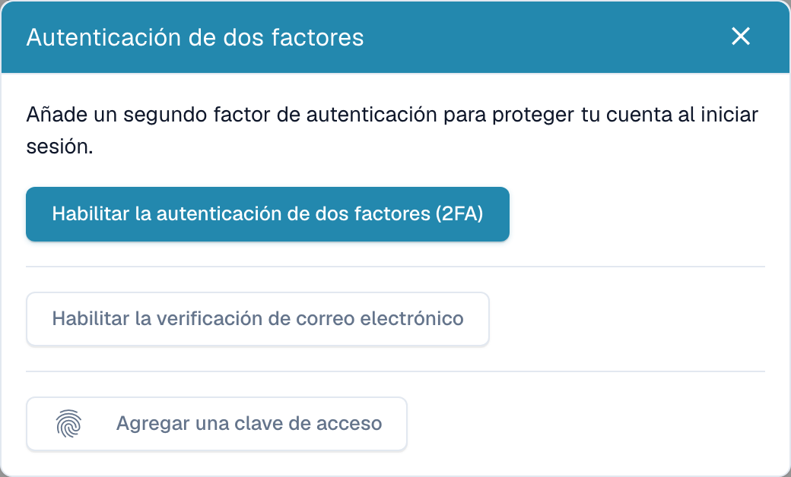
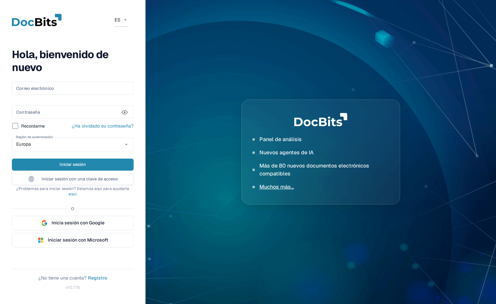

# Autenticación de Dos Factores (2FA)

## Descripción general

La Autenticación de Dos Factores (2FA) añade un segundo paso a tu inicio de sesión. Después de tu contraseña, DocBits solicita un segundo factor que solo tú posees: un código de una aplicación de autenticación, un código enviado a tu correo electrónico o una clave de acceso (Touch ID, Windows Hello, YubiKey, 1Password). Incluso si alguien averigua tu contraseña, no podrá iniciar sesión sin ese segundo factor.

La 2FA es **opcional para cada usuario** y puede ser **requerida por el administrador de tu organización**. Los inicios de sesión con inicio de sesión único (SSO) (Google, Microsoft, SAML) están exentos: tu proveedor de identidad ya aplica su propia MFA.

Puedes registrar más de un método. Los métodos que admite DocBits son:

* **Aplicación de autenticación (TOTP)** — Google Authenticator, Microsoft Authenticator, 1Password, Authy, etc.
* **Código por correo electrónico** — un código de 6 dígitos enviado al correo electrónico de tu cuenta.
* **Clave de acceso (WebAuthn/FIDO2)** — Touch ID, Windows Hello, una clave de hardware (YubiKey) o un gestor de contraseñas.

Cuando activas tu primer factor, DocBits también te proporciona **diez códigos de respaldo** para usar si alguna vez pierdes el acceso a tu método.

## Dónde encontrarlo

Abre la **configuración de tu perfil / cuenta** (menú de cuenta en la parte superior derecha → **Editar perfil**) y selecciona **Autenticación de dos factores**. El cuadro de diálogo de 2FA muestra tu estado actual y los métodos que puedes añadir.

<figure><figcaption>
Métodos de autenticación de dos factores disponibles.
</figcaption></figure>

## Configura una aplicación de autenticación (TOTP)

1. En el cuadro de diálogo de 2FA, haz clic en **Activar 2FA**.
2. Escanea el código QR con tu aplicación de autenticación (Google Authenticator, 1Password, Authy, …). Si no puedes escanear, usa la **clave manual** que se muestra debajo del código QR.
3. Introduce el código de 6 dígitos que muestra tu aplicación y confirma.
4. DocBits activa la 2FA y muestra tus **códigos de respaldo** (ver más abajo).

## Configura la verificación por correo electrónico

1. En el cuadro de diálogo de 2FA, haz clic en **Activar la verificación por correo electrónico**.
2. DocBits envía un código de 6 dígitos a la dirección de tu cuenta.
3. Introduce el código para confirmar. La verificación por correo electrónico ya está activada.

## Añade una clave de acceso

1. En el cuadro de diálogo de 2FA, haz clic en **Añadir una clave de acceso**.
2. Tu navegador o dispositivo te pide que confirmes con Touch ID, Windows Hello, una clave de hardware o tu gestor de contraseñas.
3. La clave de acceso queda guardada. Puedes añadir varias claves de acceso y renombrarlas o eliminarlas más tarde.

## Códigos de respaldo

Cuando activas tu **primer** factor, DocBits muestra **diez códigos de respaldo**, **una sola vez**. Cada código funciona una única vez y te permite iniciar sesión si pierdes tu autenticador o tu teléfono.

* Guárdalos en un lugar seguro (un gestor de contraseñas es lo ideal).
* Puedes generar un conjunto nuevo en cualquier momento con **Regenerar códigos de respaldo** (esto invalida el conjunto anterior).


Los códigos de respaldo solo se muestran en el momento en que se generan. DocBits no puede volver a mostrarlos: guárdalos de inmediato.


## Iniciar sesión con 2FA

1. Introduce tu correo electrónico y contraseña como de costumbre.

    <figure><figcaption>
La pantalla de inicio de sesión. También puedes iniciar sesión sin contraseña usando <strong>Iniciar sesión con una clave de acceso</strong>.
</figcaption></figure>
2. DocBits solicita tu segundo factor. Elige tu método:
   * **Autenticador** — escribe el código actual de 6 dígitos de tu aplicación.
   * **Correo electrónico** — haz clic en **Enviarme un código por correo electrónico** para recibir un código por correo, luego escríbelo.
   * **Clave de acceso** — haz clic en **Usar una clave de acceso** y confirma con Touch ID / Windows Hello / tu clave.
   * **Código de respaldo** — si no puedes usar tu método habitual.

3. Si tiene éxito, habrás iniciado sesión.

### Cómo se ve el código por correo electrónico

Si eliges **Correo electrónico**, DocBits envía un mensaje con un código de 6 dígitos que caduca en 10 minutos:

## Confía en este dispositivo

En la pantalla del segundo factor puedes marcar **Recordar este dispositivo**. DocBits omitirá entonces el paso de 2FA en ese dispositivo durante **30 días**. La confianza se elimina automáticamente cuando cambias tu contraseña, y puedes revocarla tú mismo en cualquier momento (ver más abajo).

## Gestiona tus claves de acceso y dispositivos de confianza

Abre el cuadro de diálogo de 2FA y haz clic en **Gestionar** para revisar lo que está registrado.

* **Claves de acceso** — renombra una clave de acceso (haz clic en su nombre) o elimínala. Eliminar tu último factor restante desactiva la 2FA.
* **Dispositivos de confianza** — revoca un solo dispositivo, o **Revocar todos los dispositivos** para forzar una nueva solicitud de 2FA en todas partes.

## Desactiva la 2FA

En el cuadro de diálogo de 2FA haz clic en **Desactivar 2FA** y confirma con un código actual del autenticador o un código de respaldo. Desactivar la 2FA también borra tus códigos de respaldo y revoca tus dispositivos de confianza.


Si tu organización **requiere** MFA, no podrás iniciar sesión con contraseña hasta que hayas configurado al menos un factor. Consulta a tu administrador si no estás seguro de si la MFA es obligatoria para tu organización.


## Inicio de sesión sin contraseña (opcional)

Una vez que tengas una clave de acceso, puedes iniciar sesión **sin escribir tu contraseña** usando **Iniciar sesión con una clave de acceso** en la pantalla de inicio de sesión. Tu contraseña seguirá funcionando como alternativa. El inicio de sesión sin contraseña requiere que la clave de acceso te verifique (Touch ID / Windows Hello / PIN), por lo que es más rápido y resistente al phishing.

Guarde los códigos de respaldo en un lugar seguro y separado del dispositivo de autenticación. Cada código es de un solo uso.

Configure la verificación por correo desde el diálogo de autenticación de dos factores. Introduzca el código recibido en su propia cuenta y complete la confirmación prevista.

Configure una aplicación de autenticación desde el diálogo de dos factores. Registre el secreto solo en su aplicación aprobada y confirme con el código temporal actual.
