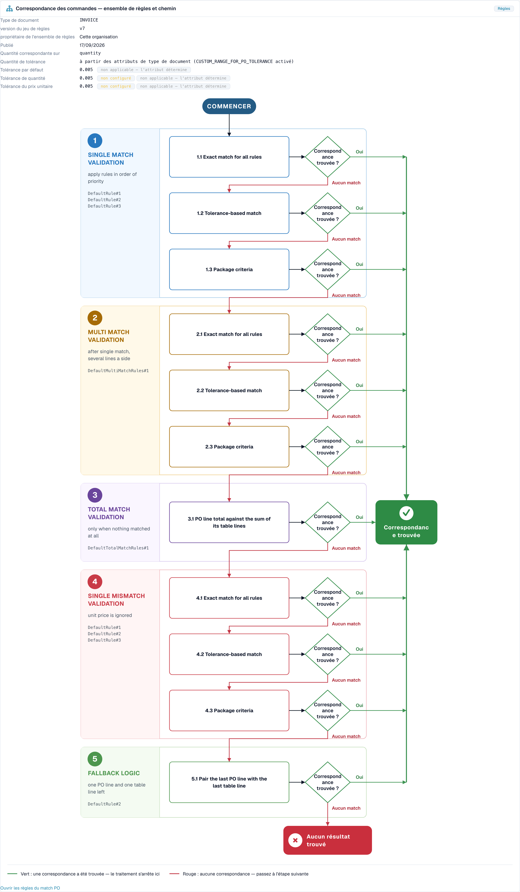

# Diagnostic du rapprochement avec le BC

## Vue d'ensemble

Beaucoup de factures s'arrêtent au bon de commande. La facture dit une chose, le bon de commande (BC) en dit une autre, et DocBits ne peut pas décider seul si elles vont ensemble. Chaque document de ce type nécessite une personne, il n'est donc **pas touchless**.

Touchless Intelligence vous montre **pourquoi** un rapprochement avec le BC a échoué et **comment** DocBits a essayé de rapprocher. Cette page explique les deux étapes du pipeline concernées, les motifs que vous verrez et le **flux de décision du rapprochement avec le BC**, un schéma qui montre les étapes de rapprochement l'une après l'autre.

### Où vous voyez le rapprochement avec le BC dans Touchless Intelligence

| Où                                                                                                                                          | Ce que vous voyez                                                                                                                                                                                          |
| ------------------------------------------------------------------------------------------------------------------------------------------- | ---------------------------------------------------------------------------------------------------------------------------------------------------------------------------------------------------------- |
| **Où le touchless est perdu en premier** (onglet de vue d'ensemble)                                                                         | Une barre telle que _Rapprochement des lignes de BC : écart d'article du BC_. Elle indique combien de documents se sont arrêtés là                                                                         |
| **Opportunités fournisseurs**                                                                                                               | Un fournisseur avec la cause racine **Rapprochement avec le BC**                                                                                                                                           |
| **Diagnostic fournisseur**, section **Comment cette organisation rapproche** (How this organisation matches) et le **cluster de problèmes** | Le flux de décision avec le jeu de règles de votre organisation                                                                                                                                            |
| **Trace du document**                                                                                                                       | L'étape **Rapprochement des lignes de BC** avec le statut **bloqué** et le motif                                                                                                                           |
| **Paramètres → Types de documents → Plus de paramètres → Bon de commande**                                                                  | Les règles de rapprochement elles-mêmes. Voir [Règles de correspondance des bons de commande](../../settings/global-settings/document-types/more-settings/purchase-order/purchase-order-matching-rules.md) |

## Les deux étapes du BC

| Étape                                                   | Question                                                    | S'arrête avec                                                                                                                        |
| ------------------------------------------------------- | ----------------------------------------------------------- | ------------------------------------------------------------------------------------------------------------------------------------ |
| **9 · Recherche du BC** (PO Lookup)                     | Existe-t-il un bon de commande pour cette facture ?         | _Bon de commande introuvable_                                                                                                        |
| **10 · Rapprochement des lignes de BC** (PO Line Match) | Chaque ligne de facture correspond-elle à une ligne de BC ? | _Écart d'article du BC_, _Écart d'identifiant de ligne du BC_, _Prix unitaire hors tolérance du BC_, _Quantité hors tolérance du BC_ |

Un document qui s'arrête à l'étape 9 ou 10 apparaît dans la file d'attente des fournisseurs avec le premier bloqueur **Rapprochement avec le BC**.

## Motifs d'échec d'un rapprochement avec le BC

| Motif affiché                                     | Signification                                                                                                                                      | Cause typique                                                                                                             | Que modifier                                                                                                                                                                                         |
| ------------------------------------------------- | -------------------------------------------------------------------------------------------------------------------------------------------------- | ------------------------------------------------------------------------------------------------------------------------- | ---------------------------------------------------------------------------------------------------------------------------------------------------------------------------------------------------- |
| **Bon de commande introuvable**                   | DocBits n'a trouvé aucun bon de commande pour le numéro de BC de la facture                                                                        | Le numéro de BC est mal lu ou absent ; le BC n'a pas encore été importé ; le BC appartient à un autre fournisseur         | Vérifiez l'extraction du numéro de BC pour ce fournisseur, l'importation des données de base des BC et le lien avec le fournisseur                                                                   |
| **Écart d'article du BC**                         | Les lignes de facture ne correspondaient pas aux lignes de BC                                                                                      | Le fournisseur utilise ses propres numéros d'article ; la description diffère ; des lignes ont été fusionnées ou scindées | Vérifiez le mappage des numéros d'article et les **priorités des règles** dans les règles de rapprochement ; ajoutez une règle pour la façon dont le fournisseur identifie les lignes                |
| **Écart d'identifiant de ligne du BC**            | Le numéro ou l'identifiant de ligne de la facture ne correspond pas au BC                                                                          | Le fournisseur renumérote les lignes                                                                                      | Rapprochez par article et quantité plutôt que par numéro de ligne                                                                                                                                    |
| **Prix unitaire hors tolérance du BC**            | Le prix diffère de plus que la tolérance autorisée                                                                                                 | Une vraie modification de prix, un écart d'arrondi ou une unité de prix différente                                        | Vérifiez la **Tolérance du prix unitaire** dans le jeu de règles ; corrigez le BC ou interrogez le fournisseur                                                                                       |
| **Quantité hors tolérance du BC**                 | La quantité diffère de plus que la tolérance autorisée                                                                                             | Livraison partielle, sur-livraison                                                                                        | Vérifiez **Rapprocher la quantité sur** et la **Tolérance de quantité**                                                                                                                              |
| **Erreur du service de rapprochement avec le BC** | Le service de rapprochement n'a pas pu répondre                                                                                                    | Un problème technique temporaire                                                                                          | Redémarrez les documents ; contactez le support si cela se répète                                                                                                                                    |
| **Exportation automatique du BC désactivée**      | Le paramètre **Exportation automatique si BC rapproché à 100 %** est désactivé, donc les documents rapprochés ne sont pas exportés automatiquement | Le paramètre est désactivé                                                                                                | Activez le paramètre si vous souhaitez l'exportation automatique. Voir [Exportation automatique si BC rapproché à 100 %](../../settings/document-processing/module/auto-export-if-po-matched-100.md) |


Tous les motifs de rapprochement avec le BC ne peuvent pas être corrigés dans DocBits. Si le fournisseur envoie un mauvais numéro de BC, la carte indique **Action du fournisseur uniquement** : le fournisseur doit corriger le document et le renvoyer.


## Le flux de décision du rapprochement avec le BC

Le flux de décision montre comment DocBits essaie de rapprocher une ligne de facture d'une ligne de BC. Il comporte **cinq étapes**, et la première correspondance l'emporte :

1. **Validation de correspondance simple** (Single match validation) : appliquer les règles par ordre de priorité. C'est le cas normal, une ligne de facture et une ligne de BC
2. **Validation de correspondance multiple** (Multi match validation) : après une correspondance simple, lorsque plusieurs lignes sont impliquées d'un côté
3. **Validation de correspondance sur le total** (Total match validation) : seulement lorsque rien n'a correspondu. Le total de la ligne de BC est comparé à la somme de ses lignes de tableau
4. **Validation d'écart simple** (Single mismatch validation) : le prix unitaire est ignoré, de sorte qu'une ligne peut être rapprochée par article et quantité même si le prix diffère
5. **Logique de repli** (Fallback logic) : il reste une ligne de BC et une ligne de tableau, elles sont donc appariées

Au sein des étapes, DocBits essaie dans cet ordre :

* **Correspondance exacte pour toutes les règles** (Exact match for all rules) : chaque valeur comparée est identique
* **Correspondance avec tolérance** (Tolerance-based match) : les valeurs numériques peuvent s'écarter dans la limite de la tolérance
* **Critères d'emballage** (Package criteria) : le dernier passage, basé sur les critères d'emballage du jeu de règles

Chaque étape demande **Correspondance trouvée ?** (Match found?). La réponse **Oui** (vert) mène à **Correspondance trouvée** et le document continue. La réponse **Aucune correspondance** (rouge) passe à l'étape suivante, et après la dernière étape le résultat est **Aucune correspondance trouvée** : le document s'arrête et nécessite une personne.

<figure><figcaption>
Le flux de décision du rapprochement avec le BC, ouvert depuis <strong>Comment cette organisation rapproche</strong> sur la page Diagnostic fournisseur. L'en-tête montre le jeu de règles (version 7, appartenant à cette organisation) et les tolérances. En dessous, les cinq étapes avec leurs passages se déroulent de haut en bas. Le vert mène à <strong>Correspondance trouvée</strong>, le rouge passe à l'étape suivante et aboutit à <strong>Aucune correspondance trouvée</strong>. Organisation d'exemple avec des données de démonstration.
</figcaption></figure>

### Ce que vous apprend l'en-tête du schéma

| Champ                                                      | Signification                                                                                                       |
| ---------------------------------------------------------- | ------------------------------------------------------------------------------------------------------------------- |
| **Type de document**                                       | Le type de document auquel appartient le jeu de règles, par exemple INVOICE                                         |
| **Version du jeu de règles**                               | La version des règles de rapprochement, par exemple v3                                                              |
| **Propriétaire du jeu de règles**                          | **Cette organisation** (vos propres règles) ou **Jeu de règles par défaut fourni** (les règles standard de DocBits) |
| **Publié**                                                 | Quand la version a été publiée                                                                                      |
| **Rapprocher la quantité sur**                             | Quelle quantité est comparée (quantité commandée, quantité ouverte)                                                 |
| **Montant de tolérance**                                   | Si les tolérances proviennent des attributs du type de document ou du jeu de règles                                 |
| **Tolérance du prix unitaire** / **Tolérance de quantité** | De combien un prix ou une quantité peut s'écarter                                                                   |
| **Tolérance par défaut**                                   | La tolérance pour toutes les autres valeurs numériques                                                              |

Dans l'exemple ci-dessus, les tolérances affichent **non configuré** et **non en vigueur : l'attribut décide**. Cela signifie : le jeu de règles n'a pas de tolérance propre, et la ligne **Montant de tolérance** indique que les tolérances proviennent des **attributs du type de document**. Une tolérance ne décide que lorsqu'elle est en vigueur. Lisez cette ligne en premier lorsqu'un écart de prix ou de quantité bloque des documents : elle vous dit **où** modifier la tolérance.

L'état du jeu de règles est affiché sous forme de note : **Version active** (ces règles décident), **Approuvée, non active**, **Brouillon, pas encore en vigueur** ou **État de la version inconnu**. Seule la version active décide.

Si des règles de transformation ont modifié un document avant le rapprochement, le schéma l'indique, par exemple _2 appliquées : (noms)_ ou _« (règle) » a reconstruit (tableau) : le rapprochement avec le BC a été perdu ici_. C'est une cause cachée fréquente : une règle qui reformate un tableau peut casser un rapprochement qui fonctionnait auparavant.

## Exemples

Les chiffres des exemples sont donnés à titre d'illustration.

### Exemple 1 : Prix dans la tolérance

Une ligne de facture a un prix unitaire de **10,40**. La ligne de BC indique **10,00**. La tolérance du prix unitaire est de **5 %**.

* La **correspondance exacte** échoue (10,40 n'est pas 10,00).
* La **correspondance avec tolérance** réussit : l'écart est de **4 %**, ce qui reste dans les 5 %.
* La ligne est rapprochée. **Correspondance trouvée.**

Avec une tolérance de **3 %**, la correspondance avec tolérance échoue aussi. Après toutes les étapes, le document s'arrête avec **Prix unitaire hors tolérance du BC**. Le schéma montre exactement ce chemin, et la solution est soit la tolérance (si 4 % est acceptable pour votre activité), soit une correction chez le fournisseur.

### Exemple 2 : Les numéros d'article du fournisseur diffèrent des vôtres

Un fournisseur facture l'article **« A-4711-X »**, votre BC indique **« 4711 »**. Aucune règle ne compare les deux, donc aucune correspondance n'est trouvée, et Touchless Intelligence regroupe toutes les factures de ce fournisseur dans un seul cluster : **Rapprochement des lignes de BC, écart d'article du BC**, 27 documents.

* Dans le cluster, vous lisez _27 concernés, 27 récupérables_, gain attendu par exemple **+8,7 pp**.
* La solution est de votre côté : ajoutez ou réordonnez une règle qui rapproche sur le numéro d'article du fournisseur ou sur la description, ou gérez les numéros d'article du fournisseur dans les données de base.
* Après avoir modifié la règle, appliquez la modification avec une [proposition de modification](touchless-change-proposals.md) et lisez l'**Historique des modifications** deux semaines plus tard : taux pur avant et après.

### Exemple 3 : Le bon de commande n'est pas encore là

Les factures arrivent avant l'importation du BC. Elles s'arrêtent à la **Recherche du BC** avec **Bon de commande introuvable**. Le cluster montre un court pic. La solution est l'ordre de vos processus, ou le calendrier de l'importation des BC, pas les règles de rapprochement. Vérifiez **Où le touchless est perdu en premier** : une barre _Recherche du BC : bon de commande introuvable_ qui grandit après chaque interruption de l'importation indique cette cause.

### Exemple 4 : Une règle a reconstruit le tableau

Après la mise en service d'une règle de transformation pour le tableau d'un fournisseur, le taux de rapprochement de ce fournisseur a fortement chuté. Le schéma d'un document concerné indique _« (règle) » a reconstruit (tableau) : le rapprochement avec le BC a été perdu ici_. La solution est d'ajuster ou d'annuler la règle de transformation, pas les règles de rapprochement.

## Une routine pour les problèmes de rapprochement avec le BC

1. Ouvrez **Où le touchless est perdu en premier**. Une étape de rapprochement avec le BC figure-t-elle parmi les trois premières ?
2. Ouvrez **Opportunités fournisseurs** et triez par **Gain attendu**. Prenez le fournisseur avec la cause racine **Rapprochement avec le BC** et le statut **RECOVERABLE**.
3. Ouvrez le **Diagnostic fournisseur** et lisez le cluster : motif, documents concernés, **Que modifier**, **Preuves manquantes**.
4. Ouvrez **Comment cette organisation rapproche** et vérifiez le jeu de règles : version, propriétaire et tolérances.
5. Ouvrez un **document d'exemple** et sa [Trace du document](touchless-document-trace.md) : quelle étape, quel motif ?
6. Modifiez **une seule** chose (ordre des règles, tolérance, mappage des articles) avec un aperçu, afin que l'**Historique des modifications** puisse la mesurer.

## Pages connexes

* [Touchless Intelligence](./)
* [Diagnostic fournisseur et clusters de problèmes](touchless-supplier-diagnosis.md)
* [Trace du document](touchless-document-trace.md)
* [Propositions de modification et rapports](touchless-change-proposals.md)
* [Règles de correspondance des bons de commande](../../settings/global-settings/document-types/more-settings/purchase-order/purchase-order-matching-rules.md)
* PO Matching Cards : guide complet
