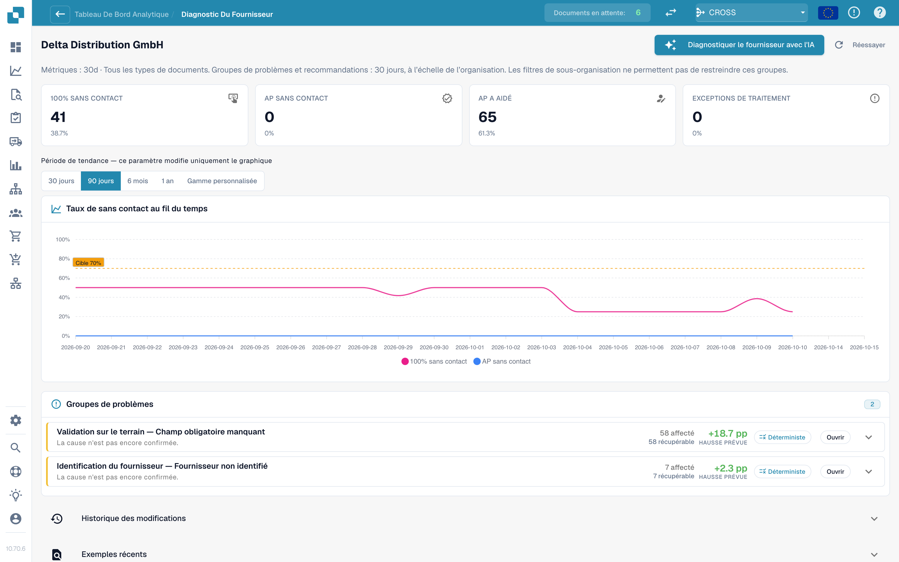
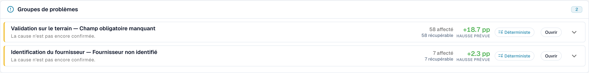

# Diagnostic fournisseur et clusters de problèmes

Cliquez sur un fournisseur dans la file d'attente pour ouvrir sa page de diagnostic.

<figure><figcaption>
La page Diagnostic fournisseur : tuiles de résultats, tendance avec sélecteur de période et deux clusters de problèmes classés par gain attendu. Organisation d'exemple avec des données de démonstration ; les noms de fournisseurs sont fictifs.
</figcaption></figure>

La page affiche :

* **Six tuiles de résultats** (Touchless pur, Touchless AP, AP assisté, Exception de processus, En cours, Non éligible), chacune liée aux documents.
* **La tendance** avec son propre sélecteur de période : 30 jours, 90 jours, 6 mois, 1 an ou une plage personnalisée (jusqu'à deux ans). Cela ne modifie que le graphique.
* **Les clusters de problèmes** (voir ci-dessous).
* **Historique des modifications** (Change history) : les modifications que vous avez appliquées pour ce fournisseur et leur effet.
* **Exemples récents** (Recent examples) : des documents d'exemple, dans deux onglets : **Nécessitait une intervention** (Needed attention) et **Passé en touchless** (Went touchless).
* **Diagnostiquer le fournisseur avec l'IA** (Diagnose supplier with AI) : analyse tous les clusters du fournisseur (administrateurs).

Une courte note explique une page vide, par exemple : _5 documents de ce fournisseur sont encore en cours de traitement et n'ont pas encore de résultat d'analyse._ ou _Les 40 documents terminés de ce fournisseur sont passés en touchless : il n'y a rien à diagnostiquer._

### Clusters de problèmes

Un **cluster** regroupe les documents d'un fournisseur qui se sont arrêtés pour le **même premier motif**. Au lieu de 40 problèmes isolés, vous voyez « 3 problèmes ».

<figure><figcaption>
Une carte de cluster ouverte : le premier bloqueur, <strong>Que modifier</strong> (What to change) et une <strong>Proposition de modification</strong> (Change proposal) avec risque, périmètre et questions ouvertes. Ici, le cluster couvre 58 documents et vaut +18,7 pp. Organisation d'exemple avec des données de démonstration ; les noms de fournisseurs sont fictifs.
</figcaption></figure>

**Exemple de cluster (illustratif).**

* **Titre** : _Champ obligatoire manquant_ à l'étape _Validation des champs_
* **Concernés** : 28 documents. **Récupérables** : 28 documents. **Gain attendu** : +2,8 pp
* **Cause présumée** : le fournisseur imprime le numéro de BC sous le tableau, là où l'extraction ne cherche pas
* **Que modifier** : _Modification des données de base_ : ajouter la mise en page de ce fournisseur. **Ouvrir** vous mène à la bonne page de paramètres
* **Responsable** : Consultant. **Confiance** : Moyenne. **Source** : Hypothèse

Ce qu'une carte de cluster affiche :

| Partie                                      | Signification                                                                                                                                                                                                                                                                                 |
| ------------------------------------------- | --------------------------------------------------------------------------------------------------------------------------------------------------------------------------------------------------------------------------------------------------------------------------------------------- |
| **Premier bloqueur** et **étape**           | Le motif et l'étape du pipeline où les documents s'arrêtent. Il existe plus de 30 motifs, par exemple _Fournisseur non identifié_, _Bon de commande introuvable_, _Prix unitaire hors tolérance du BC_, _Rejeté par l'ERP_, _Échec de la validation de la facture électronique_               |
| **Concernés / Récupérables / Gain attendu** | Combien de documents, combien peuvent être récupérés, combien de points de pourcentage cela donnerait                                                                                                                                                                                         |
| **Cause présumée / Cause confirmée**        | Ce que DocBits pense (ou ce qu'une personne a confirmé) être la raison                                                                                                                                                                                                                        |
| **Preuves** et **Preuves manquantes**       | Sur quoi repose le constat, et ce que DocBits n'a **pas** pu établir. Lisez **Preuves manquantes** avant de faire confiance au reste                                                                                                                                                          |
| **Que modifier**                            | Des étapes concrètes avec des liens **Ouvrir** vers les paramètres. Une pastille indique le type : _Modification de configuration_, _Modification des données de base_, _Modification du modèle fournisseur_, _Modification de processus_, _Action du fournisseur requise_, _Non corrigeable_ |
| **Responsable**                             | DocBits, Client, Consultant, Fournisseur ou Non attribué                                                                                                                                                                                                                                      |
| **Documents d'exemple**                     | De vrais documents du cluster à examiner                                                                                                                                                                                                                                                      |

**Corrigeable dans DocBits** et **Action du fournisseur uniquement** sont affichés dans deux groupes. Pour _Action du fournisseur uniquement_, rien dans DocBits ne change le résultat : le fournisseur doit corriger le document et le renvoyer.

### D'où vient une recommandation

Chaque cause affiche sa **source**, pour que vous puissiez distinguer un constat déduit d'une supposition :

| Source                                      | Signification                                                                                                                |
| ------------------------------------------- | ---------------------------------------------------------------------------------------------------------------------------- |
| **Déterministe** / **Basée sur des règles** | Une règle l'a déduite des preuves enregistrées dans le pipeline. Aucun modèle de langage n'est intervenu                     |
| **Hypothèse**                               | Un modèle de langage l'a proposée à partir des preuves du cluster. Considérez-la comme une piste et vérifiez-la avant d'agir |
| **Confirmée**                               | Une personne a examiné les preuves et confirmé la cause                                                                      |

Les textes de l'IA sont rédigés dans la langue de votre organisation. Si un cluster a été analysé dans une autre langue, utilisez **Analyser dans cette langue**.

## Clusters de rapprochement avec le BC

Si le premier bloqueur d'un cluster est un motif de rapprochement avec le BC (par exemple _Écart d'article du BC_ ou _Bon de commande introuvable_), la carte du cluster montre comment DocBits essaie de rapprocher la facture du bon de commande. Voir [Diagnostic du rapprochement avec le BC](touchless-po-matching-diagnosis.md).

## Pages connexes

* [Touchless Intelligence](./)
* [Diagnostic du rapprochement avec le BC](touchless-po-matching-diagnosis.md)
* [Trace du document](touchless-document-trace.md)
* [Propositions de modification et rapports](touchless-change-proposals.md)
