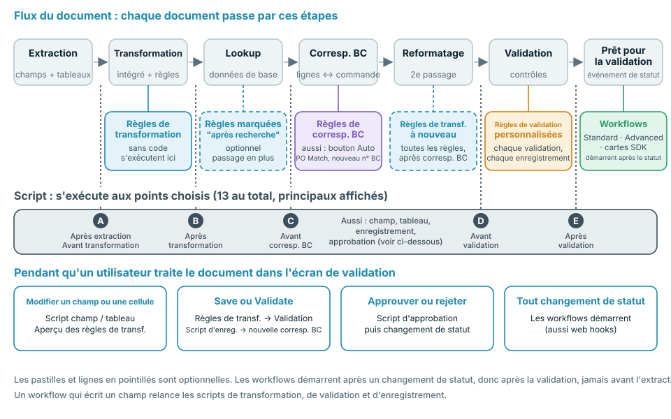
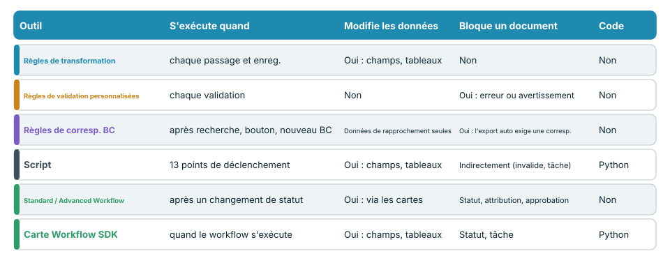
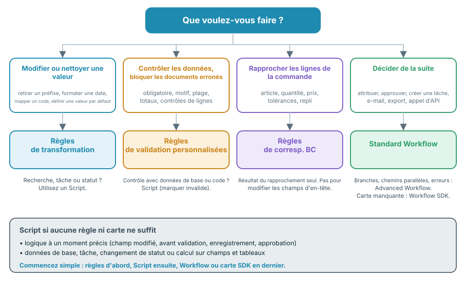

# Choisir la bonne automatisation



La vidéo (près de six minutes) aborde les mêmes sujets en quatre parties : **0:00** où chaque outil intervient dans le flux du document, **1:33** le code, les workflows et la comparaison, **2:40** ce que chaque outil peut et ne peut pas faire, **3:44** bonnes pratiques et erreurs courantes.

DocBits propose plusieurs moyens de modifier, de contrôler et d'acheminer les documents : les **règles de transformation**, les **règles de validation personnalisées**, les **règles de correspondance des bons de commande**, les **scripts**, les **Standard Workflows**, les **Advanced Workflows** et les **cartes Workflow SDK**. Ils se recoupent volontairement. Cette page vous indique lequel choisir, **à quel moment chacun s'exécute dans le flux du document**, et ce qu'il peut ou ne peut pas faire.

## La réponse courte

| Je veux … | Utiliser | Pourquoi |
| --- | --- | --- |
| Nettoyer ou réécrire une valeur (suppression d'espaces, préfixe, format de date, mappage d'unités, valeur par défaut) | [Règles de transformation](settings/global-settings/document-types/transformation-rules.md) | Sans code, aperçu en direct, exécution à chaque passage et à chaque enregistrement |
| S'assurer que les données sont complètes et plausibles, et bloquer les documents qui ne le sont pas | [Règles de validation personnalisées](settings/global-settings/document-types/custom-validation-rules.md) | Contrôles déclaratifs, erreur ou avertissement, bloquent l'export automatique |
| Rapprocher les lignes de facture des lignes de bon de commande | [Règles de correspondance des bons de commande](settings/global-settings/document-types/more-settings/purchase-order/purchase-order-matching-rules.md) | Ensembles de règles avec tolérances, solutions de repli et diagramme visuel |
| Faire ce qu'une règle ne sait pas exprimer : une recherche, un calcul sur plusieurs champs et tableaux, une tâche, un changement de statut à un moment précis | [Script](settings/global-settings/document-types/script/README.md) | Python à 13 points de déclenchement du flux |
| Décider **de la suite** à donner à un document : attribuer, approuver, créer une tâche, envoyer un e-mail, exporter, appeler une API | [Standard Workflow](workflow/standard-workflow-builder.md) | Cartes When / And / Then sur les événements de statut |
| Faire de même avec des branches, plusieurs conditions et des chemins d'erreur | [Advanced Workflow](workflow/advanced-workflow-builder.md) | Graphe visuel de nœuds |
| Besoin d'une action qu'aucune carte intégrée ne propose | [Workflow SDK (Card SDK)](workflow/card-sdk.md) | Votre propre carte, examinée par DocBits |

**Règle pratique : utilisez l'outil le moins puissant qui fait le travail.** D'abord les règles, ensuite un script, en dernier un workflow ou une carte SDK. Les règles sont plus faciles à lire, plus faciles à tester et ne peuvent pas endommager un document ; le code peut faire davantage et demande donc plus de soin.

## Où chaque outil s'exécute dans le flux du document

Chaque document traverse les mêmes étapes. Chaque outil a sa place dans ce flux, et cette place détermine ce qu'il voit et ce qu'il peut encore modifier.

<figure><figcaption></figcaption></figure>

En clair :

1. **L'extraction** lit les champs d'en-tête et les tableaux du document. Un script peut s'exécuter **après l'extraction**.
2. **La transformation** applique le formatage intégré et vos **règles de transformation**. Des scripts peuvent s'exécuter avant et après.
3. **La recherche dans les données de base** renseigne des champs tels que le fournisseur. Les règles de transformation marquées **run after lookup** font ici un passage supplémentaire.
4. **Le rapprochement avec le bon de commande** ne s'exécute que si ce rapprochement est actif pour le type de document. Les **règles de correspondance des bons de commande** interviennent ici. Un script peut s'exécuter **avant le rapprochement**.
5. **Reformatage** : toutes les règles de transformation s'exécutent de nouveau, de sorte que les valeurs écrites par la recherche ou le rapprochement sont elles aussi formatées.
6. **La validation** exécute vos **règles de validation personnalisées**. Des scripts peuvent s'exécuter **avant** et **après** la validation.
7. Le document reçoit le statut **Prêt pour la validation**. C'est le premier moment où un **workflow** peut démarrer. Les workflows réagissent aux changements de statut : ils s'exécutent donc toujours **après** la validation, jamais avant l'extraction.

Lorsqu'une personne travaille dans l'écran de validation, d'autres déclencheurs s'appliquent : la modification d'un champ ou d'une cellule de tableau exécute les scripts de changement de champ et de tableau et actualise l'aperçu des règles de transformation. **Save** et **Validate** exécutent de nouveau les règles de transformation, la validation et les scripts d'enregistrement, et refont le rapprochement avec le bon de commande lorsque le numéro de bon de commande a changé. **Approve** exécute les scripts d'approbation avant le changement de statut.


Un workflow qui écrit dans un champ se comporte comme une personne qui enregistre le document : les règles de transformation, la validation, les règles de validation personnalisées et les scripts d'enregistrement s'exécutent de nouveau pour cette écriture. Tenez-en compte lorsqu'un workflow et une règle modifient le même champ.


## Comparer les outils

<figure><figcaption></figcaption></figure>

| | Règles de transformation | Règles de validation personnalisées | Règles de correspondance BC | Script | Standard Workflow | Advanced Workflow | Carte SDK |
| --- | --- | --- | --- | --- | --- | --- | --- |
| **S'exécute quand** | À chaque passage de transformation et à chaque enregistrement | À chaque exécution de la validation | Après la recherche, **Auto PO Match**, nouveau numéro de bon de commande | 13 points de déclenchement | Après un changement de statut | Après un changement de statut | Quand son workflow s'exécute |
| **Peut lire** | Champs d'en-tête, colonnes de tableau | Champs, cellules de tableau, totaux sur les lignes | Tableaux, numéros de bon de commande, lignes de bon de commande, tolérances | L'ensemble des données extraites, recherches, utilisateurs, groupes, recherche plein texte | Données du document, utilisateurs, groupes, variables | Idem, plus les résultats des nœuds précédents | Champs, tableaux, recherches, utilisateurs, groupes |
| **Peut écrire** | Valeurs de champs et de colonnes, lignes, sous-organisation | Rien : uniquement des marqueurs valide / invalide | Uniquement les données de rapprochement | Champs, tableaux, tâches, statut | Champs, statut, attribution, tâches, export, e-mail, appel d'API | Mêmes cartes, plus logique et variables | Champs, tableaux, statut, tâches |
| **Peut bloquer un document** | Non | Oui, les erreurs bloquent l'export automatique et **Validate** | Oui, sans rapprochement complet l'export automatique attend lorsque le rapprochement est actif | Indirectement : marquer un champ comme invalide, créer une tâche | Définit le statut, attribue, approuve, rejette | Idem | Comme le type de carte |
| **Nécessite du code** | Non | Non | Non | Oui, Python restreint | Non | Non | Oui, Python dans un bac à sable |
| **Usage typique** | Normaliser les valeurs | Champs obligatoires, formats, totaux | Rapprochement des lignes | Logique spécifique | Acheminement et approbation | Acheminement avec branches | Actions de partenaires |

## Décider en quatre questions

<figure><figcaption></figcaption></figure>

1. **Une valeur doit-elle changer ?** Utilisez les **règles de transformation**. Si la modification nécessite des données de base, une tâche ou un statut, utilisez un **script**.
2. **Une valeur doit-elle être contrôlée ?** Utilisez les **règles de validation personnalisées**. Elles bloquent un document, mais ne le modifient jamais. Si le contrôle nécessite des données de base ou du code, un **script** peut marquer le champ comme invalide.
3. **Les lignes de facture doivent-elles être rapprochées d'une commande ?** Utilisez les **règles de correspondance des bons de commande**. Elles ne produisent que des résultats de rapprochement. Pour corriger un champ d'en-tête avant le rapprochement, utilisez une règle de transformation.
4. **La suite dépend-elle du document ?** Utilisez un **workflow**. Choisissez **Advanced** lorsque vous avez besoin de branches, de plusieurs conditions ou de chemins d'erreur. Choisissez une **carte SDK** uniquement si aucune carte intégrée ne fait ce dont vous avez besoin.

## Outil par outil

### Règles de transformation

* **Utilisez-les lorsque** une valeur est correcte sur le fond mais incorrecte dans la forme : préfixes, espaces, formats de date, codes d'unité, valeurs par défaut, un numéro de bon de commande dans le mauvais champ, ou des tableaux à réduire à une ligne de total.
* **Elles s'exécutent** au premier passage de transformation, lors d'un passage optionnel après la recherche dans les données de base, de nouveau après le rapprochement avec le bon de commande, et à chaque enregistrement. L'écran de validation affiche un aperçu.
* **Elles peuvent** modifier les champs d'en-tête, les colonnes et les lignes de tableau, ainsi que la sous-organisation. Chaque règle peut être limitée à certains fournisseurs ou conditions.
* **Elles ne peuvent pas** bloquer un document, appeler d'autres systèmes, utiliser des recherches dans les données de base ni créer de tâches. Une règle qui ne peut pas être appliquée laisse la valeur telle quelle.
* **En savoir plus :** [Règles de transformation](settings/global-settings/document-types/transformation-rules.md)

### Règles de validation personnalisées

* **Utilisez-les lorsque** un document ne doit pas continuer avec des données erronées : champs obligatoires, motifs, plages de nombres, valeurs autorisées, comparaison entre deux champs, totaux qui doivent concorder.
* **Elles s'exécutent** à chaque validation : dans le pipeline, à chaque enregistrement, et après l'écriture de données par un workflow.
* **Elles peuvent** marquer un champ ou une cellule de tableau comme **erreur** (bloque l'export automatique et **Validate**, sauf contournement) ou comme **avertissement** (visible, ne bloque pas).
* **Elles ne peuvent pas** modifier des données, rechercher dans les données de base ni appeler des services. Corrigez d'abord les données avec une règle de transformation, puis contrôlez-les.
* **En savoir plus :** [Règles de validation personnalisées](settings/global-settings/document-types/custom-validation-rules.md)

### Règles de correspondance des bons de commande

* **Utilisez-les lorsque** les lignes de facture doivent être rapprochées des lignes de bon de commande : correspondances simples, multiples et totales, tolérances de quantité et de prix, solutions de repli lorsque la première règle ne correspond pas.
* **Elles s'exécutent** après la recherche dans les données de base, lorsque vous cliquez sur **Auto PO Match**, et lorsque le numéro de bon de commande change à l'enregistrement.
* **Elles peuvent** produire le résultat du rapprochement et les données nécessaires à l'approbation. La vue en diagramme montre quelle règle s'applique à quelle étape.
* **Elles ne peuvent pas** réécrire les champs d'en-tête, définir un statut ni exécuter une logique personnalisée. Sans rapprochement complet, l'export automatique attend lorsque le rapprochement avec le bon de commande est actif.
* **En savoir plus :** [Règles de correspondance des bons de commande](settings/global-settings/document-types/more-settings/purchase-order/purchase-order-matching-rules.md)

### Script

* **Utilisez-le lorsque** aucune règle ne peut exprimer la logique : un calcul sur plusieurs champs et tableaux, une recherche, une tâche pour un utilisateur, un changement de statut à un moment précis, ou une réaction à une modification dans l'écran de validation.
* **Il s'exécute** aux points de déclenchement que vous choisissez : après l'extraction, avant et après la transformation, avant le rapprochement avec le bon de commande, avant et après la validation, lors des changements de champ et de tableau, à l'enregistrement et à l'approbation.
* **Il peut** lire tout le document, utiliser les recherches dans les données de base et la recherche plein texte, modifier les champs, les indicateurs et les tableaux, créer des tâches et changer le statut.
* **Il ne peut pas** importer de modules ni appeler des services externes. C'est du Python restreint. Une erreur dans un script est consignée et n'arrête jamais le traitement du document ; un script n'est donc **pas** un moyen fiable de bloquer un document : marquez plutôt le champ comme invalide ou créez une tâche.
* **En savoir plus :** [Script](settings/global-settings/document-types/script/README.md)

### Workflow standard

* **Utilisez-le lorsque** la suite dépend du document : attribuer à un utilisateur ou à un groupe, approuver ou rejeter, créer une tâche, envoyer un e-mail, exporter, définir un statut, appeler une API.
* **Il s'exécute** lorsqu'un document atteint un statut que vous avez choisi, donc après la validation. Il peut aussi démarrer depuis un web hook, une planification ou manuellement.
* **Il peut** exécuter une chaîne de cartes : **When** (démarrage), **And** (conditions, toutes doivent être remplies), **Then** (actions dans l'ordre).
* **Il ne peut pas** créer de branches, attendre plusieurs conditions ni réagir à l'erreur d'une carte dans un chemin distinct. Utilisez pour cela un Advanced Workflow.
* **En savoir plus :** [Standard Workflow](workflow/standard-workflow-builder.md)

### Workflow avancé

* **Utilisez-le lorsque** un document nécessite des chemins différents : branches selon une condition, plusieurs conditions combinées avec ALL / ANY, et un chemin pour les erreurs ou les conditions non remplies.
* **Il s'exécute** sur les mêmes événements qu'un Standard Workflow. Il nécessite l'abonnement DocFlow Advanced.
* **Il peut** utiliser les mêmes cartes qu'un Standard Workflow, plus des cartes de logique et de variables, représentées sous forme de graphe.
* **Il ne peut pas** agir avant la validation : il démarre après un changement de statut. La logique préalable à la validation relève d'un script ou d'une règle.
* **En savoir plus :** [Advanced Workflow](workflow/advanced-workflow-builder.md)

### SDK de workflow (Card SDK)

* **Utilisez-le lorsque** vous avez besoin d'une carte qui n'existe pas, par exemple une condition ou une action propre à une application partenaire.
* **Il s'exécute** chaque fois qu'un workflow contenant la carte s'exécute.
* **Il peut** lire et écrire des champs et des tableaux, enregistrer le document, changer le statut et créer des tâches.
* **Il ne peut pas** ouvrir de connexions réseau. Une exécution est limitée à 60 secondes et à 200 appels SDK. Une carte n'est mise en service qu'après examen et approbation par DocBits.
* **En savoir plus :** [Card SDK](workflow/card-sdk.md)

## Bonnes pratiques

* **Commencez par l'outil le plus simple.** Une règle de transformation vaut mieux qu'un script pour le formatage. Une règle de validation personnalisée vaut mieux qu'un script pour un contrôle. Ne recourez à un script ou à une carte SDK que lorsqu'une règle ou une carte intégrée ne peut pas faire le travail.
* **Corriger d'abord, contrôler ensuite, acheminer en dernier.** Les règles de transformation et les scripts préparent les données, les règles de validation personnalisées les évaluent, les workflows décident de la suite à donner au document. C'est l'ordre du flux.
* **Un seul responsable par champ.** Si une règle de transformation et un script écrivent dans le même champ, le résultat dépend de l'ordre. Donnez à chaque champ un seul responsable.
* **N'utilisez pas un workflow pour réparer des données.** Les workflows démarrent après la validation : la réparation arrive donc tard et déclenche une nouvelle validation. Réparez les données dans une règle ou un script avant la validation.
* **Validez avec une règle, pas avec un script.** Une erreur de script n'arrête jamais un document. Une règle de validation personnalisée, si.
* **Gardez des scripts courts, nommés selon leur finalité.** Un script par tâche, avec le point de déclenchement dans le nom, se désactive facilement lorsque quelque chose semble anormal.
* **Testez d'abord sur dev ou sandbox.** Utilisez quelques documents réels, vérifiez le résultat dans l'écran de validation, puis activez la règle ou le workflow pour la production.
* **Consultez les journaux.** Le journal du document et le journal du workflow montrent ce qui s'est exécuté et ce qui a changé.

## Erreurs courantes

| Erreur | Mieux vaut |
| --- | --- |
| Un script qui supprime les espaces et ajoute des préfixes | Une règle de transformation |
| Un workflow qui renseigne un champ après la validation | Une règle de transformation ou un script avant la validation |
| Un script censé bloquer un document invalide | Une règle de validation personnalisée |
| Une règle de validation personnalisée censée corriger une valeur | Une règle de transformation, puis la règle de validation |
| Réécrire le numéro de bon de commande dans une règle de correspondance | Une règle de transformation sur le champ *Purchase Order*, avant le rapprochement |
| Un Advanced Workflow pour un simple *When → Then* | Un Standard Workflow |
| Une carte SDK pour ce qu'une carte intégrée sait faire | La carte intégrée |

## Pages associées

* [Règles de transformation](settings/global-settings/document-types/transformation-rules.md)
* [Règles de validation personnalisées](settings/global-settings/document-types/custom-validation-rules.md)
* [Règles de correspondance des bons de commande](settings/global-settings/document-types/more-settings/purchase-order/purchase-order-matching-rules.md)
* [Script](settings/global-settings/document-types/script/README.md)
* [Workflow](workflow/README.md)
