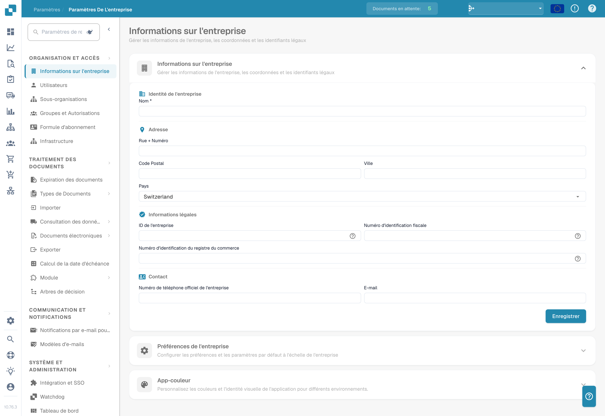

# Paramètres

## Tutoriel vidéo : aperçu des paramètres et modules


Aperçu des paramètres et modules dans DocBits


La vidéo présente les cinq groupes de l'aperçu des paramètres, la recherche et les liens rapides, ainsi que ce que contrôlent les trois pages Module.

<figure><figcaption>
Paramètres de l’organisation : informations d’identification masquées ; les sections restent accessibles dans le menu.
</figcaption></figure>

La zone Settings est votre point central pour configurer DocBits. Elle est organisée en cinq sections principales :

## 1. Organisation et accès

Gérez le profil de votre entreprise et contrôlez qui peut accéder à quoi.

* **Company Information** : saisissez le nom de votre entreprise, son adresse, son numéro fiscal et d'autres identifiants légaux.
* **Users** : ajoutez, modifiez ou désactivez des comptes utilisateur et attribuez des rôles (Admin, System Admin).
* **Sub-Organizations** : créez et gérez des sous-organisations pour les configurations multi-entités.
* **Groups and Permissions** : définissez des groupes d'utilisateurs et configurez des autorisations granulaires pour chaque groupe.

## 2. Traitement des documents

Configurez la manière dont les documents sont importés, traités et exportés.

* **Documents Expiry** : définissez des règles de suppression automatique des documents (par exemple, suppression après 48 heures, 1 semaine, etc.).
* **Document Types** : définissez et configurez les types de documents que DocBits traite (factures, commandes, bons de livraison, etc.), y compris les champs, les colonnes de tableau, les scripts, et plus encore.
* **Import** : configurez la manière dont les documents entrent dans DocBits : par e-mail (IMAP/Office 365), FTP ou chargement de fichier. Configurez les types de fichiers et les limites de pages.
* **Rule Management** : définissez des règles de résolution des conflits pour le rapprochement facture-commande d'achat, y compris les paramètres de tolérance et les workflows d'approbation.
* **OCR Settings** : configurez les seuils de qualité de la reconnaissance optique de caractères (OCR), l'utilisation de l'E-Text, la version de l'OCR IA et le comportement d'extraction des tableaux.
* **Classification and Extraction** : configurez la séparation des documents, le format des montants, les méthodes d'extraction des tableaux, les règles de classification et les modèles d'IA.
* **Lookup Master Data** : configurez la manière dont les données extraites sont validées par rapport aux données de base de votre système ERP (par exemple, comptes fournisseurs, commandes d'achat).
* **List of Values** : créez et gérez des listes de valeurs prédéfinies utilisées dans les listes déroulantes et la validation des données.
* **Export** : configurez comment et où les documents traités sont envoyés : via Webhook, SFTP, SMB ou les intégrations Infor (IDM, ION, M3, LN).
* **Module** : activez ou désactivez des fonctionnalités optionnelles telles que PO Dashboard, Auto Accounting, Supplier Portal, Workflow Builder, QR-Code Extraction, et plus encore.
* **Decision Trees** : créez une logique de décision basée sur des règles à l'aide d'un concepteur visuel. Prend en charge plusieurs politiques (Unique, First, Priority, Collect, etc.).
* **Agent Setup** : créez et gérez des agents d'automatisation et des canaux de communication pour les workflows de traitement automatisé des documents.

## 3. Communication et notifications

Contrôlez la manière dont DocBits communique avec les utilisateurs et traite les e-mails entrants.

* **Email Notification** : configurez des alertes par e-mail pour les événements de traitement des documents et les changements de statut.
* **Email Templates** : créez et gérez des modèles d'e-mail réutilisables pour les notifications, organisés par type de document.
* **Email Ingestion** : configurez la manière dont les e-mails entrants sont automatiquement classés et convertis en documents. Comprend des règles de classification, d'extraction de champs, de traitement, de gestion des expéditeurs et d'entraînement, organisées par type de document (Orders, Invoices, Quotes, Delivery Notes, COA, PO Confirm).

## 4. Système et administration

Surveillez l'état du système, gérez les intégrations et maintenez la sécurité.

* **Integration & SSO** : configurez les clés d'API pour les intégrations externes et mettez en place l'authentification unique (SSO) avec des fournisseurs d'identité.
* **Watchdog** : configurez le service Watchdog pour l'importation automatique de documents depuis des répertoires locaux.
* **Dashboard** : personnalisez le comportement du tableau de bord : filtres, paramètres d'exportation, autorisations d'action et options d'affichage des statuts.
* **Activity Logging** : consultez en temps réel les journaux d'événements système, filtrés par gravité (Debug, Info, Warning, Error), plage horaire et service.
* **Analytics** : accédez à des tableaux de bord d'analyse détaillés, notamment Logs Analytics, la surveillance Auth Security et API Metrics avec Real User Monitoring (RUM).
* **Access Audit** : activez et consultez les pistes d'audit qui suivent toutes les actions de création, de mise à jour et de suppression dans votre organisation, à des fins de conformité et de sécurité.
* **System Licenses** : consultez et gérez les informations de licence et d'utilisation des API.
* **Cache Management** : configurez les intervalles de nettoyage automatique du cache (TTL) pour les caches Received Delivery, Purchase Order et Task/Notification.
* **Fulltext Search Settings** : configurez les capacités de recherche en texte intégral dans vos documents et données (nécessite l'activation du module Fulltext Search).

## 5. Paramètres fournisseur

Configurez le Supplier Portal et gérez les workflows liés aux fournisseurs.

* **Supplier General Settings** : configurez les champs d'invitation du portail fournisseur, les statuts de workflow (Not Invited, Open, Pending Registration, Approved, Rejected) et gérez les paramètres d'approbation.
* **Email Templates** : créez et gérez des modèles d'e-mail spécifiquement destinés aux communications avec les fournisseurs.
* **Supplier Layout** : personnalisez la mise en page et l'apparence du Supplier Portal.
* **Export Configuration** : configurez la manière dont les données fournisseur sont exportées vers des systèmes externes.
* **Supplier Group** : créez et gérez des groupes de fournisseurs pour catégoriser et organiser vos fournisseurs.
* **User and Supplier Group Mapping** : associez les utilisateurs internes à des groupes de fournisseurs spécifiques pour contrôler la visibilité et l'accès.
